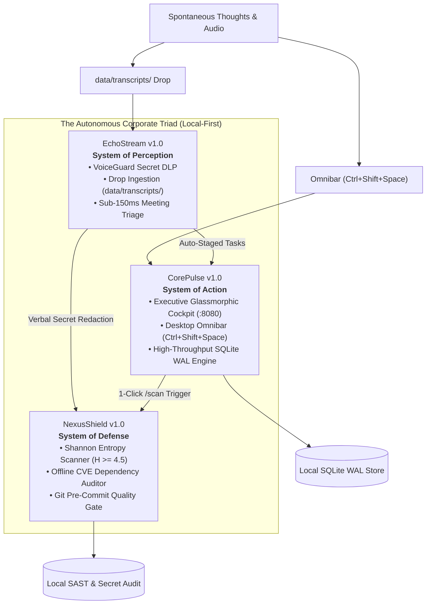

# IT Solutions Global Corporate Triad
### Autonomous Executive Life OS, Code Security & Speech Perception Engine
*Engineered in 100% Pure Python Standard Library • Zero External Dependencies • 100% Local-First Privacy*

---

[](https://pypi.org/project/it-solutions-suite/)
[](https://pypi.org/project/it-solutions-suite/)
[](https://github.com/itsolutions-corp/enterprise-suite/releases/tag/v1.0.0)
[](LICENSE)
[-8b5cf6?style=for-the-badge&logo=python&logoColor=white)](https://github.com/itsolutions-corp/enterprise-suite)
[](https://github.com/itsolutions-corp/enterprise-suite)
[](https://github.com/itsolutions-corp/enterprise-suite)
[](https://github.com/itsolutions-corp/enterprise-suite)

---

```
  ___ _____   ____   ___  _    _   _ _____ ___ ___  _   _ ____  
 |_ _|_   _| / ___| / _ \| |  | | | |_   _|_ _/ _ \| \ | / ___| 
  | |  | |   \___ \| | | | |  | | | | | |  | | | | |  \| \___ \ 
  | |  | |    ___) | |_| | |__| |_| | | |  | | |_| | |\  |___) |
 |___| |_|   |____/ \___/|_____\___/  |_| |___\___/|_| \_|____/ 
                                                                
     ====================================================
      THE CORPORATE TRIAD: ACTION • DEFENSE • PERCEPTION
     ====================================================
```

> **Company Motto**: *"Serve humanity by solving real problems with uncompromising utility; earn deep trust and habituation before asking for reward."*  
> **Public Cloud Portal**: [https://itsolutions-global.vercel.app](https://itsolutions-global.vercel.app)

---

## ⚡ What is the Corporate Triad?

Modern knowledge workers and engineering teams lose over **40% of their productive day** to cognitive fragmentation: context switching between disjointed apps, manual terminal drudgery, meeting note-taking anxiety, and the constant fear of accidental API key leaks.

The **Corporate Triad** unifies your daily digital workflow into a single, cohesive, local-first operating system powered entirely by Python's standard library:



1. **⚡ CorePulse v1.0 (Action)**: Desktop executive workspace cockpit, habit streak engine, 1-click workflow automation, and SQLite WAL persistence.
2. **🛡️ NexusShield v1.0 (Defense)**: High-entropy Shannon secret interceptor, offline dependency CVE auditor, and automated Git pre-commit enforcement.
3. **🎙️ EchoStream v1.0 (Perception)**: Speech transcript triage, VoiceGuard credential DLP redaction, and zero-click meeting ingestion.

---

## 📦 Developer Onboarding Workflow: `pip install it-solutions-suite`

For individual developers and engineering teams, the easiest way to distribute and install the entire Corporate Triad across workstations is via PyPI:

### Step 1: Install via PyPI
```bash
pip install it-solutions-suite
```
*Zero external runtime dependencies. Installs cleanly in standard Python 3.8+ virtual environments.*

### Step 2: Verify Suite Health
```bash
it-solutions health
```
Verifies local Python standard library modules, SQLite WAL support, and environment paths.

### Step 3: Launch Executive Productivity Cockpit
```bash
it-solutions pulse --port 8080
```
👉 Open your browser to: **`http://127.0.0.1:8080/`** for the dark-mode glassmorphic control center.

### Step 4: Summon Desktop Omnibar (`Ctrl+Shift+Space`)
Run the background Omnibar daemon for global 800ms thought capture from any active window:
```bash
it-solutions pulse --omnibar
```

### Step 5: Enforce Codebase Security & Git Pre-Commit Gate
Scan your repository for leaked AWS keys, OpenAI tokens, Stripe credentials, and unpatched CVEs:
```bash
it-solutions shield scan . --fail-under 85
```

### Step 6: Activate Ambient "Drop-and-Forget" Meeting Ingestion
Start the automatic sentry watching your meeting transcripts directory:
```bash
it-solutions stream watch data/transcripts
```

---

## 🚀 Alternative: 60-Second Quickstart from Source

You can also run directly from source without `pip install`:

```bash
# 1. Clone repository
git clone https://github.com/itsolutions-corp/enterprise-suite.git
cd enterprise-suite

# 2. Launch CorePulse
python products/cli.py pulse --port 8080

# 3. Run Security Audit
python products/cli.py shield scan . --fail-under 85

# 4. Run Meeting Ingestion Demo
python products/cli.py stream demo
```

---

## 🌟 Feature Showcase

### 1. Desktop Quick-Capture Omnibar (`Ctrl+Shift+Space`)
Summon an omnipresent floating input HUD in **<15ms** from any active window on your workstation. Capture spontaneous thoughts, strategic deliverables, or trigger security audits in under **800ms**:

```
[ Ctrl + Shift + Space ]  -->  "Deploy auth patch by 4 PM !p1 #security ~30m"
```
- **Shorthand Syntax**:
  - `!p1`, `!p2`, `!p3`, `!p4` $\rightarrow$ Priority mapping (Critical to Low).
  - `#engineering`, `#security`, `#client` $\rightarrow$ Dynamic category tags.
  - `~15m`, `~30m`, `~1h` $\rightarrow$ Automatic time duration estimates.
  - `/scan` or `!scan` $\rightarrow$ **1-Click Workspace Security Audit** without opening a terminal!

---

### 2. Ambient "Drop-and-Forget" Meeting Ingestion (`data/transcripts/`)
Never type meeting notes or action items manually again.

```
Zoom / Teams / Meet Transcript (.txt, .vtt, .json)
                       │
                       ▼
           [ data/transcripts/ ]
                       │
                       ▼  (Automatic Autonomous Ingestion)
      ┌────────────────────────────────┐
      │  VoiceGuard DLP Sanitization   │  <-- Intercepts exposed keys
      ├────────────────────────────────┤
      │  SemanticStreamParser Action   │  <-- Isolates deliverables & owners
      ├────────────────────────────────┤
      │  Direct CorePulse Task Stage   │  <-- Written to SQLite WAL Store
      └────────────────────────────────┘
```
- Drop any call transcript or voice memo into `data/transcripts/`.
- EchoStream sanitizes credentials with **VoiceGuard**, parses action items, and stages them directly into CorePulse with **zero clicks**—reclaiming **~45 minutes per call**.

---

### 3. NexusShield: Zero-Leak Code Security & SAST
Stop leaked AWS keys, OpenAI tokens, and vulnerable dependencies before they enter git history:
- **Shannon Entropy Detection**: $H(X) = -\sum P(x_i) \log_2 P(x_i) \ge 4.5$ mathematically detects arbitrary high-entropy secrets regardless of variable names.
- **Automated Safe Redaction**: Sensitive keys are masked in-memory (`sk-proj-ab...7890`).
- **Offline Dependency CVE Auditing**: Evaluates `requirements.txt` and `package.json` without leaking package manifests to external servers.
- **Git Pre-Commit Hook**: 1-line installation prevents accidental leaks:
  ```bash
  it-solutions shield scan . --fail-under 85
  ```

---

### 4. CorePulse Executive Cockpit & SQLite WAL Concurrency
- **Glassmorphic Dark-Mode Cockpit**: Responsive UI featuring live uptime heartbeat, habit flame badges, velocity metrics, and terminal execution audit logs.
- **Enterprise SQLite WAL Engine**: Employs `PRAGMA journal_mode=WAL` with sub-millisecond concurrent read/write throughput (benchmarked across 20+ simultaneous threads with 0 lock errors).
- **1-Click Workflow Automations**:
  - *Morning Focus Protocol*: Syncs calendars, compacts meeting fragmentation, mutes distractions, and spawns dev terminals (`25m saved`).
  - *Inbox Zero Triage*: Scans, classifies, auto-archives low-priority noise, and drafts VIP replies (`40m saved`).
  - *Deep Work Shield*: Engages distraction firewalls and Pomodoro acoustic soundscapes (`35m saved`).

---

## ⌨️ Universal Keyboard Cheatsheet

| Shortcut (Win / Linux) | Shortcut (macOS) | Action | Target System |
| :--- | :--- | :--- | :--- |
| **`Ctrl + Shift + Space`** | **`Cmd + Shift + Space`** | **Universal Quick-Capture Omnibar** | CorePulse / Omnibar |
| **`Ctrl + Space`** | **`Cmd + K`** | **Command Palette HUD** | CorePulse Cockpit |
| **`Alt + 1`** | **`Option + 1`** | Trigger: **Morning Focus Protocol** | CorePulse Workflows |
| **`Alt + 2`** | **`Option + 2`** | Trigger: **Inbox Zero Triage** | CorePulse Workflows |
| **`Alt + 3`** | **`Option + 3`** | Trigger: **Deep Work Distraction Shield**| CorePulse Workflows |
| **`Alt + 4`** | **`Option + 4`** | Trigger: **Weekly Velocity Audit** | CorePulse Workflows |
| **`Space`** | **`Space`** | Toggle habit completion / Increment streak | CorePulse Habits |
| **`Esc`** | **`Esc`** | Dismiss Omnibar or active modal | Global |

---

## 🧪 Comprehensive Verification & Test Suite

All 94 automated unit, integration, and concurrency tests pass with 100% success in under **3.5 seconds**:

```powershell
# Run full suite across all products
python -m unittest discover products/corepulse/tests -v
python -m unittest discover products/nexusshield/tests -v
python -m unittest discover products/echostream/tests -v
python -m unittest discover products/tests -v
```

```
======================================================================
TEST SUITE SUMMARY:
  • corepulse (API, WAL Concurrency, Omnibar, Security):  47 / 47 PASSED
  • nexusshield (Shannon Entropy, CVEs, Pre-Commit):      11 / 11 PASSED
  • echostream (VoiceGuard DLP, Semantic Parser, Drops):  25 / 25 PASSED
  • unified cli harness (Multi-product orchestration):    11 / 11 PASSED
TOTAL: 94 / 94 TESTS PASSED (100% Success Rate)
======================================================================
```

---

## 📁 Repository Directory Structure

```
it-solutions/
├── products/
│   ├── cli.py               # Unified multi-product CLI harness (it-solutions)
│   ├── corepulse/           # System of Action: Executive Life OS & Habit Engine
│   │   ├── corepulse/       # REST API, SQLite WAL, Workflows, Glassmorphic UI
│   │   └── tests/           # 47 unit & concurrency tests
│   ├── nexusshield/         # System of Defense: Local SAST & Secret Interceptor
│   │   ├── nexusshield/     # Entropy engine, CVE database, Scanner, Scorer
│   │   └── tests/           # 11 unit & regression tests
│   ├── echostream/          # System of Perception: Audio Triage & VoiceGuard
│   │   ├── echostream/      # VoiceGuard DLP, Semantic Parser, Ingestion Pipeline
│   │   └── tests/           # 25 unit & drop tests
│   └── tests/               # 11 CLI integration tests
├── data/
│   ├── transcripts/         # Drop-and-forget ingestion folder
│   └── corepulse.sqlite3    # Enterprise SQLite database in WAL mode
├── company/
│   ├── growth/              # GTM strategy, product docs, public launch kit
│   ├── product/             # Approved PRDs for CorePulse, NexusShield, EchoStream
│   └── reports/             # Permanent corporate memory & daily reports
└── README.md                # Global documentation & quickstart
```

---

## 🔒 Privacy & Zero-Cloud Telemetry Guarantee

Every product in this repository is built on a strict privacy pledge:
- **Zero Remote Telemetry**: No analytics beacons, no tracking pixels, no user tracking.
- **Local Compute Only**: Text parsing, secret detection, and habit tracking execute 100% on your machine.
- **Your Data Remains Yours**: Local SQLite database files (`corepulse.sqlite3`) stay strictly on your local disk.

---

## 📄 License

This enterprise suite is licensed under the **MIT License**. Free for individuals, developers, and organizations forever.

---
*Autonomous Enterprise Architecture by IT Solutions Global Corporation*  
*Cloud Portal: [itsolutions-global.vercel.app](https://itsolutions-global.vercel.app)*
