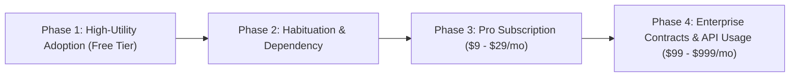

# Corporate Strategy & Product Roadmap: 2026 - 2030

## 1. Vision & Real Human Problem Statement
Humans spend over 40% of their daily productive hours on repetitive cognitive drudgery: scheduling, triaging fragmented data, manual workflow coordination, repetitive coding/troubleshooting, and administrative overhead. 

Our company builds **high-leverage, autonomous utility products** that free humans from friction, deliver immediate tangible relief, and seamlessly integrate into daily life.

---

## 2. Product Pipeline

### Flagship Product 1: `CorePulse` (Autonomous Daily Workflow & Task Engine)
- **Problem**: Individuals and small teams juggle fragmented tools (notes, tasks, code snippets, automation scripts, system monitors) with constant context switching.
- **Solution**: A unified, lightweight, local-first plus cloud-sync automated workspace orchestrator.
- **Habit Formation Loop**:
  - *Trigger*: Morning daily routine / incoming workflow tasks.
  - *Action*: One-click task execution & natural language query.
  - *Variable Reward*: Time saved, predictive automation insights, zero cognitive friction.
  - *Investment*: User saves custom workflows, notes, configs, creating high switching costs.

### Flagship Product 2: `NexusShield` (Automated Security & Code Quality Auditor)
- **Problem**: Small businesses and independent builders cannot afford dedicated QA and security audit teams.
- **Solution**: Continuous automated vulnerability scanning, code quality benchmarking, and compliance validation.

---

## 3. Monetization Engine & Phase Timeline

1. **Phase 1 (Months 1–3) - Utility & Infiltration**: Free, ultra-reliable core features that solve urgent real-world problems. Focus: Zero onboarding friction, viral satisfaction.
2. **Phase 2 (Months 3–6) - Deep Habituation**: Continuous feature drops, personalization, and integrations that make the product indispensable to daily workflow.
3. **Phase 3 (Months 6–12) - Monetization Initiation**: Introduction of Pro tiers, advanced automations, higher compute bandwidth, and priority analytics.
4. **Phase 4 (Year 2+) - Enterprise Scale**: B2B licenses, custom deployment services, and recurring maintenance contracts.
