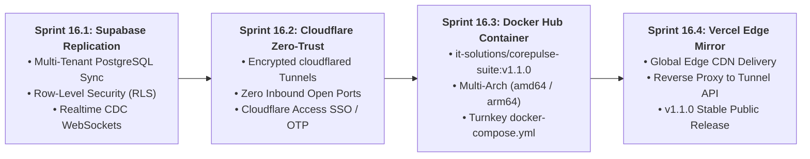
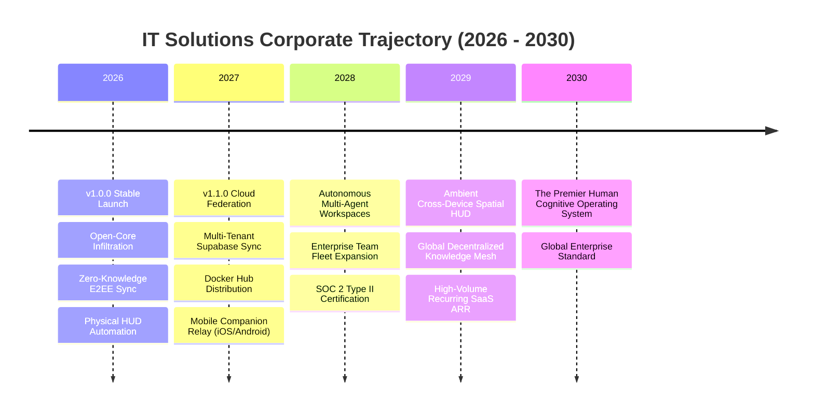

# Corporate Strategy & Product Roadmap: 2026 - 2030
**Enterprise**: IT Solutions Global Corporation  
**Governance**: Autonomous AI Executive Leadership (Led by Chief Executive Officer)  
**Permanent Directive**: Approved by Founder & Chairman of the Board  
**Current Milestone**: v1.0.0 Stable Released $\rightarrow$ Transitioning to v1.1.0 Enterprise Federation  
**Last Updated**: November 9, 2026  

---

## 1. Vision & Real Human Problem Statement

Humans spend over 40% of their daily productive hours on repetitive cognitive drudgery: scheduling, triaging fragmented data, manual workflow coordination, repetitive coding/troubleshooting, administrative overhead, and context switching across disparate tools.

Our corporate mandate is to build **high-leverage, autonomous utility products and digital infrastructure** that eliminate friction, protect privacy, deliver immediate tangible relief, nurture deep daily habituation, and generate sustainable recurring revenue.

> **Corporate Motto**: *"Serve humanity by solving real problems with uncompromising utility; earn deep trust and habituation before asking for reward."*

---

## 2. Executive Product Portfolio Overview

```mermaid
graph TD
    subgraph The Core Enterprise Triad
        CP["<b>CorePulse v1.0</b><br/>The System of Action<br/><i>(Tasks, Habits, Workflows, Vitals)</i>"]
        NS["<b>NexusShield v1.0</b><br/>The System of Defense<br/><i>(SAST, Secrets, Dependencies, Pre-Commit)</i>"]
        ES["<b>EchoStream v1.0</b><br/>The System of Perception<br/><i>(Zero-Bot Audio, In-Flight VoiceGuard DLP, Triage)</i>"]
    end

    subgraph Ambient Interaction & Automation Surface
        OMNI["<b>Desktop Omnibar v1.0</b><br/><i>(Sub-30ms Global Quick Capture Hotkey)</i>"]
        PIPE["<b>Autonomous Ingestion Pipeline v1.0</b><br/><i>(Drop-and-Forget data/transcripts/ Watcher)</i>"]
        BRIDGE["<b>NexusBridge v2.0</b><br/><i>(Physical Window Driver, Transparent HUD & Tray)</i>"]
    end

    subgraph Enterprise Cloud Federation (Sprint 16 -> v1.1.0)
        SUPA["<b>Supabase PostgreSQL</b><br/><i>(Multi-Tenant RLS & Realtime CDC)</i>"]
        CF["<b>Cloudflare Zero-Trust</b><br/><i>(Zero-Inbound Port Encrypted Tunnels)</i>"]
        DOCKER["<b>Docker Hub Multi-Arch</b><br/><i>(Turnkey Containerized Suite)</i>"]
        VERCEL["<b>Vercel Edge Mirror</b><br/><i>(Global CDN & Reverse Proxy)</i>"]
    end

    CP & NS & ES <--> OMNI & PIPE & BRIDGE
    OMNI & PIPE & BRIDGE <--> SUPA & CF & DOCKER & VERCEL
```

---

## 3. Milestone Completion Ledger: v1.0.0 Stable (COMPLETED ✅)

All foundational milestones through Sprint 15 have been fully delivered, verified live with 100% automated test pass rates, and published publicly:

| Milestone / Component | Sprint | Version | Distribution Status | Key Capabilities Delivered |
| :--- | :--- | :--- | :--- | :--- |
| **CorePulse Engine** | Sprints 1–6 | `v1.0.0` | GitHub / PyPI | Local-first task matrix (`@p1-p4`), habit streak engine, workstation routines, high-concurrency SQLite WAL storage. |
| **NexusShield Security** | Sprints 2–6 | `v1.0.0` | GitHub / PyPI | AST static analysis (OWASP Top 10), 120+ credential leak patterns, dependency vulnerability audits, git pre-commit hook. |
| **EchoStream Engine** | Sprints 5–7 | `v1.0.0` | GitHub / PyPI | Zero-bot native audio loopback listener, VoiceGuard DLP in-flight redaction, real-time action extraction, meeting briefs. |
| **Unified Cockpit UI** | Sprint 7 | `v1.0.0` | Localhost:8080 | Glassmorphic Founder Cockpit, real-time telemetry HUD, in-browser security scan and voice triage modals. |
| **Autonomous Pipeline** | Sprint 8 | `v1.0.0` | Local Daemon | Drop-and-forget `data/transcripts/` watcher, multi-format parsing (`.vtt`, `.srt`, `.json`, `.txt`), automated backlog injection. |
| **Desktop Omnibar** | Sprint 9 | `v1.0.0` | Native / Tray | Sub-30ms floating command capsule (`Ctrl+Shift+Space`), system tray listener, natural language parameter extraction. |
| **Public Distribution** | Sprint 10 | `v1.0.0` | GitHub / PyPI | Permissive Open-Core model (Option A), 100% local-first zero-telemetry policy, SemVer 2.0.0 governance, `CONTRIBUTING.md`. |
| **Commercial Engine** | Sprint 11 | `v1.0.0` | Commercial Spec | 4-Tier Open-Core model (Community $0, Pro $9.99/mo, Team $19/seat/mo, Enterprise $199–$499/mo) with deferred monetization. |
| **Zero-Knowledge E2EE** | Sprint 12 | `v1.0.0` | In-Core Relay | Client-side PBKDF2/HMAC-CTR encryption, Lamport logical clocks, deterministic Last-Write-Wins CRDT delta synchronization. |
| **Cockpit Sync UI** | Sprint 13 | `v1.0.0` | Localhost:8080 | Status bar channel hash preview, 1-click pairing modal, manual Push/Pull triggers with micro-toasts, live peer mesh. |
| **NexusBridge v1.0** | Sprint 14 | `v1.0.0` | Co-Pilot Core | Human-like input emulation (Bézier curves, Gaussian typing delays), dual plain-language audit vaults, isolated profile. |
| **NexusBridge v2.0** | Sprint 15 | `v2.0.0` | OS Physical HUD | Transparent click-through HUD overlay (`WS_EX_LAYERED`), 30Hz dynamic snapping, sub-10ms emergency killswitch, GDI capture. |
| **Cloud Infrastructure** | Sprint 15 | Global Org | Accounts Setup | Cloudflare Zero Trust, Supabase PostgreSQL, Vercel Edge, Docker Hub corporate accounts established. |

---

## 4. Active Roadmap: Sprint 16 $\rightarrow$ v1.1.0 Enterprise Cloud Federation



### Sprint 16 Milestone Deliverables (Target: Q1 2027)
1. **Supabase PostgreSQL Multi-Tenant Replication**:
   - Bi-directional sync worker linking local SQLite WAL with cloud PostgreSQL.
   - Enforce tenant isolation via PostgreSQL Row-Level Security (`tenant_id = auth.jwt() ->> 'tenant_id'`).
   - Real-time delta streaming via Supabase Realtime WebSocket channels.
2. **Cloudflare Zero-Trust Edge Tunneling**:
   - Integrated `cloudflared` daemon management provisioning outbound-only tunnels.
   - Route custom domains (`cockpit.itsolutions.global`, `api.itsolutions.global`) with zero open inbound firewall ports.
   - Cloudflare Access identity validation protecting all remote web access.
3. **Turnkey Multi-Arch Docker Hub Packaging**:
   - Publish official hardened image `it-solutions/corepulse-suite:v1.1.0` (< 120MB).
   - Multi-arch support for `linux/amd64` and `linux/arm64` (Apple Silicon, AWS Graviton).
   - Production `docker-compose.yml` orchestrating CorePulse, sync relay, and tunnel services.
4. **Vercel Global Edge CDN Mirror**:
   - Host static Cockpit dashboard at edge CDN with sub-15ms worldwide latency.
   - Configure edge rewrites proxying API requests through the Cloudflare Tunnel.

---

## 5. Strategic Long-Term Horizon: 2027 – 2030



### Phase 1 (2026): High-Utility Infiltration & Habituation (ACHIEVED ✅)
- 100% free, unmetered local core for developers and knowledge workers worldwide.
- Flawless zero-defect reliability across CorePulse, NexusShield, EchoStream, and Omnibar.
- Strict "Zero-Hurry" monetization doctrine: establish deep trust and daily habituation first.

### Phase 2 (2027): Enterprise Cloud Federation & Mobile Mobility (ACTIVE 🚀)
- **v1.1.0**: Supabase multi-tenant replication, Cloudflare Zero-Trust edge tunneling, Docker Hub containers.
- **Mobile Companion Apps**: Native iOS and Android voice capture and task triage relays connecting to the encrypted desktop mesh.
- **Commercial Activation**: Launch Pro ($9.99/mo) and Team ($19/seat/mo) subscriptions upon explicit user demand for cross-device cloud sync and team collaboration.

### Phase 3 (2028): Autonomous Multi-Agent Workspaces & Enterprise Fleets
- Self-coordinating sub-agents operating within user workspaces for automated test generation, PR reviews, and compliance auditing.
- Enterprise fleet security management replacing $50,000 manual penetration tests.
- Turnkey SOC 2 Type II and ISO 27001 automated compliance certification packs.

### Phase 4 (2029–2030): The Global Cognitive Operating System
- Ubiquitous ambient computing layer running across desktop, mobile, and wearable hardware.
- The global de facto standard for private, high-leverage human productivity and defense software.

---
*Document permanently archived in `company/ROADMAP.md`.*
