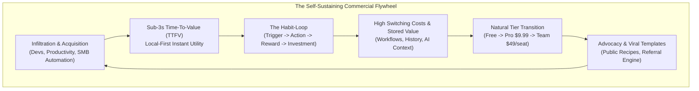
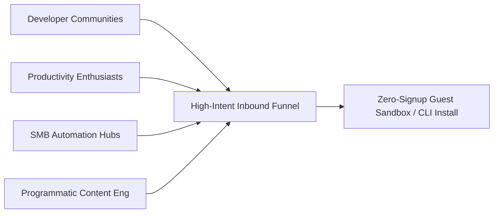
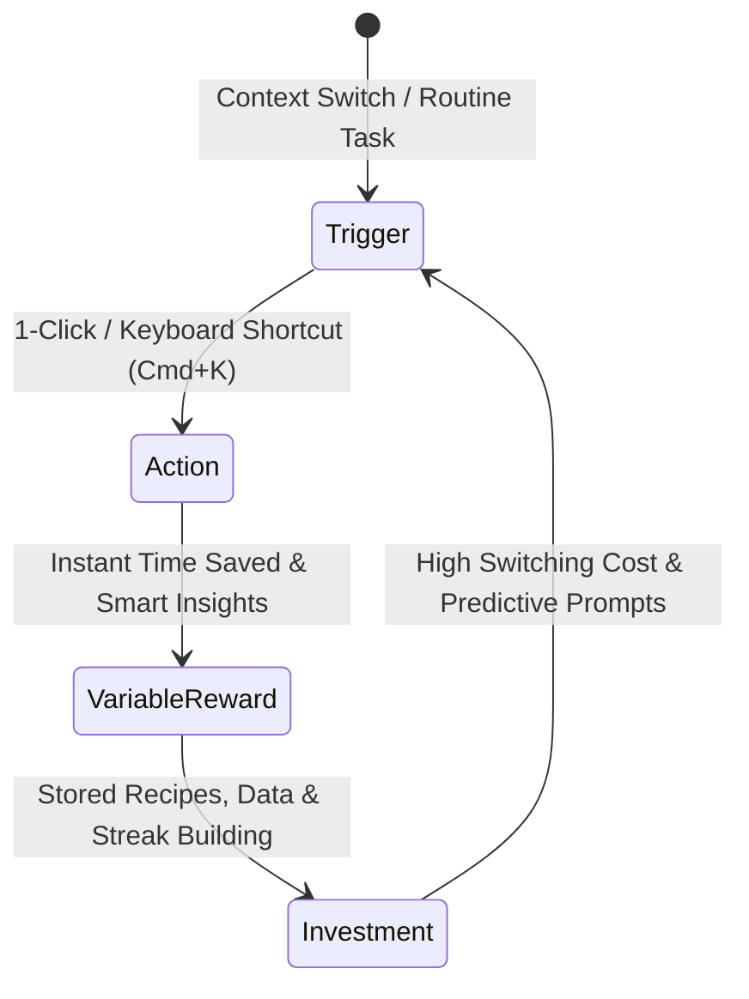
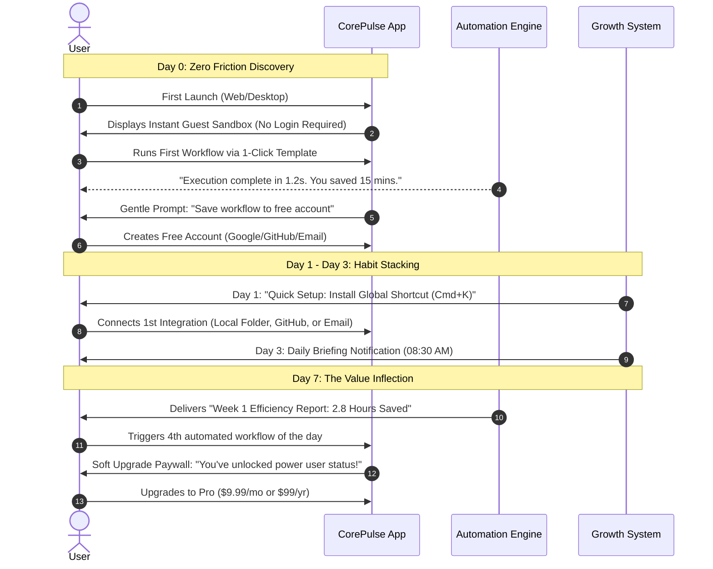
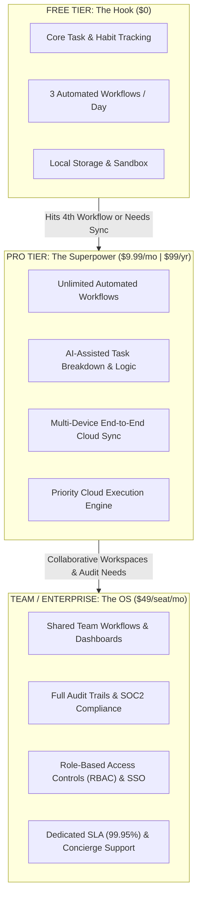
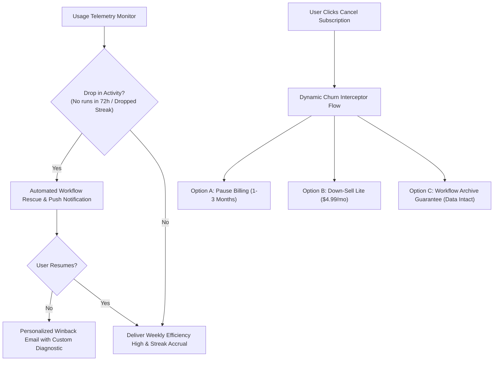
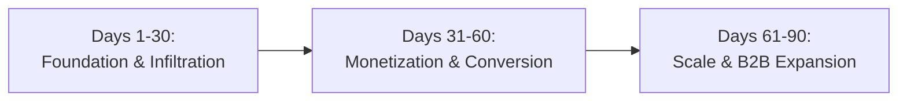

# Commercial Go-To-Market (GTM), User Habituation & Monetization Strategy
**IT Solutions Global Corporation — Commercial & Growth Division**  
*Document Version: 1.0 | Status: Active Executive Strategy | Target Product: `CorePulse` & Ecosystem*

---

## 1. Executive Strategy & The Growth Flywheel

Our commercial mission is to deliver high-leverage utility into the hands of millions of builders, operators, and knowledge workers worldwide, turning chaotic daily routines into effortless, automated execution.

We execute a **Product-Led Growth (PLG)** motion anchored in zero-friction adoption, instant utility realization, psychological habituation, and tiered value capture.

### North Star Growth Metrics
- **North Star Metric (NSM)**: **Weekly Active Automated Workflows (WAAW)** (Indicator of deep workflow dependency and retention).
- **Core SaaS Unit Economics**:
  - **Free-to-Paid Conversion**: Target 4.5% - 6.2% within 30 days of first habituation.
  - **Net Revenue Retention (NRR)**: > 125% through seat expansion and usage-tier upgrade.
  - **LTV / CAC Ratio**: > 4.8x (leveraging low organic CAC via PLG and content engineering).
  - **CAC Payback Period**: < 3.2 months on Pro, < 5.0 months on Enterprise.
  - **DAU / MAU Stickiness**: > 52% (benchmarked against top-quartile utility software).

---

## 2. User Infiltration & Acquisition Strategy

We do not burn capital on generic top-of-funnel programmatic ads. Instead, we execute precision community infiltration and programmatic content engineering where our target users already experience friction.

### 2.1 Developer & Engineer Communities
Developers are our early evangelists and distribution vectors. They demand transparent, scriptable, low-latency, and local-first utilities.
- **Channels**: Hacker News (`Show HN`), GitHub Trending, Reddit (`r/programming`, `r/commandline`, `r/selfhosted`, `r/neovim`), Dev.to, Twitter/X tech circles.
- **Infiltration Tactics**:
  - **Open-Core / CLI Gateway**: Ship a free standalone open-source CLI companion (`corepulse-cli`) that executes local shell task orchestration, pipeable via bash/powershell (`curl -fsSL https://get.corepulse.dev | sh`).
  - **Show HN & Engineering Deep-Dives**: Publish detailed post-mortems on engineering challenges (e.g., *"How we achieved 12ms local execution without Electron bloat"* or *"Building a local-first sync engine with SQLite & CRDTs"*).
  - **Developer Tool Integrations**: Official extensions for VS Code, Raycast, and Alfred. Developers launch and trigger workflows without leaving their editor or keyboard launcher.
  - **GitHub Actions & CI Integrations**: Pre-built action primitives that report task summaries directly to the developer's local `CorePulse` workspace.

### 2.2 Productivity Enthusiasts & Knowledge Workers
Power users searching for the "ultimate setup" seek structure, aesthetic minimalism, and cognitive relief.
- **Channels**: Reddit (`r/productivity`, `r/Notion`, `r/ObsidianMD`, `r/PKMS`), Product Hunt, YouTube tech reviewers, Tiago Forte / Ali Abdaal ecosystem communities.
- **Infiltration Tactics**:
  - **The "Context Switching Tax" Campaign**: Highlight the hidden cost of juggling separate apps for tasks, calendar, notes, and automations. Position `CorePulse` as the single nervous system.
  - **Template Exchange Marketplace**: Curate high-converting lifestyle & execution templates (e.g., *"The Solo Founder Daily OS"*, *"Deep Work & Flow State Orchestrator"*, *"Weekly Review & Inbox Zero Engine"*). Users can duplicate templates with 1-click.
  - **Bridges to Obsidian / Notion / Apple Notes**: Provide bi-directional sync and quick-capture hotkeys (`Cmd+Shift+Space`) that extract messy thoughts into structured tasks.
  - **Product Hunt Launch Blitz**: Tiered launch campaign coordinated with 200+ VIP beta power users to secure #1 Product of the Day / Week.

### 2.3 SMB Automation Hubs & Micro-Agencies
Small business operators and boutique agencies waste dozens of hours every week manually bridging billing, client check-ins, reporting, and team task allocation.
- **Channels**: Zapier / Make / n8n community forums, Facebook & LinkedIn agency groups, Indie Hackers, MicroConf network.
- **Infiltration Tactics**:
  - **"Zapier Without the Bill Shock" Playbook**: Target users frustrated by Zapier's punitive task-based pricing by positioning `CorePulse` as the hybrid local/cloud automation hub that executes high-frequency tasks cost-effectively.
  - **Pre-Built Agency Automation Bundles**: Offer out-of-the-box workflows (e.g., *Client Onboarding Auto-Triage*, *Invoice Tracking to Slack Sync*, *Daily Standup Summarizer*).
  - **Agency Partner Program**: Offer 30% recurring lifetime revenue share to automation consultants, fractional COOs, and freelance workflow architects who deploy `CorePulse` across client organizations.

### 2.4 Content Engineering & Programmatic SEO
We build scalable algorithmic acquisition assets that capture high-intent search traffic without ongoing headcount.
- **Programmatic Landing Pages**:
  - Generate 1,500+ dynamic comparison and integration pages (e.g., `/alternatives/zapier-for-desktop`, `/integrations/linear-to-local-sqlite`, `/templates/freelance-developer-daily-ops`).
  - Publish dynamic benchmark calculators: *"Calculate your team's annual context-switching cost"*, converting calculated losses directly into a 1-click `CorePulse` setup.
- **Open-Source Lead Magnets**:
  - Free lightweight micro-tools hosted on subdomains (e.g., `cron.corepulse.dev` for visual cron generation, `diff.corepulse.dev` for fast text/task diffs), featuring persistent, unobtrusive calls-to-action for the complete desktop/cloud suite.

---

## 3. The Psychological Habit-Loop: First Visit to Addicted DAU

To achieve top-tier retention, we operationalize Nir Eyal’s **Hook Model** across every user touchpoint, systematically transforming occasional utility into reflexive muscle memory.

### 3.1 The Trigger (External & Internal)
- **External Triggers (Phase 1: Cognitive Scaffolding)**:
  - *Morning Kickstart Notification (08:30 AM)*: *"Good morning! 4 recurring workflows queued. Press Cmd+Enter to run daily briefing."*
  - *Lightweight OS Tray / Menu Bar Presence*: Unobtrusive dot showing current active focus block, keeping `CorePulse` top-of-mind without notification fatigue.
  - *Contextual Webhook & Event Triggers*: An incoming email, GitHub PR merge, or Slack ping triggers a subtle desktop toast with a single-click resolution action.
- **Internal Triggers (Phase 2: Reflexive Association)**:
  - *Cognitive Overload / Distraction*: When feeling overwhelmed by fragmented tabs, the user reflexively presses `Cmd+K` to ground themselves in their structured task queue.
  - *End-of-Day Anxiety*: The psychological need for closure is satisfied by the "Shut Down Day" routine, which reconciles tasks and schedules tomorrow.

### 3.2 The Action (Sub-3-Second Time-To-First-Value)
Every millisecond of friction kills habit formation.
- **Zero-Friction Guest Mode**: First-time web visitors land directly in an interactive sandbox—no signup, no email prompt, no credit card.
- **The "One-Second Win"**: The user clicks a single button (*"Run Sample Workflow"*), and within 800ms sees raw unstructured input parsed, organized into subtasks, and scheduled.
- **Global Hotkey Omnipresence**: `Cmd+K` (macOS) / `Ctrl+K` (Windows) opens the Command Palette instantly from any active window, allowing instant capture in under 2 seconds.

### 3.3 The Variable Reward (Efficiency High & Dopamine Reinforcement)
Predictable rewards become boring; variable feedback sparks deep engagement.
- **Quantified Time-Saved Feedback**: After each workflow run: *"Workflow executed in 1.4s — you saved ~18 minutes of manual work."*
- **Daily & Weekly Efficiency Score**: A dynamic productivity metric (0–100) combining flow duration, completed automations, and streak consistency.
- **Serendipitous AI Insights**: The engine identifies hidden optimizations: *"You've manually filed 12 reports this week. Would you like CorePulse to auto-file these every Friday at 4 PM?"*

### 3.4 The Investment (Compounding Stored Value)
Each interaction increases the product's value to the user while multiplying switching costs.
- **Custom Workflow Formulations**: Every automated recipe the user builds or customizes locks their operating procedures inside `CorePulse`.
- **Historical Data & Context Memory**: Searchable archive of completed tasks, run logs, and workflow outcomes.
- **Streak & Habit Capital**: Visual representation of active habit streaks (e.g., 28-day automation streak). Users will not abandon an active streak.

---

## 4. User Onboarding Journey & Milestone Map

### Onboarding Cadence Breakdown

| Milestone | Target User Behavior | Mechanical Trigger | Growth Objective |
| :--- | :--- | :--- | :--- |
| **Minute 0–3** | Execute 1 template workflow in guest sandbox. | 1-Click Interactive Sample. | Deliver First Value (Aha! Moment). |
| **Minute 3–5** | Register free account to preserve workflow. | Frictionless OAuth (Google / GitHub). | Convert anonymous visitor to known lead. |
| **Day 1** | Install Desktop App or Browser Extension; set `Cmd+K`. | In-app checklist: *"Enable Instant Capture"*. | Secure physical footprint on user's device. |
| **Day 3** | Run 1st scheduled automated daily trigger. | OS notification at user's start-of-day. | Establish recurring daily usage pattern. |
| **Day 7** | Review Weekly Efficiency Report. | In-app modal + email summary of hours saved. | Validate tangible ROI and habit formation. |
| **Day 14** | Reach Free Tier threshold or invite collaborator. | Soft paywall trigger or template share prompt. | Free-to-Pro conversion or viral expansion. |

---

## 5. Pricing Architecture & Monetization Engine

We employ a 3-tier value-driven pricing model engineered to make the Free Tier irresistible, the Pro Tier a no-brainer for professionals, and the Team Tier indispensable for growing companies.

### 5.1 Tier Specifications & Packaging

| Feature Matrix | Free Tier ("The Hook") | Pro Tier ("The Superpower") | Team / Enterprise Tier ("The Operating System") |
| :--- | :--- | :--- | :--- |
| **Price Point** | **$0 / forever** | **$9.99 / month** or **$99 / year** | **$49 / seat / month** (billed annually or monthly) |
| **Target Audience** | Students, casual users, exploratory developers | Freelancers, software engineers, power operators | Startups, agencies, enterprise engineering teams |
| **Task & Habit Engine** | Full core task & habit tracking | Full core + advanced recurring logic | Full core + team-assigned tasks & milestones |
| **Automated Workflows** | **3 automated runs / day** | **Unlimited workflow executions** | **Unlimited executions + pooled quota** |
| **AI Task Breakdown** | 5 AI breakdowns / month | **Unlimited AI task decomposition** | Unlimited AI + Custom Org Prompts & LLM Keys |
| **Storage & Sync** | Local-first (single device) | **Multi-device encrypted cloud sync** | Multi-device + Shared Team Workspaces |
| **History & Logs** | 7-day execution logs | 90-day execution logs + rollback | Unlimited audit trails & compliance archives |
| **Integrations** | Webhooks, Local Filesystem, CLI | Full API, Zapier, Linear, GitHub, Slack | Custom Enterprise Webhooks & On-Premises Runners |
| **Governance & Security**| Standard community support | Priority email support | SAML SSO, SCIM, RBAC, 99.95% SLA, Dedicated AM |

### 5.2 Psychological Paywall Triggers (Friction-Free Upsell)
1. **The 4th Workflow Wall**: When a user attempts to run their 4th daily automation, rather than a hard error modal, they receive:
   > *"You've automated 3 workflows today! Pro gives you infinite automated horsepower so your work never stops. Upgrade for $9.99/mo (or $0.27/day)."*
2. **The Second Device Prompt**: When a user logs in on their mobile device or laptop:
   > *"Sync your workflows, active streaks, and task contexts seamlessly across all devices with Pro Cloud Sync."*
3. **The Complex Task Decomposer**: When a user inputs a complex multi-stage initiative (e.g. *"Launch product rebrand"*), clicking *"AI Breakdown"* highlights:
   > *"Break down multi-week projects into 1-click execution steps with Pro AI Assistant."*

---

## 6. Retention Engine & Anti-Churn Tactics

Retaining existing users is 5x cheaper than acquiring new ones. Our anti-churn architecture operates on predictive detection, automated retention loops, and frictionless down-sell safeguards.

### 6.1 Early Warning Telemetry & Churn Triggers
We monitor behavioral signals that precede cancellation by 14–21 days:
- **Signal 1: Frequency Decay**: Daily workflow executions drop by > 50% week-over-week.
- **Signal 2: Streak Break**: User misses 2 consecutive daily reviews or scheduled automations.
- **Signal 3: Sync Inactivity**: Cloud sync timestamps diverge across registered devices.

### 6.2 Automated Rescue Cadence
- **Trigger at 72 Hours Inactive**:
  - *Channel*: Push notification + in-app toast on next OS wake.
  - *Copy*: *"Your morning briefing is waiting. 1 click to clear 5 pending tasks."*
- **Trigger at 7 Days Inactive**:
  - *Channel*: Email from Founder / Growth Lead (`support@corepulse.dev`).
  - *Copy*: *"Did a workflow break? We noticed your routines paused. Reply to this email and our engineers will debug your workflow personally."* (High-touch response that converts disengaged users into loyal champions).
- **Monthly "Value Realized" Summary**:
  - Transparent retrospective sent before renewal billing: *"Last month, CorePulse executed 84 workflows for you, saving an estimated 19.4 hours. Here are your top-performing automations."*

### 6.3 Dynamic Anti-Churn Cancellation Flow
When a paying user clicks *"Cancel Subscription"*, they are routed through an intelligent retention interceptor:
1. **Diagnosis & Instant Relief**:
   - *Reason: "Too expensive"* $\rightarrow$ Offer instant 50% discount for 3 months ($4.99/mo) or downgrade to an unlisted "Lite" tier.
   - *Reason: "Not using it enough right now"* $\rightarrow$ Offer 1-click **Account Snooze** (pause billing for 30, 60, or 90 days with all automations and settings preserved).
   - *Reason: "Encountered technical bug / missing integration"* $\rightarrow$ Instantly creates a Priority Ticket tagged directly to the CTO / Lead Coder with 4-hour SLA response.
2. **The "Workflow Archive Guarantee"**:
   - Reassure the user that their data and custom scripts will **never be deleted**. When they downgrade to Free, their top 3 workflows remain active and all others are safely archived, ready to resume whenever they return.

### 6.4 Virality & Network Effects
- **Shareable Workflow Links**: Users can generate a public read-only link for any workflow recipe (e.g., `corepulse.dev/r/deep-work-blocker`). Visitors can inspect the recipe and click *"Run this in CorePulse"*, creating a self-reinforcing acquisition loop.
- **Team Expansion Infiltration**: When a Pro user shares a workflow with a colleague whose email domain matches their corporate domain, the colleague is granted a 14-day full Team trial with team dashboard capabilities unlocked.
- **Referral Capital**: Give 1 month of Pro free for both referrer and referee upon successful signup.

---

## 7. 30-60-90 Day Execution Roadmap

### Phase 1: Days 1–30 (Foundation, Zero-Friction Hook & Infiltration)
- Deploy Guest Sandbox mode on web with 5 instant one-click workflow templates.
- Release open-source `corepulse-cli` on GitHub with launch on Hacker News and Reddit.
- Enforce Free Tier boundary (3 automated workflows/day) with delight-oriented soft prompts.
- Implement telemetry logging for activation rate and 7-day retention.

### Phase 2: Days 31–60 (Monetization Engine & Habit Loops)
- Launch Stripe/Paddle billing infrastructure with Pro Tier ($9.99/mo and $99/year).
- Roll out Multi-Device Cloud Sync and AI Task Decomposition behind Pro tier.
- Launch the dynamic anti-churn cancellation flow and automated 72-hour re-engagement triggers.
- Execute Product Hunt launch and target 500 paid Pro subscribers.

### Phase 3: Days 61–90 (Team Tier Rollout & B2B Infiltration)
- Launch Team / Enterprise Tier ($49/seat/mo) with shared team dashboards, audit logs, and SSO.
- Launch the Agency / Consultant Partner Program with 30% recurring rev-share.
- Deploy 500 programmatic SEO comparison and template landing pages.
- Scale to $25k Monthly Recurring Revenue (MRR) with > 120% NRR.

---

## 8. Governance & Departmental Collaboration Handshake

| Collaborating Executive | Growth Interlock | Deliverable |
| :--- | :--- | :--- |
| **VP of Product & Production** | PRD feature alignment with habit-loop variable rewards. | In-app feedback loops, templates, and telemetry instrumentation. |
| **CTO & Lead Coder** | Sub-3s TTFV, local-first performance, and Stripe integration. | Ultra-fast CLI, desktop client hotkey responsiveness, and secure billing. |
| **Chief Quality Officer** | Zero-defect billing workflows and flawless onboarding. | Automated E2E testing of checkout, upgrade, and sync pipelines. |
| **CEO** | Executive performance reporting and resource allocation. | Bi-weekly growth audit and ARR progress updates in `company/reports/`. |

---
*Authorized by: Chief Commercial & Growth Officer*  
*IT Solutions Global Corporation*
