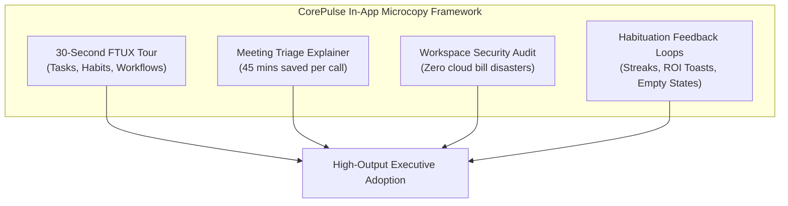
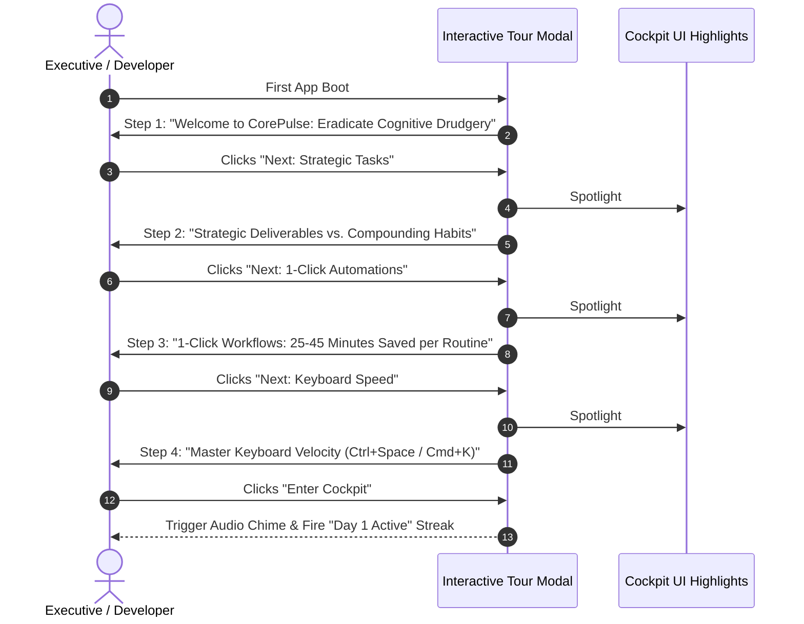
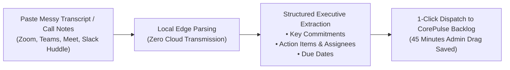
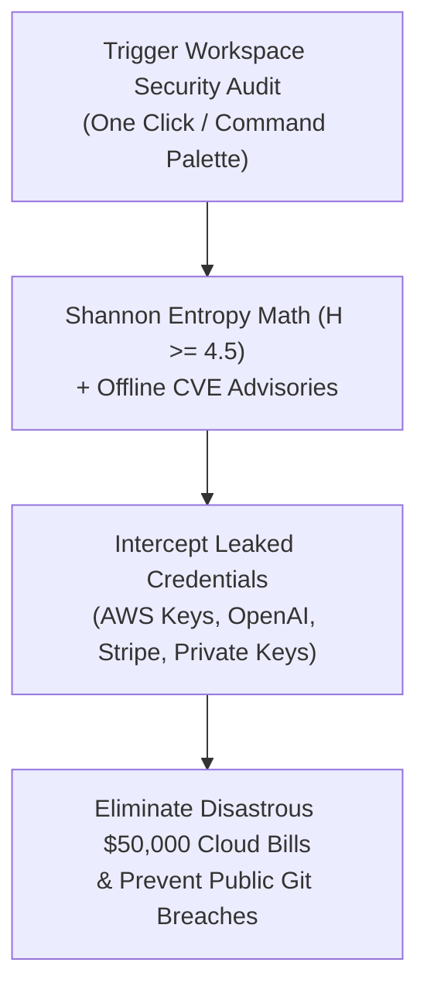

# CorePulse Web Cockpit: In-App Microcopy & Interactive Onboarding Specification
**IT Solutions Global Corporation — Commercial & Growth Division**  
*Document Version: 1.0.0 | Status: Production Specification | Target File: `company/growth/IN_APP_ONBOARDING_COPY.md`*

---

## 1. Executive UX Philosophy & Microcopy Voice Architecture

Our product ethos is rooted in our permanent corporate motto:
> **"Serve humanity by solving real problems with uncompromising utility; earn deep trust and habituation before asking for reward."**

The CorePulse Web Cockpit (`http://127.0.0.1:8080/`) operates as a **high-velocity executive cockpit**. In-app copy must never sound like generic SaaS corporate fluff, intrusive pop-up ads, or condescending tutorials. Every tooltip, empty state, modal header, and button label must feel:
- **Concise & Velocity-Driven**: Deliver maximum clarity in under 3 seconds of reading time.
- **Dopamine-Validating**: Quantify cognitive relief, minutes reclaimed, and streak momentum.
- **Architecturally Honest**: Celebrate our 100% local-first, zero-dependency, zero-cloud-telemetry principles.



---

## 2. 'Welcome to CorePulse' 30-Second Onboarding Tour

Designed for first-time user experience (FTUX). This 4-step modal tour triggers automatically on the user's first launch (or when clicking `?` in the navigation bar) and takes under 30 seconds to complete.



---

### Step 1 of 4: Welcome & Mission
- **Target Container**: Center Modal Overlay with Ambient Glassmorphism.
- **Eyebrow**: `⚡ 30-SECOND QUICKSTART`
- **Modal Title**: Welcome to CorePulse: Your Autonomous Life OS
- **Body Copy**:
  > Technical leaders lose over 40% of their workday to fragmented browser tabs, repetitive morning scripts, and context-switching fatigue.
  >
  > CorePulse unifies your daily execution into a single, zero-bloat local cockpit. In the next 30 seconds, you’ll learn how to reclaim 2+ hours of deep focus every day.
- **Micro-Metric Callout**:
  - `0 ms` Cloud Latency • `100%` Local SQLite Storage • `0` External Dependencies
- **Primary CTA Button**: `[ Next: Tasks & Habits → ]`
- **Secondary Action**: `Skip Tour (I know what I'm doing)`

---

### Step 2 of 4: Strategic Deliverables vs. Compounding Habits
- **Target Spotlight**: `#tasksPanel` (Tasks & Habits Control Column).
- **Tooltip Position**: Floating Right / Aligned to Tasks Header.
- **Eyebrow**: `PILLAR 1: FOCUS ARCHITECTURE`
- **Tooltip Title**: High-Leverage Tasks vs. Daily Habits
- **Body Copy**:
  > Not all work is created equal. CorePulse separates your work into two distinct velocity tracks:
  >
  > - **Strategic Tasks**: High-impact, non-recurring deliverables (e.g. *Deploy Production Microservice*). Prioritized by impact, not busywork.
  > - **Daily Habits**: Compounding daily rituals (e.g. *Morning Cold Review*, *90-min Deep Focus Block*). Every time you check off a habit, your flame streak counter increments.
- **Behavioral Prompt (The Loss-Aversion Hook)**:
  > 🔥 *Rule of the Streak: Never miss two days in a row. Protect your active flame counter.*
- **Quick Hotkey Badge**: `Press Space on any item to toggle completion`
- **Navigation Controls**: `[ ← Back ]` | `[ Next: 1-Click Workflows → ]`

---

### Step 3 of 4: One-Click Autonomous Workflows
- **Target Spotlight**: `#workflowCardsDeck` (Right Column: Workflow Command Deck).
- **Tooltip Position**: Floating Left / Aligned to Workflow Deck.
- **Eyebrow**: `PILLAR 2: SYSTEM OF ACTION`
- **Tooltip Title**: One-Click Workflows: Zero Manual Friction
- **Body Copy**:
  > Why spend 15 minutes every morning opening terminals, repositioning browser windows, and setting Slack to Do Not Disturb?
  >
  > One click triggers complete, multi-step sequential execution routines:
  > - **Morning Focus Protocol**: Compacts calendar fragments, engages focus shields, and launches project terminals (`Reclaims ~25 mins`).
  > - **Inbox Zero Triage**: Auto-archives promotional clutter and extracts VIP client action items (`Reclaims ~40 mins`).
  > - **Deep Work Distraction Shield**: Activates domain firewalls and Pomodoro acoustic soundscapes (`Reclaims ~35 mins`).
- **Telemetry Callout**:
  > *Every execution streams live audit logs into your local terminal and updates your cumulative "Time Saved" ROI gauge in real time.*
- **Navigation Controls**: `[ ← Back ]` | `[ Next: Keyboard Velocity → ]`

---

### Step 4 of 4: Master Keyboard Velocity
- **Target Spotlight**: Global Viewport Center Overlay.
- **Eyebrow**: `PILLAR 3: ZERO-MOUSE VELOCITY`
- **Tooltip Title**: The Omnipresent Command Palette
- **Body Copy**:
  > Never break flow state to manage tasks. Hit our universal shortcut anywhere on your workstation:
  >
  > `Ctrl + Space` (Windows/Linux) or `Cmd + K` (macOS)
  >
  > Summon the floating glassmorphic HUD in under **15 milliseconds** to capture thoughts, check habits, or trigger workflows without touching your mouse.
- **Syntax Cheatsheet Chips**:
  - `t: <title>` Quick-capture deliverable
  - `h: <title>` Quick-capture habit
  - `w: <name>` Run workflow automation
- **Primary CTA Button**: `[ 🚀 Take Flight & Enter Cockpit ]`
- **Exit Action**: Firing confetti/pulse animation and sound chime.

---

## 3. In-App Explainer Copy: 'Meeting Triage' (The Perception Tier)

This feature integrates the **EchoStream** perception doctrine into the CorePulse Cockpit. It allows users to paste raw meeting transcripts, client voice notes, or messy chat logs and converts them into structured tasks in seconds.



### 3.1 Feature Banner & Trigger Button
- **Placement**: Next to "Inbox Zero Triage" in the Executive Banner Quick Actions.
- **Button Label**: `[ 🎙️ Meeting & Audio Triage ]`
- **Button Micro-Badge**: `NEW • SAVES ~45 MIN`
- **Hover Tooltip**: 
  > *Paste conversation text, meeting transcripts, or voice memos. Automatically extract action items and commitments directly into your task backlog in 800ms.*

---

### 3.2 Meeting Triage Modal Explainer Copy

#### Modal Header
- **Eyebrow**: `ECHOSTREAM PERCEPTION ENGINE • LOCAL ON-DEVICE TRIAGE`
- **Title**: Instant Meeting & Conversation Triage
- **Subtitle**: Stop wasting 45 minutes after every call writing manual notes and typing tasks.

#### The "Why It Saves 45 Minutes" Explainer Callout Card
- **Visual Style**: Glassmorphic slate card with subtle purple glow border (`rgba(168, 85, 247, 0.25)`).
- **Header**: 🧠 Why Post-Meeting Admin Is Draining Your Output:
- **Body Copy**:
  > Research proves that after a 30-minute meeting, professionals spend an average of **45 minutes** re-reading rough notes, hunting down verbal commitments, and manually typing tasks into project management tools. Worse, **30% of verbal commitments fall through the cracks**.
  >
  > **The Solution**: Simply paste your call transcript (from Microsoft Teams, Zoom, Google Meet, or voice notes) below. EchoStream's local edge parser will instantly:
  > 1. Isolate concrete action items, assignees, and deadlines.
  > 2. Filter out conversational filler, small talk, and pleasantries.
  > 3. Populate your CorePulse task backlog with a single click.

#### Input Field Copy & Empty State
- **Input Area Label**: Raw Conversation Text or Transcript Buffer
- **Textarea Placeholder**:
  ```
  Paste raw conversation text or meeting transcript here...
  
  Example:
  "Sarah: We need to push the hotfix by 4 PM today. Let's make sure David runs the regression tests before deployment.
  Alex: Agreed, I'll update the API docs right after the call."
  ```
- **Privacy Guarantee Pill (Directly below textarea)**:
  > 🔒 **100% Local Processing**: Transcripts are parsed in-memory on your machine. Zero audio or text is sent to third-party cloud servers.

#### Action Buttons
- **Primary CTA**: `[ ⚡ Triage & Extract Action Items ]`
- **Secondary Action**: `[ Load Sample Transcript ]` (for instant zero-effort demo)
- **Cancel Button**: `[ Cancel ]`

---

### 3.3 Post-Extraction Success State Microcopy
When the parsing completes in <800ms:
- **Success Banner**: 
  > ✅ **3 Action Items Extracted in 0.6s • ~45 Minutes Reclaimed**
- **Action Items Preview Cards**:
  - `[ ] Push production hotfix by 4:00 PM` *(Priority: Critical • Category: Engineering)*
  - `[ ] Run regression test suite before deploy` *(Priority: High • Assignee: David)*
  - `[ ] Update API changelog and staging docs` *(Priority: Medium • Assignee: Alex)*
- **Primary Dispatch CTA**: `[ 📥 Add All 3 to CorePulse Backlog ]`
- **Secondary CTA**: `[ Copy Markdown Summary to Clipboard ]`
- **Toast Feedback**: *"3 strategic tasks dispatched to CorePulse backlog. Time saved: 45 minutes."*

---

## 4. In-App Explainer Copy: 'Workspace Security Audit' (The Defense Tier)

This feature integrates the **NexusShield** defense doctrine into the CorePulse Cockpit. It allows developers and operators to scan their active project directories for leaked secrets, high-entropy tokens, and vulnerable package dependencies.



### 4.1 Feature Banner & Trigger Button
- **Placement**: Under System Heartbeat or as an Audit Routine in Workflow Command Deck.
- **Button Label**: `[ 🛡️ Run Workspace Security Audit ]`
- **Button Micro-Badge**: `ZERO-LEAK CERTIFIED`
- **Hover Tooltip**:
  > *Scan your active code workspace for exposed AWS keys, OpenAI tokens, and vulnerable dependencies in <500ms before they trigger disastrous cloud bills.*

---

### 4.2 Security Audit Modal Explainer Copy

#### Modal Header
- **Eyebrow**: `NEXUSSHIELD DEFENSE ENGINE • LOCAL SAST & SECRET INTERCEPTOR`
- **Title**: Workspace Security & Secret Leak Audit
- **Subtitle**: Defend your codebase against accidental credential exposure and runaway cloud expenses.

#### The "Why Scanning Prevents Catastrophic Cloud Bills" Explainer Callout Card
- **Visual Style**: Glassmorphic obsidian card with subtle emerald/red hazard glow.
- **Header**: 💸 The $50,000 Mistake You Won't Make:
- **Body Copy**:
  > Accidental API key leaks are the #1 cause of catastrophic developer cloud bills:
  > - **AWS / Cloud Keys**: Automated bots scrape GitHub within **4 seconds** of a public commit, spinning up unauthorized crypto-mining GPU clusters that rack up **$20,000 to $60,000 in overnight charges**.
  > - **OpenAI / LLM Tokens**: Compromised project keys (`sk-proj-...`) are quickly drained by third parties running high-throughput batch inference.
  > - **Stripe Live Secret Keys**: Leaked payment keys compromise customer transactions and risk immediate merchant account suspension.
  >
  > **NexusShield runs 100% locally on your machine**. Using mathematical **Shannon Entropy ($H \ge 4.5$)**, it intercepts credentials and vulnerable packages before your code ever touches Git.

#### Scanner Configuration Form
- **Directory Path Input**:
  - **Label**: Target Workspace Directory
  - **Placeholder**: `e:\It solution\products\corepulse (Default: Current Workspace)`
  - **Helper Text**: `Scans source code, config files, .env files, requirements.txt, and package.json.`
- **Enforcement Slider / Quality Gate**:
  - **Label**: CI Failure Threshold (`--fail-under`)
  - **Default**: `85 / 100 (Enterprise Grade A)`
  - **Tooltip**: `If the computed security score falls below this threshold, pre-commit hooks and builds will halt automatically.`

#### Action Buttons
- **Primary CTA**: `[ 🔒 Scan Current Workspace Now ]`
- **Secondary Action**: `[ Install 1-Line Git Pre-Commit Hook ]`
- **Cancel Button**: `[ Close ]`

---

### 4.3 Audit Results Screen Microcopy

#### High Health Score (Clean Workspace: 90–100)
- **Score Badge**: `🛡️ 95 / 100 • Grade A (Security Verified)`
- **Header**: **Zero Leaks Detected. Your Workspace Is Secure.**
- **Body**: 
  > *No high-entropy secrets, exposed credentials, or unpatched CVEs found across 48 scanned files. Your cloud accounts are protected.*
- **Pre-Commit Banner**:
  > *Want continuous zero-leak protection? Install our 1-line Git Pre-Commit hook so secrets are intercepted automatically every time you commit.*
- **Action Button**: `[ Copy Pre-Commit Hook Script ]`

#### Critical Secret Leak Detected (Hazard State: Score < 80)
- **Score Badge**: `🚨 65 / 100 • Grade D (Critical Risk Detected)`
- **Hazard Header**: **Exposed Credential Intercepted! Immediate Action Required.**
- **Redacted Finding Card**:
  ```
  [CRITICAL] High-Entropy OpenAI Project Key Detected
  File:     config.py:14
  Redacted: sk-proj-ab...7890 (Shannon Entropy H = 4.82)
  Impact:   Risk of unauthorized LLM quota drain and billing spikes.
  Action:   Move token to an untracked environment variable or add '# nexus-ignore'.
  ```
- **Remediation Guide Tooltip**:
  > *NexusShield automatically masked your key preview above. Never commit this file to remote version control without moving the token to `.env` (and adding `.env` to `.gitignore`).*
- **Primary CTA**: `[ Re-Scan Workspace After Fix ]`

---

## 5. Microcopy Matrix: Empty States, Toasts & Tooltips

To maintain absolute responsiveness, every edge state in the web cockpit is fortified with motivating, actionable copy.

| UI Component | Context / State | Microcopy String | Primary Action / CTA |
| :--- | :--- | :--- | :--- |
| **Tasks Column** | Empty (0 tasks active) | *"Your backlog is completely clear. Zero cognitive debt! Add your next strategic deliverable above or press `Ctrl+N`."* | `[ + New Strategic Task ]` |
| **Habits Column** | Empty (0 habits active) | *"No habit routines configured yet. Daily habits compound your output. Start with a 45-min Deep Focus block."* | `[ + Add First Habit ]` |
| **Terminal Log** | Cleared / Standby | `[STANDBY] CorePulse automation engine initialized. Ready for one-click triggers or scheduled routines.` | `Run Morning Protocol` |
| **Flame Streak Badge** | Active Streak (e.g. 5 days) | *"🔥 5-Day Streak Active! You're in the top 4% of consistent operators this month."* | Hover: *"Click to view habit calendar"* |
| **Streak at Risk** | Missed yesterday | *"⚠️ Streak Protection: Complete at least 1 habit before midnight to preserve your 5-day momentum!"* | `[ Check Off Daily Habit ]` |
| **Workflow Run** | Execution started | *"⚡ Executing 'Morning Focus Protocol'... Securing cognitive headspace in real time."* | Animated spinner |
| **Workflow Success** | Execution finished | *"✓ Execution complete in 780ms. Reclaimed 25 minutes of executive time."* | Audio chime + Toast |
| **Daily 3-Workflow Cap**| Starter Free Tier limit | *"🚀 You've maximized your 3 daily free automations! You've saved 1.8 hours this week. Upgrade to Pro for infinite horsepower."* | `[ Unlock CorePulse Pro ]` |
| **API Health Status**| Healthy Heartbeat | *"● CorePulse Engine Online • SQLite WAL Concurrency Active • Zero Latency"* | Click: *"Inspect Telemetry"* |

---

## 6. Frontend Vanilla JS Implementation Template

Developers integrating these tooltips and modals into `corepulse/static/js/dashboard.js` can utilize the following drop-in helper routines:

```javascript
/**
 * CorePulse Interactive Tour & Explainer Module
 * Standalone vanilla JS implementation with zero external dependencies.
 */

// 1. Interactive 30-Second Tour Controller
const TourManager = {
  currentStep: 1,
  totalSteps: 4,

  startTour() {
    this.currentStep = 1;
    this.renderStep();
    const modal = document.getElementById('tourModalOverlay');
    if (modal) modal.style.display = 'flex';
  },

  nextStep() {
    if (this.currentStep < this.totalSteps) {
      this.currentStep++;
      this.renderStep();
    } else {
      this.finishTour();
    }
  },

  prevStep() {
    if (this.currentStep > 1) {
      this.currentStep--;
      this.renderStep();
    }
  },

  finishTour() {
    const modal = document.getElementById('tourModalOverlay');
    if (modal) modal.style.display = 'none';
    localStorage.setItem('corepulse_tour_completed', 'true');
    showToast('🚀 Welcome aboard! CorePulse cockpit initialized.', 'success');
  },

  renderStep() {
    // Dynamically update modal content according to Section 2 specification
  }
};

// 2. Meeting Triage Dialog Controller
function openMeetingTriageModal() {
  const modal = document.getElementById('meetingTriageModal');
  if (modal) modal.style.display = 'flex';
}

// 3. Security Audit Dialog Controller
function openSecurityAuditModal() {
  const modal = document.getElementById('securityAuditModal');
  if (modal) modal.style.display = 'flex';
}
```

---
*Authorized by: Chief Commercial & Growth Officer*  
*IT Solutions Global Corporation*
