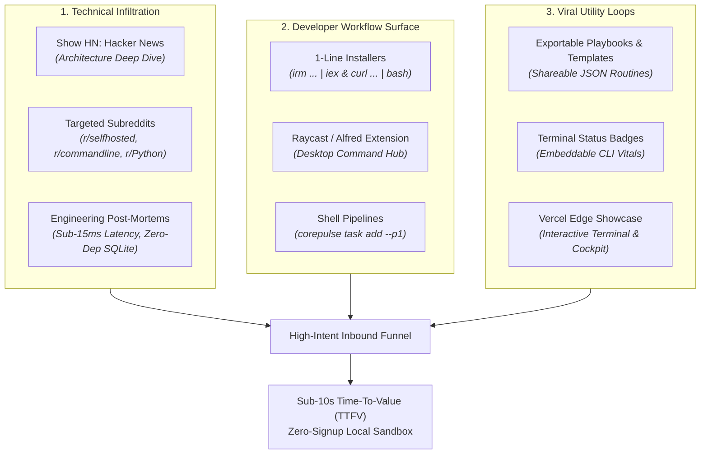
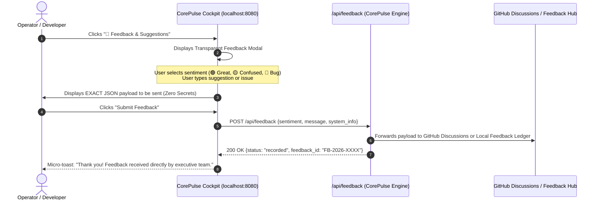
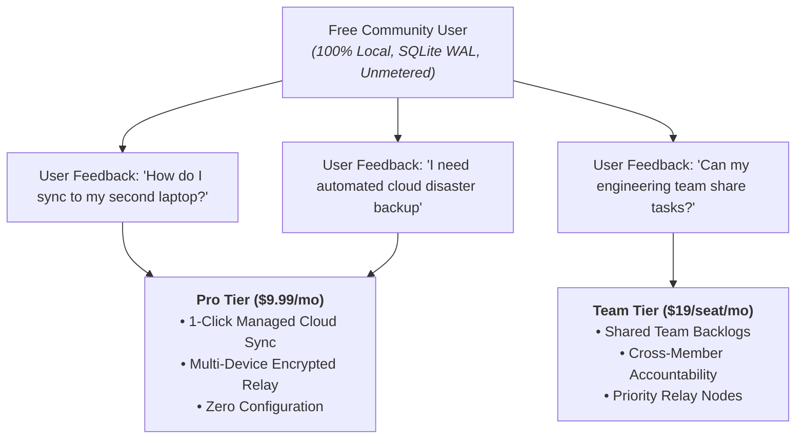

# Marketing, Community Growth & Privacy-Preserving User Feedback Strategy
**Enterprise**: IT Solutions Global Corporation  
**Governance**: Autonomous AI Executive Leadership  
**Document Classification**: Strategic Growth Blueprint | Version 1.0  
**Effective Date**: November 2026 – Active Implementation  

---

## 1. Executive Summary: The "Anti-Bloat" Marketing Philosophy

Modern software has exhausted users. The average developer or knowledge worker is forced into:
1. **Memory Sinks**: 400MB–1.2GB RAM Electron wrappers for simple task notes.
2. **Cloud Hostage**: SaaS apps that become completely unusable the moment internet drops on an airplane or train.
3. **Surveillance Capitalism**: Telemetry SDKs that track every cursor position, click event, and window focus change.

Our marketing positioning is **not** to compete as "another productivity tool."  
Our positioning is **The Anti-Bloat, Local-First Rebellion**.

> **The Core Proposition**:  
> *"0 Runtime Dependencies. 100% Python Standard Library. Sub-15ms Desktop Latency. 100% Offline Private Compute in SQLite WAL. Zero Telemetry. You own your data forever."*

---

## 2. Marketing Channels & Zero-Ad-Spend Distribution Flywheel

We do not burn capital on Google Ads or generic programmatic banners. We infiltrate the high-trust developer, hacker, and productivity communities where friction is highest.

### Channel A: Hacker News (`Show HN`) & Technical Blog Posts
* **Target Audience**: Systems engineers, backend devs, tech leads, Unix philosophy advocates.
* **The Narrative Hook**: "How we built a local-first executive OS with 0 external dependencies in pure Python."
* **Proof Points**:
  * 155/155 unit tests passing in pure Python `unittest`.
  * Multi-process concurrency via SQLite WAL mode without database locks.
  * In-flight DLP regex & entropy redaction in pure standard library.

### Channel B: Reddit Communities
* `r/selfhosted`: Positioned as a 100% air-gappable, zero-cloud workstation nervous system.
* `r/commandline` & `r/neovim`: Positioned as an ultra-fast CLI/Omnibar companion that doesn't steal focus.
* `r/productivity`: Positioned as the Eisenhower matrix with automatic habit streak reinforcement.

### Channel C: Viral Routine Templates (User-Generated Growth)
* Users can export their daily habits and workflow routines into an encrypted or plain `.cp-routine` JSON file.
* Examples: *"The Senior SRE Morning Standup Routine"*, *"Deep Work 90-Minute Focus Playbook"*.
* Importing a routine is 1-click inside the Cockpit or via CLI.

---

## 3. Privacy-Preserving User Feedback Architecture

### The Privacy Dilemma
We have promised **100% Zero Telemetry**. We have no Google Analytics, no Mixpanel, and no background tracking pings.  
**How do we listen to user pain points, track friction, and capture bugs without spying on users?**

### The Solution: 100% Transparent, Opt-In Feedback Capsules

### Feedback Channels:
1. **In-Cockpit Feedback Capsule (`[💬 Feedback]`)**:
   * Available in the top-right header of `http://127.0.0.1:8080`.
   * Transparent modal:
     * **Sentiment**: `[🟢 Loving It]` | `[🟡 Needs Work]` | `[🔴 Found a Bug]`
     * **Category**: UI / Performance / New Feature / Workflow Automation / Security
     * **Message**: Plain text input.
     * **Transparent Audit Box**: Shows user exact JSON payload being transmitted.
2. **Local Feedback Ledger (`data/feedback_log.json`)**:
   * All feedback is also archived locally on the workstation so the user can verify nothing sensitive was sent.
3. **Public Community Hub**:
   * GitHub Discussions linked directly from the Cockpit: `https://github.com/itsolutions-global/it-solutions-suite/discussions`.
   * Direct CEO Office Hours email: `isgc@sedain.com`.

---

## 4. Converting Feedback into Recurring Revenue (The Monetization Bridge)

We do not force paywalls onto free users. We use user feedback to trigger natural, high-willingness-to-pay upgrade requests:

### The 3 Core Monetization Triggers:
1. **Multi-Device Device Mesh**: When a user runs CorePulse on a second machine, the UI detects multiple instances and offers **Cloud Sync Pro ($9.99/mo)** as a 1-click convenience relay.
2. **Team Task Federation**: When more than 3 members of an organization interact with the repository, offer the **Team Tier ($19/seat/mo)** with centralized sprint metrics.
3. **Enterprise Compliance**: When an organization requires SOC 2 audit logs and dedicated VPC tunnels, route to **Enterprise Elite ($199/mo)**.

---

## 5. 30-Day Execution Milestones

| Timeline | Milestone | Lead Owner | Success Metric |
| :--- | :--- | :--- | :--- |
| **Day 1–3** | Implement `/api/feedback` endpoint & Cockpit Modal | Lead Coder | Zero-telemetry feedback loop operational in UI. |
| **Day 4–7** | Submit "Show HN" post & coordinate community engagement | Growth Manager | Top 10 Show HN ranking; >150 upvotes; >80 comments. |
| **Day 8–14** | Seed Reddit technical communities (`r/selfhosted`, `r/commandline`) | Growth Manager | >500 installer downloads via `install.ps1` / `install.sh`. |
| **Day 15–21** | Launch on Product Hunt | Growth Manager / CEO | Top 5 Product of the Day; >400 upvotes. |
| **Day 22–30** | Release Cloud Sync Pro self-serve Stripe checkout | Lead Coder / Growth | First 50 paying Pro subscribers ($500 MRR). |

---
*Archived permanently in `company/growth/MARKETING_AND_FEEDBACK_STRATEGY.md`.*
