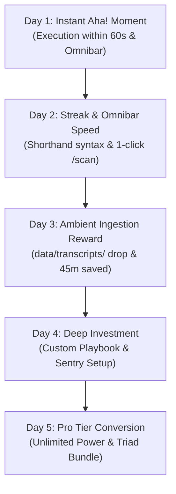

# 5-Day Automated User Onboarding, Habit-Formation Sequence & Launch Copy
**IT Solutions Global Corporation — Commercial & Growth Division**  
*Document Version: 1.2.0 | Status: Approved Implementation Specification | Target: `CorePulse v1.0`, `EchoStream`, & `NexusShield`*

---

## 1. Growth Architecture & Omnichannel Delivery Matrix

The purpose of this sequence is to systematically transition a first-time installer into a habitual Daily Active User (DAU) within 120 hours of first contact, driving our target **4.5% – 6.2% Free-to-Pro conversion rate** and **>52% DAU/MAU stickiness**.

### Omnichannel Communication Channels
1. **Desktop Native HUD, Omnibar & OS Toasts**: Low-latency, zero-bloat system notifications fired at workstation boot or summoned via **`Ctrl+Shift+Space` (Global Omnibar)** and **`Ctrl+Space` (Command Palette)**.
2. **Ambient "Drop-and-Forget" Intake Sentry**: Background ingestion monitoring `data/transcripts/` for zero-click task creation.
3. **Behavior-Triggered Lifecycle Emails**: Multi-part email drip dispatched via transactional webhooks only when specific behavioral milestones are met (or neglected).

```mermaid
journey
    title 5-Day User Habituation & Monetization Journey
    section Day 1: Immediate Aha!
      Download & Install: 5: User
      First Workflow Run in 60s: 5: CorePulse
      First Omnibar Thought Capture (Ctrl+Shift+Space): 5: User
    section Day 2: Streak & Omnibar Speed
      System Boot Toast: 4: CorePulse
      Omnibar Shorthand & 1-Click /scan: 5: User
      2-Day Streak Established: 5: CorePulse
    section Day 3: Ambient Ingestion
      Drop Transcript in data/transcripts/: 5: User
      Zero-Click Tasks Staged (<800ms): 5: EchoStream
      72-Hour Efficiency Score Revealed: 5: CorePulse
    section Day 4: Deep Investment
      Build Custom Playbook & Automated Sentry: 4: User
      Stored Value Locked in SQLite WAL: 5: CorePulse
      Switching Barrier Formed: 5: User
    section Day 5: Pro Monetization
      Hit 3-Workflow Daily Free Quota: 4: User
      Value Justification ($0.27/day): 5: CorePulse
      Pro Tier Upgrade ($9.99/mo or $19 Triad): 5: User
```

---

## 2. The 5-Day Step-by-Step Sequence



---

### DAY 1: The Immediate "Aha!" Moment (Sub-60s Execution & Omnibar)

**Behavioral Objective**: Obliterate time-to-first-value (TTFV). The user must witness a multi-step routine execute in milliseconds without filling out sign-up forms, API keys, or configurations, and experience instant thought capture via the Omnibar.

#### 1. In-App First-Run Experience (OOBE / Zero-Signup Sandbox)
- **Visual Presentation**: Glassmorphic onboarding modal with one prominent glowing cyan CTA button.
- **Micro-Copy**:
  > **Header**: Welcome to CorePulse. Let’s eliminate your morning chaos.  
  > **Subhead**: No setup needed. Click below to watch CorePulse initialize a sample developer workspace in under 800 milliseconds.  
  > **CTA Button**: `[ ⚡ Execute Instant Dev Boot ]`  
  > **Secondary Action**: `[ Browse 10+ Pre-built Templates ]`  
  > **Hotkey Indicator**: `Press Enter ↵`

#### 2. Execution Confirmation Toast & Omnibar Prompt
- **Display Duration**: 4 seconds (bottom right OS tray).
- **Sound Effect**: Soft harmonic chime (440Hz $\rightarrow$ 880Hz crisp bell).
- **Copy**:
  > **Title**: ⚡ Workspace Booted in 780ms  
  > **Body**: Terminals spawned, system vitals online, focus shield active. Reclaimed ~14 mins.  
  > **Next Step**: Press `Ctrl+Shift+Space` anywhere to summon the Quick-Capture Omnibar!

#### 3. Native OS Notification (Triggered 2 hours post-install if idle)
- **Trigger**: User closed or minimized app without running a workflow.
- **Copy**:
  > **Title**: CorePulse is ready at your fingertips  
  > **Body**: Press `Ctrl+Shift+Space` for instant thought capture, or `Ctrl+Space` for the full command cockpit.

#### 4. Lifecycle Email #1 (Dispatched 15 minutes post-installation)
- **Subject**: You just saved 15 minutes (here are your two universal shortcuts)
- **Preview Text**: Welcome to CorePulse. Your desktop workflow just got 10x lighter.
- **Sender**: Elena Vance, CorePulse Product Experience `<elena@corepulse.dev>`
- **Body**:
  ```markdown
  Hey there,

  Welcome to the CorePulse ecosystem.

  Most productivity software asks you to fill out 10 profile questions, watch a 
  12-minute demo video, and manually configure complex databases before delivering 
  a single ounce of value.

  We built CorePulse on a different principle: Instant, zero-bloat utility.

  Whether you ran the One-Click Dev Boot or the Morning Focus Routine today, 
  you’ve already reclaimed your first pocket of cognitive bandwidth.

  Here are the two shortcuts that will change your working speed forever:
  1. `Ctrl + Shift + Space` (Omnibar): Capture spontaneous thoughts, tasks, 
     and notes from any app in 800ms.
  2. `Ctrl + Space` (Command Palette): Summon the full executive cockpit, 
     trigger 1-click workflows, and check daily habit streaks.

  Tomorrow morning at 8:30 AM, your system will automatically queue your 
  Day 2 streak. Don't break it.

  Stay focused,
  Elena Vance
  Product Experience Lead, CorePulse
  ```

---

### DAY 2: The Streak Trigger & Omnibar Velocity

**Behavioral Objective**: Leverage loss aversion and micro-commitments. Teach the user Omnibar shorthand syntax (`!p1`, `#tag`, `~30m`) and 1-click security scans (`/scan`).

#### 1. OS Boot Notification / Morning Kickstart (Triggered at 08:30 AM or OS Boot)
- **Condition**: User has not opened CorePulse yet today.
- **Copy**:
  > **Title**: 🔥 Day 2 Streak Alert: Protect your momentum  
  > **Body**: 1 click to run your Morning Routine and preserve your 2-day streak.  
  > **Action Button**: `[ Run Routine ]`

#### 2. In-App Streak Tracker HUD (Upon opening the app)
- **Visual Presentation**: Glowing orange/gold flame icon next to active streak counter: `[ 🔥 2-Day Streak Active ]`.
- **Micro-Copy**:
  > **Banner**: *You're building unstoppable momentum. 2 consecutive days of zero cognitive drag.*  
  > **Habit Checklist**:
  > - [x] Morning workspace initialization
  > - [ ] 45-min Deep Focus session (`Press Alt+F to engage shield`)
  > - [ ] Daily closure audit

#### 3. Omnibar Shorthand Mastery Tip (Interactive Floating Toast)
- **Notification Type**: Subtle sliding pill at the bottom edge of the screen.
- **Copy**:
  > **Power Tip**: Tap `Ctrl+Shift+Space` anywhere and type:  
  > `"Fix auth redirect by 4 PM !p1 #security ~30m"`  
  > *CorePulse parses priority, category, and due date automatically!*  
  > *Need a fast security check? Type `/scan` to audit your workspace for leaked keys!*

#### 4. Lifecycle Email #2 (Dispatched at 10:00 AM on Day 2)
- **Subject**: Don't break the chain + The 800ms Omnibar Secret
- **Preview Text**: The difference between sporadic bursts and effortless output is the streak.
- **Sender**: Marcus Vance, Growth & User Habituation `<marcus@corepulse.dev>`
- **Body**:
  ```markdown
  Hey,

  Jerry Seinfeld famously maintained his prolific output using one simple rule: 
  "Don't break the chain."

  When you ran your first workflow yesterday, you laid the cornerstone. 
  Today is where it becomes muscle memory.

  Why technical leaders stay hooked on CorePulse:
  1. The 800ms Omnibar (`Ctrl+Shift+Space`): Type thoughts naturally with 
     `!p1` for critical priority or `#tag` for categories.
  2. 1-Click Security Audit: Type `/scan` in the Omnibar to verify zero leaked 
     AWS or OpenAI keys before you commit code.
  3. Local SQLite WAL Speed: 0ms lag, your data stays 100% on your machine.

  Take 10 seconds right now:
  Open CorePulse, tap your morning routine, and lock in your Day 2 Streak badge.

  [ Protect Your 2-Day Streak Now -> ]

  See you tomorrow for the magic of Ambient Folder Drop!

  Best,
  Marcus Vance
  Growth Lead, CorePulse
  ```

---

### DAY 3: Ambient Ingestion Reward (Drop-and-Forget & 45 Mins Reclaimed)

**Behavioral Objective**: Deliver a massive "magical" utility payoff. Introduce **Ambient Folder Drop (`data/transcripts/`)** to save 45 minutes of post-meeting manual admin drag.

#### 1. In-App Interactive Quest: "The Zero-Click Meeting Test"
- **Trigger**: App launch on Day 3.
- **Visual Presentation**: Glassmorphic quest card with an animated drop target icon.
- **Quest Copy**:
  > **Header**: 🎙️ Experience Zero-Click Meeting Ingestion  
  > **Instructions**: Drop any meeting transcript, voice memo, or text note into:  
  > `data/transcripts/`  
  > *EchoStream will automatically sanitize secrets with VoiceGuard, extract action items, and stage tasks into CorePulse with zero clicks!*  
  > **Action Button**: `[ Open Transcripts Folder ]` | `[ Try Sample Drop ]`

#### 2. The 72-Hour Efficiency Telemetry Card
- **Card Content**:
  ```
  ╔════════════════════════════════════════════════════════════════╗
  ║                 ⚡ 72-HOUR EFFICIENCY TELEMETRY               ║
  ╠════════════════════════════════════════════════════════════════╣
  ║  Workflows & Ingestions:    11 routines                      ║
  ║  Estimated Time Reclaimed:  91.5 minutes (Incl. Audio Drop)  ║
  ║  Context Switches Prevented:52 app hops                      ║
  ║  Daily Efficiency Score:    93 / 100 (Top 5% of Builders)    ║
  ║  Current Habit Streak:      🔥 3 Days                        ║
  ╚════════════════════════════════════════════════════════════════╝
  ```
- **CTA**: `[ Share Efficiency Card ]` | `[ Keep Crushing It ]`

#### 3. Lifecycle Email #3 (Dispatched at 06:00 PM on Day 3)
- **Subject**: ⚡ 91.5 minutes saved: The magic of "Drop-and-Forget" meeting triage
- **Preview Text**: Stop writing manual meeting notes. Here is how ambient ingestion works.
- **Sender**: CorePulse Telemetry Engine `<telemetry@corepulse.dev>`
- **Body**:
  ```markdown
  Hey,

  The numbers are in for your first 72 hours with CorePulse:

  - Automated Routines Executed: 11
  - Context Switching Friction Eliminated: 52 instances
  - Total Time Saved: ~91.5 minutes
  - System Efficiency Rating: 93/100

  Did you try our newest superpower today?
  **Ambient Folder Drop**: Whenever you finish a meeting on Zoom, Teams, or Meet, 
  save or drop the transcript file into `data/transcripts/`.

  You don't need to open an app, copy-paste, or click "import". 
  EchoStream's autonomous sentry:
  1. Sanitizes credentials using VoiceGuard.
  2. Extracts deliverables, assignees, and due dates.
  3. Stages them directly into your CorePulse task backlog.

  That's 45 minutes of manual post-call admin eliminated with zero clicks.

  Keep the momentum alive,
  The CorePulse Telemetry Team
  ```

---

### DAY 4: Deep Investment (Custom Playbook Setup & High Switching Moat)

**Behavioral Objective**: Guide the user to embed proprietary scripts, shell commands, and automated folder sentries into CorePulse, making switching costs insurmountable.

#### 1. In-App Guided Playbook & Sentry Configuration
- **Trigger**: Floating banner on HUD: *"Ready for custom superpowers? Build your signature playbook."*
- **Interactive Steps**:
  1. **Name your Playbook**: e.g., *"Production Staging Deploy"*, *"Morning Dev Stack"*, or *"Meeting Retrospective"*.
  2. **Add Execution Actions**:
     - *Launch applications or URLs* (e.g., Cursor, Linear, localhost:3000).
     - *Execute shell script / terminal command* (e.g., `git pull && pnpm dev`).
     - *Trigger workspace security scan* (`NexusShield SAST`).
  3. **Assign Hotkey Trigger**: e.g., `Alt+5` or summonable in Omnibar via `/custom`.
- **Completion Toast**: *"Playbook Saved Locally in SQLite WAL! Run anytime in 1 keystroke."*

#### 2. Lifecycle Email #4 (Dispatched on Day 4 morning)
- **Subject**: How Alex automated their entire morning dev stack and call notes
- **Preview Text**: Turn your repetitive 5-step routine into a single keyboard shortcut.
- **Sender**: Marcus Vance, Growth Lead `<marcus@corepulse.dev>`
- **Body**:
  ```markdown
  Hey,

  Pre-built templates are great for getting started. But the true magic of 
  CorePulse begins when you teach it your unique muscle memory.

  Take Alex, a solo full-stack engineer:
  Every day, Alex used to spend 25 minutes setting up Docker containers, 
  updating Linear boards, and manually typing call commitments.

  Now, Alex has two simple habits:
  1. Hit `Ctrl+Shift+Space` whenever an idea strikes to capture it in 800ms.
  2. Drop client call transcripts into `data/transcripts/` for zero-click task creation.

  What is the most repetitive 3-action sequence you perform every day?

  [ Build Your First Custom Playbook in 90 Seconds -> ]

  Tomorrow, we'll talk about taking your entire setup cross-device.

  Cheers,
  Marcus Vance
  ```

---

### DAY 5: Pro Tier & Triad Bundle Value Proposition

**Behavioral Objective**: Transition habituated power users into paid subscribers ($9.99/mo Pro or $19/mo Triad Bundle) by highlighting the 3-workflow daily limit, automated ambient ingestion, and encrypted multi-device sync.

#### 1. In-App Natural Ceiling Prompt (When 3rd daily workflow completes)
- **Trigger**: User completes their 3rd automated workflow run of the day.
- **Visual Presentation**: Non-hostile, celebratory glassmorphic upgrade card.
- **Copy**:
  > **Header**: 🚀 Power User Status Achieved!  
  > **Body**: You’ve maximized your 3 daily free automated workflows. You’ve saved 3.2 hours this week already!  
  > **Value Proposition**: Upgrade to **CorePulse Pro ($9.99/mo)** or **The Triad Bundle ($19/mo)** to unlock:
  > - ⚡ **Unlimited Automated Workflows**: Never hit a daily quota again.
  > - 🎙️ **Automated Ambient Sentry**: Continuous folder drop processing for infinite meeting notes.
  > - 🛡️ **Full NexusShield Quality Gates**: Automated Git pre-commit enforcement.
  > - 🔄 **Multi-Device End-to-End Cloud Sync**: Seamlessly sync across all workstations.  
  > **Price Anchor**: Only $9.99/mo ($0.27/day) — less than half a cup of coffee for 15+ hours reclaimed every month.  
  > **Primary CTA**: `[ Unlock Pro / Triad Bundle — 14-Day Free Pass ]`  
  > **Secondary CTA**: `[ Continue with Free Core (Resets tomorrow) ]`

#### 2. Lifecycle Email #5 (Dispatched on Day 5 afternoon)
- **Subject**: Unlock the Triad: Unlimited workflows, ambient drop sentry & Cloud Sync
- **Preview Text**: You've saved 3.2+ hours in 5 days. Here's how to make this your permanent operating system.
- **Sender**: Elena Vance & The Founding Team `<elena@corepulse.dev>`
- **Body**:
  ```markdown
  Hey,

  Congratulations on completing your 5-day CorePulse streak! 

  Over the past 120 hours:
  - You built a daily operating cadence with the Omnibar (`Ctrl+Shift+Space`).
  - You automated multi-step drudgery with 1-click workflows.
  - You experienced zero-click meeting triage with `data/transcripts/`.
  - You verified zero leaked credentials with NexusShield `/scan`.

  Your Free Tier gives you lifetime access to core task tracking, the Omnibar, 
  and 3 automated runs per day. That never expires.

  If you want uncapped horsepower:
  - **CorePulse Pro ($9.99/mo | $99/yr)**: Unlimited automations, AI task decomposition, 
    and multi-device encrypted sync.
  - **The Triad Bundle ($19/mo | $190/yr)**: All three systems (CorePulse + 
    NexusShield + EchoStream) with continuous background sentry and team sync.

  Try Pro risk-free for 14 days with code `PHLAUNCH2026`.

  [ Claim Your 14-Day Pro Pass -> ]

  Thank you for being part of the autonomous software revolution.

  Sincerely,
  Elena & The CorePulse Team
  ```

---

## 3. Product Launch Copy Assets & Marketing Angles

### 3.1 Show HN: The Ambient Ingestion & Omnibar Hook

- **Post Title**: `Show HN: CorePulse – Local-first desktop workspace with ambient folder drop & 800ms Omnibar`
- **Text Body**:
  ```markdown
  Hi HN,

  We just shipped two major features in CorePulse v1.0:

  1. **Global Desktop Omnibar (`Ctrl+Shift+Space`)**: A universal floating HUD 
     that spawns in <15ms over any active window. Type shorthand thoughts with 
     priority (`!p1`), tags (`#security`), and durations (`~30m`) in under 800ms, 
     or type `/scan` to trigger an instant on-device secret leak audit.
  2. **Drop-and-Forget Ingestion (`data/transcripts/`)**: When you finish a call, 
     drop your transcript (.txt, .vtt, .json) into `data/transcripts/`. Our 
     local EchoStream engine sanitizes credentials with VoiceGuard and stages 
     action items directly into SQLite WAL with zero clicks.

  100% standard library Python 3.8+. Zero external runtime dependencies. 
  Zero telemetry leaving your machine.

  CLI: `curl -fsSL https://get.itsolutions.dev | sh`
  GitHub: https://github.com/itsolutions-corp/corepulse
  ```

---

## 4. Behavioral Telemetry & Conversion Funnel Guardrails

| Stage | Target Metric | Warning Threshold | Automated Remediation Trigger |
| :--- | :--- | :--- | :--- |
| **Day 1: FTUX** | > 85% run first workflow in 60s | < 70% | Simplify OOBE modal to a single glowing "Dev Boot" button. |
| **Day 2: Omnibar**| > 50% use `Ctrl+Shift+Space` | < 35% | Display native desktop toast demonstrating Omnibar shorthand. |
| **Day 3: Ingestion**| > 30% drop a transcript | < 20% | Provide 1-click "Try Sample Transcript Drop" button. |
| **Day 4: Custom**| > 25% create custom playbook | < 15% | Introduce interactive 3-question "Playbook Wizard". |
| **Day 5: Pro**   | 4.5% – 6.2% Pro upgrade rate | < 3.0% | Deploy 48-hour 20% discount coupon or extend trial to 21 days. |

---
*Authorized by: Chief Commercial & Growth Officer*  
*IT Solutions Global Corporation*
