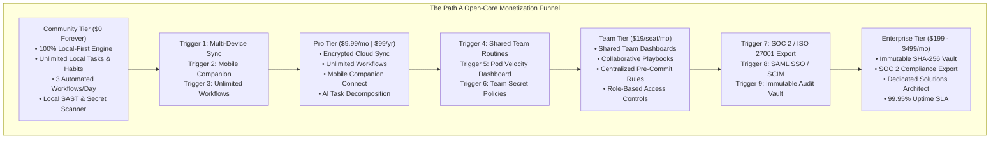
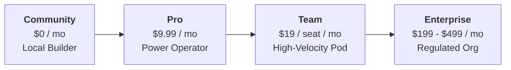
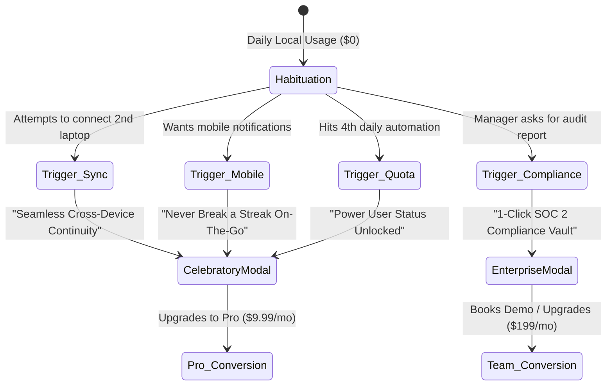
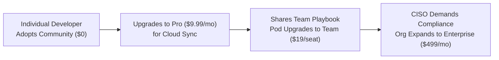

# Open-Core Monetization Playbook & Conversion Funnel Architecture (Path A Execution)
### IT Solutions Global Corporation — Commercial & Growth Division
*Document Version: 1.0.0 | Status: Active Corporate Commercial Directive | Target: `company/growth/PRICING_AND_TIERS_PLAYBOOK.md`*

---

## 1. Executive Commercial Strategy & Open-Core Philosophy

Under **Path A (Open-Core Commercial Model)** authorized by the Founder and CEO, our commercial architecture adheres to our supreme corporate motto:
> **"Serve humanity by solving real problems with uncompromising utility; earn deep trust and habituation before asking for reward."**

We do not monetize by crippling basic productivity or forcing users behind punitive paywalls. Instead, our monetization engine operates on the principle of **natural utility thresholds**:
1. **The Free Community Tier is Complete & Uncompromised**: The local-first desktop engine, Omnibar, SQLite WAL store, and basic security scanning remain 100% free, private, and open-source under the MIT license forever.
2. **Paid Tiers Monetize Value Expansion**: We capture revenue when individual users demand cross-device ubiquity, when agile pods require collaborative workflow coordination, and when enterprises demand compliance guarantees (SOC 2, ISO 27001), SSO, and dedicated SLAs.



---

## 2. The 4 Commercial Tiers



### 2.1 Community Tier ($0 / Free Forever)
- **Target Persona**: Independent builders, open-source contributors, students, and local-first purists.
- **Strategic Purpose**: High-velocity global infiltration, developer goodwill, and uninhibited organic habituation.
- **Value Proposition**: 100% private, zero-bloat personal cockpit running on local hardware with zero cloud dependencies.
- **Core Inclusions**:
  - Full local-first task and daily habit streak tracking.
  - Universal Command Palette (`Ctrl+Space`) and Quick-Capture Omnibar (`Ctrl+Shift+Space`).
  - Up to 3 automated workflow routine executions per day.
  - Complete local static application security testing (SAST) via NexusShield.
  - Local SQLite WAL high-concurrency storage engine.
  - Ambient folder drop ingestion (`data/transcripts/`) with manual API sweep.
  - Community GitHub issue support.

---

### 2.2 Pro Tier ($9.99 / month or $99 / year — Save 17%)
- **Target Persona**: Freelancers, high-output senior software engineers, founders, and executive operators.
- **Strategic Purpose**: Primary consumer/prosumer recurring revenue driver ($99 annual contracts maximizing upfront cash flow).
- **Value Proposition**: Uncapped automation horsepower and frictionless multi-device continuity.
- **Core Inclusions**:
  - **Unlimited** daily automated workflow executions (never hit a daily quota).
  - **End-to-End Encrypted Cloud Sync**: Seamless synchronization across workstations, home desktops, and laptops.
  - **Mobile Companion Connect**: Push notifications, streak preservation alerts, and mobile quick-capture on iOS and Android.
  - **AI-Assisted Task Decomposition**: Convert complex project specs into sequenced execution checklists.
  - **Continuous Ambient Sentry**: Automated real-time file watcher on `data/transcripts/`.
  - **90-Day Telemetry History**: Extended productivity velocity, habit streak archives, and deep focus analytics.
  - **Priority Email Support**: <12-hour resolution window.

---

### 2.3 Team Tier ($19 / seat / month — Billed Annually or Monthly)
- **Target Persona**: Boutique engineering agencies, startups, agile development pods (3 to 25 members).
- **Strategic Purpose**: Land-and-expand B2B team growth; viral organizational expansion driven by individual Pro champions.
- **Value Proposition**: Standardized engineering routines, asynchronous standups, and shared security defense without invasive monitoring.
- **Core Inclusions**:
  - Everything in Pro for all team members.
  - **Shared Team Workspaces & Dashboards**: Standardized 1-click dev boot presets across the organization.
  - **Collaborative Playbooks**: Shared repository of engineering routines, staging probes, and deployment checklists.
  - **Centralized NexusShield Pre-Commit Policies**: Organization-wide secret detection rules and CI/CD quality gate enforcement.
  - **Asynchronous Automated Standups**: Automatically generates daily progress recaps from completed tasks, eliminating 30-minute meetings.
  - **Role-Based Access Controls (RBAC)**: Admin, Lead, Member, and Guest role permissions.
  - **Pooled Team Automation Quota**: Unlimited shared execution bandwidth.
  - **Priority Chat Support**: Dedicated private Discord / Slack channel with <4-hour response SLA.

---

### 2.4 Enterprise Tier ($199 – $499 / month flat + volume seats)
- **Target Persona**: Mid-market enterprises, regulated FinTech/HealthTech organizations, and security-conscious engineering departments.
- **Strategic Purpose**: High-margin ARR contracts with multi-year commitments and zero churn.
- **Pricing Structure**:
  - **Growth Enterprise ($199/mo)**: Up to 20 seats, audit logs, and compliance reporting.
  - **Scale Enterprise ($499/mo)**: Up to 60 seats, custom on-prem runners, SAML SSO, and dedicated SLA.
  - **Custom Enterprise (Negotiated)**: Unlimited seats, custom contract terms, and dedicated TAM.
- **Value Proposition**: Institutional governance, zero-trust cryptographic audit trails, and automated compliance certification.
- **Core Inclusions**:
  - Everything in Team Tier.
  - **One-Click SOC 2 & ISO 27001 Audit Certificate Export**: Generates cryptographically verifiable evidence of pre-commit secret scans and dependency hygiene.
  - **Immutable SHA-256 Audit Vault**: Tamper-proof, cryptographically signed logs for compliance inspectors and external auditors.
  - **SAML 2.0 Single Sign-On (SSO) & SCIM Directory Sync**: Native integration with Okta, Azure AD / Entra ID, Google Workspace, and Ping Identity.
  - **On-Premises Dedicated Runners & Private Relay**: Keep all sync data behind your corporate VPC or on air-gapped internal servers.
  - **Custom Shannon Entropy & Secret Heuristics**: Tailor internal credential scanning regex patterns to company-specific proprietary tokens.
  - **99.95% Uptime SLA Guarantee & Dedicated Solutions Architect**: Direct escalation access with 1-hour critical response SLA.

---

## 3. Free-to-Paid Conversion Psychology: Natural Utility Triggers

Rather than annoying users with artificial paywalls, countdown timers, or crippled basic features, our conversion psychology relies on **high-intent friction moments** where the user actively demands extended power.



---

### 3.1 Trigger 1: Attempting Multi-Device Sync
- **The Moment**: The user installs CorePulse on their personal laptop or secondary work machine and attempts to import or link their active workspace.
- **The Psychological State**: Relief and admiration for the tool; anxiety about having to re-configure workflows manually.
- **In-App Non-Intrusive Modal Copy**:
  > **Header**: 🔄 Bring Your Cockpit Everywhere  
  > **Subhead**: Seamless End-to-End Encrypted Cloud Sync  
  > **Body**: Your habits, tasks, and custom playbooks are safely stored in your local SQLite database on this machine. Want your active streaks, playbooks, and Omnibar preferences to follow you between your workstation and laptop automatically?  
  > **Value Reassurance**: Zero plaintext data ever touches our servers. All sync payloads are client-side encrypted before transit.  
  > **CTA Button**: `[ Unlock Cloud Sync with Pro — 14-Day Free Pass ]`  
  > **Secondary Action**: `[ Continue with Independent Local Mode on this Machine ]`

---

### 3.2 Trigger 2: Connecting a Phone Companion
- **The Moment**: The user clicks *"Connect Mobile Companion"* or scans the pairing QR code to track habits on their iPhone or Android device.
- **The Psychological State**: High personal investment in maintaining their active 14-day habit streak while away from their desk.
- **In-App Non-Intrusive Modal Copy**:
  > **Header**: 📱 Protect Your Momentum Away from the Desk  
  > **Subhead**: CorePulse Mobile Companion Link  
  > **Body**: Never break a habit streak while traveling. The Pro Mobile Link pairs your phone to your local engine, providing morning pulse notifications, quick thought capture, and streak protection widgets on your lock screen.  
  > **Social Proof**: *"94% of users who pair mobile maintain a 30+ day streak."*  
  > **CTA Button**: `[ Activate Mobile Link — Upgrade to Pro ($9.99/mo) ]`  
  > **Secondary Action**: `[ Keep Desktop-Only Tracking ]`

---

### 3.3 Trigger 3: Exporting SOC 2 & Security Compliance Certificates
- **The Moment**: An engineering manager, tech lead, or compliance officer runs NexusShield and clicks *"Export Compliance Certificate"* or *"Generate Audit Evidence"*.
- **The Psychological State**: Urgent corporate compliance pressure; fear of failing an upcoming SOC 2 Type II or ISO 27001 audit.
- **In-App Non-Intrusive Modal Copy**:
  > **Header**: 🛡️ Instant Audit-Ready Compliance Evidence  
  > **Subhead**: NexusShield Enterprise Audit Vault  
  > **Body**: You have a pristine security score of **96/100 (Grade A)** across 48 repositories. In Enterprise Elite, you can instantly export cryptographically verifiable, timestamped PDF & JSON audit packages formatted specifically for SOC 2 Type II, ISO/IEC 27001, and OWASP Top 10 compliance auditors.  
  > **Enterprise Proof**: Eliminates weeks of manual screenshot gathering and developer questionnaires.  
  > **CTA Button**: `[ Unlock Compliance Vault & Enterprise Trial ]`  
  > **Secondary Action**: `[ Export Basic Terminal Summary ]`

---

### 3.4 Trigger 4: Hitting the 4th Daily Automated Workflow Run
- **The Moment**: The user executes their 4th automated workflow of the day on the Free Community Tier.
- **The Psychological State**: Dopamine high from the 3 successful automations already executed; recognition of massive time saved.
- **In-App Non-Intrusive Modal Copy**:
  > **Header**: ⚡ Power User Velocity Unlocked!  
  > **Subhead**: You’ve maximized your 3 daily community automations today.  
  > **Body**: Today, CorePulse executed 3 routines and saved you an estimated **42 minutes of cognitive drag**. If your work requires continuous automated horsepower, CorePulse Pro gives you **infinite daily executions**, continuous background file drop sentries, and AI task decomposition.  
  > **Price Anchor**: Less than $0.27/day ($9.99/month or $99/year) — less than half a cup of coffee for 15+ hours reclaimed every single month.  
  > **CTA Button**: `[ Unlock Unlimited Workflows — Start 14-Day Pro Pass ]`  
  > **Secondary Action**: `[ Continue with Community Tier (Quota resets at midnight) ]`

---

## 4. Comprehensive 25+ Feature Pricing Matrix

| Feature & Capability Matrix | Community ($0 / Forever) | Pro ($9.99 / mo) | Team ($19 / seat / mo) | Enterprise ($199 - $499 / mo) |
| :--- | :---: | :---: | :---: | :---: |
| **Core Productivity & Task Engine** | | | | |
| Active Tasks & Deliverables Backlog | Unlimited | Unlimited | Unlimited | Unlimited |
| Daily Habit Streaks & Flame HUD | Unlimited | Unlimited | Unlimited | Unlimited |
| Universal Command Palette (`Ctrl+Space`) | Included | Included | Included | Included |
| Desktop Quick-Capture Omnibar (`Ctrl+Shift+Space`)| Included | Included | Included | Included |
| Shorthand NLP Syntax (`!p1`, `#tag`, `~30m`) | Included | Included | Included | Included |
| **Automations & Workflows** | | | | |
| Automated Workflow Executions | 3 runs / day | **Unlimited** | **Unlimited** | **Unlimited** |
| Built-in Protocols (*Morning Focus, Inbox Zero*)| Included | Included | Included | Included |
| Custom Script Playbook Builder | Up to 2 | **Unlimited** | **Unlimited** | **Unlimited** |
| AI-Assisted Task Decomposition | 3 / month | **Unlimited** | **Unlimited** | **Unlimited** |
| **Storage & Device Continuity** | | | | |
| Local SQLite WAL Concurrency Engine | Included | Included | Included | Included |
| Multi-Device Encrypted Cloud Sync | — | **Included** | **Included** | **Included** |
| Mobile Companion App (iOS & Android) | — | **Included** | **Included** | **Included** |
| Offline Local-First Operation | 100% | 100% | 100% | 100% |
| **Security & Code Defense (NexusShield)** | | | | |
| Shannon Entropy Secret Scanner ($H \ge 4.5$) | Included | Included | Included | Included |
| Offline Dependency CVE Manifest Scanner | Included | Included | Included | Included |
| Safe Preview Redaction (`sk-proj-ab...7890`)| Included | Included | Included | Included |
| Automated Git Pre-Commit Quality Gate | Included | Included | Included | Included |
| Centralized Org-Wide Secret Policies | — | — | **Included** | **Included** |
| Custom Shannon Entropy & Regex Rules | — | — | — | **Included** |
| **Speech & Meeting Triage (EchoStream)** | | | | |
| Ambient Drop Ingestion (`data/transcripts/`)| Manual API | **Auto Sentry**| **Auto Sentry**| **Multi-Folder Sentry** |
| VoiceGuard Credential DLP Sanitization | Included | Included | Included | Included |
| Semantic Action Item Extraction | Included | Included | Included | Included |
| **Team Collaboration & Governance** | | | | |
| Shared Team Workspaces & Dashboards | — | — | **Included** | **Included** |
| Asynchronous Automated Standups | — | — | **Included** | **Included** |
| Role-Based Access Controls (RBAC) | — | — | **Included** | **Included** |
| One-Click SOC 2 / ISO 27001 Evidence Export| — | — | — | **Included** |
| Immutable SHA-256 Audit Log Vault | — | — | — | **Included** |
| SAML 2.0 Single Sign-On (SSO) & SCIM | — | — | — | **Included** |
| On-Premises Dedicated Runner Option | — | — | — | **Included** |
| **Support & Service Level Agreement** | | | | |
| Support Tier | Community GitHub| Priority Email (<12h)| Private Slack (<4h)| Dedicated TAM (<1h) |
| Uptime SLA Commitment | Best Effort | 99.9% | 99.9% | **99.95% Guaranteed** |

---

## 5. Enterprise Outbound & Self-Serve Checkout Copy

### 5.1 Self-Serve Checkout Copy (Stripe / Paddle Hosted Pages)

#### Checkout Header & Plan Confirmation
```
╔════════════════════════════════════════════════════════════════════╗
║                   COREPULSE PRO — ANNUAL PASS                      ║
║                     $99 / year ($8.25 / month)                     ║
╠════════════════════════════════════════════════════════════════════╣
║  ✓ Save 17% compared to monthly billing                            ║
║  ✓ Instant activation of Unlimited Workflows & Cloud Sync         ║
║  ✓ 14-Day Risk-Free Money-Back Guarantee                           ║
║  ✓ Zero-Questions-Asked 1-Click Cancellation                       ║
╚════════════════════════════════════════════════════════════════════╝
```

#### Trust Badges & Microcopy (Directly below Credit Card / Apple Pay input):
- 🔒 **Bank-Grade 256-Bit SSL Encryption**: Powered by Stripe. We never store or process raw payment cards.
- 🛡️ **Zero Cloud Telemetry Pledge**: Your subscription payment enables encrypted cloud relay, but your task data, code, and transcripts remain client-side encrypted and private to your hardware.
- ⚡ **Instant License Generation**: Your license key (`CP-PRO-XXXXX`) unlocks your cockpit within **3 seconds** of payment confirmation.

#### Money-Back Guarantee Callout Card:
> **The 14-Day "Cognitive Freedom" Guarantee**:  
> If CorePulse Pro doesn’t reclaim at least **10 hours of cognitive drudgery** in your first 14 days, email `guarantee@corepulse.dev` or click *"Request Refund"* inside settings. We will refund 100% of your payment immediately—no phone calls, no exit surveys, no friction.

---

### 5.2 Enterprise Outbound Pitch Copy (Target: VP of Engineering / CTO / CISO)

#### Subject Line Options:
- *Option 1*: Stopping leaked secrets before commit + eliminating context switching for {{company_name}}'s engineers
- *Option 2*: How engineering pods at {{company_name}} can reclaim 2+ hours daily (with zero cloud telemetry)
- *Option 3*: SOC 2 pre-commit compliance evidence without heavy agent bloat

#### Email Body:
```text
Hi {{first_name}},

Most engineering leaders I speak with share the same two compounding headaches:

1. Context Switching Fatigue: Senior engineers waste 35–45 minutes every morning manually setting up environments, triaging scattered tickets, and writing meeting recaps across bloated tools.
2. The Secret Leak Nightmare: Centralized scanners catch leaked AWS, OpenAI, or Stripe tokens in CI/CD *after* they are already in git history—triggering frantic credential rotations and security fire drills.

We built the **IT Solutions Corporate Triad** (CorePulse, NexusShield, EchoStream) to solve this at the workstation kernel level:

- ⌨️ Zero-Lag Productivity: Developers trigger entire workspaces, capture tasks in 800ms via our desktop Omnibar, and automate meeting notes with zero-click folder ingestion.
- 🛡️ Shift-Left Secret Interception: Using mathematical Shannon Entropy ($H \ge 4.5$), NexusShield catches exposed credentials in <500ms *before* code ever commits.
- 🔒 100% Local-First & Zero Telemetry: All parsing runs on-device in pure Python standard library. Zero code or voice data ever leaves the engineer's machine.
- 📋 1-Click SOC 2 Evidence: Instantly generate timestamped audit certificates proving 100% clean pre-commit security gates across all repositories.

Teams deploying our Enterprise Tier report saving an average of **14 hours per engineer each month** while eliminating credential leak incidents entirely.

Are you open to a brief 15-minute technical demo this Thursday at 2 PM to see the local pre-commit gate and team cockpit in action?

Best regards,

Elena Vance
Chief Commercial & Growth Officer
IT Solutions Global Corporation
elena.vance@itsolutions.dev | https://itsolutions.dev
```

---

### 5.3 Enterprise 1-Page Proposal & Executive Term Sheet Template

```markdown
# ENTERPRISE EXECUTIVE PROPOSAL & LICENSE AGREEMENT
**Customer**: {{client_company_name}}  
**Provider**: IT Solutions Global Corporation  
**Effective Date**: {{effective_date}}  
**Agreement Version**: Enterprise Elite v1.0

### 1. Scope of Deployment
IT Solutions Global Corporation grants {{client_company_name}} a non-exclusive, enterprise-wide license to deploy the Corporate Triad suite (`CorePulse`, `NexusShield`, `EchoStream`) across {{seat_count}} engineering seats.

### 2. Commercial Terms
- **Subscription Plan**: Enterprise Elite (Scale Tier)
- **Billing Cadence**: Annual Pre-Paid
- **Annual License Fee**: ${{annual_total_price}} (Equivalent to ${{monthly_equivalent}}/month)
- **Included Services**:
  - Dedicated Solutions Architect & Custom Implementation Engineering.
  - Custom Shannon Entropy heuristics and proprietary company token regex integration.
  - SAML 2.0 / SCIM Single Sign-On integration (Okta, Azure AD, Google).
  - 1-Click SOC 2 Type II and ISO/IEC 27001 verifiable evidence export vault.
  - 99.95% Infrastructure SLA with 1-hour critical response window.

### 3. Data Sovereignty & Zero-Surveillance Warranty
Provider warrants that all local-first software executes 100% on Customer-controlled hardware. Provider will never collect, inspect, store, or transmit Customer source code, keystrokes, audio buffers, or unencrypted database records to any external infrastructure.

### 4. Acceptance & Sign-off
**For Customer**:  
Signature: __________________________  
Name: {{customer_signatory_name}}  
Title: {{customer_signatory_title}}  
Date: _______________

**For IT Solutions Global Corporation**:  
Signature: __________________________  
Name: Autonomous Executive Officer  
Title: Chief Commercial & Growth Officer  
Date: _______________
```

---

## 6. Retention & Revenue Expansion Playbook (Net Revenue Retention > 130%)



### 6.1 Expansion Loops:
1. **The Colleague Recipe Link**: When a Pro user shares an automated playbook or custom meeting workflow via a local link, the receiving teammate gets a 14-day Team trial.
2. **Corporate Domain Matching**: When 3 or more users register Pro accounts under the same `@company.com` corporate email domain, the team lead receives an automated prompt:
   > *"3 engineers at {{company_domain}} are using CorePulse. Consolidate into a Team Workspace to share routines, centralize pre-commit secret rules, and save 20% on unified billing."*
3. **The Pre-Commit Infiltration Hook**: When NexusShield is committed to a public or private company repository via `.git/hooks/pre-commit`, other developers who clone the repo are automatically prompted to initialize their local scanner in 1 click.

---
*Authorized by: Chief Commercial & Growth Officer*  
*IT Solutions Global Corporation*
