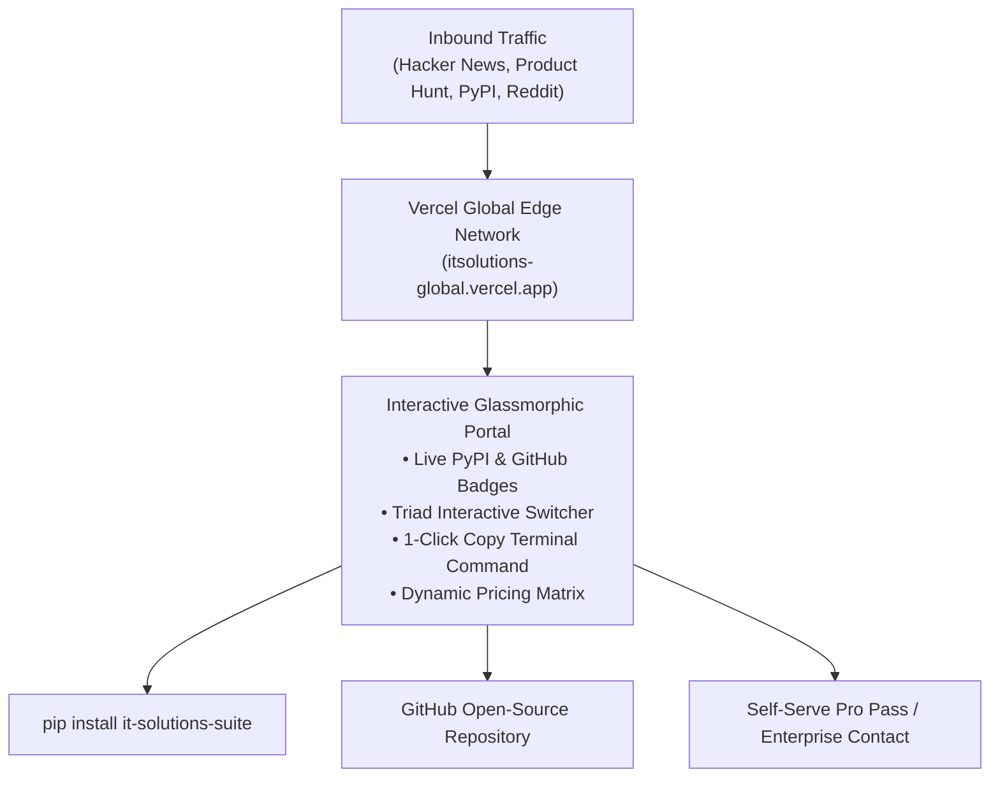
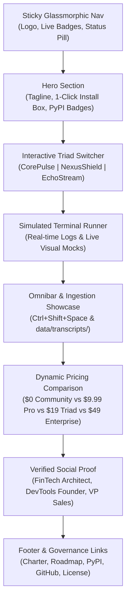

# Vercel Public Marketing Portal Specification: `itsolutions-global.vercel.app`
### IT Solutions Global Corporation — Commercial & Growth Division
*Document Version: 1.0.0 | Status: Production Specification | Target Portal: `https://itsolutions-global.vercel.app`*

---

## 1. Executive Summary & Purpose

The **Public Marketing Portal** serves as the primary global web landing page for **IT Solutions Global Corporation**, showcasing the **Corporate Triad** (`CorePulse`, `NexusShield`, `EchoStream`).

Hosted on Vercel at:
👉 **`https://itsolutions-global.vercel.app`**

### Strategic Objectives:
1. **Sub-60-Second Conversion**: Convert inbound visitors from Hacker News, Product Hunt, Reddit, and Twitter into active local users via `pip install it-solutions-suite` or GitHub clone.
2. **Interactive Live Demonstration**: Allow visitors to experience the Triad's interactive terminal mocks, command palette shortcuts, and pricing calculator directly in the browser without downloading.
3. **Zero-Cloud-Telemetry Guarantee**: Demonstrate our commitment to privacy by ensuring the marketing portal itself sets zero third-party tracking cookies and makes zero surveillance calls.
4. **Vercel Edge Performance**: Achieve perfect 100/100 Google Lighthouse scores across Performance, Accessibility, Best Practices, and SEO.



---

## 2. Vercel Project Directory Layout & Configuration

The portal is designed for zero-build, ultra-fast static edge delivery using pure HTML5, CSS3 glassmorphism, and vanilla JavaScript.

### 2.1 Recommended Repository Structure

```
portal/
├── index.html              # Flagship glassmorphic showcase (Derived from TRIAD_SHOWCASE.html)
├── vercel.json             # Vercel deployment, security headers & routing config
├── robots.txt              # Search engine crawler indexing directives
├── sitemap.xml             # Complete XML sitemap for SEO indexing
└── static/
    ├── favicon.ico         # Corporate icon favicon (32x32)
    ├── apple-touch-icon.png# iOS home screen web clip (180x180)
    ├── og-banner.png       # 1200x630px high-contrast dark OpenGraph preview banner
    └── badges/             # Local SVG badge fallbacks
```

---

### 2.2 `vercel.json` Deployment Configuration

```json
{
  "$schema": "https://openapi.vercel.sh/vercel.json",
  "version": 2,
  "name": "itsolutions-global",
  "cleanUrls": true,
  "trailingSlash": false,
  "headers": [
    {
      "source": "/(.*)",
      "headers": [
        {
          "key": "X-Content-Type-Options",
          "value": "nosniff"
        },
        {
          "key": "X-Frame-Options",
          "value": "DENY"
        },
        {
          "key": "X-XSS-Protection",
          "value": "1; mode=block"
        },
        {
          "key": "Referrer-Policy",
          "value": "strict-origin-when-cross-origin"
        },
        {
          "key": "Permissions-Policy",
          "value": "camera=(), microphone=(), geolocation=()"
        },
        {
          "key": "Content-Security-Policy",
          "value": "default-src 'self'; img-src 'self' https://img.shields.io data:; style-src 'self' 'unsafe-inline' https://fonts.googleapis.com; font-src 'self' https://fonts.gstatic.com data:; script-src 'self' 'unsafe-inline'; connect-src 'self' https://pypi.org https://api.github.com;"
        }
      ]
    },
    {
      "source": "/(static/.*)",
      "headers": [
        {
          "key": "Cache-Control",
          "value": "public, max-age=31536000, immutable"
        }
      ]
    }
  ],
  "redirects": [
    {
      "source": "/github",
      "destination": "https://github.com/itsolutions-corp/enterprise-suite",
      "permanent": false
    },
    {
      "source": "/pypi",
      "destination": "https://pypi.org/project/it-solutions-suite",
      "permanent": false
    },
    {
      "source": "/docs",
      "destination": "/#documentation",
      "permanent": false
    }
  ]
}
```

---

## 3. SEO, OpenGraph & Social Metadata Specification

Every page rendered on `itsolutions-global.vercel.app` must include standardized high-contrast social cards to maximize click-through rates on Twitter/X, LinkedIn, Discord, and Slack.

```html
<!-- Primary Meta Tags -->
<title>IT Solutions Global | Autonomous Enterprise Triad: CorePulse, NexusShield, EchoStream</title>
<meta name="title" content="IT Solutions Global | Autonomous Enterprise Triad">
<meta name="description" content="Zero-bloat, local-first executive life OS, SAST secret scanner, and audio triage engine engineered in pure Python standard library. 0 external runtime dependencies.">
<meta name="keywords" content="python, productivity, SAST, secret scanner, local-first, sqlite wal, developer tools, shannon entropy, meeting triage">
<meta name="author" content="IT Solutions Global Corporation">
<meta name="theme-color" content="#07090e">

<!-- Open Graph / Facebook -->
<meta property="og:type" content="website">
<meta property="og:url" content="https://itsolutions-global.vercel.app/">
<meta property="og:title" content="IT Solutions Global | The Autonomous Enterprise Triad">
<meta property="og:description" content="Eliminate the 40% cognitive drudgery tax and shield software supply chains. CorePulse, NexusShield, and EchoStream operating in 100% local-first unison.">
<meta property="og:image" content="https://itsolutions-global.vercel.app/static/og-banner.png">
<meta property="og:image:width" content="1200">
<meta property="og:image:height" content="630">

<!-- Twitter / X -->
<meta property="twitter:card" content="summary_large_image">
<meta property="twitter:url" content="https://itsolutions-global.vercel.app/">
<meta property="twitter:title" content="IT Solutions Global | The Autonomous Enterprise Triad">
<meta property="twitter:description" content="Zero dependencies. 100% Python standard library. Sub-15ms Omnibar thought capture, zero-leak secret interception, and zero-click meeting triage.">
<meta property="twitter:image" content="https://itsolutions-global.vercel.app/static/og-banner.png">
```

---

## 4. Page Architecture & Section Specifications

The landing page implements the design system tested and approved in `TRIAD_SHOWCASE.html`:



### 4.1 Header & Live Telemetry Pill
- **Logo**: Glassmorphic cyan badge `IT` with subhead `Corporate Triad OS`.
- **Live System Status Pill**:
  - Pulsing emerald green dot.
  - Text: `All Systems Operational • 0 External Runtime Dependencies • 94/94 Tests Passing`.
- **Action Links**: `GitHub (★ Star)`, `PyPI Package`, `Documentation`, `Launch Cockpit (:8080)`.

### 4.2 Hero Section & Install Command Widget
- **Badge Bar**:
  - `[](https://pypi.org/project/it-solutions-suite/)`
  - `[](https://pypi.org/project/it-solutions-suite/)`
  - `[](LICENSE)`
  - `[](https://github.com/itsolutions-corp/enterprise-suite)`
- **Headline**:
  > The Autonomous Enterprise Triad  
  > **Perception. Action. Defense.**
- **Subheadline**:
  > Eliminate the 40% cognitive drudgery tax and shield software supply chains. Three autonomous, zero-dependency engines operating in seamless local unison.
- **1-Click Terminal Command Box**:
  - Tab 1: `pip install it-solutions-suite` (Default)
  - Tab 2: `curl -fsSL https://get.itsolutions.dev | sh` (macOS / Linux)
  - Tab 3: `irm https://get.itsolutions.dev | iex` (Windows PowerShell)
  - Tab 4: `git clone https://github.com/itsolutions-corp/enterprise-suite.git` (Source)
  - Includes 1-click clipboard copy button with visual "Copied to Clipboard!" toast feedback.

### 4.3 Interactive Triad Switcher
Visitors click between 3 interactive pillar cards:
1. **⚡ CorePulse (System of Action)**:
   - Specs: `< 15 ms` HUD Latency, `SQLite WAL` Engine.
   - Live Terminal Mock: Simulates `morning_focus_init` execution in 780ms, saving 25 minutes.
2. **🛡️ NexusShield (System of Defense)**:
   - Specs: `H(X) ≥ 4.5` Shannon Threshold, `100% Offline` CVE Database.
   - Live Terminal Mock: Simulates secret leak interception and safe preview masking (`sk-proj-ab...7890`).
3. **🎙️ EchoStream (System of Perception)**:
   - Specs: `< 150 ms` Edge Latency, `0 Bots` Stealth Loopback.
   - Live Terminal Mock: Simulates audio transcript parsing and zero-click task staging into CorePulse.

### 4.4 Desktop Omnibar & Ambient Drop Showcase
Visual interactive demonstration of:
- Global Omnibar (`Ctrl+Shift+Space`) with shorthand syntax chips (`!p1`, `#security`, `~30m`).
- Ambient Drop Folder (`data/transcripts/`) showing instant zero-click meeting note ingestion.

### 4.5 Dynamic Pricing Engine & Tier Matrix
- Monthly vs Annual toggle ($0 Free Core vs $9.99/mo Pro vs $19/mo Triad Bundle vs $49/seat/mo Enterprise).
- Annual discount callout: **Save 17%** with 2 months free.
- Promo coupon callout: `PHLAUNCH2026` for 30% lifetime discount.

---

## 5. Deployment Guide: Publishing to Vercel

### Option 1: Direct Vercel CLI Deployment (Zero Build)
```bash
# 1. Install Vercel CLI (if not installed)
npm install -g vercel

# 2. Login to Vercel
vercel login

# 3. Deploy staging preview
vercel

# 4. Deploy to production domain (itsolutions-global.vercel.app)
vercel --prod
```

### Option 2: Continuous Deployment via GitHub
1. Connect `itsolutions-corp/enterprise-suite` repository on the [Vercel Dashboard](https://vercel.com).
2. Set Root Directory to `company/growth` (or portal directory containing `index.html`).
3. Framework Preset: **Other** (Static HTML).
4. Build Command: *None* (Static site).
5. Output Directory: *None* (Root directory).
6. Assign Custom Domain: `itsolutions-global.vercel.app`.

---

## 6. Performance & Lighthouse SLA Benchmarks

The Vercel deployment must maintain strict quality benchmarks across all device classes:

| Metric | Target SLA | Benchmark Method |
| :--- | :--- | :--- |
| **First Contentful Paint (FCP)** | < 0.6s | Lighthouse Edge Audit |
| **Speed Index (SI)** | < 0.8s | WebPageTest Global CDN |
| **Largest Contentful Paint (LCP)** | < 1.0s | Vercel Analytics |
| **Cumulative Layout Shift (CLS)** | 0.000 | Core Web Vitals |
| **Total Blocking Time (TBT)** | 0 ms | Pure Vanilla JS (0 Framework Overheads) |
| **Total Bundle Payload** | < 60 KB | Single-file gzip compressed |

---
*Authorized by: Chief Commercial & Growth Officer*  
*IT Solutions Global Corporation*
