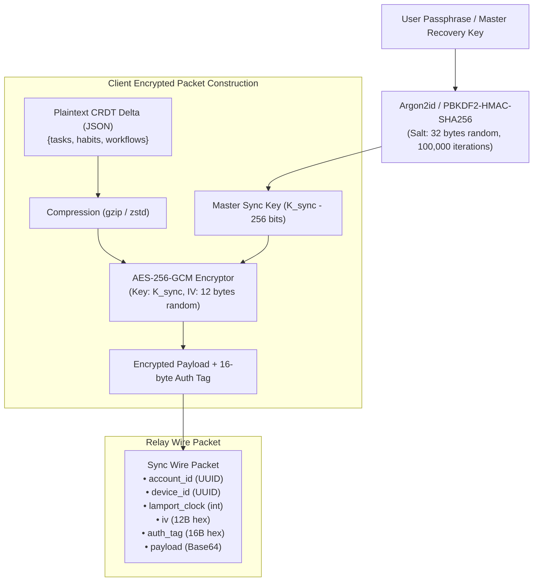
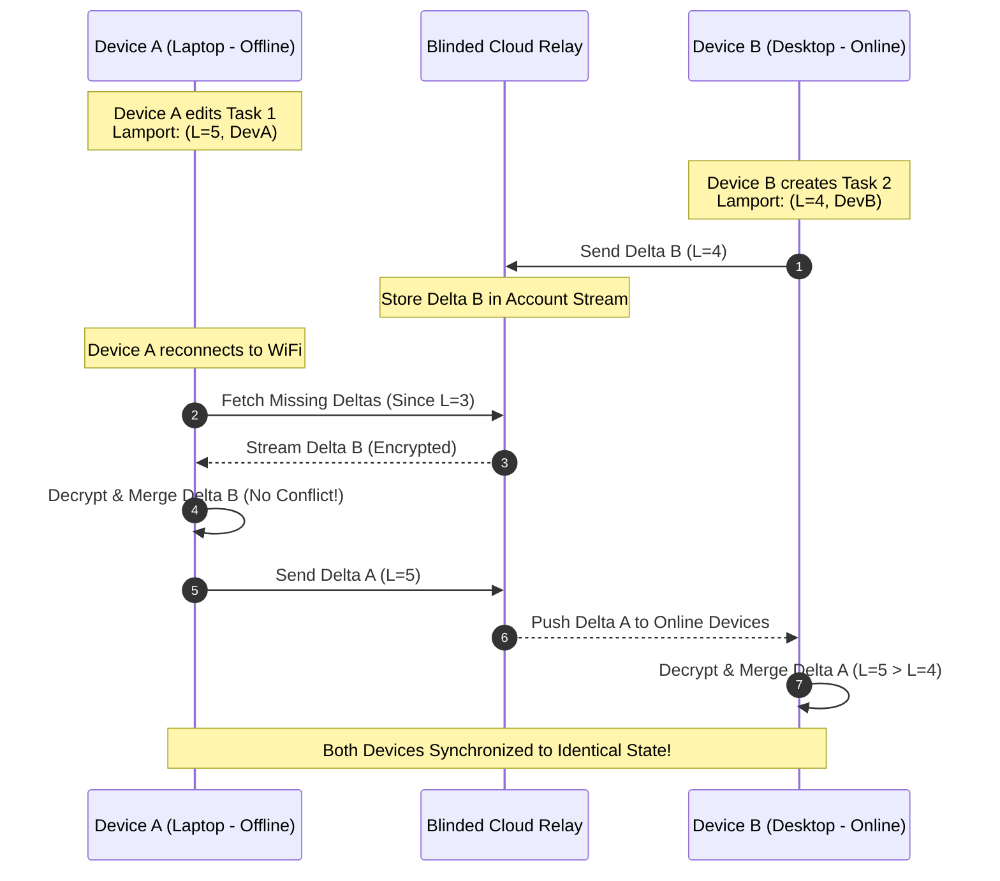
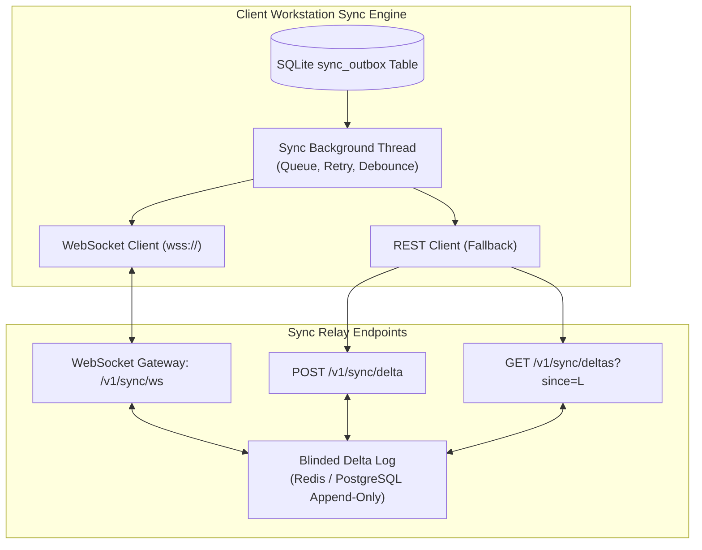
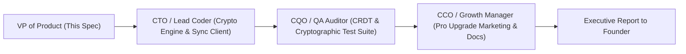

# Product Requirement Document (PRD)
## Product: Cloud Sync Pro — End-to-End Encrypted Sync Protocol v1.0
**Document Version:** 1.0.0  
**Status:** Approved for Engineering & Cryptographic Implementation (Path A Authorized by Founder)  
**Author:** VP of Product & Production  
**Target Delivery Window:** Sprint 11 (Q1 2027)  
**Distribution:** Founder & Chairman, CEO, CTO (Lead Coder), CQO (QA Auditor), CCO (Growth Manager), Head of Research  

---

## 1. Executive Summary & Cryptographic Vision

### 1.1 Vision: Zero-Knowledge Multi-Device Sovereignty
**Cloud Sync Pro v1.0** is the premium synchronization engine that powers the **Pro ($9.99/mo)**, **Team ($19/seat/mo)**, and **Enterprise** tiers of the IT Solutions product suite (**CorePulse**, **NexusShield**, and **EchoStream**).

While legacy productivity tools (Notion, Todoist, Monday) process and store unencrypted user data on central cloud servers—exposing sensitive tasks, meeting transcripts, and project notes to cloud breaches and sub-poenas—Cloud Sync Pro operates on a strict **Zero-Knowledge End-to-End Encrypted (E2EE) Architecture**.

User data is encrypted client-side using **AES-256-GCM** before touching a network socket. The cloud sync relay acts as a blinded, zero-knowledge courier: it transports encrypted binary blobs and version vectors without ever possessing the decryption keys, passphrase, or plain text. Conflict resolution is achieved deterministically across distributed offline nodes via **Lamport Logical Clocks** and **Conflict-free Replicated Data Types (CRDTs)**.

```mermaid
flowchart LR
    subgraph Client Workstation A (Laptop)
        DB_A[(Local SQLite DB)] --> CRDT_A["CRDT Delta Extractor<br/>(Lamport Clock: L=14)"]
        CRDT_A --> ENC_A["Client AES-256-GCM<br/>(User Secret Key K_sync)"]
    end

    subgraph Blinded Cloud Relay Server (Zero-Knowledge)
        RELAY["<b>Untrusted Sync Relay</b><br/>• Inspects: Account ID & Version Vector<br/>• Cannot Read: Encrypted Ciphertext<br/>• Distributes: WebSocket / REST Deltas"]
    end

    subgraph Client Workstation B (Desktop)
        ENC_B["Client AES-256-GCM<br/>(User Secret Key K_sync)"] --> CRDT_B["CRDT Merge Engine<br/>(Deterministic LWW Resolver)"]
        CRDT_B --> DB_B[(Local SQLite DB)]
    end

    ENC_A -->|"Encrypted Blob + Vector"| RELAY
    RELAY -->|"Encrypted Blob + Vector"| ENC_B
```

### 1.2 Core Architectural Objectives
1. **Zero-Knowledge Guarantee**: The cloud relay operator, infrastructure provider, or an intercepted network node cannot decrypt user tasks, habit logs, voice transcripts, or workspace routines.
2. **Deterministic Conflict-Free Resolution**: Two or more devices operating offline for hours or days merge seamlessly upon reconnection without losing data, using Last-Write-Wins Element Sets (LWW-Element-Set) and Lamport timestamps.
3. **Sub-100ms Delta Propagation**: WebSocket streaming delivers change deltas between active online devices in under 100 milliseconds.
4. **Lightweight Relay Bandwidth**: Relays transport compact binary/JSON compressed diffs, ensuring cloud bandwidth costs remain under $0.05 per user/month.
5. **Zero-Dependency Core Compatibility**: Client cryptographic primitives utilize standard library algorithms or universal standard bindings (`cryptography` or native WebCrypto in Cockpit UI), ensuring seamless cross-platform execution.

---

## 2. Cryptographic Security Architecture & Key Derivation



### 2.1 Key Derivation Specifications
- **Key Derivation Function (KDF)**:
  - Primary: `Argon2id` (Memory: 64MB, Iterations: 3, Parallelism: 4).
  - Fallback: `PBKDF2-HMAC-SHA256` with 600,000 iterations and 32-byte cryptographically secure random salt (`os.urandom(32)`).
- **Master Encryption Key ($K_{\text{sync}}$)**: 256-bit symmetric key retained strictly in local volatile RAM or encrypted OS credential storage (Windows Credential Manager, macOS Keychain, Linux Secret Service).
- **Cipher**: `AES-256-GCM` (Galois/Counter Mode) providing authenticated encryption with associated data (AEAD).
  - Initialization Vector (IV / Nonce): 12-byte cryptographically random value regenerated for **every single delta packet**.
  - Authentication Tag: 16-byte tag verifying message integrity and detecting any tampering by the relay or network transit.

### 2.2 Device Pairing & Secret Handoff Protocol
When a user adds a secondary device (e.g., pairing a mobile phone or second laptop):
1. **Primary Device** generates a short-lived (180-second) ephemeral pairing session using Elliptic Curve Diffie-Hellman (ECDH over Curve25519).
2. **Display**: Displays a high-density QR code or 12-word BIP-39 mnemonic phrase.
3. **Secondary Device**: Scans QR code or inputs mnemonic. The master key $K_{\text{sync}}$ is exchanged over the encrypted ECDH tunnel.
4. **Zero Cloud Secret Exposure**: The master passphrase never transits the cloud unencrypted.

---

## 3. Conflict-free Replicated Data Types (CRDT) & Lamport Clocks

### 3.1 Distributed State Synchronization Challenge
When a developer updates a task on their laptop while offline on a flight, and simultaneously ticks off habits on their desktop at home, both devices maintain local SQLite databases. A naive database overwrite would destroy data.

Cloud Sync Pro utilizes a **State-Based Delta CRDT with Lamport Clocks**:



### 3.2 The Lamport Logical Clock Specification
Every client node maintains a local integer counter $L$ initialized from database metadata:
1. **Local Mutation**: Upon any user action (create/update/delete task, habit check-in), the node increments its clock:
   $$L_{\text{local}} \leftarrow L_{\text{local}} + 1$$
2. **Message Generation**: The delta is tagged with a deterministic Lamport Tuple:
   $$\text{Timestamp} = (L_{\text{local}}, \text{ClientUUID}, T_{\text{wallclock}})$$
3. **Message Reception**: Upon receiving a remote delta with Lamport value $L_{\text{remote}}$, the node updates:
   $$L_{\text{local}} \leftarrow \max(L_{\text{local}}, L_{\text{remote}}) + 1$$

### 3.3 Conflict Resolution Rules (LWW-Element-Set)
- **Field-Level Granularity**: Conflicts are resolved at the individual field level (`title`, `completed`, `priority`, `due_date`) rather than discarding whole records.
- **Deterministic Winner**:
  - Highest $L$ wins.
  - If $L_{\text{local}} == L_{\text{remote}}$, tie-break deterministically using lexical comparison of `ClientUUID`.
- **Tombstone Deletions**: Deletions write a tombstone record `{id: "task_123", deleted: true, lamport: L}` ensuring deletions propagate across all nodes before garbage collection.

---

## 4. Cloud Relay Transport Layer Specifications

### 4.1 Relay Protocol Architecture
The cloud sync relay is a high-throughput, asynchronous transport daemon deployable on edge infrastructure (e.g., Cloudflare Workers, Fly.io, or self-hosted Docker):



### 4.2 Transport APIs

#### 4.2.1 Real-Time WebSocket Channel: `wss://sync.itsolutions.global/v1/sync/ws`
- **Handshake Headers**:
  - `Authorization: Bearer <Ed25519_JWT_License_Token>`
  - `X-Device-ID: <device_uuid>`
  - `X-Last-Lamport: <integer>`
- **Frame Types**:
  - `SYNC_DELTA_PUSH`: Transmits encrypted client mutations.
  - `SYNC_DELTA_BROADCAST`: Broadcasts incoming changes to all other connected devices belonging to the same `account_id`.
  - `HEARTBEAT`: 30-second ping/pong to maintain persistent keep-alive.

#### 4.2.2 REST Fallback Endpoints (For Restricted Firewalls)
- **`POST /v1/sync/delta`**: Pushes a batch of encrypted delta frames.
- **`GET /v1/sync/deltas?since=<lamport_clock>`**: Retrieves missed historical deltas.

---

## 5. Local Database Schema Additions for Sync

To support offline-first queuing and Lamport delta tracking without breaking backwards compatibility, two dedicated tables are appended to `corepulse.sqlite3`:

```sql
-- 1. Sync Outbox: Queues uncommitted local changes for cloud relay transmission
CREATE TABLE IF NOT EXISTS sync_outbox (
    id INTEGER PRIMARY KEY AUTOINCREMENT,
    entity_type TEXT NOT NULL,       -- 'task', 'habit', 'routine', 'config'
    entity_id TEXT NOT NULL,
    action TEXT NOT NULL,            -- 'insert', 'update', 'delete'
    lamport_clock INTEGER NOT NULL,
    payload_encrypted TEXT NOT NULL, -- AES-256-GCM Base64 blob
    iv TEXT NOT NULL,
    auth_tag TEXT NOT NULL,
    created_at DATETIME DEFAULT CURRENT_TIMESTAMP
);

-- 2. Sync Metadata: Tracks vector clocks and remote device sync status
CREATE TABLE IF NOT EXISTS sync_metadata (
    key TEXT PRIMARY KEY,
    value TEXT NOT NULL,
    updated_at DATETIME DEFAULT CURRENT_TIMESTAMP
);
-- Keys: 'current_lamport_clock', 'last_synced_lamport', 'sync_passphrase_salt', 'sync_enabled'
```

---

## 6. UI / Cockpit Cloud Sync Wireframes

### 6.1 Cloud Sync Settings & Device Mesh Modal

```
+----------------------------------------------------------------------------------------------------+
|  COREPULSE PRO: END-TO-END ENCRYPTED CLOUD SYNC                             [ STATUS: SYNCHRONIZED ]|
+----------------------------------------------------------------------------------------------------+
|  Security Level: Zero-Knowledge AES-256-GCM | Master Key: Validated | Latency: 42ms                |
|  Current Lamport Clock: L=1,428             | Outbox Queue: 0 Pending Changes                     |
+----------------------------------------------------------------------------------------------------+
|  PAIRED WORKSTATIONS (3 of 5 Max):                                                                 |
|  * [Laptop-Dev]     MacBook Pro M3 (macOS 15)      - Online (Active Now)    [ This Device ]       |
|  * [Studio-Rig]     Custom Workstation (Win 11)    - Synced 2 minutes ago   [ Ping ] [ Unpair ]   |
|  * [Mobile-Phone]   iPhone 16 Pro (iOS 18)         - Synced 1 hour ago      [ Ping ] [ Unpair ]   |
+----------------------------------------------------------------------------------------------------+
|  ACTIONS & DEVICE ENROLLMENT:                                                                      |
|  [ + PAIR NEW DEVICE (QR / CODE) ]        [ FORCE RESYNC FROM CLOUD ]        [ BACKUP VAULT ]      |
+----------------------------------------------------------------------------------------------------+
|  [X] Auto-sync changes in real-time via WebSocket                                                  |
|  [X] Compress outgoing deltas with GZIP (Bandwidth savings: ~74%)                                  |
|  [ ] Sync over metered networks (cellular / hot-spots)                                             |
+----------------------------------------------------------------------------------------------------+
```

---

## 7. Non-Functional & Cryptographic SLAs

- **Client Decryption & Merge Overhead**: < 15ms for a batch of 50 tasks on standard hardware.
- **Relay Latency**: < 80ms worldwide propagation over WebSocket mesh.
- **Bandwidth Consumption**: < 2 KB per standard 10-task edit delta (compressed).
- **Zero Plaintext Guarantee**: In the event of a catastrophic server database dump of the cloud relay, zero plaintext tasks, habits, meeting notes, or user IDs can be recovered.
- **Offline Tolerance**: Unlimited offline operation. Client outbox safely holds up to 100,000 pending mutations in local SQLite until connection is restored.

---

## 8. QA Validation Matrix & Acceptance Criteria

| Test ID | Test Scenario | Acceptance Criteria | Severity |
| :--- | :--- | :--- | :--- |
| **QA-SYNC-01** | Client-Side Cipher Integrity | Inspecting wire packets sent to relay verifies payload is high-entropy ciphertext; zero plaintext task titles or tags are visible. | Blocker |
| **QA-SYNC-02** | Lamport Clock Concurrency | Device A and Device B simultaneously edit the same task title offline; higher Lamport clock deterministically wins upon merge without data loss. | Critical |
| **QA-SYNC-03** | Field-Level Merge Preservation | Device A edits task title while Device B checks off task completed status; merging preserves BOTH the new title and completed status. | Critical |
| **QA-SYNC-04** | Tamper Detection (Auth Tag Failure) | Modifying a single byte of ciphertext in transit causes AES-256-GCM decryption to raise an authentication error and discard the corrupted packet. | Critical |
| **QA-SYNC-05** | Offline Outbox Recovery | User creates 20 tasks in airplane mode; reconnecting flushes outbox to relay in a single batch in < 500ms. | High |
| **QA-SYNC-06** | Bad Passphrase Isolation | Entering an incorrect sync passphrase on a second device fails key derivation verification and prevents corrupting local database state. | High |

---

## 9. Departmental Handshake & Engineering Action Plan



- **Immediate Autonomous Handshake**:
  - **CTO / Lead Coder**: Implement the client cryptographic engine (`crypto_sync.py`), the local outbox queue in `database_sqlite.py`, and the Lamport CRDT merge logic.
  - **CQO / QA Auditor**: Deploy test harness (`test_cloud_sync.py`) validating Lamport clock monotonicity, AES-256-GCM authentication tag verification, and concurrent field-level merges.
  - **CCO / Growth Manager**: Prepare product documentation detailing *"Why Cloud Sync Pro is 100x More Private than Notion or Todoist"*.
