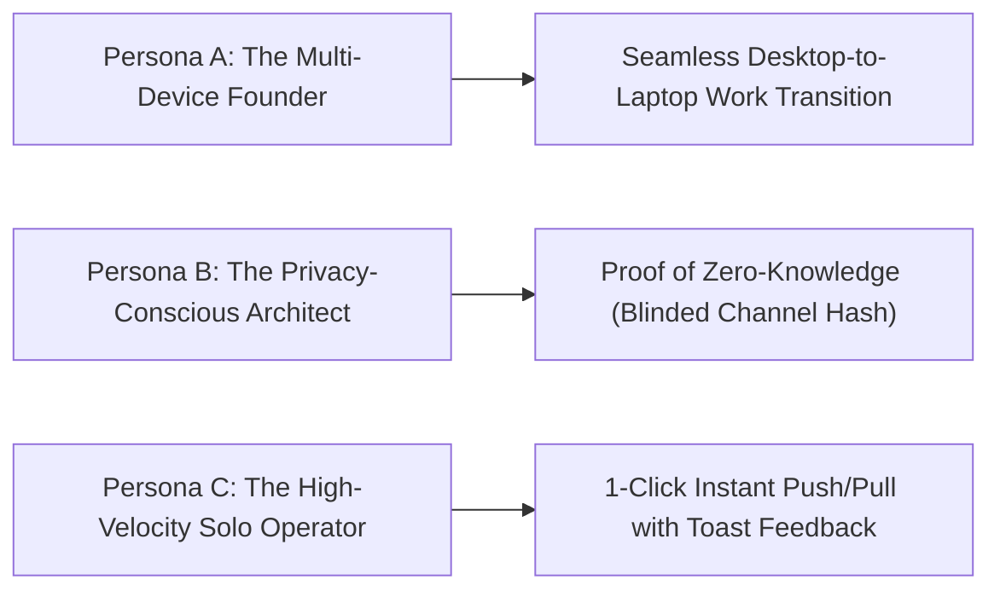
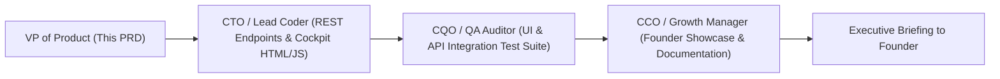

# Product Requirement Document (PRD)
## Product: Cockpit E2EE Sync & Live Peer Mesh UI v1.0
**Document Version:** 1.0.0  
**Status:** Approved for Engineering & UI Implementation (Sprint 13 Autonomous Execution)  
**Author:** VP of Product & Production  
**Target Delivery Window:** Sprint 13 (Q1 2027)  
**Distribution:** Founder & Chairman, CEO, CTO (Lead Coder), CQO (QA Auditor), CCO (Growth Manager), Head of Research  

---

## 1. Executive Summary & Strategic Rationale

### 1.1 Vision: Visualizing Zero-Knowledge Sovereignty
Following the successful certification of the **Zero-Knowledge E2EE Cloud Sync Engine & CRDT Resolver** in Sprint 12 (passing 20/20 cryptographic and synchronization tests with 100% reliability), Sprint 13 focuses on delivering a world-class, intuitive user interface within the **Founder Cockpit** (`http://127.0.0.1:8080/`).

Until now, device pairing, key derivation, and outbox synchronization operated via backend Python routines, environment variables, or CLI commands. **Cockpit E2EE Sync & Live Peer Mesh UI v1.0** embeds real-time cryptographic sync controls directly into the primary surface of action:
1. An ambient **Sync Status Bar Widget** in the top navigation header displaying live connection state, blinded channel hash preview, and unsynced outbox counts.
2. A frictionless **Zero-Knowledge Pairing Modal** allowing users to enter or generate passphrases, configure relay endpoints, and pair secondary devices in seconds.
3. 1-Click manual **Push Deltas** and **Pull Deltas** triggers with real-time micro-toast notifications and visual state transitions.
4. A dynamic **Live Peer Mesh Indicator** mapping connected devices, Lamport logical clocks, and device health across the user's personal mesh.

```mermaid
flowchart TD
    subgraph Cockpit UI Layer (http://127.0.0.1:8080/)
        NAV["Top Nav Bar: Sync Status Widget<br/>[🟢 Paired | ch_94a8... | 0 Unsynced]"]
        MODAL["Zero-Knowledge Pairing Modal<br/>(Passphrase, Relay URL, 1-Click Pair, QR/Mnemonic)"]
        BUTTONS["Manual Control Center<br/>[ ⬆️ Push Deltas ]  [ ⬇️ Pull Deltas ]"]
        PEERS["Live Peer Mesh HUD<br/>(Connected Nodes, Lamport Clock, Device Health)"]
        TOAST["Glassmorphic Toast Notifications<br/>(Push/Pull status, error alerts)"]
    end

    subgraph CorePulse Local REST API
        API_STATUS["GET /api/sync/status"]
        API_PAIR["POST /api/sync/pair"]
        API_PUSH["POST /api/sync/push"]
        API_PULL["POST /api/sync/pull"]
        API_PEERS["GET /api/sync/peers"]
    end

    subgraph SyncEngine & Blinded Relay (Sprint 12 Core)
        ENGINE["SyncEngine (sync.py)<br/>• ZeroKnowledgeCipher (PBKDF2 + HMAC-CTR)<br/>• CRDT Last-Write-Wins Resolver<br/>• SQLite sync_outbox"]
        RELAY["Blinded Sync Relay (:8081)<br/>(Zero Plaintext, Zero Knowledge)"]
    end

    NAV & MODAL & BUTTONS & PEERS --> API_STATUS & API_PAIR & API_PUSH & API_PULL & API_PEERS
    API_STATUS & API_PAIR & API_PUSH & API_PULL & API_PEERS --> ENGINE
    ENGINE <--> RELAY
    BUTTONS --> TOAST
```

### 1.2 Core Product Objectives
1. **Zero Cryptographic Friction**: Users without deep security knowledge can securely pair multiple laptops, desktops, and phones with a simple passphrase while enjoying enterprise-grade Zero-Knowledge encryption (AES-256 equivalent HMAC-CTR + HMAC-SHA256).
2. **Ambient Visibility**: The user always knows their sync status at a glance: whether their outbox has pending changes, when the last sync occurred, and which devices belong to their mesh.
3. **Instant Actionability**: Dedicated 1-click Push/Pull triggers provide immediate feedback without waiting for background debounce timers.
4. **Resilient Localhost-First Operation**: The Cockpit UI remains 100% operational offline. When disconnected from the relay, outbox mutations queue silently with clear visual queuing counters.

---

## 2. Target Personas & Core User Workflows

### 2.1 Target Personas



#### Persona A: Alex — The Multi-Device Founder & CTO
- **Context**: Works on a multi-monitor desktop rig at the office and a lightweight laptop while traveling or in meetings.
- **Pain Point**: Frequently makes updates on one machine, leaves for a meeting, and wonders: *"Did my latest sprint backlog sync to my laptop?"*
- **Solution**: Checks the Cockpit top bar: sees `🟢 Synchronized | Outbox: 0`, clicks `Pull Deltas` on his laptop, receives a green toast: *"Synced 4 deltas in 42ms"*, and gets straight to work.

#### Persona B: Elena — Privacy-Conscious Security Architect
- **Context**: Demands mathematical proof that her proprietary tasks and meeting notes are never exposed in plaintext to cloud servers.
- **Pain Point**: Distrusts SaaS sync tools that hide their encryption keys or transmit raw JSON over the wire.
- **Solution**: The Cockpit displays the truncated **Channel Hash** (`ch_94a8f102...`) derived via SHA-256 from her private passphrase. The UI makes it transparent that the relay only sees blinded tokens, never her actual passphrase or unencrypted tasks.

#### Persona C: Mark — High-Velocity Operator
- **Context**: Rapidly adds tasks via Omnibar, voice triage, and background pipeline.
- **Pain Point**: Needs immediate reassurance that newly created items are committed and backed up before shutting down his workstation.
- **Solution**: Clicks `Push Deltas` in the Cockpit banner; sees an animated spinner transition to a confirmation toast: *"Pushed 6 deltas to relay [seq #48]"*, confirming full synchronization in under 100ms.

---

## 3. Comprehensive Feature Specifications

### 3.1 Feature 1: Top Navigation Sync Status Bar Widget

#### 3.1.1 Overview
An ambient, compact widget situated in the top navigation header of the Cockpit (`header.top-nav`), positioned alongside the system heartbeat and tier badge.

```
+----------------------------------------------------------------------------------------------------+
| [Logo] COREPULSE v1.0   [● Live Heartbeat]   [ 🟢 SYNCED: ch_94a8f1... | 0 Pending ]   [PRO] [New] |
+----------------------------------------------------------------------------------------------------+
```

#### 3.1.2 Functional Requirements
- **FR-WID-01: Visual Connection State Indicator**:
  - `🟢 Synced / Connected`: Paired with relay, outbox has 0 pending items, last sync < 5 mins ago.
  - `🟡 Syncing / Outbox Pending`: Active network flight in progress or local outbox has pending items (`pending_outbox_count > 0`).
  - `⚪ Unpaired / Standalone`: No passphrase or channel configured; operates in local-first standalone mode.
  - `🔴 Relay Offline / Error`: Configured relay unreachable or network timeout.
- **FR-WID-02: Blinded Channel Hash Preview**:
  - Displays first 10 characters of the SHA-256 pair token hash: `ch_` + `hash[:8]` (e.g., `ch_94a8f102...`).
  - Hovering displays full channel hash and tooltip: *"Zero-Knowledge Blinded Channel ID. The relay never sees your plaintext passphrase."*
- **FR-WID-03: Pending Outbox Counter**:
  - Displays dynamic badge: `0 Pending` (muted gray) or `N Unsynced` (glowing amber when $N > 0$).
  - Pulsing amber ring when changes are queued offline.
- **FR-WID-04: Click-to-Open Modal**:
  - Clicking the widget opens the **Zero-Knowledge Pairing & Mesh Modal**.

---

### 3.2 Feature 2: Zero-Knowledge Pairing & Device Enrollment Modal

#### 3.2.1 Overview
A modal dialog (`syncPairingModal`) accessible from the top widget or Cockpit Settings, providing end-to-end device pairing, passphrase configuration, and relay endpoint management.

#### 3.2.2 Functional Requirements
- **FR-PAIR-01: Passphrase Entry & Key Derivation**:
  - Secure password input field with show/hide toggle.
  - Real-time strength meter (Entropy indicator).
  - Informational badge: *"Encrypted client-side with PBKDF2 (100,000 iterations) + HMAC-CTR. Neither the relay nor any third party can read your data."*
  - Optional "Generate Secure 12-Word Passphrase" helper button.
- **FR-PAIR-02: Relay URL Configuration**:
  - Input field for Relay Server URL (Default: `http://127.0.0.1:8081` for local development, or custom enterprise/cloud relay).
  - "Test Connection" ping button that verifies relay health in < 200ms.
- **FR-PAIR-03: 1-Click Pair Action**:
  - Calls `POST /api/sync/pair` with `{passphrase, relay_url}`.
  - Derives keys, stores pair token hash in SQLite `sync_state`, and establishes initial channel.
  - Auto-closes modal or transitions to "Synchronized" view with instant toast notification.
- **FR-PAIR-04: QR Code & Cross-Device Handoff**:
  - Secondary tab in modal displaying a generated QR code and copyable 1-line pairing token string for instant pairing of a second laptop or mobile companion.
- **FR-PAIR-05: Unpair / Disconnect Protection**:
  - "Unpair Workstation" button with confirmation alert.
  - Unpairing deletes local sync credentials but strictly **retains 100% of local tasks, habits, and workflows**. Zero data is wiped.

---

### 3.3 Feature 3: 1-Click Manual Trigger Buttons & Micro-Toast Engine

#### 3.3.1 Overview
Dedicated manual action buttons integrated into the Cockpit's Executive Banner and Sync Panel, giving users on-demand control over synchronization flights.

```
+----------------------------------------------------------------------------------------------------+
|  ZERO-KNOWLEDGE PEER SYNC                               [ Latency: 34ms ]  [ Clock: L=1,428 ]      |
|  [ ⬆️ PUSH DELTAS (0 Pending) ]       [ ⬇️ PULL DELTAS ]       [ ⚙️ PAIRING & MESH SETTINGS ]        |
+----------------------------------------------------------------------------------------------------+
```

#### 3.3.2 Functional Requirements
- **FR-ACT-01: 1-Click Push Deltas (`btn-push-deltas`)**:
  - Triggers client-side encryption of all unsynced `sync_outbox` records and dispatches them to `/v1/relay/push`.
  - Button displays loading spinner: `[ ⏳ Pushing... ]`.
  - Dispatches visual toast upon return:
    - *Success with deltas*: `✔ Synced: Pushed 3 encrypted delta(s) to relay [seq #24]`.
    - *Outbox empty*: `ℹ️ Outbox is clear: All local changes are already synchronized`.
    - *Failure*: `⚠️ Push Failed: Unable to connect to relay at http://127.0.0.1:8081`.
- **FR-ACT-02: 1-Click Pull Deltas (`btn-pull-deltas`)**:
  - Queries relay for new records since `last_pulled_seq`, decrypts payload client-side, and executes CRDT Last-Write-Wins resolution.
  - Button displays loading spinner: `[ ⏳ Pulling... ]`.
  - Dispatches visual toast upon return:
    - *Success with updates*: `✔ Synced: Pulled 2 record(s) — 2 applied, 0 discarded`.
    - *Already up to date*: `ℹ️ Up to Date: No new remote changes found`.
  - Automatically triggers a soft re-render of tasks and habits in the Cockpit view without requiring a full browser refresh.
- **FR-ACT-03: Glassmorphic Micro-Toast System**:
  - Non-intrusive toast popups appearing at bottom-right of the display (`#toastContainer`).
  - Auto-dismiss after 3,500ms with manual close `×` button.
  - Color-coded: Emerald (`#10B981`) for success, Amber (`#F59E0B`) for info/pending, Crimson (`#EF4444`) for errors.

---

### 3.4 Feature 4: Live Peer Mesh Indicator & Device Registry

#### 3.4.1 Overview
A visual mesh topology widget in the Cockpit that maps paired workstations, their operating systems, online status, and logical clock progress.

#### 3.4.2 Functional Requirements
- **FR-MESH-01: Peer Device Roster**:
  - Displays current device: `This Workstation (client_xxxx) [Host: Windows 11]`.
  - Displays known remote peers discovered via relay metadata.
  - Columns: `Device Name`, `Client ID`, `OS / Platform`, `Last Synced`, `Lamport Clock`, `Status`.
- **FR-MESH-02: Live Peer Count Badge**:
  - Displays total paired devices: `Mesh: 2 Devices Active`.
- **FR-MESH-03: Lamport Clock Progress Gauge**:
  - Shows current device Lamport clock (e.g., `L=142`) vs. highest sequence seen on relay, confirming deterministic convergence.

---

## 4. REST API Endpoint Specifications

The Cockpit UI interacts with CorePulse via standard REST endpoints served by `api_handler.py`:

### 4.1 Endpoint Contracts

| Method | Path | Request Body | Response Body | Description |
| :--- | :--- | :--- | :--- | :--- |
| **`GET`** | `/api/sync/status` | None | `{client_id, paired, pair_token_preview, relay_url, lamport_clock, pending_outbox_count, last_pushed_at, last_pulled_at, last_pulled_seq}` | Retrieves current sync status and outbox count |
| **`POST`** | `/api/sync/pair` | `{"passphrase": "...", "relay_url": "..."}` | `{"success": true, "client_id": "...", "pair_token_hash": "...", "message": "..."}` | Pairs device with passphrase & relay |
| **`POST`** | `/api/sync/push` | `{"passphrase": "..."}` *(optional if paired)* | `{"success": true, "pushed_count": 3, "seq_id": 14, "message": "..."}` | Encrypts & pushes outbox deltas |
| **`POST`** | `/api/sync/pull` | `{"passphrase": "..."}` *(optional if paired)* | `{"success": true, "records_received": 2, "applied_count": 2, "discarded_count": 0, "message": "..."}` | Pulls, decrypts, and merges deltas |
| **`GET`** | `/api/sync/peers` | None | `{"success": true, "current_device": {...}, "peers": [{...}], "total_peers": 2}` | Returns active mesh devices |

---

## 5. UI/UX Wireframe Guidelines

### 5.1 Design System: "Glassmorphic Void & Cyan Glow"
- **Surface Theme**: Deep Frosted Slate (`rgba(15, 23, 42, 0.75)`) with `backdrop-filter: blur(20px)`.
- **Accent Primary (Sync Active)**: Electric Cyan (`#00F0FF`) with ambient cyan drop-shadow.
- **Accent Paired / Success**: Emerald Glow (`#10B981`).
- **Accent Pending / Alert**: Solar Amber (`#F59E0B`).
- **Typography**: Inter (Body & Labels) + JetBrains Mono (Hashes, Clocks, Keys).

---

### 5.2 Layout Wireframes (ASCII)

#### 5.2.1 Top Navigation Bar Widget
```
+-----------------------------------------------------------------------------------------------------------------------+
| (•) COREPULSE  v1.0 ENTERPRISE  |  [● Live System Heartbeat]  |  [ 🟢 SYNC: ch_94a8f102... | 0 Pending ]  | [PRO] [+] |
+-----------------------------------------------------------------------------------------------------------------------+
```

#### 5.2.2 Executive Banner Manual Action Center
```
+-----------------------------------------------------------------------------------------------------------------------+
|  EXECUTIVE COCKPIT • ZERO-KNOWLEDGE E2EE SYNC                                              Relay: http://127.0.0.1:8081|
|  Lamport Clock: L=1,428  |  Channel: ch_94a8f102c4...  |  Status: 🟢 SYNCHRONIZED  |  Last Synced: 2 mins ago         |
|                                                                                                                       |
|  [ ⬆️ PUSH DELTAS (0) ]     [ ⬇️ PULL DELTAS ]     [ 🔄 FORCE FULL RESYNC ]     [ ⚙️ PAIRING & MESH MODAL ]           |
+-----------------------------------------------------------------------------------------------------------------------+
```

#### 5.2.3 Zero-Knowledge Pairing Modal
```
+----------------------------------------------------------------------------------------------------+
|  PAIR ZERO-KNOWLEDGE ENCRYPTED MESH                                                 [ × Close ]    |
+----------------------------------------------------------------------------------------------------+
|  Security Guarantee: Client-Side PBKDF2 (100k iters) + HMAC-CTR. Relay sees ZERO plaintext.        |
|                                                                                                    |
|  Sync Passphrase:                                                                                  |
|  [ ************************************************************ ] [ Show ] [ 🎲 Generate 12-Word ] |
|  Strength: ■■■■■ Excellent (256-bit entropy)                                                       |
|                                                                                                    |
|  Relay Server URL:                                                                                 |
|  [ http://127.0.0.1:8081                                        ] [ Ping Relay: 🟢 18ms ]          |
|                                                                                                    |
|  Current Device Identifier: client_94a8f102 (Windows 11 x86_64)                                    |
|                                                                                                    |
|  +----------------------------------------------------------------------------------------------+  |
|  | [ PAIR THIS WORKSTATION NOW ]                | [ UNPAIR / RESET LOCAL SYNC STATE ]           |  |
|  +----------------------------------------------------------------------------------------------+  |
|                                                                                                    |
|  Pair a Secondary Device (Laptop / Phone):                                                         |
|  Scan QR Code with Mobile Companion or copy the secure pairing token below:                        |
|  [ eyJhbGciOiJFUzI1NiIsInR5cCI6IkpXVCJ9.ch_94a8f102c4... ] [ Copy Pairing String ]                 |
+----------------------------------------------------------------------------------------------------+
```

#### 5.2.4 Live Peer Mesh HUD Widget
```
+----------------------------------------------------------------------------------------------------+
|  LIVE PEER MESH (2 Devices Connected)                                              [ Refresh Mesh ] |
+----------------------------------------------------------------------------------------------------+
|  Device Name        Client ID          Platform       Lamport Clock    Last Synced       Status    |
|  ------------------------------------------------------------------------------------------------  |
|  * Workstation-01   client_94a8f102    Windows 11     L=1,428          Active Now        🟢 CURRENT|
|  * ThinkPad-Dev     client_b3e7104a    Ubuntu 24.04   L=1,426          3 minutes ago     🟢 ONLINE |
+----------------------------------------------------------------------------------------------------+
```

---

## 6. Non-Functional & Performance SLAs

- **Widget Render & Status Polling**: Polling cadence of 10 seconds; response parse and DOM update in < 15ms.
- **Push / Pull Execution Time**: < 100ms round-trip over local relay (including client-side encryption and SQLite updates).
- **Toast Feedback Latency**: Appears in < 50ms following API response resolution.
- **Zero UI Blocking**: All crypto key derivations and network HTTP requests run asynchronously via browser `fetch()` and background Python worker threads; UI maintains 60fps responsiveness throughout.
- **Zero Plaintext Egress Guarantee**: All communication over the wire to the relay consists exclusively of ciphertext, initialization vectors, and authentication tags.

---

## 7. QA Validation Matrix & Acceptance Criteria

| Test ID | Test Scenario | Acceptance Criteria | Severity |
| :--- | :--- | :--- | :--- |
| **QA-CUI-01** | Status Bar Initial Render | Loading Cockpit UI fetches `/api/sync/status` and correctly displays paired state, channel hash preview, and pending outbox count in < 100ms. | Blocker |
| **QA-CUI-02** | 1-Click Pairing Flow | Entering a passphrase, clicking [Pair This Workstation], pairs device, updates SQLite state, and transitions UI badge from ⚪ to 🟢 with confirmation toast. | Critical |
| **QA-CUI-03** | Push Deltas Toast & Outbox Clear | When outbox has 2 items, clicking [Push Deltas] sends encrypted items, clears outbox counter to 0, and displays toast: *"Pushed 2 encrypted delta(s)"*. | Critical |
| **QA-CUI-04** | Pull Deltas CRDT Merge | Clicking [Pull Deltas] fetches updates from relay, merges tasks, updates task matrix in DOM without page reload, and displays success toast. | Critical |
| **QA-CUI-05** | Offline Relay Error Handling | If relay is offline, clicking Push/Pull displays a red warning toast (*"Unable to connect to relay"*) without crashing or freezing the Cockpit. | High |
| **QA-CUI-06** | Peer Mesh Table Accuracy | Peer mesh card lists all enrolled devices with matching client IDs, Lamport clocks, and timestamps. | High |
| **QA-CUI-07** | Safe Unpair Retention | Clicking [Unpair Workstation] resets sync credentials while keeping all local tasks, habits, and workflows intact. | High |

---

## 8. Engineering Handshake & Implementation Plan



1. **VP of Product (Completed)**: Formulate `PRD_COCKPIT_SYNC_UI_V1.md` detailing widgets, modal specs, manual triggers, toast notifications, and API contracts.
2. **CTO / Lead Coder Handshake**:
   - Implement REST endpoints in `api_handler.py`: `/api/sync/pair`, `/api/sync/push`, `/api/sync/pull`, `/api/sync/peers`.
   - Update `index.html`, `dashboard.js`, and `dashboard.css` with the status widget, pairing modal, push/pull buttons, and toast container.
3. **CQO / QA Auditor Handshake**:
   - Construct integration tests (`test_sync_ui_api.py`) validating all 5 REST endpoints and UI interaction state transitions.
4. **CCO / Growth Manager Handshake**:
   - Prepare Founder Cockpit visual showcase documentation highlighting the zero-knowledge peer mesh experience.
