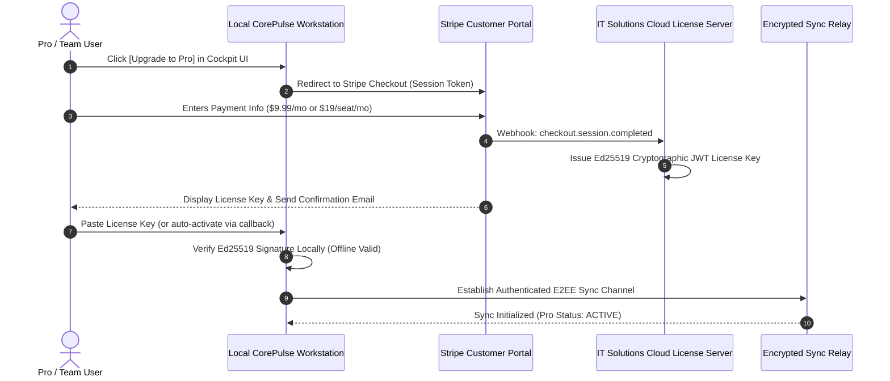
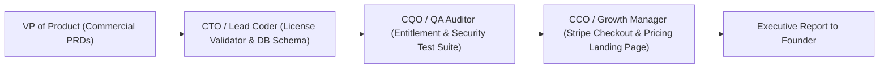

# Product Requirement Document (PRD)
## Product: Commercial Tiers & Monetization Engine v1.0
**Document Version:** 1.0.0  
**Status:** Approved for Engineering & Commercial Execution (Path A Authorized by Founder)  
**Author:** VP of Product & Production  
**Target Delivery Window:** Sprint 11 (Q1 2027)  
**Distribution:** Founder & Chairman, CEO, CTO (Lead Coder), CQO (QA Auditor), CCO (Growth Manager), Head of Research  

---

## 1. Executive Summary & Strategic Rationale

### 1.1 Commercial Vision: Path A Open-Core Commercialization
In accordance with the Founder's authorization of **Path A (Open-Core Commercial Model)**, IT Solutions Global Corporation transitions its unified product triad (**CorePulse**, **NexusShield**, and **EchoStream**) from an infiltration-first community foundation into a sustainable, high-margin commercial engine.

We adhere strictly to the corporate governance philosophy:
> **"Serve humanity by solving real problems with uncompromising utility; earn deep trust and habituation before asking for reward."**

Our commercial model preserves the **Free Local Core** with zero degradation, zero artificial throttling, and zero paywalls on local compute. Monetization is unlocked exclusively at the boundaries of **network leverage**: multi-device encrypted cloud synchronization, mobile companion relays, team collaboration, and enterprise governance.

```mermaid
flowchart TD
    subgraph Tier 0: Community Open-Core ($0 / Free Forever)
        T0["<b>Local Workstation Utility</b><br/>• Unmetered Tasks, Habits & Routines<br/>• Full Local SAST & Secret Scanner<br/>• Local VoiceGuard DLP & Ingestion Pipeline<br/>• Desktop Quick-Capture Omnibar (Ctrl+Shift+Space)<br/>• Unified Cockpit UI (Localhost:8080)"]
    end

    subgraph Tier 1: Pro Power User ($9.99/mo or $99/yr)
        T1["<b>Cross-Device Mobility & Cloud Security</b><br/>• E2EE Zero-Knowledge Multi-Device Sync<br/>• Mobile Companion Relay (iOS/Android)<br/>• Automated Daily Cloud Backups (Point-in-Time Restore)<br/>• 1-Year Historical Focus Analytics"]
    end

    subgraph Tier 2: Team Collaboration ($19/seat/mo)
        T2["<b>Shared Team Intelligence & Workflow</b><br/>• Shared Meeting Hubs & Transcripts<br/>• Auto-Assigning Extracted Action Items<br/>• Team Productivity & Burnout Dashboard<br/>• Shared Team Routine Repository<br/>• RBAC & Slack/Discord Webhooks"]
    end

    subgraph Tier 3: Enterprise Governance ($199 - $499/mo)
        T3["<b>Fleet-Wide Defense & Enterprise Compliance</b><br/>• Centralized Fleet Security Dashboard<br/>• CI/CD Blocking Quality Gates<br/>• SOC 2 / ISO 27001 Export Compliance Packages<br/>• SAML SSO / Okta / SCIM Directory Sync<br/>• Air-Gapped VPC & Dedicated SLA"]
    end

    T0 -->|"Organic Habituation & Device Mobility"| T1
    T1 -->|"Team Co-Working & Task Handoff"| T2
    T2 -->|"Corporate Security & Compliance Mandate"| T3
```

### 1.2 Core Commercial Objectives
1. **Uncompromised Free Core**: Ensure 100% of local workstation features remain completely free, unmetered, and private forever, maintaining developer goodwill and viral bottom-up adoption.
2. **High-Conversion Value Boundaries**: Target Pro ($9.99/mo) conversion by solving the friction of multi-machine synchronization (laptop + desktop + phone) via zero-knowledge client-side encryption.
3. **Team Multiplier**: Drive high-LTV B2B expansion at $19/seat/mo by converting individual meeting transcripts and action items into collaborative team deliverables.
4. **Enterprise Defense Moat**: Offer $199–$499/mo fleet security and compliance gates that replace $50,000 manual enterprise penetration audits.
5. **High Gross Margins ($\ge$ 92%)**: By utilizing local-first compute on client hardware and lightweight encrypted delta sync over relay servers, cloud compute costs remain under $0.20 per user/month.

---

## 2. Comprehensive Tier Specifications & Entitlement Matrix

### 2.1 Complete Tier Comparison Matrix

| Feature / Capability | Community Tier | Pro Tier | Team Tier | Enterprise Tier |
| :--- | :--- | :--- | :--- | :--- |
| **Pricing** | **$0 / Free Forever** | **$9.99 / mo** ($99/yr) | **$19 / seat / mo** | **$199 – $499 / mo** |
| **Target User** | Solo devs, students, hobbyists | Power devs, consultants | Startups, agencies (3–20 seats) | High-growth SMBs, Enterprises |
| **CorePulse Tasks & Habits** | Unlimited local | Unlimited local + synced | Unlimited + team boards | Unlimited + org governance |
| **Workstation Routines** | Unlimited local routines | Unlimited + synced presets | Shared team routine repo | Standardized org fleet routines |
| **NexusShield SAST & Secrets** | Full 120+ patterns, pre-commit | Full local + cloud alerts | Shared vulnerability triage | Centralized fleet dashboard |
| **VoiceGuard DLP & Pipeline** | Local drop watcher & redact | Local + mobile voice ingest | Shared meeting transcripts | Fleet-wide voice DLP audit log |
| **Desktop Omnibar** | Sub-30ms local floating bar | Local + cross-device status | Local + team status HUD | Enforced org hotkeys & macros |
| **Cloud Multi-Device Sync** | None (100% Localhost) | **E2EE Zero-Knowledge Sync** | E2EE Multi-Device + Team | E2EE + On-Prem / VPC Option |
| **Device Limit** | 1 Local Workstation | Up to 5 Devices | Up to 5 Devices / Seat | Unlimited Devices / Org |
| **Mobile Companion Relay** | None | **Included (iOS / Android)** | Included (Team Routing) | Included (MDM / MAM support) |
| **Cloud Backups** | Manual local export | **Automated Daily Backups** | Automated Daily + 90d Point-in-Time | Immutable Enterprise Vault |
| **Historical Analytics** | 7-day local rolling | **1-Year Historical Trends** | 1-Year Team Aggregates | Multi-Year Fleet Audit Trail |
| **Team Meeting Hubs** | None | Personal meeting notes | **Shared Meeting Archives** | Shared Org Meeting Vault |
| **Action Item Assignment** | Self only | Self only | **Auto-Assign to Teammates** | Auto-Assign + Jira/Linear sync |
| **CI/CD Quality Gates** | Local CLI only | Local CLI only | GitHub Action basic gate | **Enforced Blocking PR Gate** |
| **Compliance Export** | Basic markdown | PDF Audit Certificate | Team Audit Certification | **SOC 2 / ISO 27001 Package** |
| **Authentication & SSO** | Local (No login required) | Email Magic Link / Passkey | Workspace Org Auth | **SAML 2.0 / Okta / SCIM** |
| **Support SLA** | Community GitHub | Priority Email (<12h) | Dedicated Slack / Discord | Dedicated Technical Account Mgr |

---

### 2.2 Deep Dive: Tier 0 — Community Open-Core ($0 Free Forever)
- **Positioning**: The premier developer-first local cognitive workspace. Zero friction, zero signups, zero phone-home tracking.
- **Entitlements**:
  - Full local SQLite database with WAL concurrency.
  - Unlimited tasks, priority matrix (`@p1-p4`), tag filters, and habit streak engine.
  - Full NexusShield static application security testing (SAST), 120+ credential leak patterns, and git pre-commit hook.
  - Full EchoStream audio/transcript parser and in-flight VoiceGuard DLP credential redaction.
  - Drop-and-forget background ingestion watcher (`data/transcripts/`).
  - Desktop Quick-Capture Omnibar (`Ctrl+Shift+Space`) and system notification tray companion.
  - Unified Cockpit UI served locally on `http://127.0.0.1:8080`.

---

### 2.3 Deep Dive: Tier 1 — Pro Power User ($9.99/mo or $99/yr)
- **Positioning**: Built for mobile developers, consultants, and power operators who work across multiple workstations (e.g., home desktop, laptop, office rig) and need asynchronous mobile capture.
- **Key Capabilities**:
  1. **E2EE Zero-Knowledge Multi-Device Sync**: Synchronizes CorePulse tasks, habits, and workflows across up to 5 personal machines in real-time. Data is encrypted client-side using AES-256-GCM before leaving the workstation.
  2. **Mobile Companion Relay**: Lightweight web/native mobile relay allowing users to speak quick voice notes or drop files on mobile, triggering VoiceGuard redaction and immediate sync to their workstation backlog.
  3. **Automated Daily Cloud Backups**: Daily encrypted point-in-time snapshots stored on tamper-proof cloud storage, with 1-click restore.
  4. **1-Year Historical Focus Analytics**: Long-term focus telemetry, deep work velocity, and habit streak retention reports with CSV/JSON export.

---

### 2.4 Deep Dive: Tier 2 — Team Collaboration ($19/seat/mo)
- **Positioning**: Designed for high-velocity software engineering teams, boutique agencies, and startups (3 to 20 seats) tired of lost verbal commitments and meeting overhead.
- **Key Capabilities**:
  1. **Shared Team Meeting Hubs**: When a team member ingests a meeting transcript, EchoStream extracts decisions and commitments into a shared team meeting archive.
  2. **Auto-Assigning Extracted Action Items**: Heuristic parsing detects verbal assignments (e.g., *"Sarah will deploy the database migration by Thursday"*) and automatically assigns the task to Sarah's CorePulse queue, firing an optional Slack or Discord webhook.
  3. **Team Productivity & Focus Dashboard**: Privacy-preserving aggregate metrics showing team focus hours, completed sprint velocity, and habit consistency without invasive surveillance or keystroke tracking.
  4. **Shared Organizational Routine Repository**: Engineering leads define standardized workspace routines (e.g., `team:onboarding`, `team:deploy-prep`) that team members can trigger with 1 click from their Omnibar.
  5. **Role-Based Access Control (RBAC)**: Team Owner, Admin, and Member permissions.

---

### 2.5 Deep Dive: Tier 3 — Enterprise Governance ($199 – $499/mo base fleet)
- **Positioning**: For fast-growing SMBs, funded startups, and regulated technology companies requiring formal security assurance, automated compliance evidence, and centralized defense.
- **Pricing Model**: $199/mo (up to 15 seats) or $499/mo (up to 50 seats), plus $10/seat/mo for additional scale.
- **Key Capabilities**:
  1. **Centralized Fleet Security Dashboard**: Real-time visibility into all developer workstations running NexusShield. Immediately flags uncommitted secret exposures or critical CVE vulnerabilities across all developer branches.
  2. **CI/CD Enforced Blocking Quality Gates**: Seamless GitHub Actions / GitLab CI runner that blocks pull request merges if secrets or high-severity CVEs are introduced.
  3. **SOC 2 & ISO 27001 Compliance Package**: Automated export of cryptographic audit trails, SBOM inventories (CycloneDX/SPDX), and data-handling logs ready for compliance auditors.
  4. **SAML 2.0 / Okta / Azure AD Single Sign-On**: Enterprise identity federation and automated employee offboarding via SCIM.
  5. **Air-Gapped & VPC Deployment**: Dedicated private relay instance deployable inside the customer's AWS/GCP VPC or local Docker cluster.

---

## 3. Monetization Engine & Licensing Architecture



### 3.1 Cryptographic Offline Licensing Engine
- **Algorithm**: Ed25519 asymmetric cryptographic signatures.
- **Payload Structure**:
  ```json
  {
      "sub": "usr_94a8f102c4",
      "tier": "pro", // 'pro', 'team', 'enterprise'
      "seats": 1,
      "features": ["e2ee_sync", "cloud_backup", "mobile_relay", "analytics_1y"],
      "issued_at": "2027-01-15T00:00:00Z",
      "expires_at": "2028-01-15T00:00:00Z",
      "devices_allowed": 5,
      "sig": "3045022100e4a...[Ed25519 signature]"
  }
  ```
- **14-Day Offline Grace Period**: Pro and Team licenses are verified locally via the embedded public key. The application requires an asynchronous online heartbeat ping only once every 14 days, preventing software lockouts during travel or air-gapped field operations.

### 3.2 In-App Upgrade Flows & Frictionless UX
- **Contextual Discovery (No Nag-Screens)**: Upgrade buttons appear contextually only when a user interacts with network capabilities:
  - Clicking *"Enable Cloud Sync"* in Settings.
  - Clicking *"Assign to Teammate"* in meeting triage.
  - Clicking *"Export SOC 2 Report"* in NexusShield.
- **One-Click Downgrade Protection**: If a user cancels their subscription, their account downgrades gracefully to the Community tier. **Zero local tasks, local audit reports, or local transcripts are ever deleted or locked.**

---

## 4. UI / Cockpit Billing & Entitlement Wireframes

### 4.1 Cockpit Plan & License Manager (Settings Modal)

```
+----------------------------------------------------------------------------------------------------+
|  COREPULSE SUITE SETTINGS  |  [ General ]  [ Cloud Sync ]  [ Security ]  [ Plan & Billing ]        |
+----------------------------------------------------------------------------------------------------+
|  CURRENT SUBSCRIPTION: PRO POWER USER ($9.99/mo)                           [ STATUS: ACTIVE ]     |
|  License Key: CP1-PRO-9842-8812-****-****                                  Renews: Feb 15, 2027    |
|  Connected Devices (2 of 5):                                                                       |
|  • Workstation-Alpha (Windows 11) - Last synced 12 seconds ago             [ CURRENT DEVICE ]     |
|  • ThinkPad-Dev (Ubuntu 24.04)    - Last synced 4 minutes ago              [ Revoke Device ]      |
+----------------------------------------------------------------------------------------------------+
|  PRO CAPABILITIES ACTIVE:                                                                          |
|  ✔ End-to-End Encrypted Cloud Sync (AES-256-GCM)                           Latency: 38ms          |
|  ✔ Automated Daily Cloud Backups (Last Backup: Today 04:00 UTC)             [ Download Backup ]    |
|  ✔ Mobile Voice Relay Link Active                                          [ QR Code Link ]       |
|  ✔ 1-Year Focus & Habit Velocity Analytics                                 [ Export Analytics ]   |
+----------------------------------------------------------------------------------------------------+
|  TEAM UPGRADE OPPORTUNITY:                                                                         |
|  Need shared meeting hubs and automatic task assignment for your engineers?                        |
|  [ UPGRADE TO TEAM ($19/seat/mo) ]                      [ MANAGE STRIPE BILLING & INVOICES ]       |
+----------------------------------------------------------------------------------------------------+
```

---

## 5. Non-Functional & Financial SLAs

- **Gross Margin Target**: $\ge$ 92.5% across all paid tiers.
- **Cloud Infrastructure Cost Cap**: < $0.20 per active Pro user/month (since compute is local and relay bandwidth is compressed CRDT deltas).
- **Payment Processor Integration**: Stripe Billing & Customer Portal via PCI-DSS compliant hosted checkout.
- **License Verification Latency**: < 5ms local Ed25519 signature check.
- **Data Portability Guarantee**: Users at any tier can export 100% of their data in JSON/SQLite format at any time with 1 click.

---

## 6. QA Validation Matrix & Acceptance Criteria

| Test ID | Test Scenario | Acceptance Criteria | Severity |
| :--- | :--- | :--- | :--- |
| **QA-TIER-01** | Free Core Unmetered | Community user can create 10,000 tasks and run 500 SAST scans without any paywall, throttle, or license error. | Blocker |
| **QA-TIER-02** | Cryptographic License Validation | Pasting a valid Ed25519 signed Pro license key unlocks Cloud Sync within 50ms and persists across restarts. | Critical |
| **QA-TIER-03** | Tampered License Rejection | Modifying a single character in the license payload fails signature verification and rejects the key. | Critical |
| **QA-TIER-04** | 14-Day Offline Grace | Pro user disconnected from the internet for 14 continuous days retains full Pro features. | High |
| **QA-TIER-05** | Graceful Downgrade Safety | Expired license disables cloud sync relay but retains 100% access to all local data with zero data loss. | High |
| **QA-TIER-06** | Team Task Routing | Extracted meeting action item assigned to a team member delivers via configured webhook in < 500ms. | High |

---

## 7. Departmental Handshake & Release Plan



1. **VP of Product (Completed)**: Formulate `PRD_COMMERCIAL_TIERS_V1.md` and companion `PRD_CLOUD_SYNC_PRO_V1.md`.
2. **CTO / Lead Coder Handshake**:
   - Implement the offline Ed25519 license verification module (`license.py`).
   - Add entitlement check middleware to Cloud Sync endpoints.
3. **CQO / QA Auditor Handshake**:
   - Construct automated unit tests (`test_license.py`) verifying signature validation, device caps, and offline grace limits.
4. **CCO / Growth Manager Handshake**:
   - Prepare pricing tier page copy and Stripe product IDs corresponding to the authorized pricing matrix.
