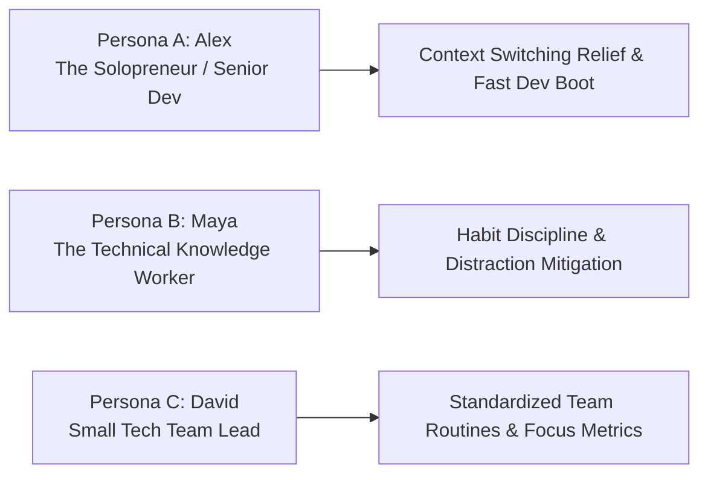
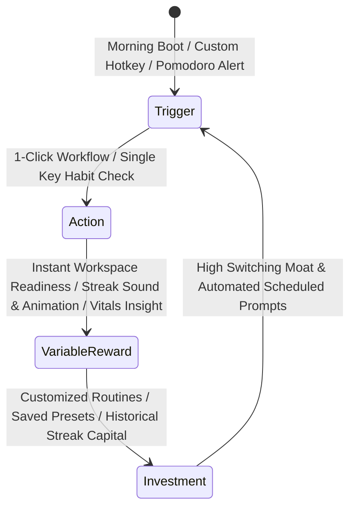
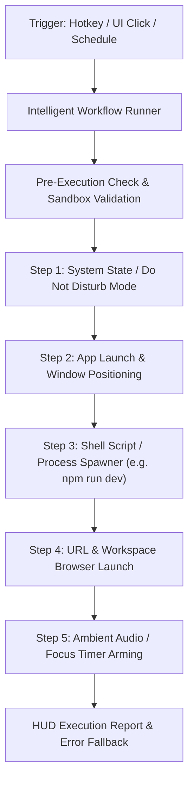
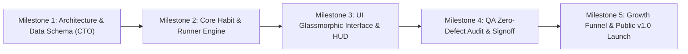

# Product Requirement Document (PRD)
## Product: CorePulse v1.0
**Document Version:** 1.0.0  
**Status:** Approved for Engineering & QA Implementation  
**Author:** VP of Product & Production  
**Target Delivery Window:** Q1 2027  
**Distribution:** CEO, CTO (Lead Coder), CQO (QA Auditor), CCO (Growth Manager)  

---

## 1. Executive Summary & Product Vision

### 1.1 Vision
**CorePulse** is an autonomous, high-leverage desktop workspace orchestrator and daily habit engine designed to eliminate the 40% cognitive drudgery tax suffered by technical professionals and knowledge workers. By combining **local-first automation routines**, **habituation loops (The Hook Model)**, and **real-time system/focus telemetry** inside an ultra-responsive, glassmorphic dark-mode interface, CorePulse transforms fragmented toolsets into an effortless, single-command operating rhythm.

### 1.2 Strategic Objectives
1. **Frictionless Daily Adoption**: Deliver instant tangible utility within 90 seconds of installation with zero mandatory account registration for local tier.
2. **Organic Habit Loop**: Establish CorePulse as the premier morning boot-to-work trigger and end-of-day closure tool.
3. **High Switching Moat**: Capture user workflows, habit streaks, custom script automations, and focus history to ensure 85%+ Month-3 retention.
4. **Predictable Recurring Revenue**: Seamless conversion funnel from Free to Pro ($9.99/mo) and Team ($49/mo) through natural utility ceilings rather than annoying paywalls.

---

## 2. Target Personas & Core User Problems

### 2.1 Target Personas



#### Persona A: Alex — The Solo Engineer / Independent Founder
- **Profile**: 28–42 years old; runs dev environments, multiple client projects, and terminal scripts daily.
- **Pain Points**:
  - Spends 15–20 minutes every morning manually setting up IDEs, Docker containers, terminal tabs, browser tabs, and music.
  - Suffers cognitive fatigue from repetitive shell commands and context switching between tasks.
  - Frustrated by heavy, bloated Electron tools that drain CPU and RAM.
- **Core Need**: Instant one-click workspace initialization and lightweight system vitals monitor.

#### Persona B: Maya — The High-Output Knowledge Worker / Researcher
- **Profile**: 25–38 years old; manages complex research workflows, writing, and client deliverables.
- **Pain Points**:
  - Struggles with fragmented habit tracking apps (Notion, mobile apps, paper planners) that don't bridge to actual computer work.
  - Vulnerable to digital distraction rabbit holes during transitions between tasks.
- **Core Need**: An unobtrusive desktop HUD that gamifies daily habits, protects flow state, and triggers deep focus sessions with one hotkey.

#### Persona C: David — Lead of a High-Velocity Agile Team (3–10 members)
- **Profile**: 32–48 years old; manages a boutique engineering or digital agency.
- **Pain Points**:
  - Inconsistent onboarding routines for new projects across engineers.
  - No visibility into team burnout risks or focus trends without invasive, creepy keystroke trackers.
- **Core Need**: Shared one-click routine repository and privacy-respecting aggregate focus dashboards.

### 2.2 Core Problems Solved

| Problem Dimension | Status Quo Pain | CorePulse v1.0 Solution |
| :--- | :--- | :--- |
| **Tool Sprawl** | Users juggle Todoist (tasks), Raycast/Alfred (launchers), ActivityWatch/RescueTime (focus), and bash scripts. | Unified system combining task engine, workflow runner, and hardware/focus monitor into one glassmorphic hub. |
| **Setup Friction** | Daily startup routine takes 10+ manual actions (opening apps, setting repos, starting servers). | One-Click Intelligent Workflow Runner executing custom sequential routines in milliseconds. |
| **Habit Breakdown** | Habit trackers exist on phones away from the workstation; cognitive disconnection leads to abandonment. | Workstation-native habit engine tied directly to desktop triggers, boot events, and session milestones. |
| **Privacy Invasion** | Enterprise time-tracking software feels invasive (screenshots, keystroke logging). | 100% Local-first telemetry engine: privacy-preserving focus scores computed on-device with zero surveillance telemetry. |

---

## 3. Product Architecture & The Habit Formation Engine

CorePulse is engineered around **The Hook Model** (Nir Eyal) to guarantee deep organic retention and daily reliance.



### 3.1 Hook Loop Implementation Mechanics
1. **Trigger (External & Internal)**:
   - *External*: System boot prompt, discreet glassmorphic floating pill widget, configurable global hotkey (`Ctrl+Space` / `Cmd+K`), scheduled routine notifications.
   - *Internal*: The craving for mental clarity and structured momentum at the start of a work block.
2. **Action (Frictionless Execution)**:
   - Zero-loading time native UI; single keypress to check a habit or trigger a complex multi-step routine.
3. **Variable Reward**:
   - Immediate visual gratification: smooth glassmorphism animations, audio confirmation tone, dynamic calculation of "Time Saved Today" (e.g., *"+14 minutes saved"*), and weekly streak badges.
4. **Investment**:
   - Users save custom script chains, environment flags, daily journal notes, and historical telemetry, compounding value over time.

---

## 4. Comprehensive Feature Specifications

### 4.1 Automated Daily Task & Habit Engine

#### 4.1.1 Overview
A workstation-native habit and priority task engine designed for continuous keyboard-driven operation, recurring streak psychology, and adaptive daily planning.

#### 4.1.2 Functional Requirements
- **FR-HABIT-01: Micro-Habits & Daily Rituals**:
  - Support positive habits (e.g., *Morning Standup Prep*, *Hydrate & Stretch*, *Review Pull Requests*, *Zero Inbox*).
  - Habit cadence options: Daily, Weekdays, Specific Days, Interval (every N hours).
- **FR-HABIT-02: Streak Engine & Forgiveness Logic**:
  - Live streak counter with milestone badges (3-day, 7-day, 21-day, 50-day, 100-day).
  - *Grace Shield*: 1 automatic streak freeze per 14-day cycle to prevent streak despair and churn.
- **FR-HABIT-03: Daily Task Matrix**:
  - Priority buckets: **Crucial (P1)**, **High Leverage (P2)**, **Maintenance (P3)**.
  - Keyboard-driven quick-entry modal (`Tab`, `Enter`, `Ctrl+N`).
  - Auto-rollover of unfinished P1/P2 tasks to the next morning with friction indicator.
- **FR-HABIT-04: Hook Integration**:
  - Audio and visual micro-confetti feedback upon habit completion.
  - Daily "Pulse Score" (0–100%) dynamically updating with task completions and focus time.

---

### 4.2 Intelligent Workflow Runner (One-Click Custom Routines)

#### 4.2.1 Overview
An automated orchestration engine capable of executing complex multi-step workstation routines with a single click or hotkey.

#### 4.2.2 Workflow Execution Architecture



#### 4.2.3 Core Preset Routines (Out-of-the-Box)
1. **"Morning Launch" Routine**:
   - Opens project repository in IDE (e.g., VS Code).
   - Starts local backend/frontend services (e.g., `docker compose up -d` or `npm run dev`).
   - Launches Jira/GitHub dashboard in designated browser workspace.
   - Activates Do Not Disturb mode for 90 minutes.
2. **"Deep Focus Sprint" Routine**:
   - Mutes notifications across Slack, Discord, and Teams.
   - Launches 45-minute Pomodoro timer in HUD.
   - Plays designated local or Spotify ambient focus stream.
   - Sets productivity monitor to strict blocking mode.
3. **"End-of-Day Shutdown" Routine**:
   - Prompts for 60-second daily recap journal entry.
   - Prompts git status check (`git status --short`) for uncommitted work.
   - Gracefully terminates running local dev servers and Docker containers.
   - Displays daily summary report (Time saved, Focus score, Habits completed).

#### 4.2.4 Technical Step Execution Engine
- **Supported Step Types**:
  - `launch_app`: Launch executable with arguments.
  - `run_command`: Execute PowerShell/Bash command with timeout and environment variables.
  - `open_url`: Launch specified browser profile with target tabs.
  - `set_system_state`: Audio volume, DND status, display brightness.
  - `trigger_timer`: Arm focus sprint timer or Pomodoro clock.
- **Safety Sandbox**:
  - Dry-run validation prior to saving workflows.
  - Maximum execution timeout (default: 30s per step, configurable).
  - Graceful step failure handling: `abort_on_error`, `continue_with_warning`, or `rollback`.

---

### 4.3 Real-Time Productivity & System Monitor

#### 4.3.1 Overview
A sleek, lightweight hardware telemetry and cognitive focus monitoring subsystem that gives users real-time situational awareness of both machine and human performance.

#### 4.3.2 Functional Requirements
- **FR-MON-01: Hardware Vitals HUD**:
  - Live CPU utilization gauge (percentage + core frequency overview).
  - RAM utilization gauge (used vs total, swap space).
  - Primary Disk I/O & Battery/Thermal indicator (for laptops).
  - Lightweight polling interval: Adaptive 1s during active HUD, 5s when minimized to background (CPU overhead < 0.8%).
- **FR-MON-02: Flow State & Focus Tracker**:
  - Active window categorizer: *Productive* (IDEs, Terminals, Docs), *Neutral* (Email, Slack), *Distracting* (Social Media, Video streaming).
  - *Local-First Privacy Guarantee*: App titles and URLs are hashed/evaluated locally; zero logs ever transmitted to external servers.
  - Real-time **Deep Work Ratio**: $\text{DWR} = \frac{\text{Productive Minutes}}{\text{Total Active Workstation Minutes}}$.
- **FR-MON-03: Friction & Thermal Warnings**:
  - Soft glassmorphic alert if system load exceeds 85% for >3 minutes (e.g., runaway compilation or memory leak).
  - Posture / Eye-Break micro-prompt after 60 minutes of uninterrupted keyboard activity.

---

### 4.4 Tiered Licensing & Monetization Logic

#### 4.4.1 Product Tier Comparison

| Feature / Capability | Free Tier ("Core") | Pro Tier ("Power") | Team Tier ("Orchestrate") |
| :--- | :--- | :--- | :--- |
| **Price Point** | **$0 / Forever** | **$9.99 / month** ($99/year) | **$49 / month** (5 seats, +$10/seat) |
| **Daily Habit Engine** | Up to 5 Active Habits | Unlimited Habits + Grace Shields | Unlimited + Team Challenges |
| **Workflow Runner** | 3 Custom Routines | Unlimited Chained Routines | Shared Team Routine Repo |
| **Step Execution** | App Launch, URL Open | Shell scripts, Cron triggers, Webhooks | Remote routines, Shared CLI configs |
| **System Vitals HUD** | Standard CPU/RAM gauge | Advanced thermal, per-process analytics | Hardware fleet health aggregate |
| **Focus Telemetry** | 7-day local history | Unlimited cloud-synced history & CSV export | Team productivity index (anonymized) |
| **Data & Cloud Sync** | 100% Local device only | End-to-End Encrypted Cloud Sync | Centralized RBAC + Cloud Backup |
| **Support** | Community / Docs | Priority Ticket Response (<12h) | Dedicated Slack/Discord Channel + SLA |

#### 4.4.2 Monetization & Licensing Engine
- **License Key Format**: Ed25519-signed cryptographically secure JWT keys (`CP1-XXXX-XXXX-XXXX-XXXX`).
- **Offline Grace Period**: 14 days of offline operation allowed before requiring an asynchronous license ping to verify status.
- **Frictionless In-App Upgrade**:
  - In-app Stripe Customer Portal modal.
  - Instant upgrade with zero application restart required.
  - Automatic feature entitlement activation via local cryptographic payload verification.

---

## 5. UI/UX Wireframe Guidelines

### 5.1 Design System: "Glassmorphic Void"

#### 5.1.1 Color Palette & Theme Tokens
- **Base Background**: Deep Carbon Void (`#0B0F17`)
- **Card Background**: Translucent Frosted Glass (`rgba(17, 24, 39, 0.70)`) with `backdrop-filter: blur(20px)`
- **Border Lines**: Subtle Glow Stroke (`rgba(255, 255, 255, 0.08)`) with active state (`rgba(0, 240, 255, 0.40)`)
- **Accent Primary**: Electric Cyan (`#00F0FF`) — represents active execution & high focus
- **Accent Success**: Neon Emerald (`#10B981`) — represents completed habits & optimal system state
- **Accent Warning**: Solar Amber (`#F59E0B`) — represents focus slip & high resource utilization
- **Accent Pro**: Royal Purple (`#8B5CF6`) — highlights premium capabilities
- **Typography**: Inter / JetBrains Mono for system metrics and telemetry values.

---

### 5.2 Layout Wireframes

#### 5.2.1 Main Dashboard View (ASCII Wireframe)

```
+----------------------------------------------------------------------------------------------------+
|  COREPULSE v1.0   [Search or Cmd+K...]                 [Flow: 88%]  [CPU: 18%] [Pro Active]  [ _ O X ] |
+----------------------------------------------------------------------------------------------------+
|  [Sidebar]    |  DAILY PULSE (Monday, Oct 26)                            SYSTEM VITALS HUD         |
|  * Dashboard  |  +----------------------------------------------------+  +-----------------------+ |
|  * Habits     |  | Daily Score: [ 84% ||||||||||||||||||.... ]        |  | CPU: [ 2.4 GHz | 18% ]| |
|  * Workflows  |  | "3 of 4 core rituals completed today"               |  | RAM: [ 14.2 / 32 GB ] | |
|  * Monitor    |  +----------------------------------------------------+  | Disk: [ Write: 12MB/s]| |
|  * Settings   |                                                          +-----------------------+ |
|               |  PRIORITY FOCUS TASKS                  HABITS (STREAK)   ACTIVE FOCUS SPRINT       |
|  [Tier Status]|  +----------------------------------+  +---------------+ +-----------------------+ |
|  PRO ACTIVE   |  | [X] P1: Refactor auth middleware |  | [X] Standup (8)| | [ 28:40 Remaining   ] | |
|  v1.0.0-GA    |  | [X] P1: Fix race condition in DB |  | [X] Hydrate (14)| | Mode: Deep Code       | |
|               |  | [ ] P2: Review PR #142           |  | [ ] Walk 15m (3)| | App: VS Code (92%)   | |
|               |  | [ ] P3: Update API documentation |  | [X] Git sync(21)| | [ Pause ]  [ Finish ] | |
|               |  +----------------------------------+  +---------------+ +-----------------------+ |
|               |                                                                                    |
|               |  INTELLIGENT WORKFLOW RUNNER (ONE-CLICK ROUTINES)                                  |
|               |  +-----------------------+  +-----------------------+  +-----------------------+   |
|               |  | [>] MORNING LAUNCH    |  | [>] DEEP FOCUS SPRINT |  | [>] END-OF-DAY SHUTDOWN|   |
|               |  | 4 Steps | Hotkey: ^M  |  | 3 Steps | Hotkey: ^F  |  | 5 Steps | Hotkey: ^E  |   |
|               |  | [ RUN NOW ]           |  | [ RUN NOW ]           |  | [ RUN NOW ]           |   |
|               |  +-----------------------+  +-----------------------+  +-----------------------+   |
+----------------------------------------------------------------------------------------------------+
| Status: All systems nominal | Background runner: IDLE | Local encrypted vault: LOCKED              |
+----------------------------------------------------------------------------------------------------+
```

#### 5.2.2 Micro-Interactions & Responsiveness
1. **Command Palette (`Ctrl+K` / `Cmd+K`)**:
   - Opens overlay modal in <20ms.
   - Fuzzy search over all tasks, workflows, habits, and system toggle commands.
2. **Workflow Execution Animation**:
   - Card displays an electric cyan glowing progress ring around step icons as they succeed.
   - Instant toast notification upon completion with execution duration (e.g., *"Routine 'Morning Launch' completed in 1.2s"*).
3. **Glassmorphic Hover & Focus States**:
   - Subtle `translateY(-2px)` elevation with enhanced box-shadow on glass panels when hovered.

---

## 6. Technical Stack & Implementation Guidelines for Engineering

### 6.1 Recommended Tech Stack
- **Desktop Shell**: Lightweight modern framework (Tauri v2 with Rust backend + Vite/React/TypeScript frontend or high-performance Electron with isolated contexts). Tauri recommended for sub-30MB RAM footprint.
- **Local Database**: SQLite with WAL mode (`better-sqlite3` or Rust `rusqlite`), encrypted via SQLCipher.
- **System Telemetry**: Native OS bindings (`sysinfo` in Rust or `node-systeminformation`).
- **Styling**: Tailwind CSS with custom glassmorphism utilities (`backdrop-blur-md`, custom gradients, CSS variables).

### 6.2 Latency & Performance SLA
- **Cold Boot Time**: < 800ms to interactive dashboard.
- **Command Palette Trigger Latency**: < 16ms (within 1 frame at 60fps).
- **Idle Memory Footprint**: < 45 MB RAM.
- **Idle CPU Utilization**: < 0.5% CPU load.

---

## 7. QA Validation Matrix & Acceptance Criteria

| ID | Test Scenario | Acceptance Criteria | Severity |
| :--- | :--- | :--- | :--- |
| **QA-PRD-01** | Habit Completion Loop | Clicking habit checkbox updates streak count immediately, plays audio, and writes state to local DB in <10ms. | Critical |
| **QA-PRD-02** | Workflow Chained Execution | 4-step routine runs sequentially. Failure of step 2 with `continue_with_warning` executes steps 3 & 4 and flags step 2 in logs. | Critical |
| **QA-PRD-03** | System Telemetry Accuracy | CPU/RAM readings match OS Task Manager within ±3% tolerance across a 10-minute continuous run. | High |
| **QA-PRD-04** | License Enforcement | Free user attempting to add a 4th custom workflow sees the Pro Upgrade modal; cannot save without active license. | High |
| **QA-PRD-05** | Offline License Validation | App remains fully unlocked in Pro mode when disconnected from network for up to 14 days. | High |

---

## 8. Release Milestones & Autonomous Handshake



- **Immediate Next Autonomous Action**: Lead Coder (CTO) implements database schema, core workflow runner logic, and Tauri/React skeleton in alignment with this specification.
- **QA Handshake**: CQO develops automated test suite targeting Section 7 acceptance criteria.
