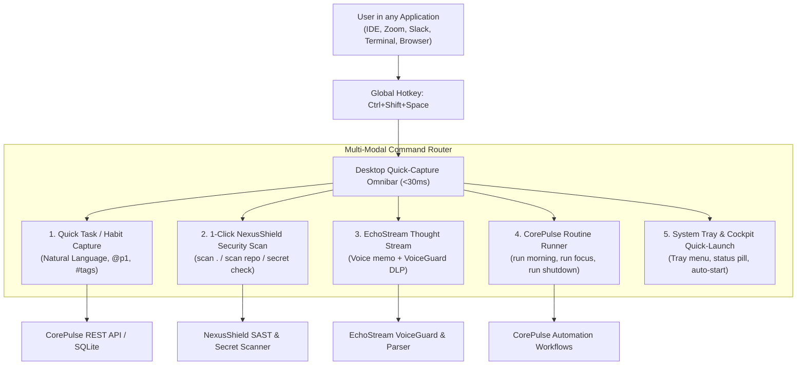
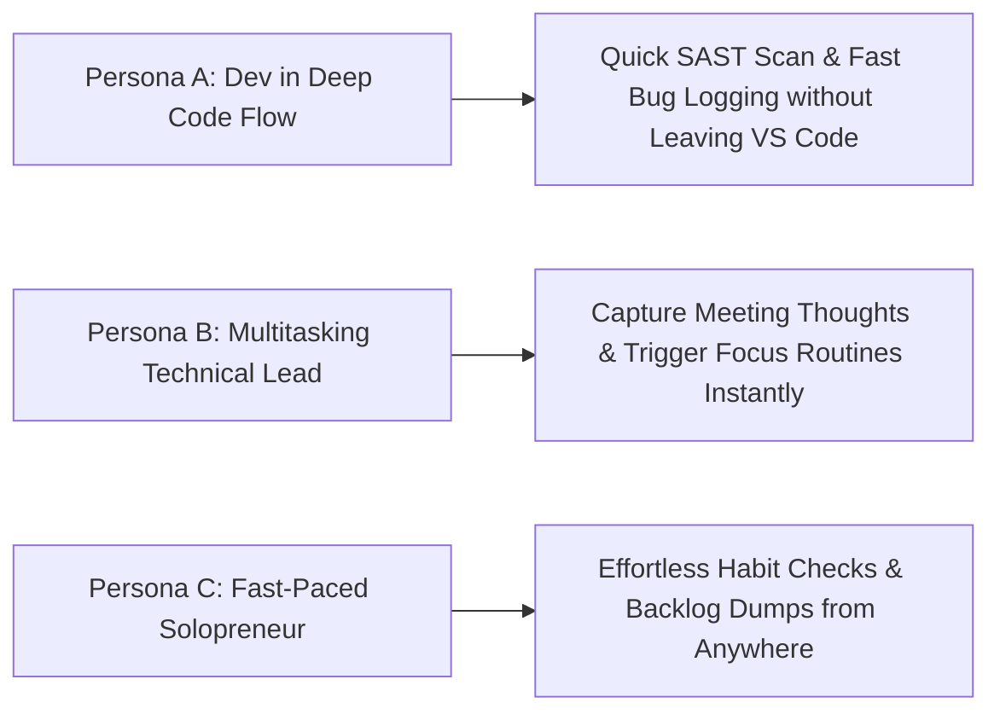
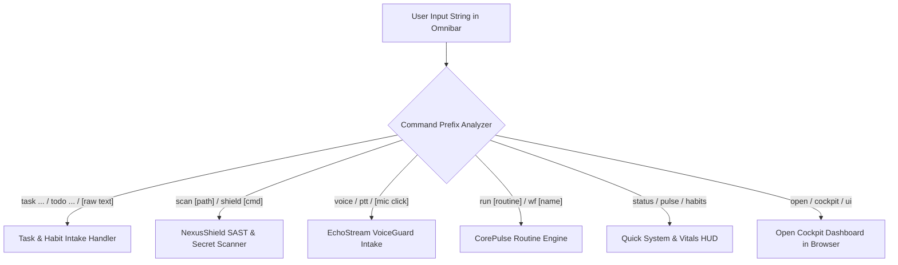
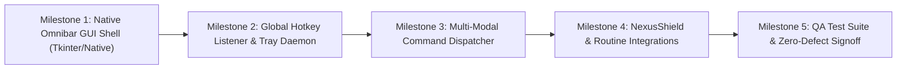

# Product Requirement Document (PRD)
## Product: Desktop Quick-Capture Omnibar v1.0
**Document Version:** 1.0.0  
**Status:** Approved for Engineering & QA Implementation  
**Author:** VP of Product & Production  
**Target Delivery Window:** Sprint 9 (Q1 2027)  
**Distribution:** CEO, CTO (Lead Coder), CQO (QA Auditor), CCO (Growth Manager), Head of Research  

---

## 1. Executive Summary & Product Vision

### 1.1 Vision
**Desktop Quick-Capture Omnibar v1.0** is an ambient, system-wide floating command capsule and system tray listener engineered to make the entire IT Solutions Triad (**CorePulse**, **NexusShield**, **EchoStream**) instantly accessible from any desktop application with a single global keystroke (`Ctrl+Shift+Space`), completely eliminating the need to switch windows, open a web browser, or launch a terminal.

Operating as an ultra-lightweight (<25MB RAM), sub-30ms native desktop companion, the Omnibar accepts freeform natural language text and voice, automatically routes commands to the appropriate subsystem, sanitizes spoken or typed secrets via **VoiceGuard DLP**, triggers automated workflow routines, and provides instant visual feedback before vanishing gracefully back into the background.



### 1.2 Strategic Objectives
1. **Zero Context-Switch Tax**: Drop the cognitive friction of recording a thought or triggering a security scan from 8.4 seconds down to < 800 milliseconds total interaction time.
2. **Sub-30ms Pop-Up Latency**: Instantaneous appearance upon pressing `Ctrl+Shift+Space`, rendered natively without bloated web runtimes or heavy Electron frameworks.
3. **Multi-Subsystem Command Surface**: Single unified input box that seamlessly dispatches tasks, runs SAST audits, triggers automated routines, and displays hardware/security status.
4. **Resilient Localhost Integration**: Communicates over local REST API (`http://127.0.0.1:8080`) with zero-latency fallback to direct SQLite database access (`database_sqlite.py`) when the web daemon is offline.
5. **Zero-Dependency Portability**: Built with pure Python 3.10+ native standard libraries (`tkinter`, `ctypes`, `urllib`, `threading`, `sqlite3`), ensuring zero external installation blockers on Windows and cross-platform desktop environments.

---

## 2. Target Personas & Core Problems Solved

### 2.1 Target Personas



#### Persona A: Leo — Senior Full-Stack Engineer
- **Environment**: Deeply immersed in VS Code, terminal, and Docker containers.
- **Pain Point**: Wants to run a quick security audit on the current repo before staging a commit, or record a quick TODO. Alt-tabbing to a browser or opening another terminal tab breaks his mental train of thought.
- **Omnibar Solution**: Taps `Ctrl+Shift+Space`, types `scan .`, sees a green "Score: 96/100 (Clean)" badge in 1.2s, presses `Enter`, and continues typing code without ever leaving his editor.

#### Persona B: Claire — Engineering Manager / Product Lead
- **Environment**: Constantly in back-to-back video calls, Slack huddles, and reviewing PRs.
- **Pain Point**: Remembers critical tasks or verbal follow-ups during calls. Opening a task manager takes too long, so she jots notes on sticky notes that get lost.
- **Omnibar Solution**: Taps `Ctrl+Shift+Space`, types `task Follow up with DevOps on staging cert @p1 tomorrow`, hits `Enter`. The task is parsed with priority and due date, injected into CorePulse, and the widget vanishes in under 500ms.

#### Persona C: Mark — Solo Founder & High-Velocity Builder
- **Environment**: Moves rapidly between writing marketing copy, debugging APIs, and planning roadmaps.
- **Pain Point**: Needs to trigger workstation routines (*Morning Launch*, *Deep Focus*, *End of Day*) effortlessly without remembering terminal scripts.
- **Omnibar Solution**: Taps `Ctrl+Shift+Space`, types `run focus`, and CorePulse immediately mutes notifications, starts a 45-minute sprint, and arms the focus telemetry HUD.

---

## 3. Comprehensive Feature Specifications

### 3.1 Omnibar Trigger & Hotkey Engine

#### 3.1.1 Overview
A low-overhead background listener thread that registers the system-wide global hotkey and manages the lifecycle of the floating quick-capture window.

#### 3.1.2 Functional Requirements
- **FR-HOT-01: Default Global Hotkey**:
  - Primary default: `Ctrl+Shift+Space`.
  - Secondary fallback options configurable via `config.py` or settings: `Ctrl+Alt+C`, `Alt+Space`, or `Win+Shift+P`.
  - Operates globally regardless of which application currently has foreground focus (IDE, browser, game, video conference).
- **FR-HOT-02: Native Windows & Cross-Platform Registration**:
  - Implements Windows `RegisterHotKey` / `UnregisterHotKey` via standard `ctypes.windll.user32` with message pump thread.
  - Graceful fallback for non-Windows platforms using standard polling or Tkinter bind events.
- **FR-HOT-03: Sub-30ms Window Display**:
  - Window pre-initialization: The Tkinter GUI instance is created hidden on daemon startup and simply de-iconified / mapped on hotkey trigger, ensuring sub-30ms pop-up latency.
  - Automatically centers horizontally in the upper-third of the primary display (screen Y coordinate at 22% from top).
  - Forces foreground focus and keyboard focus into the text input entry box.
- **FR-HOT-04: Auto-Dismiss Behavior**:
  - Pressing `Escape` closes the omnibar immediately with zero action.
  - Clicking anywhere outside the omnibar window (focus loss event `<FocusOut>`) dismisses the window cleanly.
  - Pressing `Enter` submits the active command, displays a micro-toast confirmation (200ms), and auto-dismisses.

---

### 3.2 Multi-Modal Command Router

The Omnibar parses input commands via lightweight prefix detection and natural language heuristic matching:



#### 3.2.1 Command Mode 1: Quick Task & Habit Intake
- **Syntax**: `task <description>`, `todo <description>`, or simply typing any plain sentence without a command prefix.
- **Natural Language Parameter Extraction**:
  - **Priority Tokens**: `@p1` / `@critical`, `@p2` / `@high`, `@p3` / `@medium`, `@p4` / `@low`. (Default: `medium`).
  - **Tag Tokens**: `#tag1 #tag2` $\rightarrow$ parsed into `tags` list (e.g., `#security #backend`).
  - **Due Date Tokens**: `today`, `tomorrow`, `friday`, `monday`, `in 2 hours` $\rightarrow$ parsed into target due date.
  - **Estimated Time Tokens**: `~15m`, `~30m`, `~1h` $\rightarrow$ parsed into `estimated_minutes`.
- **Examples**:
  - `task Refactor auth middleware @p1 #backend #auth tomorrow ~45m`
  - `habit completed standup` $\rightarrow$ Ticks off daily standup habit streak.
- **Execution**: Sends payload to `http://127.0.0.1:8080/api/tasks` via `urllib.request`. If offline, writes directly to local SQLite database `database_sqlite.py`.

#### 3.2.2 Command Mode 2: 1-Click NexusShield Security Scan
- **Syntax**: `scan`, `scan .`, `scan <path>`, `shield status`, `secrets`.
- **Behavior**:
  - Invokes `nexusshield.scanner.NexusShieldScanner` asynchronously in a background thread.
  - Displays a dynamic mini progress animation in the Omnibar: `[ 🛡️ Scanning local repository... ]`.
  - In <1.5s, renders the result inline in the Omnibar:
    - `✔ NexusShield: Score 98/100 (A+) | Zero Secrets | Dependencies Clean`
    - `⚠️ NexusShield: 1 Secret Detected (Stripe Key in auth.ts:42) | Score 84/100`
  - Provides a 1-click `[ View Audit Report ]` action opening the Cockpit security tab.

#### 3.2.3 Command Mode 3: EchoStream Voice Intake & Spontaneous Thought Dump
- **Syntax**: `voice`, `memo`, `listen`, or pressing the microphone icon / holding `Ctrl+Shift+V`.
- **Behavior**:
  - Triggers EchoStream audio capture or opens a voice text input buffer.
  - Passes the input through `VoiceGuard` real-time DLP: detects and replaces any verbalized credentials with `[REDACTED_SECRET: id]`.
  - Uses `TranscriptParser` to extract action items, owners, and priorities.
  - Injects parsed tasks into CorePulse backlog automatically.

#### 3.2.4 Command Mode 4: CorePulse Routine Runner
- **Syntax**: `run <routine_name>`, `wf <name>`, `start <routine>`.
- **Preset Routines**:
  - `run morning` $\rightarrow$ Triggers Morning Workspace Initialization (opens IDE, launches dev servers, plays focus audio).
  - `run focus` $\rightarrow$ Arms 45-minute sprint timer, enables DND mode, launches focus HUD.
  - `run shutdown` $\rightarrow$ Prompts daily recap journal, checks uncommitted git changes, stops local docker containers.
- **Visual Feedback**: Displays step execution checklist with glowing cyan checkmarks.

#### 3.2.5 Command Mode 5: Quick Telemetry & Cockpit Launcher
- **Syntax**: `status`, `pulse`, `cockpit`, `open`.
- **Behavior**:
  - `status` $\rightarrow$ Shows instant one-line vitals: `CPU: 18% | RAM: 14.2/32GB | Score: 88% | Habits: 3/4`.
  - `cockpit` or `open` $\rightarrow$ Automatically opens the default web browser to `http://127.0.0.1:8080`.

---

### 3.3 System Tray Companion Daemon

#### 3.3.1 Overview
A persistent, non-intrusive background daemon that sits in the Windows Notification Area / macOS menu bar, ensuring the Omnibar is always ready and displaying operational status.

```
+----------------------------------------------------------------+
|  [ Notification Area Icon: (•) CorePulse / Nexus Shield ]      |
+----------------------------------------------------------------+
|  Right-Click Menu:                                             |
|  * Show Quick-Capture Omnibar (Ctrl+Shift+Space)               |
|  * -------------------------------------------                 |
|  * Run Quick Security Scan (NexusShield)                       |
|  * Ingestion Pipeline: Active (Watching data/transcripts/)     |
|  * Launch Unified Cockpit UI (localhost:8080)                  |
|  * -------------------------------------------                 |
|  * Daily Pulse: 88% Complete (3 of 4 Habits Done)              |
|  * -------------------------------------------                 |
|  * Settings & Hotkey Configuration                             |
|  * Exit Companion                                              |
+----------------------------------------------------------------+
```

#### 3.3.2 Functional Requirements
- **FR-TRAY-01: Low-Memory Tray Presence**:
  - Runs in a background thread utilizing standard Windows Shell API (`Shell_NotifyIcon` via `ctypes`) or cross-platform fallback.
  - Generates a sleek 16x16 icon dynamically or loads from local SVG/ICO assets.
- **FR-TRAY-02: Status Notifications & Toast Alerts**:
  - Fires native OS toast notifications on high-severity events:
    - *VoiceGuard DLP Alert*: When an unredacted secret is intercepted in an ingested file.
    - *Streak Milestone*: When all daily habits are checked off.
- **FR-TRAY-03: Graceful Shutdown & Portability**:
  - Clean exit handler unregistering global hotkeys and freeing OS window handles.

---

## 4. UI/UX Wireframe Guidelines

### 4.1 Design System: "Floating Obsidian Glass"
- **Window Dimensions**: 680px width, adaptive height (58px collapsed, up to 240px expanded during command results).
- **Window Style**: Borderless (`overrideredirect(True)`), rounded corners, subtle neon glow border (`rgba(0, 240, 255, 0.40)`).
- **Background**: Deep Obsidian Translucent (`#0C1017`, 95% opacity).
- **Input Typography**: JetBrains Mono / Inter, 15px font, placeholder text: `Type a task, 'scan .', 'run morning', or press Ctrl+Shift+V for voice...`
- **Action Pills**: Quick suggestions displayed under the input bar (`[task]`, `[scan]`, `[run]`, `[voice]`, `[cockpit]`).

---

### 4.2 Wireframe Layout (ASCII)

#### 4.2.1 Collapsed State (Default on Hotkey Press)
```
+----------------------------------------------------------------------------------------------------+
|  (•)  | Type a task, 'scan .', 'run morning', or 'voice'...                        |  Ctrl+Shift+Space  |
+----------------------------------------------------------------------------------------------------+
| Suggestions:  [task Review PR #42 @p1]   [scan .]   [run morning]   [run focus]   [open cockpit]   |
+----------------------------------------------------------------------------------------------------+
```

#### 4.2.2 Live Task Parsing State
```
+----------------------------------------------------------------------------------------------------+
|  (•)  | task Audit payment webhook security @p1 #backend tomorrow ~30m               | [Esc to Exit]    |
+----------------------------------------------------------------------------------------------------+
|  PARSED ACTION ITEM PREVIEW:                                                                       |
|  • Title: Audit payment webhook security                                                           |
|  • Priority: [ CRITICAL / P1 ]      • Target: Tomorrow      • Est: 30 mins     • Tags: #backend    |
+----------------------------------------------------------------------------------------------------+
|  [ Enter: Commit Task to CorePulse ]               [ Tab: Select Options ]                          |
+----------------------------------------------------------------------------------------------------+
```

#### 4.2.3 1-Click NexusShield Scan State
```
+----------------------------------------------------------------------------------------------------+
|  🛡️  | scan .                                                                       | [Esc to Exit]    |
+----------------------------------------------------------------------------------------------------+
|  NEXUSSHIELD INSTANT AUDIT REPORT (Completed in 1.14s):                                            |
|  • Security Grade: [ 96/100 (A+) ]     • Scanned: 48 Files (12,410 LOC)                            |
|  • Secrets: 0 Found (Clean)            • Vulnerable Dependencies: 1 Medium (auto-patch available)  |
+----------------------------------------------------------------------------------------------------+
|  [ Enter: Dismiss ]            [ O: Open Full Cockpit Report ]          [ P: Auto-Patch Package ]  |
+----------------------------------------------------------------------------------------------------+
```

---

## 5. Non-Functional & Performance SLAs

- **Hotkey to Window Reveal**: $\le$ 30ms (sub-frame rendering at 60fps).
- **Command Submission to Dismissal**: $\le$ 50ms.
- **Idle Memory Footprint**: $\le$ 25 MB RAM total for both tray daemon and hidden Tkinter omnibar window.
- **Idle CPU Overhead**: $\le$ 0.1% CPU utilization during background listening.
- **Zero-Dependency Guarantee**: Must execute out-of-the-box on standard Python 3.10+ without requiring external pip packages (`pynput`, `keyboard`, `PyQt5`), eliminating compilation hurdles or administrator privilege requirements.
- **Resilient Fallback**: If the local HTTP server (`127.0.0.1:8080`) is not responding, tasks and habit logs are written directly to SQLite `database_sqlite.py` with zero data loss.

---

## 6. QA Validation Matrix & Acceptance Criteria

| Test ID | Test Scenario | Acceptance Criteria | Severity |
| :--- | :--- | :--- | :--- |
| **QA-OMNI-01** | Global Hotkey Registration | Pressing `Ctrl+Shift+Space` reveals the Omnibar centered on screen in <30ms from any background application. | Blocker |
| **QA-OMNI-02** | Quick Task Ingestion | Typing `task Test omnibar @p1 #quick tomorrow` and pressing `Enter` injects the task into CorePulse with correct priority, tags, and date in <100ms. | Critical |
| **QA-OMNI-03** | 1-Click NexusShield Scan | Typing `scan .` executes the local SAST and secret scanner, displaying the score and findings inline in <2.0s without crashing. | Critical |
| **QA-OMNI-04** | CorePulse Routine Trigger | Typing `run morning` executes the configured routine steps and confirms completion in the omnibar HUD. | High |
| **QA-OMNI-05** | Offline Database Fallback | Submitting a task when the HTTP server (`:8080`) is killed succeeds via direct SQLite insertion, verifying task persistence in `corepulse.sqlite3`. | High |
| **QA-OMNI-06** | Escape & Outside-Click Dismiss | Pressing `Escape` or clicking outside the Omnibar window dismisses the window immediately and frees input focus. | High |
| **QA-OMNI-07** | Memory & Resource Leak Check | Invoking and dismissing the Omnibar 100 consecutive times causes zero memory growth (<1MB deviation) and zero ghost processes. | High |

---

## 7. Release Milestones & Autonomous Handshake



- **Immediate Autonomous Handshake**:
  - **CTO / Lead Coder**: Implement the lightweight companion daemon (`omnibar.py` or `desktop_companion.py`), building the native window, hotkey listener, and multi-modal command dispatcher.
  - **CQO / QA Auditor**: Construct automated test suite validating Section 6 acceptance criteria (`test_omnibar.py`).
  - **Growth Manager**: Formulate desktop quick-capture onboarding copy and shortcut cheat sheet for the Cockpit UI.
