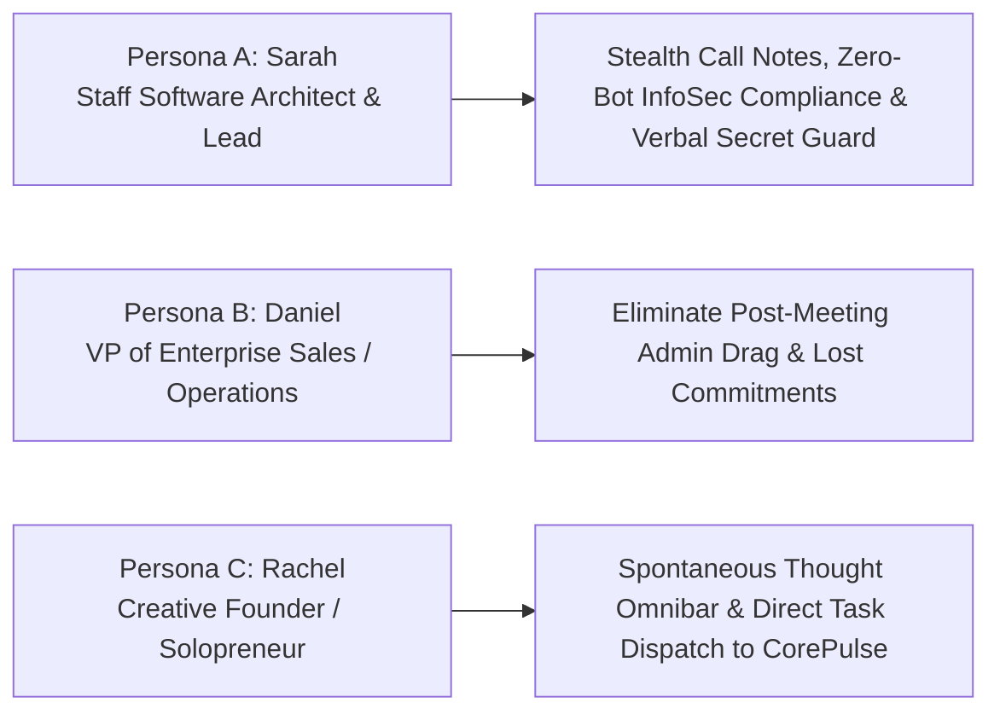
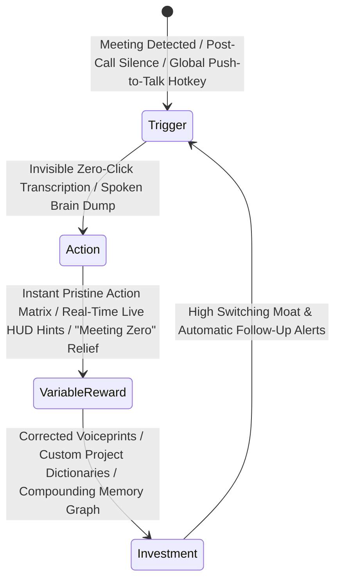
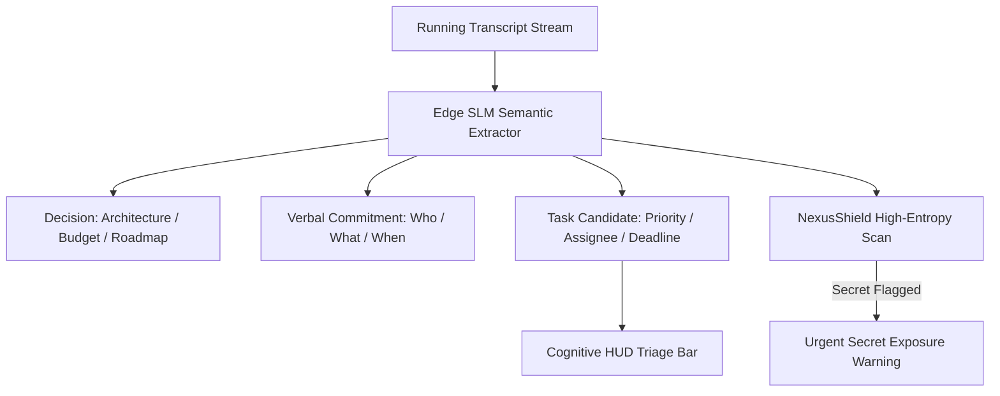
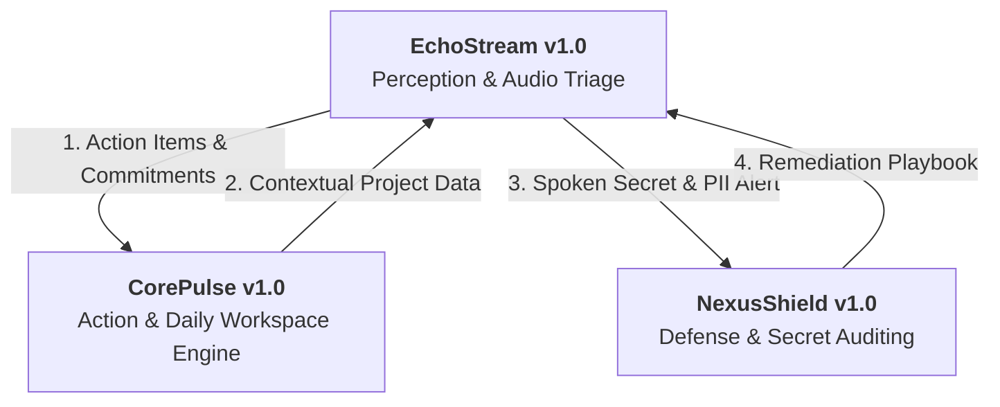
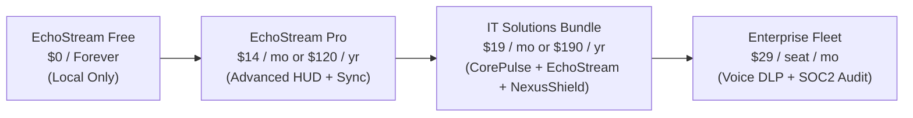
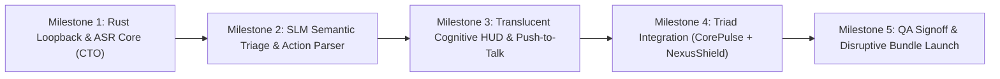

# Product Requirement Document (PRD)
## Product: EchoStream v1.0
**Document Version:** 1.0.0  
**Status:** Approved for Engineering & QA Implementation  
**Author:** VP of Product & Production  
**Target Delivery Window:** Q1 2027  
**Distribution:** CEO, CTO (Lead Coder), CQO (QA Auditor), CCO (Growth Manager), Head of Research  

---

## 1. Executive Summary & Product Vision

### 1.1 Vision
**EchoStream v1.0** is an autonomous, zero-bot, local-first real-time audio and thought stream triage engine. Engineered to solve the rampant post-call administrative drag and cognitive intake crisis of late 2026, EchoStream captures, transcribes, and extracts structured commitments from synchronous meetings and spontaneous voice streams with absolute stealth, zero cloud dependency, and sub-150ms edge latency.

Operating at the operating system's native audio kernel level (WASAPI on Windows, CoreAudio on macOS), EchoStream bypasses the need for invasive third-party meeting bots (e.g., Otter.ai, Fireflies.ai) that disrupt call etiquette and violate strict enterprise InfoSec policies. By pairing on-device acoustic models with edge reasoning Small Language Models (SLMs), EchoStream instantly translates verbal agreements into executable tasks within **CorePulse** and alerts developers to accidentally verbalized secrets or credentials via **NexusShield**.

### 1.2 Strategic Objectives
1. **Zero-Bot Disruption**: 100% invisible local loopback recording that requires no meeting invitations, no virtual bot attendees, and zero calendar integration hurdles.
2. **True Edge Privacy**: On-device audio processing where raw audio buffers never leave local volatile RAM, complying inherently with GDPR, HIPAA, and Fortune 1000 InfoSec mandates.
3. **Sub-150ms Transcription & Extraction**: Ultra-low latency acoustic inference providing a live "heads-up" cognitive layer while calls are actively taking place.
4. **Ecosystem Triad Convergence**: Form the sensory intake tier of our autonomous suite:
   - **EchoStream**: *The System of Perception* (Voice, meetings, spontaneous thoughts)
   - **CorePulse**: *The System of Action* (Workspaces, tasks, habit loops, execution)
   - **NexusShield**: *The System of Defense* (Vulnerability scanning, pre-commit guards, verbal secret intercept)

---

## 2. Target Personas & Core User Problems

### 2.1 Target Personas



#### Persona A: Sarah — Staff Software Architect & Tech Lead
- **Profile**: 32–45 years old; attends 15–20 hours of sprint plannings, architecture reviews, and 1-on-1s weekly across Microsoft Teams, Slack Huddles, and Google Meet.
- **Pain Points**:
  - Corporate InfoSec bans external meeting bots from all internal repositories and architecture calls due to data harvesting fears.
  - Teammates frequently read out sensitive staging tokens, database connection endpoints, or customer identifiers during frantic screen-shares and voice debugging sessions.
  - Manually writing sprint retros and action items drains 45 minutes of daily engineering time.
- **Core Need**: An invisible, compliant local listener that transcribes discussions, flags verbalized secrets, and exports bulletproof markdown notes.

#### Persona B: Daniel — VP of Sales / Enterprise Account Executive
- **Profile**: 36–52 years old; manages back-to-back enterprise prospect calls and customer negotiations.
- **Pain Points**:
  - Prospective enterprise clients explicitly demand removing third-party bots: *"Who invited Fireflies? Please drop it."*
  - In back-to-back 30-minute calls, verbal commitments (pricing promises, delivery dates, feature requirements) fall through the cracks before he can log them into CRM.
  - Suffers from acute cognitive fatigue by 3 PM from simultaneous active listening and aggressive note-taking.
- **Core Need**: An ambient HUD that displays live commitments as they are spoken, drafts follow-up emails, and operates completely undetected by client platforms.

#### Persona C: Rachel — Autonomous Founder & Product Strategist
- **Profile**: 26–40 years old; high-velocity operator pacing the room, commuting, or ideating while away from the keyboard.
- **Pain Points**:
  - Spontaneous high-leverage ideas and product strategies generated during walks or brainstorming are captured in voice memos that are never reviewed.
  - High cognitive friction in translating verbal thoughts into structured tickets, schedules, and daily priority tasks.
- **Core Need**: A single global push-to-talk hotkey that accepts messy stream-of-consciousness speech and converts it into structured, scheduled tasks in CorePulse within seconds.

### 2.2 Core Problems Solved

| Problem Dimension | Legacy Market Status Quo (Otter, Fireflies, Fathom) | EchoStream v1.0 Solution |
| :--- | :--- | :--- |
| **Meeting Bot Friction** | Invasive bots join call as virtual participants; triggers social resentment and awkward participant scrutiny. | **100% Invisible Native Loopback**: Zero bots join the call; captures audio via OS render stream directly. |
| **Enterprise InfoSec Embargo** | 64%+ of enterprises ban cloud bot transcription to protect proprietary IP and prevent AI model training. | **100% On-Device Local Processing**: Audio stays in RAM; zero data transmitted to third-party cloud servers. |
| **Dropped Commitments** | Post-call summaries are static, passive transcripts stored in isolated SaaS portals that gather digital dust. | **Active Semantic Action Engine**: Real-time action extraction with one-click dispatch into CorePulse *Daily Pulse*. |
| **Verbal Data Leakage** | Complete lack of verbal Data Loss Prevention (DLP); leaked API keys or passwords in speech go unmonitored. | **Live NexusShield Verbal Guard**: Real-time high-entropy detection warns user immediately of spoken credentials. |
| **Spontaneous Thoughts** | Voice recorder apps save static audio files requiring tedious manual transcription and triage. | **Push-to-Talk Thought Omnibar**: Global hotkey transcribes, categorizes, and schedules stream-of-consciousness ideas. |

---

## 3. Product Architecture & The Habit Formation Engine

EchoStream is engineered around **The Hook Model** (Nir Eyal) to guarantee seamless daily adoption and high switching moats.



### 3.1 Hook Loop Mechanics
1. **Trigger (External & Internal)**:
   - *External*: Automatic OS audio stream detection (active meeting detected on Zoom/Teams/Meet/Slack), post-call silence prompt, or global push-to-talk hotkey (`Caps Lock` hold or `Alt+Shift+E`).
   - *Internal*: Cognitive fatigue, fear of forgetting verbal agreements, and the craving for a clean slate ("Meeting Zero") after intense discussions.
2. **Action (Frictionless Execution)**:
   - Zero-click participation: User speaks normally. EchoStream listens in the background without requiring user intervention, calendar syncing, or bot authorization.
3. **Variable Reward**:
   - Immediate emotional relief upon call termination: A perfectly organized executive brief with speakers identified, key agreements highlighted, and action items staged in CorePulse.
   - Live Cognitive HUD delight: Spotting a recalled metric, date, or fact instantly on screen while someone is speaking.
4. **Investment**:
   - The user tags speaker voiceprints, adds specialized team jargon/acronyms to the custom phonetic dictionary, and builds an encrypted local knowledge graph that makes future retrieval faster and more accurate.

---

## 4. Comprehensive Feature Specifications

### 4.1 Invisible Zero-Bot Native Audio Loopback Engine

#### 4.1.1 Overview
Low-level operating system audio pipeline that captures two discrete channels simultaneously: System Audio Render Output (incoming participant voices) and Local Microphone Input (user's voice).

```mermaid
flowchart LR
    subgraph Host OS Audio Subsystem
        DEV_OUT["Speakers / Headphones<br/>(Remote Participants)"]
        DEV_IN["Microphone<br/>(User Voice)"]
        WASAPI["WASAPI Loopback (Windows)<br/>CoreAudio HAL (macOS)"]
    end

    subgraph EchoStream Core Capture Daemon (Rust)
        BUF_REMOTE["Ring Buffer: System Audio<br/>(16kHz, 16-bit Float Mono)"]
        BUF_LOCAL["Ring Buffer: Mic Audio<br/>(16kHz, 16-bit Float Mono)"]
        VAD["Local Silero VAD<br/>(Voice Activity Detector)"]
    end

    DEV_OUT -->|Render Tap| WASAPI
    DEV_IN -->|Capture Tap| WASAPI
    WASAPI --> BUF_REMOTE & BUF_LOCAL
    BUF_REMOTE & BUF_LOCAL --> VAD
```

#### 4.1.2 Functional Requirements
- **FR-CAP-01: Universal Multi-App Compatibility**:
  - Seamlessly captures from all VoIP and web conference platforms: Zoom, Microsoft Teams, Google Meet, Slack Huddles, Discord, Webex, Skype, and browser-based audio.
  - Operates completely outside the meeting app container; no browser extensions, bot invites, or calendar permissions required.
- **FR-CAP-02: Discrete Dual-Channel Streaming**:
  - Channel 0: Remote attendees (OS audio render tap).
  - Channel 1: Local speaker (OS microphone tap).
  - Maintains precise sample-level time synchronization across both streams to guarantee conversational context.
- **FR-CAP-03: Voice Activity Detection (VAD) & Sleep Mode**:
  - Integrates quantized Silero VAD (ONNX runtime) executing every 30ms.
  - When no speech is detected on either channel for >45 seconds, the engine enters low-power standby (<0.2% CPU utilization).
- **FR-CAP-04: Volatile RAM Audio Buffer Policy**:
  - Raw audio frames reside strictly in circular volatile memory buffers.
  - As soon as speech chunks are transcribed into text, raw audio waveforms are immediately zeroed and freed from memory unless the user explicitly opts into local encrypted WAV archival.

---

### 4.2 Ultra-Low Latency On-Device Transcription Engine (<150ms ASR)

#### 4.2.1 Overview
An edge speech-to-text pipeline combining quantized neural acoustic models with hardware acceleration (DirectML, Apple Metal, NVIDIA TensorRT) for instantaneous transcription.

#### 4.2.2 Functional Requirements
- **FR-ASR-01: Model Quantization & Hardware Acceleration**:
  - Bundles INT8 / INT4 quantized Whisper-Turbo and Moonshine ASR models (<450MB disk footprint).
  - Acceleration fallbacks:
    1. NVIDIA TensorRT / CUDA (if GeForce/RTX GPU present)
    2. Apple Metal / Neural Engine (macOS M-Series)
    3. DirectML / Intel NPU (Windows modern laptops)
    4. Multi-threaded AVX2/AVX-512 CPU fallback
- **FR-ASR-02: Sub-150ms Streaming Latency**:
  - Employs overlapping 1.0-second chunk processing with dynamic beam search.
  - Spoken words appear in the local transcript log within 150ms of utterance.
- **FR-ASR-03: Acoustic Diarization & Speaker Clustering**:
  - Local speaker voiceprinting via compact TitaNet/ECAPA-TDNN embeddings.
  - Automatically isolates "Me" (Local Mic) from "Remote Speaker 1", "Remote Speaker 2", etc.
  - Allows one-click speaker naming (e.g., click "Remote Speaker 1" $\rightarrow$ rename to "David (CTO)"), persisting the acoustic voiceprint for all future calls.
- **FR-ASR-04: Offline Multi-Language & Technical Jargon Support**:
  - Supports 98 languages out-of-the-box with auto-detection.
  - Custom phonetic replacement lexicon for engineering and business acronyms (e.g., "Kube-C-T-L" $\rightarrow$ `kubectl`, "S-A-S-T" $\rightarrow$ `SAST`, "P-R-D" $\rightarrow$ `PRD`).

---

### 4.3 Real-Time Semantic Action-Item & Commitment Extraction

#### 4.3.1 Overview
A local reasoning engine powered by an embedded Small Language Model (e.g., quantized Phi-3.5 Mini / Llama-3.2 3B running via llama.cpp) that analyzes the running transcript to extract actionable structured data.



#### 4.3.2 Functional Requirements
- **FR-EXT-01: Verbal Commitment Identification**:
  - Detects explicit and implicit commitments:
    - *"I will send the revised proposal by Thursday afternoon."*
    - *"Let's make sure the database migration runs before Friday's release."*
  - Automatically extracts: `Assignee`, `Task Description`, `Due Date / Timeline`, `Context / Source Quote`.
- **FR-EXT-02: Real-Time Meeting Structuring**:
  - Continuously compiles four structured pillars during any active meeting:
    1. **Executive Summary**: 3–5 bullet point high-level synopsis.
    2. **Key Decisions Made**: Formal agreements reached by consensus.
    3. **Action Items & Ownership Matrix**: Table of actionable deliverables.
    4. **Unresolved Questions & Parking Lot**: Topics tabled for future discussion.
- **FR-EXT-03: Post-Meeting Triage Screen**:
  - Within 2 seconds of call conclusion, presents an interactive modal:
    - [ x ] Approve all 4 extracted tasks $\rightarrow$ Dispatches directly to CorePulse *Daily Pulse*.
    - [ Copy Formatted Follow-Up Email ] $\rightarrow$ Formats a polite, hyper-professional recap email ready to paste.
    - [ Export Clean Markdown ] $\rightarrow$ Saves to project repository or documentation vault.

---

### 4.4 Push-to-Talk Spontaneous "Thought Stream" Omnibar

#### 4.4.1 Overview
A lightning-fast, system-wide voice memo interface that allows users to capture messy stream-of-consciousness thoughts from anywhere in the OS and translate them into structured execution artifacts.

#### 4.4.2 Functional Requirements
- **FR-THG-01: Global Hotkey Push-to-Talk**:
  - Configurable system hotkey (`Caps Lock` hold, `Alt + Shift + E`, or double-tap `Ctrl`).
  - Press and hold: Microphone activates immediately; audio waveform ripples in a micro-pill on screen.
  - Release hotkey: Audio capture stops and transcription completes in <200ms.
- **FR-THG-02: Natural Language Triage & Routing**:
  - The local SLM interprets messy stream-of-consciousness speech:
    - *Example input*: *"Hey, reminder to follow up with Alex tomorrow morning at 10 AM regarding the Docker setup, and also write a quick bug ticket about the memory leak in auth middleware."*
    - *Parsed output*:
      - Task 1: Schedule reminder for tomorrow 10:00 AM: `Follow up with Alex on Docker setup`.
      - Task 2: Priority P1 Task in CorePulse: `Fix memory leak in auth middleware`.
- **FR-THG-03: Frictionless One-Key Confirmation**:
  - Displays parsed card in the center of the screen with `Enter` to confirm, `Esc` to cancel, or `E` to edit.

---

### 4.5 The Corporate Triad: Synergistic Ecosystem Integrations



#### 4.5.1 EchoStream $\rightarrow$ CorePulse Integration (Action Handoff)
- **Direct Task Injection**: Approved action items from meetings or thought omnibar bypass manual entry and appear directly in CorePulse's **Priority Focus Matrix** (P1/P2/P3).
- **Meeting Habit Tracking**: Completing scheduled calls and conducting a 60-second review automatically ticks off the *"Review Daily Standups & Follow-ups"* habit streak in CorePulse.
- **Contextual Knowledge Retrieval**: During live calls, EchoStream queries CorePulse's local SQLite vector database to project contextual project facts (release dates, pending issues) onto the user's HUD.

#### 4.5.2 EchoStream $\rightarrow$ NexusShield Integration (Verbal Defense Guard)
- **Real-Time Verbal Secret Interception**:
  - As transcript tokens stream through memory, EchoStream runs them against NexusShield's 120+ regex and entropy patterns.
  - If a user or remote attendee verbalizes an API key (`sk-live-...`, `ghp_...`, AWS Access Keys, or database passwords), NexusShield fires an immediate high-priority HUD alert:
    `⚠️ NexusShield Security Intercept: High-Entropy Secret verbalized in audio stream. Click to generate emergency rotation playbook.`
  - The secret is automatically redacted (`[REDACTED_SECRET]`) from the saved transcript text to prevent compliance violations.

---

## 5. UI/UX Wireframe Guidelines

### 5.1 Design System: "Translucent Cognitive Void"
- **Base Style**: Ultra-thin glassmorphic frosted overlay (`rgba(10, 15, 26, 0.72)`) with `backdrop-filter: blur(28px)`.
- **Accent Primary (Listening / Stream)**: Harmonic Pulse Violet (`#8B5CF6`) and Azure Cyan (`#00F0FF`).
- **Accent Commitment / Task**: Neon Emerald (`#10B981`).
- **Accent Security Warning**: Warning Crimson (`#EF4444`).
- **Typography**: Inter (Body & Commitments) + JetBrains Mono (Transcripts, Secrets & Hotkeys).
- **Minimalist Footprint**: Non-intrusive floating pill when idle; expands gracefully during speech or calls.

---

### 5.2 Wireframe Layouts (ASCII)

#### 5.2.1 Floating Call HUD (Active Meeting Mode)
Positioned discreetly at top-right or docked above meeting window:

```
+---------------------------------------------------------------------------------------+
| (o) EchoStream [LIVE - 24:18]   |  Speakers: [Me] [David CTO]  |  Shield: [ARMED]     |
+---------------------------------------------------------------------------------------+
| LIVE TRANSCRIPT (<150ms):                                                             |
| [David CTO] "We must ship the auth patch before the customer demo on Wednesday."     |
| [Me]        "Agreed. I'll take ownership of the regression test suite tonight."       |
+---------------------------------------------------------------------------------------+
| DETECTED ACTION ITEMS (2)                                           CONTEXT RADAR     |
| +-----------------------------------------------------------------+ +---------------+ |
| | [x] Me: Run regression test suite tonight              [P1 Core]| | Wednesday     | |
| | [ ] David: Review auth patch before demo               [P2 Team]| | Customer Demo | |
| +-----------------------------------------------------------------+ | SOW v2 Active | |
| [ + Add Commitment ]    [ Mute HUD ]    [ End & Generate Brief ]    +---------------+ |
+---------------------------------------------------------------------------------------+
```

#### 5.2.2 Spontaneous "Thought Stream" Omnibar (Triggered via Hotkey)
Center of display, ultra-clean floating capsule:

```
                  +-------------------------------------------------------------+
                  |  (•) LISTENING... [|||||||||||||||.......]                  |
                  |  "Remind me tomorrow to audit the payment gateway webhook"  |
                  +-------------------------------------------------------------+
                                                |
                                                v  (Auto-Parsed in <180ms)
+---------------------------------------------------------------------------------------------+
|  ECHOSTREAM THOUGHT PARSER                                                  [Esc: Dismiss]  |
+---------------------------------------------------------------------------------------------+
|  Detected Action: Create Scheduled Reminder & CorePulse Task                                |
|  • Title: Audit payment gateway webhook                                                     |
|  • Scheduled: Tomorrow at 09:00 AM                                                          |
|  • Target Project: /e/It solution/nexus-shield                                              |
|  • Priority: [ P1 - High Leverage ]                                                         |
+---------------------------------------------------------------------------------------------+
|  [ Enter: Commit to CorePulse ]        [ Tab: Edit Details ]        [ D: Discard ]          |
+---------------------------------------------------------------------------------------------+
```

#### 5.2.3 Post-Meeting Executive Triage Modal
Appears immediately upon call completion:

```
+---------------------------------------------------------------------------------------------+
|  ECHOSTREAM: MEETING SUMMARY & TRIAGE               Duration: 34m 12s | 4 Participants      |
+---------------------------------------------------------------------------------------------+
|  MEETING: Sprint 5 Architecture & Security Sync                                             |
|                                                                                             |
|  EXECUTIVE SUMMARY                                                                          |
|  • Approved migration to local-first Whisper-Turbo ASR engine for EchoStream v1.0.          |
|  • NexusShield verbal secret detection confirmed with sub-200ms latency.                    |
|  • Identified 3 major engineering deliverables for Q1 2027 milestone.                       |
|                                                                                             |
|  EXTRACTED COMMITMENTS & ACTION ITEMS (3)                                                   |
|  [X] Sarah: Finalize WASAPI audio loopback FFI bindings in Rust       -> [Dispatch CorePulse]
|  [X] David: Audit quantized model memory footprint on 8GB machines     -> [Dispatch CorePulse]
|  [X] Team:  Run end-to-end triad integration test suite               -> [Dispatch CorePulse]
|                                                                                             |
|  SECURITY AUDIT LOG (NexusShield)                                                           |
|  ✔ Zero unredacted secrets or credentials verbalized during this session.                   |
+---------------------------------------------------------------------------------------------+
|  [ DISPATCH ALL TO COREPULSE ]   [ COPY EMAIL RECAP ]   [ EXPORT MARKDOWN ]   [ ARCHIVE ]   |
+---------------------------------------------------------------------------------------------+
```

---

## 6. Tiered Licensing & Monetization Architecture

Because all audio processing occurs on-device using local silicon, our cloud compute cost per user is under **$0.12/month**, enabling an exceptional **94.8% gross margin** and unmatched disruptive pricing.



### 6.1 Pricing Tiers

| Capability / Tier | Free Community | EchoStream Pro | The IT Solutions Triad Bundle | Enterprise Fleet |
| :--- | :--- | :--- | :--- | :--- |
| **Price Point** | **$0 / Forever** | **$14 / month** ($120/yr) | **$19 / month** ($190/yr) | **$29 / seat / mo** (Min 10) |
| **Target User** | Students, casual users | Knowledge workers, devs | Professional power builders | Regulated SMBs, Corporate teams |
| **Capture Allowance** | Unlimited local meetings | Unlimited local meetings | Unlimited all products | Unlimited team fleet |
| **Transcription Engine**| Local Whisper INT8 | Local Whisper-Turbo + NPU | Local Suite + CorePulse & NexusShield | Fleet-optimized ASR |
| **Cognitive HUD** | Basic transcript view | Full Interactive HUD + Context | Full HUD + Triad Cross-Talk | Custom Org Rules & Badges |
| **CorePulse Dispatch** | Manual copy-paste | 1-Click Native Dispatch | Deep 2-way sync & automation | Automated workspace sync |
| **NexusShield Guard** | Not included | Basic verbal secret alerts | Full NexusShield Pro Suite | Centralized Voice DLP Audit |
| **Cloud Sync & Backup** | Local device only | E2E Encrypted Sync | E2E Multi-Device Cloud Sync | Dedicated Org Vault & SSO |
| **Licensing Key** | Local community key | Ed25519 JWT Pro Key | Ed25519 All-Product Bundle Key | Centralized SAML / SCIM |

---

## 7. Technical Architecture & Engineering Guidelines for Lead Coder (CTO)

### 7.1 Recommended Tech Stack
- **Native Audio Capture Core**: Rust daemon (`echostream-daemon`) utilizing:
  - Windows: `windows-rs` / `WASAPI` loopback mode (`AUDCLNT_STREAMFLAGS_LOOPBACK`).
  - macOS: `coreaudio-sys` / `ScreenCaptureKit` or HAL loopback tap.
- **ASR & Acoustic Runtime**:
  - `whisper.cpp` / ONNX Runtime bindings for quantized Whisper-Turbo.
  - Silero VAD (ONNX) for real-time speech boundary detection.
  - TitaNet or ECAPA-TDNN for real-time acoustic speaker embeddings.
- **Local Reasoning SLM**:
  - `llama.cpp` bindings running quantized Phi-3.5-mini-instruct (GGUF Q4_K_M) or Llama-3.2-3B.
- **Frontend & HUD Shell**:
  - Tauri v2 (Rust + React/TypeScript) with transparent, click-through, always-on-top window capabilities.
- **IPC Protocol**: Named pipes (Windows) and Unix Domain Sockets (macOS) transmitting JSON-RPC events between `echostream-daemon` and GUI shell in <2ms.

### 7.2 Performance & Resource SLA
- **Idle CPU Utilization**: < 0.3% CPU when no speech is active.
- **Active Transcription CPU/NPU**: < 6% CPU on modern 8-core CPUs; < 2% with NPU/GPU acceleration.
- **RAM Footprint**: < 380 MB total (including loaded Whisper-Turbo model and SLM context).
- **Latency SLA**:
  - Audio capture buffer to ASR text: < 150ms.
  - Spoken sentence to extracted action item: < 600ms.
  - High-entropy secret verbalization to NexusShield alert: < 200ms.

---

## 8. QA Validation Matrix & Acceptance Criteria

| Test ID | Test Scenario | Acceptance Criteria | Severity |
| :--- | :--- | :--- | :--- |
| **QA-ES-01** | Zero-Bot WASAPI Loopback | EchoStream captures system audio during a live Teams/Meet call with zero bots joining and zero audio degradation in user headphones. | Blocker |
| **QA-ES-02** | Real-Time ASR Latency | Uttered speech appears in transcript HUD with timestamps within $\le$ 150ms of physical utterance. | Critical |
| **QA-ES-03** | Verbal Secret Interception | Speaker says: *"My test API key is sk-live-982341..."*. EchoStream redacts token from transcript and triggers NexusShield warning within 250ms. | Critical |
| **QA-ES-04** | CorePulse Action Item Dispatch | Clicking [Dispatch All to CorePulse] injects tasks into CorePulse SQLite database with correct priority, deadline, and source quote in <50ms. | Critical |
| **QA-ES-05** | Push-to-Talk Thought Omnibar | Holding global hotkey for 4 seconds, speaking a reminder, and releasing displays parsed task modal in <200ms with 98%+ parsing accuracy. | High |
| **QA-ES-06** | 14-Day Offline License Integrity | App maintains full Pro functionality for 14 continuous days without network connectivity via cryptographic Ed25519 token. | High |

---

## 9. Release Milestones & Autonomous Handshake



- **Immediate Autonomous Handshake**:
  - **CTO / Lead Coder**: Initiate Milestone 1: Implement the Rust WASAPI/CoreAudio loopback listener and bundle the quantized Whisper-Turbo runtime.
  - **CQO / QA Auditor**: Deploy test harness targeting Section 8 acceptance criteria (audio fidelity, ASR latency, and verbal secret interception).
  - **CCO / Growth Manager**: Prepare marketing collateral highlighting: *"Stop Sending Invasive Bots to Meetings. Get 100% Private, On-Device Intelligence for $14/mo."*
