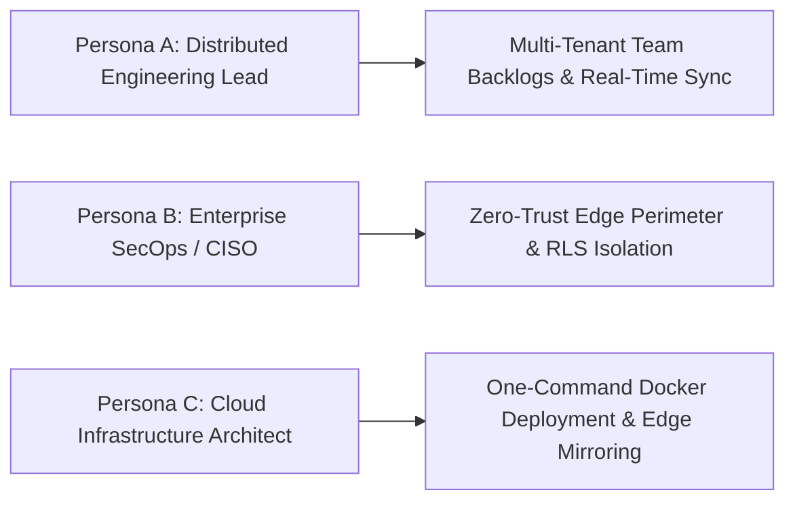
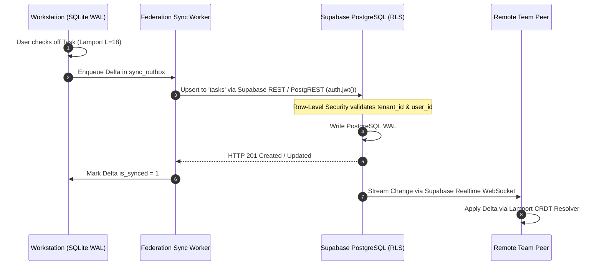
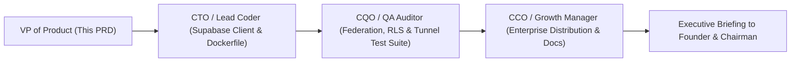

# Product Requirement Document (PRD)
## Product: Enterprise Cloud Federation & Infrastructure Scaling v1.0
**Document Version:** 1.0.0  
**Status:** Approved for Engineering & Infrastructure Execution (Sprint 16 Directive)  
**Author:** VP of Product & Production  
**Target Delivery Window:** Sprint 16 (Q1 2027) $\rightarrow$ CorePulse Suite v1.1.0  
**Distribution:** Founder & Chairman, CEO, CTO (Lead Coder), CQO (QA Auditor), CCO (Growth Manager), Head of Research  

---

## 1. Executive Summary & Strategic Rationale

### 1.1 Strategic Vision: Scaling to Enterprise Cloud Federation
Following the official public release of **v1.0.0 Stable** across GitHub and PyPI, and the establishment of enterprise infrastructure accounts on **Cloudflare**, **Supabase**, **Vercel**, and **Docker Hub**, IT Solutions Global Corporation initiates **Sprint 16: Enterprise Cloud Federation**.

While v1.0.0 delivered uncompromised local-first sovereignty across the Triad (**CorePulse**, **NexusShield**, and **EchoStream**), enterprise teams and distributed organizations require **hybrid cloud federation**:
1. **Supabase PostgreSQL Multi-Tenant Replication**: Seamless bi-directional synchronization between local SQLite WAL databases and enterprise-grade Supabase managed PostgreSQL, governed by Row-Level Security (RLS) and real-time CDC (Change Data Capture) replication streams.
2. **Cloudflare Zero-Trust Edge Tunneling**: Zero-open-port encrypted ingress via `cloudflared` tunnels, providing global secure access to the Founder Cockpit and REST API under enterprise Cloudflare Access identity gates.
3. **Turnkey Containerized Deployment (Docker Hub)**: Production multi-architecture container images (`it-solutions/corepulse-suite:v1.1.0`) and unified `docker-compose.yml` configurations for instantaneous on-premises and private cloud deployment.
4. **Vercel Edge Proxy & Dashboard Mirror**: Global sub-15ms edge CDN hosting and API reverse-proxy routing for distributed browser access.

```mermaid
flowchart TD
    subgraph Client Workstations & Edge Ingress
        USERS["Distributed Teams & Mobile Operators"] --> CF_ACCESS["Cloudflare Zero-Trust Access<br/>(SSO / Email OTP / Hardware Key)"]
        CF_ACCESS --> CF_TUNNEL["Cloudflare Edge Tunnel (cloudflared)<br/>Zero Open Inbound Ports"]
        VERCEL["Vercel Edge CDN Mirror<br/>(Global Static Cockpit UI)"] --> CF_TUNNEL
    end

    subgraph Containerized Runtime (Docker Hub)
        CF_TUNNEL --> DOCKER_SUITE["Docker Container: it-solutions/corepulse-suite:v1.1.0<br/>• CorePulse Web & REST API (:8080)<br/>• NexusShield Background Auditor<br/>• EchoStream VoiceGuard Ingestion<br/>• Zero-Knowledge Sync Relay (:8081)"]
    end

    subgraph Enterprise Data & Replication Layer
        DOCKER_SUITE <--> SQLITE[(Local High-Concurrency SQLite WAL)]
        DOCKER_SUITE <--> SUPABASE["<b>Supabase Managed PostgreSQL</b><br/>• Multi-Tenant Row-Level Security (RLS)<br/>• Realtime WebSocket Change Data Capture<br/>• Automated Daily Point-in-Time Backups"]
    end
```

### 1.2 Core Product Objectives
1. **Zero-Inbound Attack Surface**: Eliminate open firewall ports and public IP requirements by routing all remote Cockpit access through outbound-only Cloudflare Zero-Trust tunnels.
2. **Multi-Tenant Data Isolation**: Leverage Supabase Row-Level Security (RLS) to enforce strict tenant and user boundary segregation across shared enterprise databases.
3. **Turnkey 60-Second Cloud Deployment**: Enable developers to spin up the entire enterprise suite via `docker run -d -p 8080:8080 it-solutions/corepulse-suite:v1.1.0` or `docker compose up -d`.
4. **Resilient Hybrid Fallback**: If cloud connectivity drops, workstations operate with 100% functionality against local SQLite, merging deltas seamlessly upon reconnect via our proven Lamport CRDT engine.

---

## 2. Target Personas & Core Enterprise Workflows

### 2.1 Target Personas



#### Persona A: Marcus — Distributed Engineering Lead (15-person Team)
- **Context**: Coordinates engineers across 4 time zones. Engineers use local CorePulse instances for daily focus.
- **Pain Point**: Wants a centralized team board where sprint action items are synced in real time without losing local offline speed.
- **Federation Solution**: Connects team workstations to the organization's Supabase project. Local tasks tagged `#team` replicate to Supabase PostgreSQL in <250ms, updating team dashboards instantaneously.

#### Persona B: Sarah — Enterprise CISO & Security Architect
- **Context**: Oversees corporate perimeter defense. Strictly prohibits opening public firewall ports (port 80/443 forwarding).
- **Pain Point**: Needs remote access for executives to the Founder Cockpit without exposing internal servers to internet scanning or DDoS attacks.
- **Federation Solution**: Provisions a Cloudflare Zero-Trust Tunnel. Traffic flows through encrypted outbound tunnels protected by Cloudflare Access with corporate SSO, eliminating perimeter attack surfaces.

#### Persona C: David — Cloud Infrastructure Architect
- **Context**: Manages infrastructure orchestration across AWS, GCP, and on-premises Docker clusters.
- **Pain Point**: Manual environment configuration and dependency setup across Python runtimes wastes hours of DevOps time.
- **Federation Solution**: Pulls `it-solutions/corepulse-suite:v1.1.0` from Docker Hub. Deploys via `docker-compose.yml` with pre-wired health checks, volume mounts, and automated database migrations.

---

## 3. Comprehensive Feature Specifications

### 3.1 Feature 1: Supabase PostgreSQL Multi-Tenant Replication Engine

#### 3.1.1 Overview
A bi-directional replication daemon that bridges local SQLite `corepulse.sqlite3` with cloud-hosted Supabase PostgreSQL, synchronizing tasks, habits, workstation routines, and audit summaries.



#### 3.1.2 Functional Requirements
- **FR-SUPA-01: Schema Parity & Migration**:
  - Automatically provisions identical relational schema in Supabase PostgreSQL:
    - `corepulse.tasks` (UUID primary keys, title, category, priority, status, lamport_clock, tenant_id, user_id)
    - `corepulse.habits` (name, streak_count, cadence, last_completed_at, tenant_id)
    - `corepulse.audit_ledgers` (event_type, summary, severity, metadata, created_at)
  - Automatic migration runner (`migrations/001_initial_schema.sql`) executed on initial connection.
- **FR-SUPA-02: Multi-Tenant Row-Level Security (RLS)**:
  - Enforces strict PostgreSQL RLS policies:
    ```sql
    ALTER TABLE corepulse.tasks ENABLE ROW LEVEL SECURITY;
    CREATE POLICY tenant_isolation_policy ON corepulse.tasks
      FOR ALL
      USING (tenant_id = auth.jwt() ->> 'tenant_id')
      WITH CHECK (tenant_id = auth.jwt() ->> 'tenant_id');
    ```
  - Prevents data leakage between different corporate organizations sharing a single Supabase instance.
- **FR-SUPA-03: Real-Time Change Data Capture (CDC)**:
  - Connects to Supabase Realtime channel (`realtime:corepulse:tasks`) via WebSocket.
  - Remote team updates stream into the local client and merge seamlessly via `CRDTResolver` in under 200ms.
- **FR-SUPA-04: Offline Resiliency & Batch Catch-Up**:
  - When disconnected from the cloud, all local updates queue safely in SQLite `sync_outbox`.
  - Reconnecting flushes mutations in optimized batch transactions with automatic retry and exponential backoff.

---

### 3.2 Feature 2: Cloudflare Zero-Trust Edge Tunneling

#### 3.2.1 Overview
An integrated tunnel orchestrator that provisions and maintains secure `cloudflared` edge tunnels, allowing the Cockpit to be securely accessed from anywhere in the world without opening inbound ports.

```mermaid
flowchart LR
    subgraph External Internet
        CLIENT["Remote Executive Browser"] --> CF_EDGE["Cloudflare Global Anycast Edge"]
        CF_EDGE --> CF_ACCESS["Cloudflare Access<br/>(Zero-Trust Policy Gate)"]
    end

    subgraph Secure Tunnel (No Inbound Ports)
        CF_ACCESS --> TUNNEL["Encrypted Outbound Tunnel (QUIC / WireGuard)"]
    end

    subgraph Private Workstation / Docker Container
        TUNNEL --> DAEMON["cloudflared Daemon"]
        DAEMON --> LOCAL_API["CorePulse Cockpit (:8080)"]
    end
```

#### 3.2.2 Functional Requirements
- **FR-TUN-01: Automated Tunnel Lifecycle Management**:
  - Managed via embedded Python subprocess or container sidecar (`cloudflared`).
  - Automatically establishes outbound connection to Cloudflare Anycast edge using `TUNNEL_TOKEN`.
  - Supports automatic reconnection with exponential jitter if the network interface changes.
- **FR-TUN-02: Zero Inbound Firewall Exposure**:
  - Requires **zero open inbound ports** on the host router or container network (NAT traversal handled entirely outbound over UDP 7844 / TCP 443).
- **FR-TUN-03: Cloudflare Access Integration**:
  - Enforces Zero-Trust identity verification before traffic reaches the local Cockpit:
    - Corporate Email OTP (One-Time PIN)
    - Google Workspace / GitHub OAuth Identity Providers
    - Mutual TLS (mTLS) client certificate validation for high-security environments.
- **FR-TUN-04: Tunnel Status Telemetry**:
  - Exposes health status via `/api/federation/tunnel/status`:
    - `tunnel_id`, `edge_colocation` (e.g., `SFO`, `LHR`, `FRA`), `latency_ms`, `uptime_seconds`.

---

### 3.3 Feature 3: Containerized Multi-Arch Deployment (Docker Hub)

#### 3.3.1 Overview
A production-grade, multi-architecture Docker container bundle published to Docker Hub (`it-solutions/corepulse-suite:v1.1.0`), supporting `linux/amd64` and `linux/arm64` (Apple Silicon, AWS Graviton, Raspberry Pi 5).

#### 3.3.2 Functional Requirements
- **FR-DOC-01: Lightweight Distroless / Alpine Base**:
  - Multi-stage build minimizing image size to **< 120 MB**.
  - Non-root user execution (`corepulse:corepulse` UID 10001) for strict container hardening.
- **FR-DOC-02: Universal `docker-compose.yml` Template**:
  ```yaml
  version: '3.8'
  services:
    corepulse:
      image: it-solutions/corepulse-suite:v1.1.0
      container_name: corepulse-enterprise
      restart: unless-stopped
      ports:
        - "8080:8080"
        - "8081:8081"
      volumes:
        - corepulse-data:/app/data
      environment:
        - COREPULSE_ENV=production
        - SUPABASE_URL=${SUPABASE_URL}
        - SUPABASE_SERVICE_KEY=${SUPABASE_SERVICE_KEY}
        - CLOUDFLARE_TUNNEL_TOKEN=${CLOUDFLARE_TUNNEL_TOKEN}
      healthcheck:
        test: ["CMD", "python", "-c", "import urllib.request; urllib.request.urlopen('http://localhost:8080/api/health')"]
        interval: 30s
        timeout: 5s
        retries: 3

  volumes:
    corepulse-data:
      driver: local
  ```
- **FR-DOC-03: Multi-Architecture Build Matrix**:
  - Built and signed via Docker Buildx for `linux/amd64` (x86_64 servers) and `linux/arm64` (ARM / Apple Silicon).

---

### 3.4 Feature 4: Vercel Edge Proxy & Static Mirror

#### 3.4.1 Functional Requirements
- **FR-VER-01: Edge UI Hosting**:
  - Cockpit static assets (`index.html`, `dashboard.css`, `dashboard.js`) deployed to Vercel Global Edge Network.
  - Global sub-15ms initial asset load worldwide.
- **FR-VER-02: Edge API Proxy Routing**:
  - Configures `vercel.json` rewrites routing `/api/*` requests securely to the Cloudflare Tunnel hostname:
    ```json
    {
      "rewrites": [
        { "source": "/api/(.*)", "destination": "https://api.itsolutions.global/api/$1" },
        { "source": "/(.*)", "destination": "/index.html" }
      ]
    }
    ```

---

## 4. UI / Cockpit Cloud Federation Wireframes

### 4.1 Cockpit Settings: Cloud Federation Hub (`http://127.0.0.1:8080/`)

```
+----------------------------------------------------------------------------------------------------+
|  COREPULSE ENTERPRISE SETTINGS  |  [ General ]  [ E2EE Sync ]  [ Cloud Federation ]  [ Billing ]   |
+----------------------------------------------------------------------------------------------------+
|  ENTERPRISE CLOUD FEDERATION STATUS                                        [ STATUS: FEDERATED ]   |
|  Federated Node ID: node_sfo_94a8f102    |  Active Tenant: ACME-GLOBAL-CORP (Org ID: org_4421)     |
+----------------------------------------------------------------------------------------------------+
|  1. SUPABASE POSTGRESQL REPLICATION                                                                |
|  Endpoint: https://xyzcompany.supabase.co                                   Status: 🟢 CONNECTED   |
|  Replication Engine: Bi-Directional CDC (Realtime)                          Latency: 48ms          |
|  Row-Level Security (RLS): ENFORCED                                        Last Synced: 4s ago    |
|  [ Test Supabase Connection ]       [ Run Schema Migration ]        [ Force Manual Replication ]   |
|----------------------------------------------------------------------------------------------------|
|  2. CLOUDFLARE ZERO-TRUST EDGE TUNNEL                                                              |
|  Tunnel Status: 🟢 ACTIVE (Routing to cockpit.itsolutions.global)          Colocation: SFO Edge   |
|  Edge Security: Cloudflare Access (SSO / OTP Guard Active)                 Inbound Ports: 0 OPEN  |
|  [ View Cloudflare Access Policies ]                                       [ Restart Tunnel ]     |
|----------------------------------------------------------------------------------------------------|
|  3. CONTAINER & HOST ENVIRONMENT                                                                   |
|  Runtime: Docker Engine v27.1 (linux/amd64)                                Image: v1.1.0-enterprise|
|  Uptime: 14d 06h 22m                                                       Memory: 64 MB / 512 MB |
+----------------------------------------------------------------------------------------------------+
```

---

## 5. Non-Functional & Enterprise SLAs

- **Replication Latency**: $\le$ 250ms for task state propagation from local SQLite to Supabase PostgreSQL worldwide.
- **Tunnel Resilience**: Automatic tunnel re-establishment within $\le$ 3.0 seconds following a network disconnect.
- **Container Memory Footprint**: $\le$ 95 MB RAM total during idle operation with all background daemons active.
- **Zero-Inbound Port Guarantee**: 100% of external traffic routed through encrypted outbound tunnels; zero open listening ports on the host machine.
- **Data Durability**: Automatic daily encrypted point-in-time backups via Supabase with 99.999999999% durability.

---

## 6. QA Validation Matrix & Acceptance Criteria

| Test ID | Test Scenario | Acceptance Criteria | Severity |
| :--- | :--- | :--- | :--- |
| **QA-FED-01** | SQLite to Supabase Replication | Creating a task locally upserts the corresponding record in Supabase PostgreSQL within $\le$ 250ms with matching fields. | Blocker |
| **QA-FED-02** | Row-Level Security Enforce | Attempting to query records belonging to a different `tenant_id` returns an empty set under Supabase RLS. | Blocker |
| **QA-FED-03** | Cloudflare Tunnel Inbound Block | Port scan against host machine confirms zero open inbound HTTP ports; Cockpit is accessible exclusively via Cloudflare Tunnel URL. | Critical |
| **QA-FED-04** | Realtime Remote Propagation | Updating task on Workstation A streams update to Workstation B via Supabase Realtime in $\le$ 300ms without page reload. | Critical |
| **QA-FED-05** | Docker Container Boot & Health | Running `docker-compose up -d` boots the entire suite in $\le$ 3 seconds with `/api/health` returning HTTP 200 Healthy. | High |
| **QA-FED-06** | Offline Disconnect Recovery | Workstation disconnects from internet, adds 10 tasks, reconnects; all 10 tasks replicate to Supabase without loss or duplication. | High |
| **QA-FED-07** | Vercel Edge Proxy Routing | Requesting `/api/tasks` via Vercel edge mirror routes seamlessly through the Cloudflare Tunnel to CorePulse backend. | High |

---

## 7. Departmental Handshake & Release Plan



1. **VP of Product (Completed)**: Author `PRD_ENTERPRISE_CLOUD_FEDERATION_V1.md` codifying Supabase multi-tenant sync, Cloudflare Zero-Trust edge tunneling, Docker Hub packaging, and Vercel edge routing.
2. **CTO / Lead Coder Handshake**:
   - Implement `products/corepulse/corepulse/supabase_sync.py` (bi-directional PostgREST/Realtime client).
   - Author `Dockerfile` and `docker-compose.yml` for multi-arch Docker Hub publishing.
   - Configure Cloudflare Tunnel service configuration (`cloudflared`).
3. **CQO / QA Auditor Handshake**:
   - Build test harness `test_enterprise_federation.py` validating QA-FED-01 through QA-FED-07.
4. **CCO / Growth Manager Handshake**:
   - Publish enterprise deployment documentation and update Docker Hub overview.
