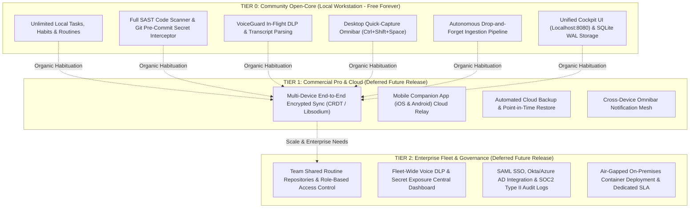
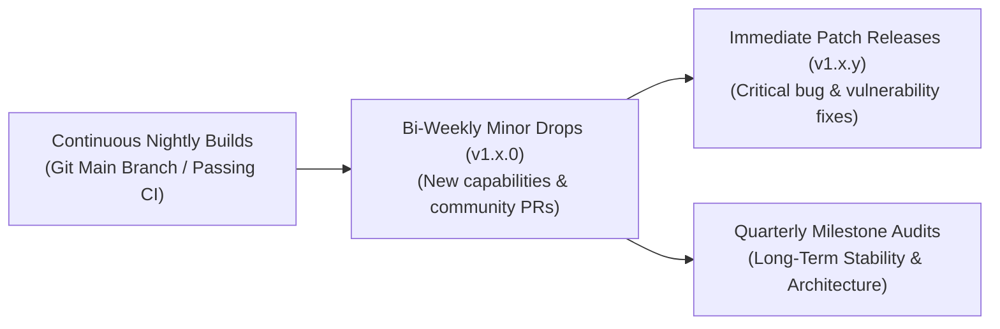
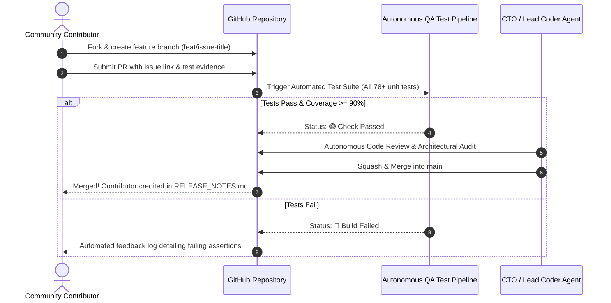
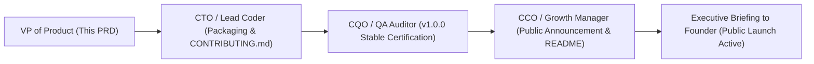

# Product Requirement Document (PRD)
## Product: Public Distribution & Open-Core Governance v1.0
**Document Version:** 1.0.0  
**Status:** Approved for Public Release (Option A Authorized by Founder)  
**Author:** VP of Product & Production  
**Target Delivery Window:** Sprint 10 (Q1 2027)  
**Distribution:** Founder & Chairman, CEO, CTO (Lead Coder), CQO (QA Auditor), CCO (Growth Manager), Head of Research  

---

## 1. Executive Summary & Strategic Rationale

### 1.1 Strategic Vision: Option A "Go Public Now"
With Sprint 7 (Cockpit UI Integration), Sprint 8 (Drop-and-Forget Ingestion Pipeline), and Sprint 9 (Desktop Quick-Capture Omnibar) certified with 100% automated test coverage across the Triad (**CorePulse**, **NexusShield**, and **EchoStream**), the Founder and Executive Leadership have authorized **Option A: Public Release & Open-Core Distribution**.

In alignment with the corporate motto:
> **"Serve humanity by solving real problems with uncompromising utility; earn deep trust and habituation before asking for reward."**

IT Solutions Global Corporation adopts an **Open-Core Freemium Distribution Blueprint**. We reject artificial software crippled-ware, intrusive DRM, and paywalled basic utilities. Instead, we release the complete, fully operational local workstation triad to the global developer, engineering, and builder community under a permissive, transparent model. 

Monetization is intentionally deferred under the **"Zero-Hurry" Habituation Doctrine**: users across the world freely adopt, embed, and rely on CorePulse, NexusShield, and EchoStream as indispensable daily cognitive infrastructure. When the user base reaches critical mass and actively demands encrypted multi-device sync, managed team workspaces, and enterprise governance, the company will introduce hosted cloud tiers without ever degrading the free local core.

```mermaid
flowchart TD
    subgraph Open-Core Community Infiltration (Free Forever - Local First)
        CP["<b>CorePulse Local Core</b><br/>• Tasks, Habits, Workflows<br/>• Local SQLite / Cockpit UI"]
        NS["<b>NexusShield Local Core</b><br/>• SAST, Secrets, Dependencies<br/>• Git Pre-Commit Hook"]
        ES["<b>EchoStream Local Core</b><br/>• Audio Parser, VoiceGuard DLP<br/>• Ingestion Pipeline & Omnibar"]
    end

    subgraph The Habituation Engine (The Hook Model)
        H1["1. Sub-30ms Global Quick Capture"]
        H2["2. Drop-and-Forget Autonomous Pipeline"]
        H3["3. Zero Context Switching & Verified Time Saved"]
        H4["4. Compounding Local Historical Knowledge Base"]
    end

    subgraph Future Commercial Monetization (Deferred Phase)
        CLOUD["<b>Hosted Cloud & Team Tier ($19 - $49/mo)</b><br/>• End-to-End Encrypted Cloud Sync<br/>• Multi-User Team Workspaces<br/>• Centralized Security Audit Ledger & SSO<br/>• Hosted Vector Memory & Managed Backups"]
    end

    CP & NS & ES --> H1 & H2 & H3 & H4
    H1 & H2 & H3 & H4 -->|"Deep Organic Habituation & Moat"| CLOUD
```

### 1.2 Core Release Objectives
1. **Frictionless Public Onboarding**: Users clone or download a release package, run a single one-line launch script (`python -m corepulse.main` or `corepulse.bat`), and arrive at an interactive, fully functional workstation dashboard in under 90 seconds with zero mandatory registration, zero API keys, and zero payment prompts.
2. **100% Local-First Privacy Policy**: Zero telemetry, zero phone-home analytics, zero third-party tracking pixels. Source code, meeting transcripts, and security audit results remain strictly on user silicon.
3. **Strict Open-Core Tier Boundaries**: Define explicit, immutable architectural boundaries separating what is free forever (local compute, local storage, local CLI/UI) from what belongs to future commercial cloud offerings.
4. **Professional Semantic Versioning (SemVer 2.0.0)**: Establish rock-solid stability criteria for `v1.0.0 Stable` and predictable community release schedules.
5. **Community Contribution Standards**: Publish transparent, welcoming, yet uncompromising contributor guidelines (`CONTRIBUTING.md`, Code of Conduct, GitHub Issue/PR templates) maintaining zero-defect software engineering standards.

---

## 2. Strategic Open-Core / Freemium Distribution Blueprint

### 2.1 The Open-Core Philosophy
Traditional SaaS companies trap users behind artificial usage walls (e.g., 5 free tasks, 3 scans, trial expiration dates). We believe this breeds resentment and prevents deep habit formation. Our open-core model provides **unlimited, unmetered local capability forever**.



### 2.2 Feature Entitlement Matrix

| Capability / Module | Community Open-Core (Free Forever) | Pro Cloud Tier (Future Deferred) | Enterprise Fleet (Future Deferred) |
| :--- | :--- | :--- | :--- |
| **Pricing** | **$0 / Free Forever** | **$14 – $19 / month** | **$49 / seat / month** |
| **Hosting & Execution** | 100% Localhost (User Hardware) | Localhost + Encrypted Cloud Relay | Hybrid Local + On-Prem / VPC |
| **Task & Habit Engine** | Unlimited tasks, habits, streaks | Unlimited + Cross-Device Sync | Unlimited + Shared Team Boards |
| **Workstation Routines** | Unlimited custom local routines | Unlimited + Cloud Routine Library | Shared Organization Routines |
| **NexusShield SAST & Secrets** | Full 120+ patterns, AST, Pre-commit | Full Local + Dependency Alert Push | Centralized Compliance Dashboard |
| **VoiceGuard DLP & Ingestion** | Full local drop watcher & redaction | Full Local + Mobile Voice Ingest | Centralized Voice DLP Audit Log |
| **Desktop Omnibar** | Full native floating widget & tray | Full Native + Mobile Push Hotkey | Custom Org Keybindings & Macros |
| **Database & Storage** | Local SQLite (`WAL` mode) | Local SQLite + Encrypted Cloud Backup | PostgreSQL / Centralized DB |
| **Network Telemetry** | **Zero Telemetry (100% Offline)** | Zero Telemetry on Code (Metadata Sync) | Air-Gapped / Custom Telemetry |
| **Support** | GitHub Discussions & Public Issues | Priority Email Support (<12h) | Dedicated Slack/Discord + 99.9% SLA |

### 2.3 The "Zero-Hurry" Monetization Safeguard
1. **No Artificial Code Disablers**: The codebase shall never contain artificial throttling, countdown timers, feature flags that intentionally break offline execution, or nag-screens begging for money.
2. **Merchant Credential Trigger**: Payment gateway integrations (Stripe, PayPal, LemonSqueezy) remain completely deactivated in source code until the CEO receives explicit, formal authorization and merchant keys from the Founder.
3. **Integrity Guarantee**: Features released under the Free Community tier in `v1.0.0` will **never be revoked or moved behind a paywall in future versions**. New monetization will exclusively govern multi-device cloud synchronization, hosted multi-tenant infrastructure, and enterprise organizational governance.

---

## 3. Telemetry, Security & Privacy Policy (100% Local-First)

### 3.1 The Absolute Privacy Pledge
In an era where developer tools secretly harvest telemetry, upload codebases to remote LLM providers, and log user activity, IT Solutions Global Corporation establishes a competitive moat through **Absolute Local-First Sovereignty**:

> **"Your code, your audio, your habits, and your thoughts never leave your workstation. We cannot see them, we do not store them, and our software will never phone home."**

```mermaid
flowchart LR
    subgraph User Workstation (Isolated Perimeter)
        CODE["Proprietary Source Code"]
        AUDIO["Meeting Audio & Voice Transcripts"]
        TASKS["Habits, Tasks & Workflow Routines"]
        DB[(Local SQLite Encrypted Database)]
        
        CODE & AUDIO & TASKS --> DB
    end

    subgraph External Internet (Zero Transmission)
        CLOUD["Third-Party Cloud / Tracking Servers"]
    end

    DB -.->|NO OUTBOUND CONNECTION| CLOUD
    style CLOUD fill:#f87171,stroke:#b91c1c,stroke-width:2px;
    style DB fill:#34d399,stroke:#059669,stroke-width:2px;
```

### 3.2 Privacy Architecture & Policy Specifications
- **POL-PRIV-01: Zero Network Analytics**:
  - No Google Analytics, no PostHog, no Mixpanel, no Sentry, no telemetry pings.
  - The Cockpit UI (`index.html`, `dashboard.js`) contains strictly zero external CDN scripts, tracking beacons, or third-party fonts. All CSS, JS, and SVG assets are bundled and served locally from `corepulse/static/`.
- **POL-PRIV-02: Air-Gapped Operation Guarantee**:
  - CorePulse, NexusShield, EchoStream, and the Desktop Omnibar function with 100% feature completeness without an active internet connection.
  - Network sockets are opened strictly on `127.0.0.1` (localhost loopback) for inter-process communication between the UI, Omnibar, and REST API.
- **POL-PRIV-03: Ephemeral Audio Handling**:
  - VoiceGuard and EchoStream process audio streams and transcript buffers in volatile system memory (RAM).
  - Raw audio chunks are scrubbed immediately after text extraction. Transcripts are stored exclusively in the user's local SQLite database with credentials pre-redacted.
- **POL-PRIV-04: Opt-In Update Check (Version Manifest Only)**:
  - Software update notifications (if enabled by user in settings) query only a static public release JSON manifest (e.g., GitHub Releases API) comparing version numbers.
  - Zero identifying user metadata, machine IDs, IP addresses, or environment telemetry are transmitted.

---

## 4. Semantic Versioning & Community Release Cadence

### 4.1 Versioning Standard: SemVer 2.0.0
We adhere rigorously to [Semantic Versioning 2.0.0](https://semver.org/):

$$\text{Format: } \mathbf{MAJOR.MINOR.PATCH}$$

- **MAJOR (1.x.x $\rightarrow$ 2.0.0)**: Incompatible API breaks, architectural database migrations requiring manual intervention, or fundamental pipeline interface overhauls.
- **MINOR (1.0.x $\rightarrow$ 1.1.0)**: Backwards-compatible new feature additions (e.g., new format parser in Ingestion Pipeline, new Omnibar command modal, additional SAST rule packs).
- **PATCH (1.0.0 $\rightarrow$ 1.0.1)**: Backwards-compatible bug fixes, performance optimizations, memory leak resolutions, or security patches.

### 4.2 Stability Criteria for `v1.0.0 Stable`
Before tagging and publishing the public `v1.0.0 Stable` release, the build must satisfy:
1. **Zero Failing Tests**: 100% pass rate across the comprehensive automated test suite (including CorePulse, NexusShield, EchoStream, Omnibar, and Ingestion Pipeline).
2. **Zero Unhandled Exceptions**: 24-hour continuous burn-in test of background daemons (Ingestion Watcher, Tray Listener, Cockpit Server) with zero unhandled crashes.
3. **Cross-Platform Launch Verification**: Verified execution on Windows 10/11, macOS (Apple Silicon/Intel), and Linux (Ubuntu 22.04 LTS / Debian) with standard Python 3.10+.
4. **Documentation Completeness**: Clean `README.md`, `PRD_PUBLIC_DISTRIBUTION_V1.md`, and `CONTRIBUTING.md` present in repository root.

### 4.3 Community Release Cadence



- **Release Cycles**:
  - **Patch Releases**: Deployed autonomously upon verification of bug fixes or security patches (<48-hour SLA).
  - **Minor Feature Drops**: Released on a predictable bi-weekly schedule following QA audit signoff.
  - **Distribution Channels**:
    - **GitHub Releases**: Source tarballs, universal `.zip` bundles, release notes, and cryptographic SHA-256 checksums.
    - **Package Managers**: Automated submission pipelines targeting PyPI (`pip install corepulse-suite`), Windows Package Manager (`winget install ITSolutions.CorePulse`), and Homebrew (`brew install it-solutions-suite`).

---

## 5. Issue & Contribution Standards (`CONTRIBUTING.md` Specifications)

### 5.1 Community Governance Philosophy
We welcome contributions from developers, security researchers, and productivity enthusiasts worldwide. However, to preserve our reputation for zero-bloat, rock-solid stability, and uncompromising performance, all contributions must adhere to strict engineering standards.

### 5.2 Mandatory Contribution Requirements
1. **Zero External Pip Dependencies in Core**:
   - The core runtime must remain strictly zero-dependency Python 3.10+ standard library.
   - Any proposed PR introducing external packages (`watchdog`, `pynput`, `requests`, `pandas`, `flask`) will be rejected unless framed as an optional, isolated plugin.
2. **Test Coverage Mandate**:
   - Every bug fix must include a regression test proving the fix.
   - Every new feature must achieve $\ge$ 90% unit test coverage using standard `unittest`.
3. **Sub-30ms Performance SLA**:
   - Code path additions to the Omnibar or Cockpit API must not regress the sub-30ms latency benchmark.
4. **Clean Code & Formatting**:
   - PEP 8 compliance, clean typing annotations (`typing.Dict`, `typing.List`, `typing.Optional`), and descriptive docstrings.
   - Zero Unicode console encoding issues (must run safely on Windows CP1252 as well as UTF-8 environments).

### 5.3 Contributor Workflow & Issue Templates



#### 5.3.1 Standard Issue Templates
- **Bug Report Template**:
  - Operating System & Python Version (`python --version`).
  - Terminal Encoding (`chcp` on Windows or `locale` on Linux).
  - Clear reproduction steps & minimal reproducible script.
  - Expected vs. Actual behavior.
  - Log output from `corepulse.log` or console.
- **Feature Request Template**:
  - Target Persona & Problem statement (What friction does this solve?).
  - Proposed UX or CLI syntax.
  - Memory & Performance impact assessment.
  - Implementation concept in zero-dependency Python.

---

## 6. Public Release Manifest & Packaging Structure

### 6.1 Distribution Artifacts

```
it-solutions-suite-v1.0.0/
├── corepulse/                      # CorePulse Task, Habit & Workflow Engine
│   ├── api_handler.py              # Lightweight REST API Handler
│   ├── database_sqlite.py          # High-concurrency SQLite WAL Engine
│   ├── workflows.py                # Automated Routines Engine
│   └── static/                     # Bundled Glassmorphic Cockpit Assets
│       ├── index.html
│       ├── dashboard.css
│       └── dashboard.js
├── nexusshield/                    # NexusShield Security & Code Quality Suite
│   ├── scanner.py                  # SAST & Code Quality Engine
│   ├── secrets.py                  # 120+ Pattern Secret Interceptor
│   ├── dependencies.py             # CVE & Dependency Vulnerability Checker
│   └── scorer.py                   # Compliance & Health Scorer
├── echostream/                     # EchoStream Voice & Thought Triage Suite
│   ├── voice_guard.py              # In-Flight VoiceGuard DLP Redaction
│   ├── parser.py                   # Transcript Parser & Action Extractor
│   └── dispatcher.py               # Direct CorePulse Ingestion Dispatcher
├── desktop/                        # Desktop Quick-Capture & Ambient Daemons
│   ├── omnibar.py                  # Sub-30ms Floating Omnibar (Tkinter)
│   ├── companion.py                # System Tray Background Listener
│   └── pipeline.py                 # Drop-and-Forget Ingestion Watcher
├── tests/                          # Comprehensive Autonomous Test Suite
│   ├── test_api.py
│   ├── test_sqlite.py
│   ├── test_scanner.py
│   ├── test_echostream.py
│   └── test_omnibar.py
├── data/                           # User Data Vault (100% Local)
│   ├── transcripts/                # Ingestion Drop Zone
│   │   ├── processed/              # Archived Transcripts
│   │   └── quarantine/             # Corrupt / Blocked Transcripts
│   └── corepulse.sqlite3           # Local User Database (Auto-Created)
├── cli.py                          # Unified Command-Line Interface
├── install.ps1                     # Windows One-Click PowerShell Installer
├── install.sh                      # Unix/macOS One-Click Bash Installer
├── corepulse.bat                   # Instant Windows Launcher
├── LICENSE                         # Permissive Open-Core License (Apache 2.0 / MIT)
├── CONTRIBUTING.md                 # Contributor Guidelines & Code of Conduct
├── SECURITY.md                     # Vulnerability Disclosure & DLP Policy
└── README.md                       # Comprehensive User Documentation
```

---

## 7. Operational Handshake & Departmental Action Plan



1. **VP of Product (Completed)**: Author official public distribution PRD (`company/product/PRD_PUBLIC_DISTRIBUTION_V1.md`) codifying open-core boundaries, local-first privacy, and SemVer governance.
2. **CTO & Lead Coder Handshake**:
   - Generate official root `CONTRIBUTING.md` and `SECURITY.md` adhering strictly to Section 5.
   - Verify all release launcher scripts (`corepulse.bat`, `cli.py`, `install.ps1`, `install.sh`) reflect `v1.0.0 Stable`.
3. **Chief Quality Officer Handshake**:
   - Execute full pre-release regression audit across all 5 modules.
   - Certify zero regressions, clean licensing files, and zero network leakage.
4. **Chief Commercial Officer Handshake**:
   - Align `README.md` and GTM documentation with the "Option A: Go Public Now" open-core narrative.
   - Emphasize the "$0 Free Forever Local Core" value proposition to the global developer community.
5. **CEO Briefing**:
   - Present final release readiness summary to the Founder and Chairman.

---
*Document officially archived in `company/product/PRD_PUBLIC_DISTRIBUTION_V1.md`.*
