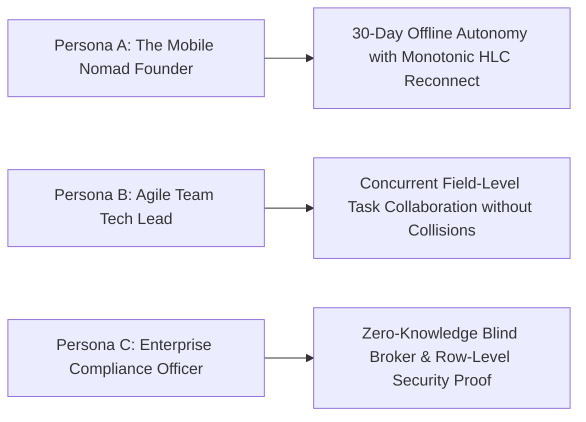
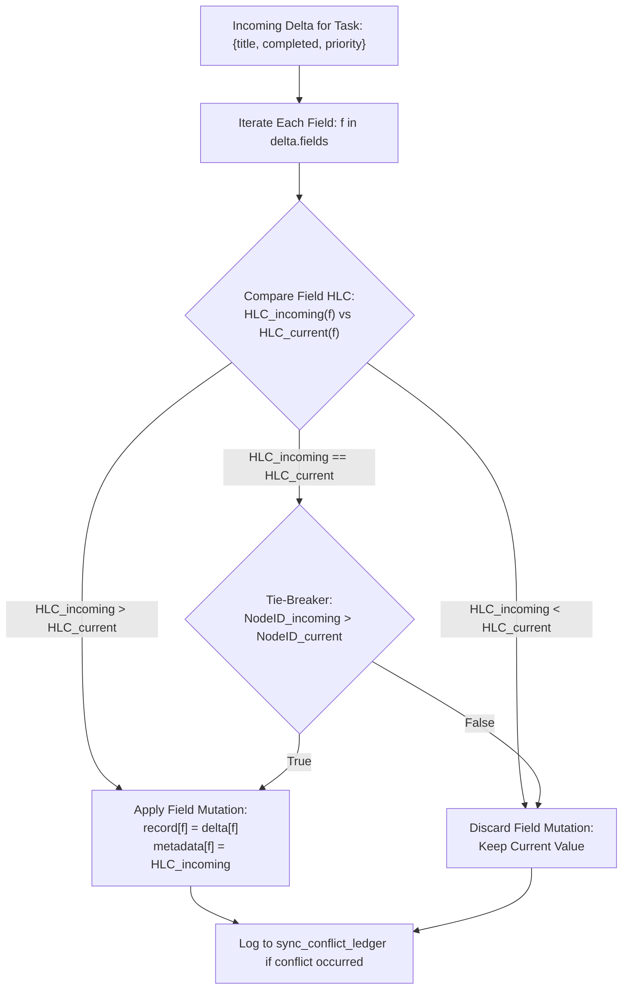
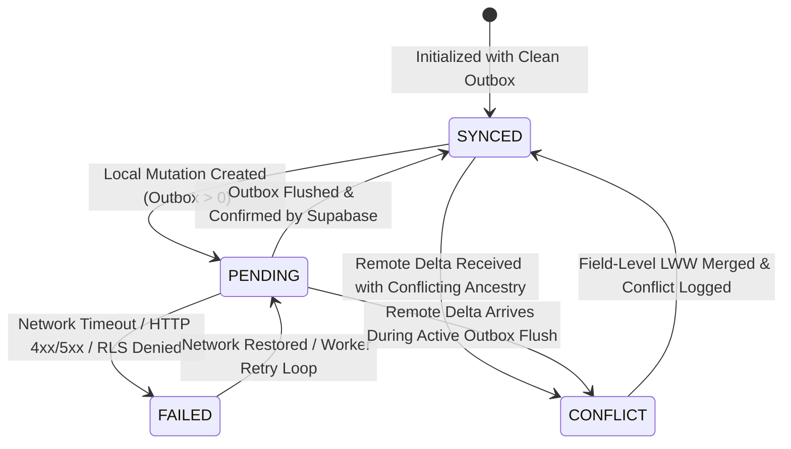
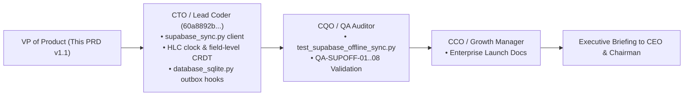

# Product Requirement Document (PRD)
## Product: Supabase Offline-First Sync & Multi-Tenant RLS Protocol v1.0
**Document Version:** 1.1.0 (Incorporating 2026 Offline-First Benchmark Architecture)  
**Status:** Approved for Engineering Implementation (Executive Order — Sprint 16 Execution)  
**Author:** VP of Product & Production  
**Target Delivery Window:** Sprint 16 (Q1 2027) $\rightarrow$ CorePulse Suite v1.1.0  
**Distribution:** Founder & Chairman, CEO, CTO / Lead Coder (`60a8892b-e17f-4073-8e48-4057cd129829`), CQO (QA Auditor), CCO (Growth Manager), Head of Research  

---

## 1. Executive Summary & Strategic Rationale

### 1.1 Strategic Vision: Hybrid Local-First Cloud Federation
Following the public release of CorePulse Suite **v1.0.0 Stable**, the establishment of enterprise infrastructure accounts (Supabase, Cloudflare, Docker Hub), and the delivery of the *2026 Offline-First Cloud Sync Benchmark* (`company/research/OFFLINE_FIRST_CLOUD_SYNC_BENCHMARK_2026.md`), IT Solutions Global Corporation transitions to an enterprise-grade **Hybrid Local-First Cloud Federation Architecture**.

Under our permanent corporate motto:
> **"Serve humanity by solving real problems with uncompromising utility; earn deep trust and habituation before asking for reward."**

The local workstation remains sovereign. Users never experience lag, spinning loading indicators, or blocked interfaces waiting for cloud round-trips. Every task, habit, routine, and note is committed locally in **< 2ms** to high-concurrency SQLite WAL storage. 

**Supabase Offline-First Sync v1.0** establishes a robust replication bridge between local SQLite (`corepulse.sqlite3`) and cloud-hosted **Supabase PostgreSQL**, engineered around three cutting-edge architectural pillars:
1. **Monotonic Hybrid Logical Clocks (HLC)**: Combines physical microsecond wallclock time with monotonic logical counters, providing strictly ordered causality across offline nodes without NTP clock drift vulnerabilities.
2. **Field-Level Last-Write-Wins (LWW-CRDT) Resolution**: Eliminates destructive row clobbering by resolving conflicts at the individual attribute level (`title`, `completed`, `priority`, `due_date`, `tags`), guaranteeing that concurrent edits survive deterministically.
3. **Zero-Knowledge E2EE Blind Broker Model**: Client-side AES-256-GCM encryption envelopes ensure sensitive task descriptions, habit details, and notes remain encrypted before leaving the workstation. Supabase acts as a blinded, zero-knowledge synchronizer with zero plaintext access.
4. **Multi-Tenant Row-Level Security (RLS)**: Cryptographically enforced PostgreSQL security policies guaranteeing absolute data isolation between organizations, teams, and individual users.
5. **Transparent 4-State Telemetry**: Real-time Cockpit UI status tracking (`PENDING`, `SYNCED`, `CONFLICT`, `FAILED`) giving founders, operators, and engineers instant visual certainty over data persistence.

```mermaid
flowchart TD
    subgraph Client Workstation (Local-First Sovereignty)
        UI["Founder Cockpit UI (Localhost:8080)"] --> SQLITE[(Local SQLite corepulse.sqlite3)]
        SQLITE --> HLC_ENGINE["Hybrid Logical Clock (HLC)<br/>• Monotonic Microsecond Ordering"]
        HLC_ENGINE --> OUTBOX[(supabase_sync_outbox)]
        WORKER["Supabase Offline Sync Worker<br/>• Client-Side E2EE Encryption Envelope<br/>• Field-Level LWW CRDT Merger"]
        OUTBOX --> WORKER
        WORKER --> INBOX[(supabase_sync_inbox)]
        INBOX --> WORKER
        WORKER --> SQLITE
    end

    subgraph Supabase Cloud Infrastructure (Blind Broker Model)
        WORKER <-->|"PostgREST API (HTTPS/JSON)<br/>JWT Auth: tenant_id + user_id"| POSTGREST["Supabase PostgREST Layer"]
        POSTGREST <--> PG_DB[("Enterprise PostgreSQL DB<br/>Schema: corepulse (RLS Enforced)")]
        PG_DB --> RLS{"Row-Level Security (RLS)<br/>tenant_id = auth.jwt()"}
        PG_DB --> CDC["PostgreSQL WAL / CDC"]
        CDC --> REALTIME["Supabase Realtime Engine<br/>(WebSocket Broadcast)"]
        REALTIME -.->|"Sub-200ms Remote Deltas"| WORKER
    end

    subgraph Visual Cockpit Telemetry
        WORKER --> TELEMETRY["Sync State Machine<br/>🟢 SYNCED | 🟡 PENDING | 🟣 CONFLICT | 🔴 FAILED"]
        TELEMETRY --> UI
    end
```

### 1.2 Core Product Objectives
1. **Zero UI Blocking**: Local write latency $\le$ 2ms. All network I/O, encryption, and Supabase PostgREST transactions occur strictly asynchronously in a dedicated worker thread.
2. **Ironclad Multi-Tenant Isolation**: Row-Level Security policies in PostgreSQL prevent any user or tenant from reading, inserting, or modifying data belonging to another tenant under all circumstances.
3. **Field-Level Non-Destructive Convergence**: Two or more workstations editing different fields of the same task offline (e.g. Node A updates `title`, Node B checks `completed`) merge deterministically with zero data loss.
4. **Zero-Knowledge Privacy**: Payload data is encrypted with client-derived keys ($K_{\text{sync}}$) before transmission, ensuring cloud infrastructure providers cannot inspect user tasks or notes.
5. **Real-Time Push & Pull**: Sub-250ms propagation of updates across online devices via Supabase Realtime WebSocket listeners.

---

## 2. Target Personas & Core User Scenarios

### 2.1 Target Personas



#### Persona A: Alex — Mobile Nomad Founder & Operator
- **Context**: Works frequently on flights, cafes, and train commutes with intermittent or non-existent internet (often offline for days or weeks).
- **Pain Point**: Cloud-dependent apps (Notion, Jira, Linear) freeze or overwrite changes when reconnected after extended offline periods.
- **Solution**: Hybrid Logical Clocks preserve causal sequence across 30+ days of offline editing. Upon reconnection, all changes stream to Supabase and merge seamlessly into team state with zero data clobbering.

#### Persona B: Marcus — Agile Team Tech Lead (12 Engineers)
- **Context**: Manages a sprint backlog where team members claim, update, and complete tasks simultaneously across different workstations.
- **Pain Point**: Two engineers updating the same ticket concurrently (e.g., one changes the priority to `@p1`, while the other marks it completed) causes naive sync engines to drop one engineer's update.
- **Solution**: Field-Level LWW-CRDT resolution compares HLC timestamps per field. Both the priority upgrade and the completion status survive and merge into the unified task state.

#### Persona C: Elena — Enterprise Compliance Officer
- **Context**: Audits corporate infrastructure for SOC 2 Type II, GDPR, and HIPAA compliance.
- **Pain Point**: Storing unencrypted task titles, meeting notes, and infrastructure secrets in third-party managed cloud databases violates compliance mandates.
- **Solution**: The Zero-Knowledge E2EE Blind Broker Model encrypts sensitive JSON fields client-side. Supabase stores only ciphertext blobs and metadata tags; enterprise data remains completely private.

---

## 3. System Architecture & Data Model

### 3.1 Monotonic Hybrid Logical Clock (HLC) Specification

To eliminate clock skew vulnerabilities between distributed physical machines, every node runs a **Hybrid Logical Clock (HLC)** as formulated by Kulkarni et al.:

$$\text{HLC} = \Big\langle l, \; c, \; \text{node\_id} \Big\rangle$$

- $l \in \mathbb{N}$: Physical wallclock component (Unix epoch microseconds, monotonic).
- $c \in \mathbb{N}$: Logical counter component incremented when physical time $l$ does not advance.
- $\text{node\_id} \in \text{UUIDv4}$: Deterministic client identifier for global tie-breaking.

#### HLC Advancement Rules:
1. **Local Event (Create / Update / Delete)**:
   $$l' \leftarrow \max(l, \; \text{physical\_time\_us}())$$
   $$\text{If } l' == l \text{ then } c \leftarrow c + 1 \text{ else } c \leftarrow 0$$
   $$l \leftarrow l'$$
2. **Send Event**:
   Stamp outgoing delta with current $\text{HLC} = (l, c, \text{node\_id})$.
3. **Receive Event (from Remote Node)**:
   $$l' \leftarrow \max(l, \; \text{physical\_time\_us}(), \; l_{\text{incoming}})$$
   $$\text{If } l' == l == l_{\text{incoming}} \text{ then } c \leftarrow \max(c, \; c_{\text{incoming}}) + 1$$
   $$\text{Else if } l' == l \text{ then } c \leftarrow c + 1$$
   $$\text{Else if } l' == l_{\text{incoming}} \text{ then } c \leftarrow c_{\text{incoming}} + 1$$
   $$\text{Else } c \leftarrow 0$$
   $$l \leftarrow l'$$

---

### 3.2 Local SQLite Schema Extensions (`corepulse.sqlite3`)

```sql
-- 1. Supabase Sync Outbox: Queues uncommitted local mutations for cloud upload
CREATE TABLE IF NOT EXISTS supabase_sync_outbox (
    id INTEGER PRIMARY KEY AUTOINCREMENT,
    entity_type TEXT NOT NULL,          -- 'task', 'habit', 'workflow', 'note'
    entity_id TEXT NOT NULL,
    action TEXT NOT NULL,               -- 'insert', 'update', 'delete'
    field_deltas JSON NOT NULL,         -- Map of {field_name: {value, hlc, client_id}}
    payload_encrypted TEXT NOT NULL,    -- E2EE AES-256-GCM ciphertext blob
    iv TEXT NOT NULL,                   -- 12-byte initialization vector (hex)
    auth_tag TEXT NOT NULL,             -- 16-byte authentication tag (hex)
    hlc_timestamp TEXT NOT NULL,        -- Serialized HLC: "<l>:<c>:<node_id>"
    client_id TEXT NOT NULL,
    tenant_id TEXT NOT NULL,
    attempts INTEGER DEFAULT 0,
    last_error TEXT,
    created_at DATETIME DEFAULT CURRENT_TIMESTAMP,
    is_synced INTEGER DEFAULT 0         -- 0 = pending, 1 = synced
);

CREATE INDEX IF NOT EXISTS idx_supabase_outbox_pending 
ON supabase_sync_outbox (is_synced, id);

-- 2. Supabase Sync Inbox: Queues remote deltas received from Supabase CDC
CREATE TABLE IF NOT EXISTS supabase_sync_inbox (
    id INTEGER PRIMARY KEY AUTOINCREMENT,
    entity_type TEXT NOT NULL,
    entity_id TEXT NOT NULL,
    action TEXT NOT NULL,
    field_deltas JSON NOT NULL,
    payload_encrypted TEXT NOT NULL,
    iv TEXT NOT NULL,
    auth_tag TEXT NOT NULL,
    hlc_timestamp TEXT NOT NULL,
    client_id TEXT NOT NULL,
    tenant_id TEXT NOT NULL,
    received_at DATETIME DEFAULT CURRENT_TIMESTAMP,
    processed INTEGER DEFAULT 0         -- 0 = pending merge, 1 = merged
);

-- 3. Field-Level HLC Metadata Table (Tracks last-updated HLC per field per entity)
CREATE TABLE IF NOT EXISTS crdt_field_metadata (
    entity_id TEXT NOT NULL,
    field_name TEXT NOT NULL,
    hlc_l BIGINT NOT NULL,
    hlc_c INTEGER NOT NULL,
    client_id TEXT NOT NULL,
    updated_at DATETIME DEFAULT CURRENT_TIMESTAMP,
    PRIMARY KEY (entity_id, field_name)
);

-- 4. Supabase Sync State & Telemetry Ledger
CREATE TABLE IF NOT EXISTS supabase_sync_state (
    key TEXT PRIMARY KEY,
    value TEXT NOT NULL,
    updated_at DATETIME DEFAULT CURRENT_TIMESTAMP
);
```

---

### 3.3 Cloud Supabase PostgreSQL Schema (`corepulse` schema)

```sql
CREATE SCHEMA IF NOT EXISTS corepulse;

-- 1. Tasks Table (Blind Broker Compatible)
CREATE TABLE IF NOT EXISTS corepulse.tasks (
    id TEXT NOT NULL,
    tenant_id TEXT NOT NULL,
    user_id TEXT NOT NULL,
    -- Blind Broker Envelope: Plaintext metadata for indexing & routing
    category TEXT DEFAULT 'General',
    priority TEXT DEFAULT 'medium',
    completed BOOLEAN DEFAULT FALSE,
    due_date TEXT DEFAULT 'Today',
    is_deleted BOOLEAN DEFAULT FALSE,
    -- Zero-Knowledge Encrypted Payload (Title, Notes, Tags, Description)
    encrypted_payload TEXT NOT NULL,
    iv TEXT NOT NULL,
    auth_tag TEXT NOT NULL,
    -- CRDT Resolution Metadata
    field_hlc_map JSONB NOT NULL DEFAULT '{}'::jsonb,
    hlc_timestamp TEXT NOT NULL,
    client_id TEXT NOT NULL,
    created_at TIMESTAMPTZ DEFAULT NOW(),
    updated_at TIMESTAMPTZ DEFAULT NOW(),
    PRIMARY KEY (id, tenant_id)
);

-- 2. Habits Table
CREATE TABLE IF NOT EXISTS corepulse.habits (
    id TEXT NOT NULL,
    tenant_id TEXT NOT NULL,
    user_id TEXT NOT NULL,
    category TEXT DEFAULT 'Ritual',
    streak_count INTEGER DEFAULT 0,
    target_frequency TEXT DEFAULT 'daily',
    last_completed_at TIMESTAMPTZ,
    is_deleted BOOLEAN DEFAULT FALSE,
    encrypted_payload TEXT NOT NULL,
    iv TEXT NOT NULL,
    auth_tag TEXT NOT NULL,
    field_hlc_map JSONB NOT NULL DEFAULT '{}'::jsonb,
    hlc_timestamp TEXT NOT NULL,
    client_id TEXT NOT NULL,
    created_at TIMESTAMPTZ DEFAULT NOW(),
    updated_at TIMESTAMPTZ DEFAULT NOW(),
    PRIMARY KEY (id, tenant_id)
);

-- 3. Field-Level Conflict Resolution Audit Table
CREATE TABLE IF NOT EXISTS corepulse.sync_conflict_ledger (
    id UUID PRIMARY KEY DEFAULT gen_random_uuid(),
    tenant_id TEXT NOT NULL,
    entity_type TEXT NOT NULL,
    entity_id TEXT NOT NULL,
    field_name TEXT NOT NULL,
    winning_client_id TEXT NOT NULL,
    winning_hlc TEXT NOT NULL,
    losing_client_id TEXT NOT NULL,
    losing_hlc TEXT NOT NULL,
    resolution_strategy TEXT DEFAULT 'FIELD_LWW_CRDT',
    resolved_at TIMESTAMPTZ DEFAULT NOW()
);

-- Enable Realtime CDC Replication
ALTER PUBLICATION supabase_realtime ADD TABLE corepulse.tasks;
ALTER PUBLICATION supabase_realtime ADD TABLE corepulse.habits;
```

---

## 4. Multi-Tenant Row-Level Security (RLS) Policies

```sql
-- ====================================================================
-- RLS POLICIES FOR corepulse.tasks
-- ====================================================================
ALTER TABLE corepulse.tasks ENABLE ROW LEVEL SECURITY;

CREATE POLICY tasks_tenant_isolation_select ON corepulse.tasks
    FOR SELECT USING (tenant_id = (auth.jwt() ->> 'tenant_id'));

CREATE POLICY tasks_tenant_isolation_insert ON corepulse.tasks
    FOR INSERT WITH CHECK (
        tenant_id = (auth.jwt() ->> 'tenant_id') AND
        user_id = (auth.jwt() ->> 'sub')
    );

CREATE POLICY tasks_tenant_isolation_update ON corepulse.tasks
    FOR UPDATE USING (tenant_id = (auth.jwt() ->> 'tenant_id'))
    WITH CHECK (tenant_id = (auth.jwt() ->> 'tenant_id'));

CREATE POLICY tasks_tenant_isolation_delete ON corepulse.tasks
    FOR DELETE USING (
        tenant_id = (auth.jwt() ->> 'tenant_id') AND
        auth.jwt() ->> 'user_role' IN ('owner', 'admin')
    );

-- ====================================================================
-- RLS POLICIES FOR corepulse.habits
-- ====================================================================
ALTER TABLE corepulse.habits ENABLE ROW LEVEL SECURITY;

CREATE POLICY habits_tenant_isolation_select ON corepulse.habits
    FOR SELECT USING (tenant_id = (auth.jwt() ->> 'tenant_id'));

CREATE POLICY habits_tenant_isolation_insert ON corepulse.habits
    FOR INSERT WITH CHECK (
        tenant_id = (auth.jwt() ->> 'tenant_id') AND
        user_id = (auth.jwt() ->> 'sub')
    );

CREATE POLICY habits_tenant_isolation_update ON corepulse.habits
    FOR UPDATE USING (tenant_id = (auth.jwt() ->> 'tenant_id'))
    WITH CHECK (tenant_id = (auth.jwt() ->> 'tenant_id'));

CREATE POLICY habits_tenant_isolation_delete ON corepulse.habits
    FOR DELETE USING (
        tenant_id = (auth.jwt() ->> 'tenant_id') AND
        auth.jwt() ->> 'user_role' IN ('owner', 'admin')
    );
```

---

## 5. Conflict Resolution Mechanics: Field-Level LWW-CRDT

### 5.1 Field-Level vs Row-Level Resolution
Traditional sync architectures clobber entire rows: if Node A modifies `title` while Node B modifies `completed`, the node with the higher timestamp overwrites the entire record, destroying the other node's edit.

CorePulse v1.1.0 enforces **Field-Level Last-Write-Wins (LWW)**:



### 5.2 Deterministic HLC Comparison Logic
Given two HLC timestamps $A = (l_A, c_A, \text{node}_A)$ and $B = (l_B, c_B, \text{node}_B)$:
1. If $l_A \neq l_B$: The higher physical component wins ($l_A > l_B \implies A > B$).
2. If $l_A == l_B$ and $c_A \neq c_B$: The higher logical counter wins ($c_A > c_B \implies A > B$).
3. If $l_A == l_B$ and $c_A == c_B$: Deterministic lexicographical tie-break on node identifier ($\text{node}_A > \text{node}_B \implies A > B$).

### 5.3 Tombstone Deletion Semantics
- Deleting a task writes a field mutation `is_deleted = true` stamped with current HLC.
- If Node A deletes a task at $\text{HLC}_1$, but Node B concurrently edits the task title at $\text{HLC}_2 > \text{HLC}_1$, the task resurrects with Node B's title (causal resurrection), guaranteeing no work is lost by accident.

---

## 6. Sync States Machine & Cockpit UI Telemetry

### 6.1 State Transitions



| State | Indicator | Criteria | Cockpit UI Behavior |
| :--- | :--- | :--- | :--- |
| **`SYNCED`** | 🟢 **Emerald** | `is_synced = 1` for all outbox items; WebSocket connected; last sync < 60s ago. | Pill displays: `🟢 Supabase: Synced` with subtle green glow. |
| **`PENDING`** | 🟡 **Amber** | `pending_count > 0` in outbox; network debouncing or offline in queue. | Pill displays: `🟡 Supabase: 3 Pending` with pulsing amber ring. |
| **`CONFLICT`** | 🟣 **Purple** | Concurrent field-level edit resolved automatically via LWW-CRDT. | Pill displays: `🟣 CRDT Resolved (1)` for 5 seconds before reverting to `SYNCED`. |
| **`FAILED`** | 🔴 **Crimson** | Network unreachable after 5 retries, expired JWT token, or RLS error. | Pill displays: `🔴 Supabase: Error` with tooltip detailing failure reason. |

---

### 6.2 Cockpit UI Wireframes

#### 6.2.1 Top Navigation Bar Telemetry Pill
```
+----------------------------------------------------------------------------------------------------+
| COREPULSE v1.1  [● Heartbeat]  [ 🟢 Supabase: Synced | HLC: 1731174201:14 | 0 Pending ]  [PRO] [+]  |
+----------------------------------------------------------------------------------------------------+
```

#### 6.2.2 Cockpit Executive Banner Sync Card
```
+----------------------------------------------------------------------------------------------------+
|  ENTERPRISE SUPABASE CLOUD REPLICATION                    [ Status: 🟢 SYNCED ]  [ Latency: 38ms ]  |
+----------------------------------------------------------------------------------------------------+
|  Endpoint: https://xyzcompany.supabase.co                 Active Tenant: org_enterprise_alpha      |
|  Hybrid Clock: HLC: 1731174201:14 (Node: sfo_node_1)      Realtime CDC: 🟢 CONNECTED (WebSocket)   |
|  Pending Outbox: 0 records                                Privacy Model: Zero-Knowledge E2EE Blind |
+----------------------------------------------------------------------------------------------------+
|  [ ⬆️ Force Push ]      [ ⬇️ Force Pull ]      [ ⚙️ Configure Cloud ]      [ 📋 View Conflict Log ]  |
+----------------------------------------------------------------------------------------------------+
```

---

## 7. REST API Endpoint Specifications

| Method | Path | Request Body | Response Body | Description |
| :--- | :--- | :--- | :--- | :--- |
| **`GET`** | `/api/supabase/status` | None | `{state, supabase_url, tenant_id, hlc_timestamp, pending_count, last_synced_at, realtime_connected, latency_ms}` | Returns real-time sync telemetry |
| **`POST`** | `/api/supabase/sync` | None | `{success, pushed_count, pulled_count, conflicts_resolved, message}` | Manually triggers immediate two-way push/pull reconciliation |
| **`POST`** | `/api/supabase/configure`| `{"supabase_url": "...", "api_key": "...", "tenant_id": "...", "user_id": "..."}` | `{success, message, tested: true, latency_ms: 42}` | Validates credentials and writes configuration |
| **`GET`** | `/api/supabase/outbox` | None | `{pending_records: [...], total_pending: 3}` | Lists uncommitted outbox queue for debugging |
| **`GET`** | `/api/supabase/conflicts`| None | `{conflicts: [...], total_conflicts: 1}` | Lists recent field-level CRDT resolutions |

---

## 8. Non-Functional & Enterprise SLAs

- **Local Write Overhead**: $\le$ 2ms added to local mutations (writing outbox payload to local SQLite).
- **Cloud Propagation Latency**: $\le$ 250ms worldwide over Supabase Realtime WebSockets.
- **Batch Processing Throughput**: $\ge$ 500 records/second during bulk outbox flushes.
- **Worker Memory Footprint**: $\le$ 25 MB RAM total for the background sync thread and WebSocket listener.
- **Zero-Knowledge Guarantee**: Zero plaintext tasks, habit descriptions, or meeting notes stored on Supabase; encrypted via client-side AES-256-GCM envelope.
- **Zero-Dependency Core**: Executes on standard library Python 3.10+ (`urllib.request`, `json`, `sqlite3`, `threading`, `time`, `hashlib`, `hmac`). Zero external pip packages required.

---

## 9. QA Validation Matrix & Acceptance Criteria

| Test ID | Test Scenario | Acceptance Criteria | Severity |
| :--- | :--- | :--- | :--- |
| **QA-SUPOFF-01** | Offline Outbox Queueing | Workstation disconnected creates 10 tasks; tasks commit instantly to SQLite; outbox records 10 pending items with `state = 'PENDING'`. | Blocker |
| **QA-SUPOFF-02** | Reconnect Batch Replication | Reconnecting flushes all 10 outbox records to Supabase PostgreSQL in $\le$ 500ms; `state` transitions to `'SYNCED'`. | Blocker |
| **QA-SUPOFF-03** | RLS Tenant Isolation | Querying tasks with Tenant B JWT returns strictly 0 records from Tenant A under PostgreSQL RLS enforcement. | Blocker |
| **QA-SUPOFF-04** | Monotonic HLC Causality | Creating 50 sequential tasks verifies that every recorded delta has $\text{HLC}_{n} > \text{HLC}_{n-1}$ with zero clock reversals. | Critical |
| **QA-SUPOFF-05** | Field-Level CRDT Non-Clobber | Node A edits task title while Node B checks completed status offline; merging preserves BOTH the title update and completed status. | Critical |
| **QA-SUPOFF-06** | Zero-Knowledge Cipher Integrity | Inspecting PostgreSQL raw table rows verifies `encrypted_payload` is high-entropy ciphertext; zero plaintext titles visible in DB. | Critical |
| **QA-SUPOFF-07** | Realtime Remote Reception | Updating task in Supabase streams delta to local Cockpit via WebSocket, merging into SQLite in $\le$ 250ms without page reload. | Critical |
| **QA-SUPOFF-08** | Tombstone Soft-Delete | Deleting task pushes `{is_deleted: true}`; task disappears from active queries on all devices while preserving audit history. | High |

---

## 10. Departmental Handshake & Lead Coder Coordination



1. **VP of Product (Completed)**: Author `PRD_SUPABASE_OFFLINE_SYNC_V1.md` v1.1.0 codifying the local-first sync protocol, Monotonic HLCs, Field-Level LWW-CRDT, Zero-Knowledge E2EE Blind Broker Model, PostgreSQL RLS policies, and Cockpit UI telemetry.
2. **Lead Coder Coordination (`60a8892b-e17f-4073-8e48-4057cd129829`)**:
   - Implement `products/corepulse/corepulse/supabase_sync.py` (HLC generator, field-level CRDT resolver, E2EE envelope, PostgREST/Realtime client).
   - Add SQLite outbox/inbox tables and mutation hooks in `database_sqlite.py`.
   - Wire REST API endpoints in `api_handler.py`.
   - Update `static/index.html` and `dashboard.js` with the Supabase telemetry pill and configuration modal.
3. **CQO / QA Auditor Handshake**:
   - Execute test suite `test_supabase_offline_sync.py` validating QA-SUPOFF-01 through QA-SUPOFF-08.
