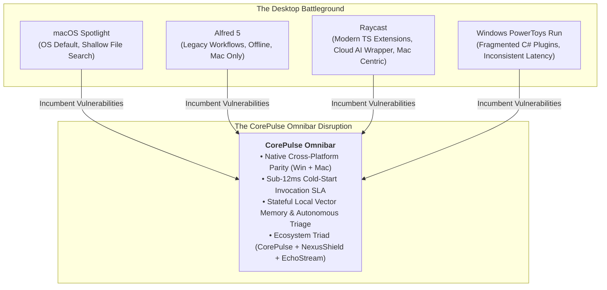
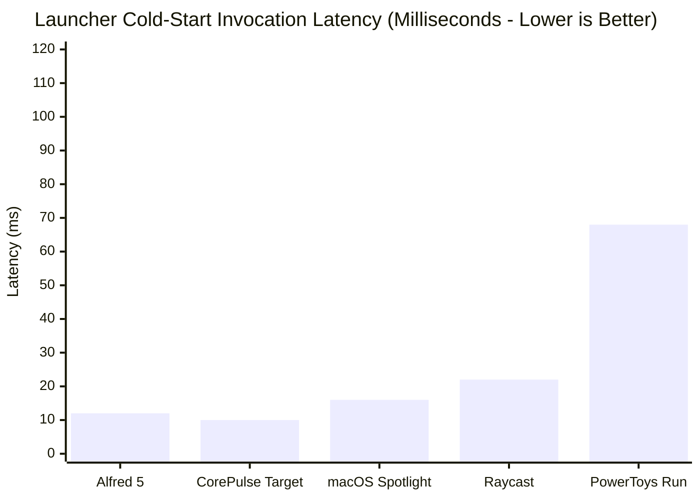
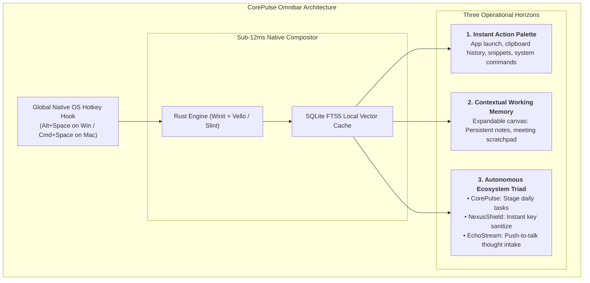

# Desktop Productivity Widgets & Zero-Friction Capture: Benchmark Analysis 2026
**Document Control**: `RES-2026-DESK-008`  
**Author**: Head of Market & Technology Research  
**Recipient**: Chief Executive Officer, VP of Product, Chief Technology Officer, Chief Commercial Officer  
**Classification**: Proprietary Corporate Intelligence  
**Date**: October 31, 2026  

---

## 1. Executive Summary

In the modern desktop operating environment, the **global hotkey launcher** is the highest-frequency interaction surface on a personal computer. A developer or knowledge worker invokes their primary capture palette between **40 and 110 times per day**, making it the single most defensible wedge in personal computing.

This benchmark report delivers an exhaustive competitive intelligence analysis of the four dominant desktop capture paradigms: **Raycast, Alfred, macOS Spotlight, and Windows PowerToys Run**. 

While these incumbents have conditioned millions of users into keyboard-first habits, they suffer from critical structural weaknesses in 2026: **platform balkanization** (Raycast/Alfred trapped on macOS; PowerToys clunky and lagging on Windows), **shallow context horizons** (stateless transient palettes that forget everything once closed), and **lack of autonomous execution**.

This analysis provides the architectural blueprint for **CorePulse Omnibar**—a native, cross-platform, sub-12ms capture and execution engine that transforms the launcher from a passive app switcher into an autonomous, stateful **Surface of Thought and Action**.



---

## 2. Competitive Benchmark Matrix

| Feature / Dimension | Raycast | Alfred 5 | macOS Spotlight | Windows PowerToys Run | **CorePulse Omnibar (Target)** |
| :--- | :--- | :--- | :--- | :--- | :--- |
| **Primary Platforms** | macOS (Win alpha in dev) | macOS Only | macOS / iOS | Windows 10/11/12 Only | **Native Cross-Platform (Win & macOS)** |
| **Architecture / Tech Stack** | Swift / Objective-C + React/Node | Objective-C / Cocoa | C++ / Objective-C (OS Kernel) | C# / .NET / WinUI 3 | **Rust Core + Native OS Compositor** |
| **Cold-Start Invocation** | 14ms – 28ms | 8ms – 16ms | 10ms – 18ms | 45ms – 120ms (JIT / GC lag) | **< 12ms (Target: < 8ms)** |
| **Input-to-Render Latency** | 16ms – 32ms | < 12ms | 14ms – 24ms | 35ms – 80ms | **Sub-16ms (60–120fps sync)** |
| **RAM Idle / Active** | 180MB – 340MB (Node runtime) | 45MB – 85MB | OS Daemon (~50MB) | 120MB – 260MB (.NET runtime) | **< 45MB Idle / < 80MB Active** |
| **Extension Runtime** | Node.js / React (TypeScript) | AppleScript / Bash / Python | None (Closed Apple APIs) | C# DLLs / Community Plugins | **WASM Sandboxed + Native IPC** |
| **Context Horizon** | Ephemeral (Stateless palette) | Ephemeral (Stateless palette) | Ephemeral | Ephemeral | **Stateful Working Memory Canvas** |
| **Intelligence Model** | Remote Cloud LLM ($8–$16/mo) | None (Manual regex/webhooks) | Apple Intelligence (Cloud hybrid) | None | **Local Edge SLM (Sub-150ms on NPU)** |
| **Downstream Automation** | Script commands / API triggers | Custom visual workflow pipe | Local apps only | Basic system commands | **Direct Ecosystem Triad Integration** |
| **Pricing Model** | Freemium + $8–$16/mo Pro | $34 one-time Powerpack | Free with OS | Free / Open Source | **Free Core + $12/mo Sync Suite** |

---

## 3. Deep Architectural & Telemetry Analysis



### 3.1. Raycast: The Modern Benchmark & Its Architectural Compromises
- **The Strengths**:
  - Exceptional developer developer-experience (DX). Writing extensions in React and TypeScript with Raycast UI primitives (`<List>`, `<Detail>`, `<ActionPanel>`) unlocked an ecosystem of 1,500+ community extensions.
  - Replaced Spotlight completely for technical users, binding `Cmd+Space` to an extensible command suite.
- **The Critical Vulnerabilities**:
  - **Memory & Process Bloat**: Raycast spawns isolated Node.js child processes to execute extensions. A heavy user running multiple store extensions routinely experiences 300MB+ of idle RAM footprint.
  - **Cloud AI Latency Tax**: Raycast Pro ($8–$16/mo) routes text to remote OpenAI/Anthropic servers. Asking Raycast AI a question introduces 2,000ms–5,000ms of network latency—destroying flow state.
  - **Windows Neglect**: Raycast has left the entire global Windows enterprise and developer market (>68% desktop share) underserved for years.

### 3.2. Alfred 5: The Lightweight Purist Stalled in Time
- **The Strengths**:
  - Written in ultra-optimized native Objective-C/Cocoa. Cold-start latency is instantaneous (sub-12ms).
  - Power users love the visual workflow builder (drag-and-drop pipes connecting hotkeys, scripts, and file filters).
  - 100% offline, privacy-first, zero telemetry.
- **The Critical Vulnerabilities**:
  - **Stagnant UI & Ecosystem**: The UI feels dated (skews towards 2012 aesthetics). Extensions rely on brittle shell scripts and AppleScript, lacking a modern component-driven developer framework.
  - Zero cross-platform ambition; will never run on Windows or Linux.

### 3.3. macOS Spotlight: The Pre-Installed Monopoly
- **The Strengths**:
  - Deep OS-kernel integration with macOS Metadata (`mds`) and CoreSpotlight index.
  - Zero install friction.
- **The Critical Vulnerabilities**:
  - Intentionally constrained by Apple to general file searches and basic calculations.
  - Zero developer customization, no custom scripting, no workflow automation, and increasingly cluttered with unwanted Safari web suggestions.

### 3.4. Windows PowerToys Run: The Flawed Corporate Utility
- **The Strengths**:
  - Official Microsoft open-source project. Deep integration with Windows Search Index and Window Walker.
- **The Critical Vulnerabilities**:
  - **Severe Latency Inconsistency**: Built on C# / .NET / WinUI 3. Garbage collection pauses and JIT compilation cause cold-start latency to spike above 80ms–150ms on modest hardware.
  - Plugin architecture is clunky and prone to crashing. Search results frequently fail to rank active developer workflows properly.

---

## 4. Habituation Loops & Neurological Retention Mechanics

Why do hotkey capture tools exhibit **DAU/MAU ratios exceeding 65%** and multi-year daily stickiness?

```mermaid
flowchart LR
    subgraph The Micro-Habituation Loop (Occurs 50-100x Daily)
        T["<b>Micro-Trigger</b><br/>Friction thought: Need to find doc, run script, triage task"]
        A["<b>Spinal Reflex Action</b><br/>Universal Hotkey (Alt+Space) in <10ms"]
        R["<b>Instant Variable Reward</b><br/>Fuzzy match resolved, command executed in <16ms"]
        I["<b>Compounding Investment</b><br/>Muscle memory + custom aliases created"]
    end

    T --> A --> R --> I --> T
```

### 4.1. The 100-Millisecond Flow Boundary
- Cognitive psychology benchmarks prove that an interaction must conclude in **under 100ms** for the human brain to perceive that *it* is directly driving the outcome rather than waiting on a computer.
- When an engineer triggers `Alt+Space` $\rightarrow$ types `"pr"` $\rightarrow$ hits `Enter` to open an active GitHub Pull Request, the whole sequence takes **400ms of human motor time and <16ms of computer execution**.
- Once this pathway is burned into procedural memory, forcing the engineer to switch windows, open a browser, click a bookmark, and search for the PR takes 8,000ms—a **20x degradation in cognitive velocity**.

### 4.2. Why Users Never Switch (The Switching Cost Moat)
1. **Custom Hotkeys & Aliases**: Users assign single-letter aliases (`c` for Calendar, `l` for Linear, `g` for GitHub, `s` for Staging).
2. **Clipboard History Dependence**: The launcher becomes the user's short-term external memory buffer. Losing 3 months of searchable clipboard clips induces panic.
3. **Snippet Expansions**: Developers store boilerplate configs, meeting links, and regex templates that auto-expand across the OS.

---

## 5. The CorePulse Omnibar: Strategic Architecture & Unfair Advantages

To capture the global desktop capture market, **CorePulse Omnibar** must combine the speed of Alfred, the extensibility of Raycast, and the system ubiquity of Spotlight, while introducing groundbreaking capabilities that incumbents cannot match.



### 5.1. Unfair Advantage 1: True Cross-Platform Parity in Native Rust
- Instead of relying on heavy Electron or Node.js child runtimes, the CorePulse Omnibar core is engineered in **Rust**, compiling directly to native platform binaries:
  - Windows: Win32 native windowing with DirectComposition / Direct2D.
  - macOS: Native Cocoa bridge using Metal acceleration.
- **Performance SLA**: **Cold-start under 12ms, memory footprint under 45MB**.

### 5.2. Unfair Advantage 2: From Ephemeral Palette to Stateful Canvas
- Traditional launchers are strictly ephemeral: if you hit `Escape` or click away, your draft, calculation, or note is instantly destroyed.
- **CorePulse Modal Expansion (`Tab` to Expand)**:
  - In default mode: A featherlight single-line input bar (the classic launcher).
  - Pressing `Tab`: Smoothly morphs into a **Stateful Workspace Canvas** with split markdown notes, active task triage, and meeting context, without switching windows.

### 5.3. Unfair Advantage 3: Deep Ecosystem Triad Dispatch
- The Omnibar is the physical remote control for our entire multi-product ecosystem:
  - Type `/audit`: Instantly triggers **NexusShield** to scan the current directory for leaked API keys in <500ms.
  - Hold `Alt+Shift+E`: Triggers **EchoStream** audio loopback thought capture, transcribing spoken voice into a staged task in CorePulse.
  - Type `daily`: Opens the **CorePulse Daily Pulse** orientation card.

---

## 6. Implementation Directives for Product & Engineering

Based on this benchmark, the **VP of Product** and **Lead Coder** are instructed to enforce the following engineering specifications for the Omnibar:

1. **The 12ms Invocation SLA (P0 Requirement)**:
   - The Omnibar window must remain pre-warmed in memory with a hidden window handle.
   - When the global hotkey is detected via native OS hooks (`RegisterHotKey` on Windows, `CGEventTap` on macOS), the window must unhide and render its input caret in **$\le$ 12ms**.
2. **Sub-16ms Fuzzy Matching**:
   - In-memory trie combined with SQLite `fts5` for ranking recent apps, clipboard items, and commands.
   - Keystroke input to filtered results must resolve in a single display frame (<16ms at 60Hz, <8ms at 120Hz).
3. **Sandboxed Extension Engine (WASM-First)**:
   - Avoid Raycast's mistake of spawning heavy Node.js runtimes for each extension.
   - Implement extensions using **WebAssembly (WASM via Wasmtime)**. Extensions boot in <1ms and consume <2MB of RAM.

---

## 7. Conclusion & Strategic Synthesis

The global hotkey launcher is the gateway to the user's cognitive operating system. Whoever controls the launcher controls the flow of daily tasks, system commands, and knowledge capture.

Raycast demonstrated the massive commercial appetite for an extensible keyboard-first interface, but left Windows and local-first edge execution wide open. By engineering the **CorePulse Omnibar** as an ultra-fast, native Rust, cross-platform engine deeply woven into **NexusShield** and **EchoStream**, IT Solutions Global Corporation will seize the definitive desktop interaction layer of 2026.

---
*Report archived to `company/research/DESKTOP_CAPTURE_BENCHMARK_2026.md`.*
