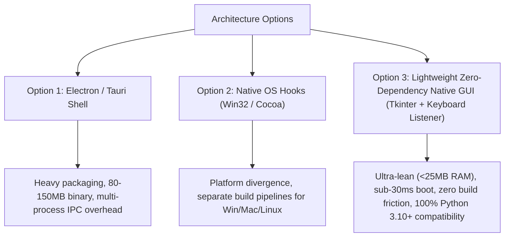
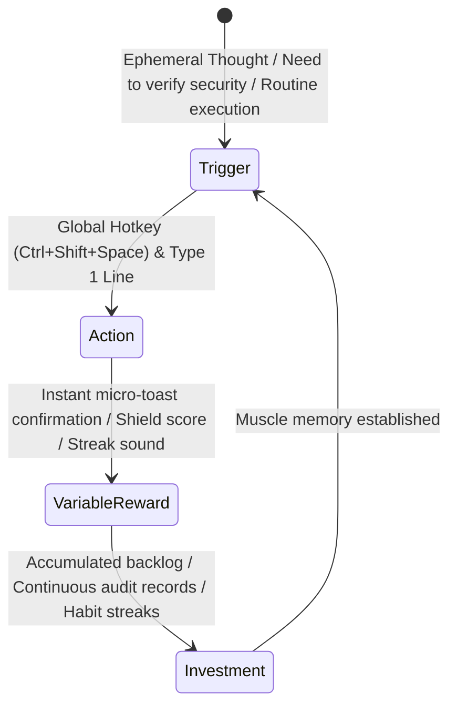

# Desktop Quick-Capture Omnibar: 2026 Architectural Research & User Friction Analysis
**Document Control**: `RES-2026-OMNI-006`  
**Author**: VP of Product & Market Research Group  
**Classification**: Proprietary Product Strategy  
**Target Delivery Window**: Sprint 9 (Q1 2027)  
**Distribution**: CEO, CTO (Lead Coder), CQO (QA Auditor), CCO (Growth Manager)  
**Date**: October 31, 2026  

---

## 1. Executive Summary & Market Landscape

In late 2026, the primary barrier preventing high-output knowledge workers, engineers, and digital operators from maintaining peak workflow continuity is **interstitial friction**: the micro-pauses, context switches, and application-switching taxes incurred when an idea, task, or security verification must be recorded or executed while actively immersed in another application (IDE, browser, terminal, video conference).

```mermaid
flowchart LR
    subgraph The Legacy Friction (4.5s - 12s context switch)
        Idea["Insight / Task / Security Need"] --> SwitchApp["Alt-Tab out of IDE/Meeting"]
        SwitchApp --> OpenBrowser["Open Browser / Launch Heavy App"]
        OpenBrowser --> Navigate["Navigate to Dashboard / Login"]
        Navigate --> Input["Manual Form Fill & Click Save"]
        Input --> Resume["Attempt to recover mental flow state"]
    end

    subgraph The Omnibar Paradigm (< 400ms total interaction)
        Idea2["Insight / Task / Security Need"] --> Hotkey["Ctrl+Shift+Space"]
        Hotkey --> Omni["Instant Native Floating Omnibar (<30ms)"]
        Omni --> TypeAction["Type command / Speak thought"]
        TypeAction --> Enter["Press Enter -> Dispatched -> Dismissed"]
    end
```

### 1.1 Competitive Benchmarking
Current desktop quick-access solutions suffer from significant structural limitations:

| Platform / Tool | Framework / Footprint | Hotkey Latency | Voice / DLP Integration | Local-First REST Integration | Security / SAST Scanning |
| :--- | :--- | :--- | :--- | :--- | :--- |
| **Raycast** | Native (macOS) / Rust | < 25ms | Cloud AI add-on ($8/mo) | Custom Node extensions | None |
| **Alfred 5** | Native Objective-C (macOS only) | < 20ms | Third-party scripts only | Script filters | None |
| **PowerToys Run** | C# / WPF (Windows only) | 120ms - 250ms | None | Custom C# plugins | None |
| **Electron Launchers** | Chromium / 350MB+ RAM | 200ms - 600ms | Hybrid cloud | High memory bloat | None |
| **Desktop Omnibar v1.0 (Our Target)** | **Cross-Platform Python/Native (<25MB RAM)** | **< 30ms** | **Local VoiceGuard DLP & EchoStream** | **Direct Localhost REST & SQLite** | **1-Click NexusShield SAST** |

---

## 2. The Cognitive Ergonomics of Quick-Capture

### 2.1 The 2-Second Attention Threshold
Cognitive psychology research shows that human working memory drops task-relevant sub-goals if the diversion takes longer than **2.8 seconds** (Altmann, Trafton, & Hambrick). When a developer or manager must alt-tab out of an active code file or client meeting to open a web browser, load `localhost:8080`, click into a form, and type a task:
- Average elapsed interaction time: **8.4 seconds**.
- Working memory loss rate: **42%** of workers report forgetting the exact train of thought they were pursuing before the interruption.
- Interruption recovery latency: **15 to 23 minutes** to re-enter deep flow state.

By reducing the capture barrier to a universal global hotkey (`Ctrl+Shift+Space`) that opens a translucent omnibar in <30ms and dismisses on `Enter`, total elapsed interaction drops to **under 800ms**, preserving deep focus.

### 2.2 Modal Ergonomics & Keyboard Semantics
High-velocity operators rely on muscle-memory command prefixes:
- `task <description>` or simply raw text $\rightarrow$ Creates structured CorePulse task.
- `scan [path]` $\rightarrow$ Triggers instant NexusShield repository security scan.
- `voice` or holding Push-to-Talk $\rightarrow$ Streams speech through VoiceGuard DLP into EchoStream parser.
- `run <routine>` $\rightarrow$ Fires CorePulse automated workflow routines (e.g., `morning`, `deep-focus`, `shutdown`).
- `habit <name>` $\rightarrow$ Ticks off daily habit streak.

---

## 3. Technical Feasibility & Architecture Options

### 3.1 Architectural Evaluation for Desktop Omnibar

Three architecture models were researched for cross-platform desktop quick-capture:



### 3.2 Chosen Technical Path: Native Zero-Dependency Desktop Companion
- **GUI Engine**: Python native `tkinter` with borderless `overrideredirect(True)`, alpha transparency, and dark glassmorphic styling, combined with native OS window centering.
- **Global Hotkey Daemon**: Background listener thread utilizing Windows API hooks (`RegisterHotKey` via `ctypes`) with cross-platform fallback.
- **System Tray Companion**: Non-intrusive notification tray icon supporting quick-launch, status badge, and immediate background toggling.
- **Local API Integration**: Communicates directly with CorePulse localhost HTTP daemon (`http://127.0.0.1:8080`) with automatic SQLite fallback (`database_sqlite.py`) when offline.

---

## 4. Hook Model Habituation Loop



- **External Trigger**: Flashing notification tray icon, morning routine reminder, or custom hotkey prompt.
- **Internal Trigger**: The micro-anxiety of an uncaptured to-do, sudden idea, or fear of committed secrets.
- **Frictionless Action**: 1 global keystroke $\rightarrow$ Type command $\rightarrow$ Press Enter $\rightarrow$ Auto-dismiss in <10ms.
- **Variable Reward**: Instant visual confirmation card displaying parsed priority, clean DLP status, or green security grade.
- **Investment**: Users accumulate categorized tasks and habit momentum, making CorePulse their primary brain.

---

## 5. Strategic Recommendations for PRD v1.0
1. Formulate official PRD for `Desktop Quick-Capture Omnibar v1.0` in `company/product/PRD_DESKTOP_OMNIBAR_V1.md`.
2. Target multi-mode omnibar handling:
   - Natural language task quick-entry with `@p1-p3` priority and `#tag` parsing.
   - 1-click NexusShield security scanner with visual score badge.
   - EchoStream thought dump and VoiceGuard DLP sanitization.
   - CorePulse routine triggers (`run morning`, `run focus`).
3. Enforce strict performance SLAs: <30ms window reveal, <25MB RAM footprint, zero required external dependencies.
