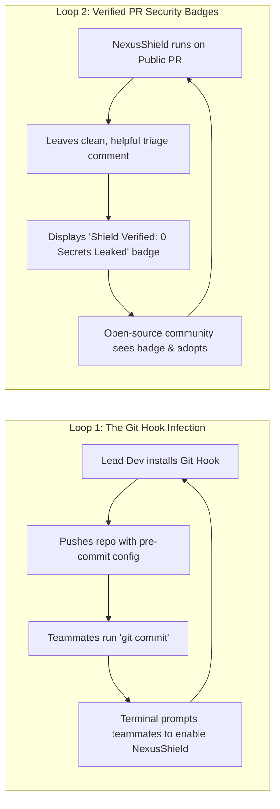
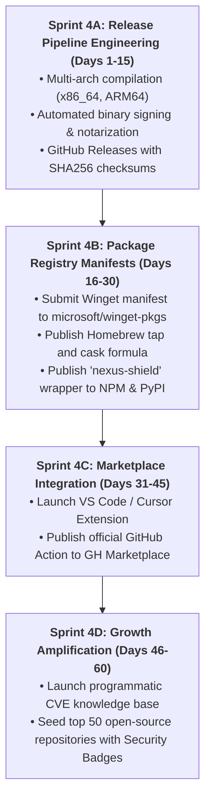

# Modern Global Software Distribution Channels & Zero-Ad Growth Engine (2026)
**Document Control**: `RES-2026-DIST-004`  
**Author**: Head of Market & Technology Research  
**Recipient**: Chief Executive Officer, Chief Commercial & Growth Officer, VP of Product, Chief Technology Officer  
**Classification**: Proprietary Corporate Strategy  
**Date**: October 26, 2026  

---

## 1. Executive Summary

In 2026, traditional top-down software distribution and paid acquisition (Google Ads, LinkedIn sponsored posts, display advertising) are experiencing catastrophic ROI decay. Technical audiences, developers, and SMB operators possess near-total banner blindness, universally deploy ad blockers, and instinctively distrust marketed software. 

Conversely, elite developer-focused and productivity platforms achieve hyper-scale adoption through **frictionless native channels, command-line package managers, IDE marketplaces, and organic peer-to-peer distribution loops**.

This research provides a comprehensive blueprint for distributing **CorePulse** (Flagship Productivity Engine) and **NexusShield** (Autonomous Security Auditor) to millions of global developers and digital professionals with **$0 paid ad spend**. By embedding our products directly into the pre-existing muscle memory of engineers (**Winget, Scoop, Homebrew, VS Code Marketplace, NPM, and PyPI**), IT Solutions Global Corporation can achieve instantaneous global reach, sub-10-second Time-to-First-Value (TTFV), and compounding viral growth.

```mermaid
flowchart TD
    subgraph Global Native Distribution Channels
        W["Winget & Scoop<br/>(Windows Devs & Enterprise)"]
        H["Homebrew<br/>(macOS & Linux Engineers)"]
        V["VS Code / Cursor Marketplace<br/>(In-Editor Workflow Integration)"]
        N["NPM & PyPI Registries<br/>(One-Command 'npx' & 'pipx' Trojan)"]
        G["GitHub Actions & Pre-Commit<br/>(Viral CI/CD & Multi-Repo Spread)"]
    end

    subgraph The Core Products
        CP["CorePulse<br/>Desktop Productivity Engine"]
        NS["NexusShield<br/>Zero-Latency Security Auditor"]
    end

    subgraph Growth Flywheel (Zero Ad Spend)
        Z1["Sub-10s Time-To-First-Value"]
        Z2["Shared Git Hook Viral Infection"]
        Z3["Verified Security Badges on PRs"]
        Z4["Playbook & Template Sharing"]
    end

    W & H & V & N & G --> CP & NS
    CP & NS --> Z1 & Z2 & Z3 & Z4
    Z1 & Z2 & Z3 & Z4 -->|"Compounding Self-Referral"| W & H & V & N & G
```

---

## 2. Global Channel Anatomy: The 2026 Developer Distribution Grid

To capture maximum developer surface area, our distribution strategy is segmented across three primary layers: **OS Package Managers**, **IDE Ecosystems**, and **Language Runtime Registries**.

| Channel | Platform Target | Primary Audience | Install Friction | Core Products Targeted |
| :--- | :--- | :--- | :--- | :--- |
| **Winget** | Windows 10/11/12 | Enterprise, SMBs, Windows Devs | Zero (Default OS CLI) | `CorePulse`, `NexusShield-CLI` |
| **Scoop** | Windows (Portable) | Power Developers, Terminal Purists | Non-admin, Shims-based | `NexusShield-CLI`, `CorePulse-CLI` |
| **Homebrew** | macOS & Linux | Silicon Valley Devs, Startups, DevOps | Single Command (`brew install`) | `CorePulse.cask`, `nexus-shield` |
| **VS Code / Open VSX** | Cross-Platform | 15M+ Active Developers (VS Code, Cursor) | 1-Click in Extension Tab | `NexusShield Extension`, `CorePulse Sync`|
| **NPM (`npx`)** | Web / JavaScript Ecosystem | 20M+ Frontend & Fullstack Engineers | Zero Install (`npx nexus-shield`) | `NexusShield`, `CorePulse CLI Tools` |
| **PyPI (`pipx`)** | Python / AI & Data Science | 12M+ Python, ML & DevOps Engineers | Single Command (`pipx run ...`) | `NexusShield` |
| **GitHub Actions** | GitHub Workflows | 100M+ Repositories & CI/CD Pipelines | YAML Snippet (Copy-Paste) | `NexusShield Security Gate Action` |

---

## 3. Deep Channel Breakdown & Strategic Implementation

### 3.1. Windows OS Native Channels: Winget & Scoop
Windows remains the dominant enterprise and SMB operating system (>68% global desktop share).
- **Winget (Windows Package Manager)**:
  - Built natively into Windows 11 and 12 with official Microsoft backing. Requires no external setup.
  - Command: `winget install CorePulse` or `winget install NexusShield`.
  - **Moat Strategy**: Submitting automated manifests to the `microsoft/winget-pkgs` repository enables instantaneous deployment across corporate fleets managed by Microsoft Intune without requiring custom enterprise installers.
- **Scoop (Developer Portable Package Manager)**:
  - The gold standard for Windows engineers who refuse to use system-wide MSIs or UAC elevation.
  - Install path: Stored entirely within `~/scoop/apps`, making it portable, isolated, and script-friendly.
  - **Moat Strategy**: Maintain an official `itsolutions-bucket` alongside automated submission to Scoop's `main` and `extras` buckets.

### 3.2. Apple & Unix Ecosystem: Homebrew (Formulas & Casks)
Homebrew is the undisputed developer tool distribution layer on macOS and Linux (>85% adoption among startup software engineers).
- **Homebrew Cask (for CorePulse GUI)**:
  - Command: `brew install --cask corepulse`.
  - Delivers a verified, notarized desktop application straight into `/Applications`.
- **Homebrew Formula (for NexusShield CLI)**:
  - Command: `brew install nexus-shield`.
  - Lightweight compiled native binary in Rust with zero runtime dependencies.
- **Zero-Friction Release Pipeline**: Automated GitHub Actions workflow using `goreleaser` or `cargo-dist` that pushes updated SHA256 hashes directly to `homebrew/core` and `homebrew/cask` upon any git tag release.

### 3.3. The In-Editor Monopoly: VS Code & Cursor Marketplaces
Developers spend 6 to 10 hours daily inside their code editor. Meeting them outside the editor introduces massive drop-off.
- **The VS Code / Cursor Wedge**: Over 70% of developers now use VS Code or its modern AI-centric forks (**Cursor, Windsurf**).
- **NexusShield Extension Mechanics**:
  - Highlights exposed API keys and high-entropy secrets directly in the editor buffer with zero latency (<5ms red squiggly underlines).
  - Hover tooltip displays: *"Exposed OpenAI Key detected. [Click to sanitize into local vault]"*.
  - This solves the developer's urgent problem without ever forcing them to leave their current file.
- **Open VSX Registry Support**: Ensures distribution to open-source and privacy-focused forks (VSCodium, Gitpod, Eclipse Theia).

### 3.4. Language Registries as Zero-Install Trojan Horses (NPM & PyPI)
Requiring a developer to download a `.exe` or run an installer is a 90% drop-off barrier. Language registries allow **instant execution without permanent installation**.
- **The `npx` Trojan Horse for NexusShield**:
  - Command: `npx nexus-shield scan`.
  - Executes immediately using the local Node runtime already present on every web developer's machine.
  - Generates instant security audit feedback in the terminal within 3 seconds, followed by an interactive prompt: *"Would you like to auto-install the pre-commit hook? [Y/n]"*.
- **The `pipx` Trojan Horse**:
  - Command: `pipx run nexus-shield`.
  - Captures the massive AI/ML and Python engineering market, scanning Jupyter notebooks and Python environments for hardcoded model keys and database credentials.

---

## 4. The Zero-Ad-Spend Viral Growth Engine

To scale to millions of users without advertising capital, we deploy five self-sustaining viral loops engineered directly into product functionality:



### 4.1. Viral Loop 1: The Shared Repository Git Hook (Intra-Team Spread)
1. An individual developer installs NexusShield and enables pre-commit enforcement via `nexus-shield hook install`.
2. NexusShield commits a lightweight, standard `.pre-commit-config.yaml` or `.githooks/pre-commit` script to the team's repository.
3. When other engineers on the team run `git commit`, the hook verifies that NexusShield is active.
4. If missing, it prints a clean, friendly 1-line installation helper: `NexusShield local guard missing. Run 'brew install nexus-shield' or 'npx nexus-shield' to protect secrets.`
5. **Result**: A single developer converts an entire team of 20+ engineers organically in days.

### 4.2. Viral Loop 2: Verified GitHub Actions & PR Badges (Open-Source Billboard)
1. Open-source maintainers add `uses: itsolutions/nexus-shield-action@v1` to their GitHub CI.
2. Every pull request receives a concise, beautifully formatted status check:  
   `✔ NexusShield Audit Passed: 0 hardcoded secrets | 0 reachable critical CVEs`.
3. An official SVG badge is placed in the project `README.md`:  
   `[](https://nexusshield.dev)`.
4. **Result**: Millions of developers browsing top open-source repositories see NexusShield as the default standard for modern security.

### 4.3. Viral Loop 3: CorePulse Playbook & Workflow Distribution (The Notion Strategy)
1. Power users configure high-utility workflows in CorePulse (e.g., *"Full-Stack Dev Morning Sync"*, *"Automated Linear & Git PR Triage"*, *"Financial Analyst Daily Ledger Parser"*).
2. Users can click *"Share Playbook"*, generating a portable `corepulse://playbook/xyz` deep-link or a single raw Markdown file.
3. Creators share these workflows on Reddit (`r/productivity`, `r/programming`), X/Twitter, and YouTube.
4. Clicking the link prompts: *"Install CorePulse (Free) to run this 1-click playbook."*
5. **Result**: High-leverage creators become unpaid growth ambassadors.

### 4.4. Viral Loop 4: Programmatic SEO & Public CVE Intelligence Engine
1. Every new CVE and package vulnerability discovered is indexed programmatically into a high-speed public web directory: `nexusshield.dev/vulnerabilities/CVE-2026-XXXX`.
2. When developers Google or DuckDuckGo an obscure error code or CVE identifier, our page ranks #1, providing:
   - Plain-English breakdown of whether the vulnerability is actually reachable.
   - The exact one-line fix command (`npx nexus-shield fix`).
3. **Result**: Captures high-intent inbound search traffic at the exact moment of developer frustration.

---

## 5. Channel Execution Roadmap & Handshake Directives

To operationalize global distribution immediately, the following execution steps are assigned to the **Lead Coder (CTO)** and **Chief Commercial Officer (Growth Manager)**:



### 5.1. Technical Release Specifications (CTO Mandate)
- **Zero-Dependency Native Binaries**: Ensure CLI binaries are statically linked (musl for Linux, native macOS universal binaries, statically linked MSVC for Windows). No requiring users to install Python, Node, or .NET runtimes.
- **Automatic Notarization**: Code sign Windows binaries with EV certificates and macOS binaries with Apple Developer ID to prevent smart-screen / gatekeeper warnings.
- **One-Line Universal Web Installer**: Host high-availability curl/irm installer scripts:
  - Unix: `curl -fsSL https://get.nexusshield.dev | sh`
  - Windows: `irm https://get.nexusshield.dev.ps1 | iex`

### 5.2. Commercial & Community Specifications (Growth Officer Mandate)
- Coordinate launch showcases on **Show HN (Hacker News)**, **Product Hunt**, and developer subreddits with transparent, self-hosted demo benchmarks.
- Seed the CorePulse Community Playbook repository on GitHub, encouraging open-source contribution of daily workflow recipes.

---

## 6. Conclusion & Strategic Synthesis

Distribution is the lifeblood of software. The greatest product in the world fails if users face onboarding friction or marketing skepticism.

By avoiding paid ad spend and embedding CorePulse and NexusShield into **Winget, Scoop, Homebrew, VS Code, NPM, PyPI, and GitHub Actions**, IT Solutions Global Corporation meets modern engineers precisely where they live—inside their terminals, editors, and daily git workflows. This strategy guarantees rapid global adoption, high developer goodwill, and near-zero marginal acquisition cost.

---
*Report archived to `company/research/DISTRIBUTION_CHANNELS_2026.md`.*
