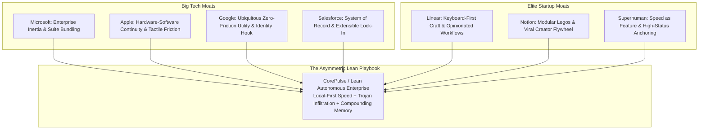
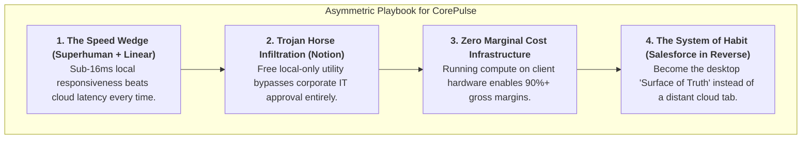

# Habituation Engines & Monetization Moats: Big Tech Giants vs. Elite Lean Startups
**Document Control**: `RES-2026-GOV-002`  
**Author**: Head of Market & Technology Research  
**Recipient**: Chief Executive Officer, VP of Product, Chief Commercial Officer  
**Classification**: Proprietary Corporate Strategy  
**Date**: October 26, 2026  

---

## 1. Executive Overview

Sustained dominance in enterprise and consumer software is never an accident of engineering; it is an engineered synthesis of **cognitive habituation** and **structural economic moats**. 

This research investigates how the world’s four preeminent tech conglomerates (**Microsoft, Apple, Google, Salesforce**) and the three most disciplined modern lean startups (**Linear, Notion, Superhuman**) construct daily user dependency and multi-billion-dollar recurring monetization engines. Furthermore, this study delivers an asymmetric playbook detailing how lean autonomous software organizations (such as IT Solutions Global Corporation / CorePulse) can extract, adapt, and operationalize these enterprise mechanics without legacy bloat or institutional overhead.

---

## 2. The Big Tech Playbook: Structural Scale & Institutional Moats

Big Tech giants establish moats not through product agility, but through **distribution gravity, ecosystem defaultism, and switching friction**.

### 2.1. Microsoft: Enterprise Inertia, Suite Bundling & IT Admin Capture
- **Primary Habituation Mechanism**: The Workplace Default. From OS boot (Windows) to enterprise messaging (Teams) and documentation (Office/SharePoint), Microsoft weaves itself into the fundamental employment contract. The user does not "choose" Microsoft; the organization mandates it.
- **Monetization Moat**: Enterprise Agreement (EA) bundling. Microsoft discounts disparate tools into unified per-seat SKUs (Microsoft 365 E3/E5). Even if an individual point solution (e.g., Slack or Zoom) is 5x better, enterprise procurement faces extreme economic pressure to adopt the "free" or bundled Microsoft equivalent.
- **Defensive Barrier**: Compliance and IT Administration. Active Directory / Azure Entra ID, SOC2/HIPAA pre-certifications, and unified billing make switching out of the Microsoft ecosystem an organizational hazard for CIOs.

### 2.2. Apple: Hardware-Software Continuity & Tactile Micro-Friction
- **Primary Habituation Mechanism**: Tactile, multi-device continuity. Features like Universal Clipboard, AirDrop, Handoff, and biometric Apple Pay reduce cross-device transaction costs to near-zero. Users develop neurological muscle memory rooted in haptic feedback, fluid 120Hz ProMotion animations, and native OS ergonomics.
- **Monetization Moat**: High-margin hardware lock-in coupled with high-retention Services (iCloud, App Store, AppleCare). Once photos, keychain credentials, and device backups reside in iCloud, abandoning iOS/macOS represents severe personal friction.
- **Defensive Barrier**: Privacy as a commercial moat. Apple leverages user privacy controls (e.g., App Tracking Transparency) to disrupt third-party competitors while consolidating proprietary platform control.

### 2.3. Google: The Zero-Cost Utility Hook & Identity Infrastructure
- **Primary Habituation Mechanism**: Low-barrier utility at ubiquitous scale. Search, Gmail, Maps, and Google Docs remove all friction to entry. The habit is forged through immediate gratification and zero onboarding latency.
- **Monetization Moat**: The Google Identity Graph & Advertising/Workspace Engine. "Sign in with Google" embeds Google as the web's universal authentication layer. In B2B, Google Workspace acts as a seamless upgrade path from free consumer Gmail to enterprise corporate infrastructure.
- **Defensive Barrier**: Web-scale network effects and collaborative real-time multiplayer document synchronization (operational transformation).

### 2.4. Salesforce: The System of Record (SoR) & AppExchange Marketplace
- **Primary Habituation Mechanism**: Corporate operational dependency. Sales reps, account managers, and executives must log interactions into Salesforce to maintain compensation, sales commissions, and operational visibility.
- **Monetization Moat**: The System of Record (SoR). Customer data, revenue history, pipeline forecasting, and contract milestones reside in Salesforce’s proprietary schema.
- **Defensive Barrier**: The AppExchange ecosystem and customization inertia. Once an enterprise develops custom Apex triggers, Visualforce components, and hundreds of third-party connectors, replacing Salesforce requires a multi-million-dollar migration project with high operational risk.

---

## 3. The Elite Startup Playbook: Speed, Craft & Viral Infiltration

Unlike conglomerates, elite modern startups win by **narrowing surface area, obsessing over interaction latency, and nurturing passionate subcultures**.

### 3.1. Linear: Opinionated Workflows & Keyboard-First Craft
- **Primary Habituation Mechanism**: The "Linear Method" and sub-50ms interaction loops. Linear rejects bloated Jira-style configuration panels in favor of a strictly opinionated, keyboard-first issue tracking interface. Engineers enter a flow state where logging, filtering, and closing tickets takes milliseconds via hotkeys.
- **Monetization Moat**: Engineering culture capture. Linear is viewed as a badge of craftsmanship and modern engineering pride. Development teams proactively demand Linear over legacy tools, forcing bottom-up procurement.
- **Defensive Barrier**: Extreme craft and design velocity. By maintaining a clean GraphQL backend, local client caching, and uncompromising UI responsiveness, competitors trying to clone Linear feel heavy and sluggish by comparison.

### 3.2. Notion: The Lego-Block Flywheel & User-Generated Distribution
- **Primary Habituation Mechanism**: Modularity and creative self-expression. Users do not just consume a tool; they build their own operating system using Notion's page, block, and database primitives.
- **Monetization Moat**: The User-Generated Content (UGC) creator economy. Notion’s template marketplace turns its most active users into evangelists who sell and distribute Notion systems across TikTok, YouTube, and corporate teams.
- **Defensive Barrier**: Bottom-up Trojan-horse adoption. Individual employees introduce Notion for personal notes, migrate a project team, and eventually convert the entire department into an enterprise workspace.

### 3.3. Superhuman: Speed as a Feature & Status-Driven Pricing
- **Primary Habituation Mechanism**: The "100ms Rule" and Inbox Zero psychology. Superhuman engineered an email client where every single keypress resolves in under 100ms. By transforming tedious email processing into a gamified, keyboard-only sprint, Superhuman turns a daily chore into an empowering dopamine loop.
- **Monetization Moat**: High-status pricing ($30/user/month). Superhuman inverted standard software discounting by pricing premium-first, signaling executive status and high professional velocity.
- **Defensive Barrier**: Algorithmic triage, hyper-personalized onboarding, and uncompromising performance ergonomics.

---

## 4. Deep Comparative Matrix: Giants vs. Elite Startups

| Dimension | Big Tech Conglomerates (MSFT, AAPL, GOOG, CRM) | Elite Modern Startups (Linear, Notion, Superhuman) | CorePulse Strategy (Lean Autonomous Hybrid) |
| :--- | :--- | :--- | :--- |
| **Initial Hook** | Bundling, corporate mandate, or OS pre-installation | Visual elegance, visceral UI speed, personal productivity | Universal hotkey, 0ms cold-start omnibar, edge SLM triage |
| **Daily Habit Trigger** | Administrative requirement / default system alert | Desire for flow state, visual aesthetic, personal mastery | Ambient Morning Pulse + automated daily task synthesis |
| **User Switching Cost** | Data integration inertia, IT bureaucracy, custom schemas | Accumulated templates, personalized workflows, muscle memory | Local vector knowledge graph + custom deterministic playbooks |
| **Pricing Model** | Enterprise volume discounts, bundled seat licenses | Self-serve tiered SaaS ($8–$30/seat/mo) | Free local core + $12/mo encrypted sync / team relay |
| **Architecture** | Massive centralized cloud infrastructure | Cloud-first Web/Electron with aggressive client caching | **Local-First Native (SQLite + CRDTs + Edge Models)** |
| **Primary Weakness** | Slow UI, feature bloat, bureaucratic updates | Cloud latency, subscription stacking, lack of system hooks | Zero-marketing brand awareness initially |

---

## 5. The Asymmetric Lean Playbook: How Small Corporate Teams Win

How can a lean autonomous company with minimal headcount compete against multi-billion-dollar budgets? By refusing to fight on the incumbents' terms. Small teams must deploy **asymmetric warfare** across architecture, user psychology, and monetization.

### 5.1. Play 1: Exploit the "Bundling Bloat" Dilemma (Unbundle with Speed)
- **The Giant's Vulnerability**: Microsoft and Google bundle hundreds of features into monolithic web portals (Teams, SharePoint, Google Drive). As suites grow, their client applications become bloated, slow, and distracting.
- **The Lean Counter-Move**: Build the ultra-fast "Surface of Truth" on the user's desktop. Do not attempt to rebuild all of Office or Google Workspace; instead, build the high-frequency orchestration layer that controls them in under 16ms.

### 5.2. Play 2: The Local-First IT Trojan Horse (Bypassing Enterprise Gatekeepers)
- **The Startup Problem**: Getting enterprise software approved through enterprise InfoSec, SOC2 audits, and procurement takes 6–12 months.
- **The Lean Counter-Move**: Provide an exceptional, 100% local-first tool that stores data on the user’s local SSD and requires zero cloud accounts for base utility. Individual engineers, managers, and SMB owners can install it without security friction. Once the daily habit is ingrained across a team, introduce peer-to-peer encrypted CRDT team collaboration.

### 5.3. Play 3: Edge-Native Economics (The 90%+ Gross Margin Moat)
- **The Incumbent Problem**: Cloud-native AI companies (Notion AI, Zapier Central) incur massive GPU inferencing bills on remote cloud clusters, forcing them to charge $10–$30/user/month or throttle usage.
- **The Lean Counter-Move**: Run Small Language Models (SLMs) directly on the user's Apple Silicon, Intel Core Ultra, or AMD NPU chips. Compute cost to our company: **$0.00**. This enables us to offer autonomous intelligence within an affordable $12/month subscription while maintaining elite 90%+ SaaS gross margins.

### 5.4. Play 4: Compounding Local Memory as an Unbreakable Retention Moat
- **The Mechanism**: Every file searched, task closed, and playbook configured trains the user’s local vector embedding index.
- **The Moat**: After 90 days of daily use, CorePulse knows the user’s projects, codebases, communication style, and recurring routines better than any external cloud service. Switching to an incumbent would mean starting from zero cognitive context.

---

## 6. Implementation Directives for CorePulse

Based on this deep study, the following core features must be prioritized in the upcoming product sprint:

1. **The 16ms Rule (Latency SLA)**: Every keypress, palette invocation, and local query must render in under 16ms (60–120fps fluid response). No loading spinners on local operations.
2. **Ambient Desktop Presence (Status Heartbeat)**: Adopt Apple’s subtle tactile presence. A minimalist desktop tray icon indicating autonomous background health without cluttering the screen.
3. **Frictionless Keyboard Shortcuts**: Replicate Linear’s universal shortcut mapping (`G` then `I` for Inbox, `Cmd+K` / `Alt+Space` for Omnibar, `Cmd+Enter` to execute).
4. **Viral Template & Playbook Export**: Adopt Notion’s playbook sharing. Allow users to export custom automations (e.g., "Developer PR Triage Playbook") as single markdown/JSON files to share on GitHub and social media.

---

## 7. Strategic Synthesis & Conclusion

The history of software proves that **speed, craft, and cognitive habituation routinely conquer raw balance sheet size**. Microsoft dominates enterprise procurement, but engineers and knowledge workers live where their hands move fastest.

By synthesizing the speed of Superhuman, the craftsmanship of Linear, the bottom-up modularity of Notion, and the economic efficiency of local-first edge computing, CorePulse is primed to build a high-retention, high-margin autonomous enterprise.

---
*Report archived to `company/research/GIANTS_VS_STARTUPS_ANALYSIS.md`.*
