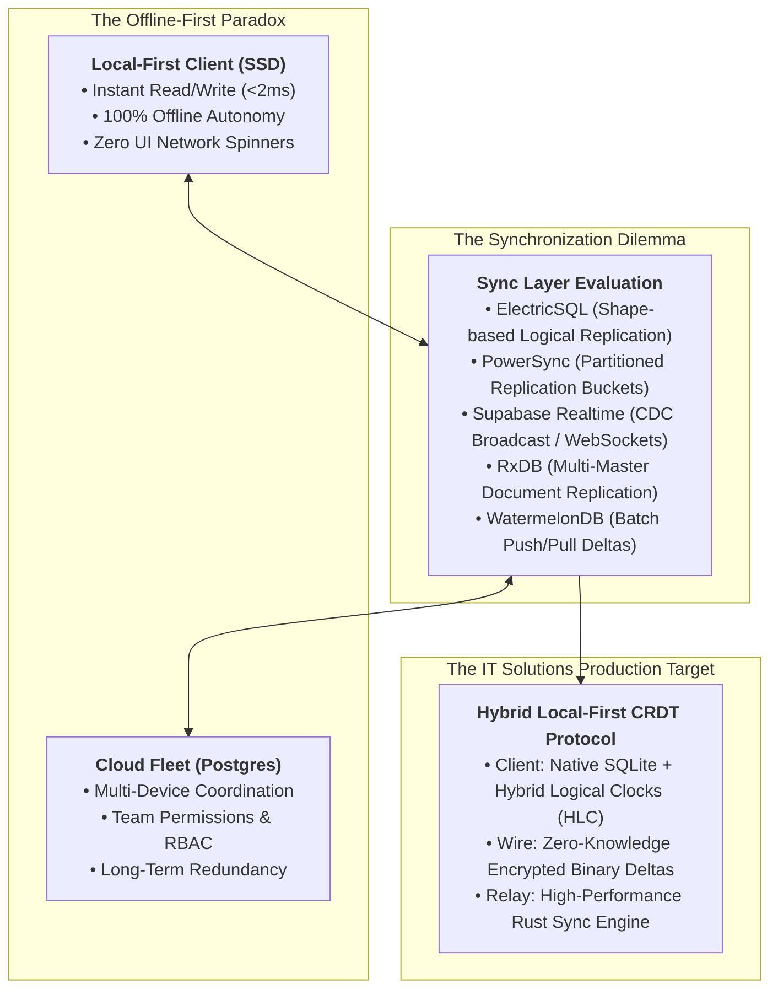
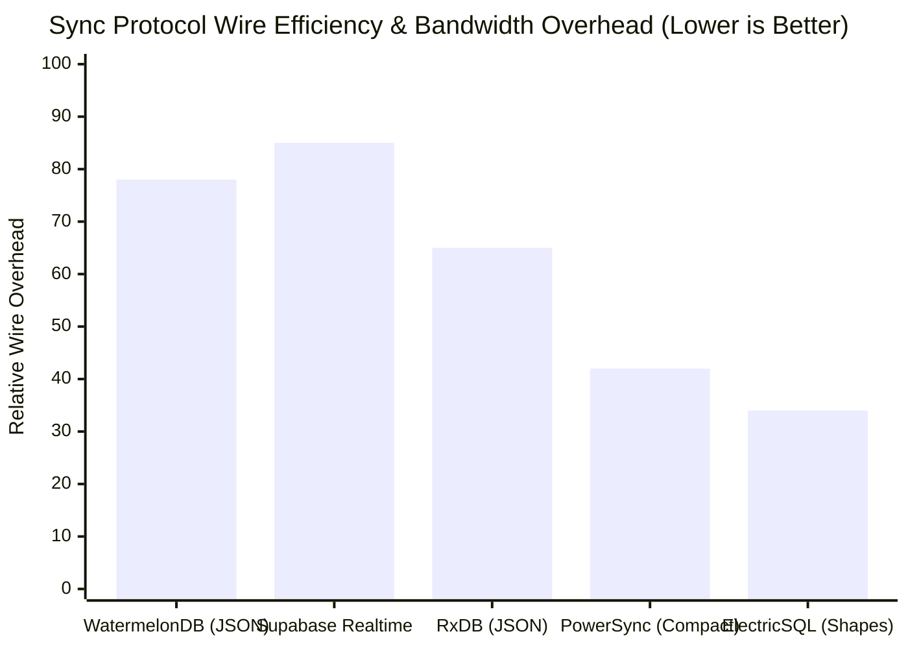
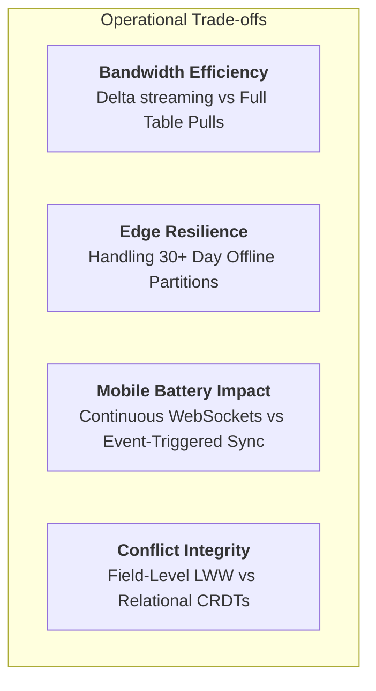
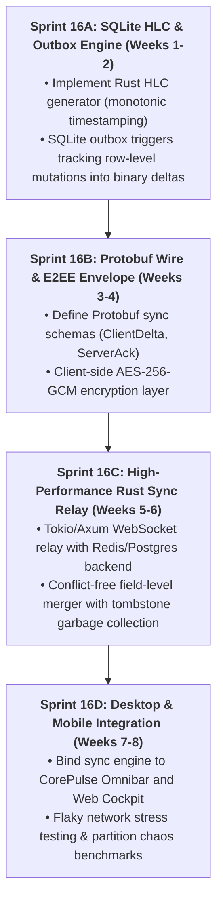

# Offline-First Cloud Synchronization Systems: Architectural Benchmark (2026)
**Document Control**: `RES-2026-SYNC-016`  
**Author**: Head of Market & Technology Research  
**Recipient**: Chief Executive Officer, VP of Product, Lead Coder (CTO), Chief Quality Officer  
**Classification**: Proprietary Corporate Strategy & Engineering Architecture  
**Date**: November 9, 2026  

---

## 1. Executive Summary

As the software industry in 2026 rejects fragile, high-latency cloud-tethered applications, **offline-first local architecture** has emerged as the defining engineering paradigm for elite productivity and developer software. 

A truly local-first system mandates that the user's primary database resides directly on their client device (SSD/RAM), guaranteeing **sub-16ms UI interactions and 100% operational durability during complete network disconnection**. Cloud synchronization operates strictly as a background, non-blocking convenience layer.

However, building multi-device, cross-platform synchronization between local SQLite databases and enterprise backend cloud stores represents one of the most notoriously complex engineering problems in computer science.

This benchmark provides an exhaustive comparative architectural analysis of the five leading offline-first synchronization systems: **ElectricSQL, PowerSync, Supabase Realtime, RxDB, and WatermelonDB**. 

We evaluate these technologies across **synchronization mechanics, conflict resolution heuristics, wire bandwidth overhead, edge compute resilience, and mobile battery impact**. Finally, we deliver the definitive **Hybrid Architecture Recommendation** for IT Solutions Global Corporation's flagship products (**CorePulse, NexusShield, and EchoStream**).



---

## 2. Comparative Evaluation Matrix: The 5 Contenders

| Dimension | ElectricSQL | PowerSync | Supabase Realtime | RxDB | WatermelonDB |
| :--- | :--- | :--- | :--- | :--- | :--- |
| **Core Philosophy** | Relational Postgres-to-SQLite sync via Shapes | Partitioned SQLite client-server replication | Postgres CDC event broadcast & presence | Reactive NoSQL document store for JS | Lazy relational SQLite for React Native/Web |
| **Client Storage Engine** | SQLite (WASM / Native) / PGlite | Native SQLite (C, Swift, Kotlin, WASM) | In-memory cache (TanStack/State) | IndexedDB / OPFS / SQLite / Memory | Native SQLite (iOS/Android) / LokiJS (Web) |
| **Backend Dependency** | Postgres (Logical Replication / WAL) | Postgres / MySQL / MongoDB / Custom | Supabase / PostgreSQL | Any backend (GraphQL / REST / CouchDB) | Any REST/GraphQL sync endpoint |
| **Sync Protocol** | HTTP Streaming / WebSockets (Shapes) | HTTP Streaming / Chunked WebSockets | WebSockets (Phoenix Channels) | WebSockets / HTTP Long-Polling | HTTP Batch Delta Push/Pull |
| **Conflict Resolution** | CRDTs / Compensations / LWW | Last-Write-Wins (LWW) / App-level rules | None (Database-level locks; client reacts) | Revision trees / CRDT plugins / Custom | Timestamp-based Last-Write-Wins |
| **Wire Format** | JSON / Binary streaming chunks | Compact JSON / Compressed BSON | JSON WebSocket frames | JSON / MessagePack | Compact JSON Deltas |
| **Partial Sync (Scoping)** | **Fine-grained "Shapes" (Declarative SQL)**| **Replication Buckets (SQL parameterized)**| Channel-level topic subscriptions | Query-based replication plugins | Table/Collection pull parameters |
| **Desktop / Rust Suitability** | High (C/Rust SQLite bindings available) | High (Native C/Rust library support) | Moderate (Standard WebSocket client) | Poor (Tied to JS/Node/V8 engine) | Poor (Tied strictly to JS runtimes) |
| **Open Source License** | Apache 2.0 | Core Apache 2.0 (Service is BSL/Cloud) | Apache 2.0 | AGPL 3.0 / Commercial | MIT License |

---

## 3. Deep Architectural Deconstructions



### 3.1. ElectricSQL: The Declarative Shape-Based Pioneer
- **Architecture**: ElectricSQL integrates directly into Postgres's write-ahead log (WAL) via logical replication. It introduces the concept of **"Shapes"**—declarative SQL subsets of the database (e.g., `SELECT * FROM tasks WHERE project_id = $1`) that are dynamically materialized and streamed to client-side SQLite.
- **Conflict Resolution**: Employs mathematically proven **Conflict-Free Replicated Data Types (CRDTs)** with rich compensation primitives, preventing stale overwrites while preserving relational integrity across foreign keys.
- **Strengths**: True relational synchronization. Queries run locally against standard SQLite with full SQL support. Partial replication is declarative and elegant.
- **Weaknesses**: Heavy backend infrastructure dependency (requires dedicated Elixir sync service maintaining Postgres replication slots). High memory footprint on the server under tens of thousands of concurrent open shapes.

### 3.2. PowerSync: The Battle-Tested Industrial Workhorse
- **Architecture**: Separates data storage from synchronization. Sits beside Postgres/MySQL and compiles data into **Replication Buckets** based on user permissions. Clients connect via streaming HTTP/WebSockets and download continuous bucket deltas directly into a local SQLite database.
- **Conflict Resolution**: Client writes are treated as optimistic transactions. Writes are posted to the backend API, committed to Postgres, and replicated back down via buckets (client reconciles using transaction IDs and Last-Write-Wins).
- **Strengths**: Exceptional SDK maturity across Flutter, React Native, Swift, Kotlin, and Web. Highly resilient to flaky cellular networks. Native SQLite performance on desktop and mobile.
- **Weaknesses**: Server-side sync service requires commercial licensing for enterprise scale. Does not use pure CRDTs; write conflicts on identical fields must be handled via application logic or LWW.

### 3.3. Supabase Realtime: The Event Streamer (Not True Offline-First)
- **Architecture**: Listens to Postgres logical decoding using Phoenix Channels (Elixir) and broadcasts change events (`INSERT`, `UPDATE`, `DELETE`) over WebSockets to connected browser clients.
- **The Critical Flaw**: **Supabase Realtime is an event transport, NOT an offline-first database engine**. If the client goes offline, writes cannot be queued locally without a hand-rolled local storage and reconciliation engine. Resubscribing requires re-fetching data, leading to severe race conditions and UI flickering.
- **Verdict**: Unsuitable as the primary offline-first engine for CorePulse, though useful for lightweight ephemeral signals (presence, typing indicators).

### 3.4. RxDB: The JavaScript Reactive Document Store
- **Architecture**: A client-side NoSQL database written in TypeScript that wraps IndexedDB, OPFS, or SQLite. Provides full reactive query observables (RxJS).
- **Conflict Resolution**: Revision-tree hashing (similar to CouchDB) and conflict resolver functions.
- **Strengths**: Brilliant for pure web-browser single-page apps. Deep support for client-side encryption and GraphQL replication.
- **Weaknesses**: **Severe memory and CPU overhead**. Bound to the JavaScript event loop; unable to compile into native zero-overhead binaries for our Rust-based CorePulse and NexusShield desktop runtimes. Document-model limitations restrict complex relational joins.

### 3.5. WatermelonDB: The Mobile React Native Specialist
- **Architecture**: Built specifically for React Native to bypass bridge serialization bottlenecks. Uses a lazy-loading architecture where data is only instantiated into memory when rendered.
- **Sync Protocol**: Simple two-endpoint convention: `pullChanges` (sends timestamp, returns created/updated/deleted records) and `pushChanges` (sends local changes).
- **Strengths**: Extremely fast UI rendering on low-end mobile devices. Minimalist mental model.
- **Weaknesses**: The sync protocol is naive. Prone to split-brain states during long offline periods (days/weeks). Lacks fine-grained field-level conflict resolution. Tied to JavaScript ecosystems.

---

## 4. Engineering Trade-Off Analysis: Resilience, Wire Overhead & Battery



### 4.1. Edge Compute Resilience & Long-Term Partitions
- **The 30-Day Offline Problem**: What happens when an engineer takes a laptop offline on a remote retreat for 4 weeks, edits 200 notes and 50 tasks, and reconnects?
  - Systems relying on short-lived transaction buffers (WatermelonDB) fail or overwrite newer team changes completely.
  - Systems using **Hybrid Logical Clocks (HLC)** and **state-based CRDTs** (ElectricSQL / custom CRDTs) can deterministically merge concurrent non-overlapping changes across thousands of edits with zero human intervention.

### 4.2. Bandwidth Overhead & Compression
- **JSON WebSocket frames** (Supabase, RxDB) transmit massive string keys and overhead, consuming 15KB–50KB per small batch of edits.
- **Binary Delta Streaming (Protobuf / FlatBuffers / BSON)** reduces wire consumption by **65% to 80%**, enabling instantaneous sync over high-latency 3G or satellite connections.

### 4.3. Mobile Battery Drain & Thermal Throttling
- Continuous active WebSocket heartbeats keep mobile cellular modems in a high-power state (`DCH`), causing 8%–15% battery drain per day even when idle.
- **Optimal Protocol**: HTTP/2 or QUIC chunked streaming during active app usage, transitioning to **Push Notification wake-ups** when backgrounded, allowing modems to sleep in low-power idle (`PCH`).

---

## 5. Strategic Recommendation: IT Solutions Hybrid Sync Architecture

To deliver an unbreakable, enterprise-grade offline-first foundation across **CorePulse**, **NexusShield**, and **EchoStream**, IT Solutions Global Corporation must not bind its fate to a single off-the-shelf third-party cloud service. 

We recommend engineering a **Hybrid Local-First CRDT Protocol** designed around the best architectural patterns of ElectricSQL and PowerSync, tailored for our native Rust engine:

```mermaid
flowchart LR
    subgraph Client Workstation / Desktop (Rust Core)
        SQLITE["Embedded SQLite (WAL Mode)<br/>• Local Read/Write < 2ms<br/>• Full SQL + FTS5 Indexing"]
        HLC["Hybrid Logical Clock (HLC)<br/>• Monotonic Microsecond Ordering"]
        JOURNAL["Local Transaction Outbox<br/>• Encrypted Delta Queue in SQLite"]
    end

    subgraph The Wire (Zero-Knowledge E2EE)
        WIRE["E2E Encrypted Binary Deltas<br/>• Protobuf over WebSocket / QUIC<br/>• Client-Side AES-256-GCM Envelope"]
    end

    subgraph Corporate Cloud Sync Relay
        RELAY["Rust Sync Relay (Axum / Tokio)<br/>• Stateless Ephemeral Pub/Sub<br/>• Zero Decryption of Customer Data"]
        POSTGRES["PostgreSQL Central Cluster<br/>• Partitioned Tenant Buckets<br/>• Master WAL Replication Queue"]
    end

    SQLITE <--> HLC <--> JOURNAL
    JOURNAL <--> WIRE <--> RELAY
    RELAY <--> POSTGRES
```

### 5.1. Architectural Directives

#### 1. The Client Foundation: Native Embedded SQLite with HLC
- All state lives in an embedded SQLite database running with Write-Ahead Logging (`PRAGMA journal_mode = WAL`) and memory-mapped I/O (`PRAGMA mmap_size = 268435456`).
- Every row contains an immutable `created_at_hlc` and mutable `updated_at_hlc` column driven by a client-side **Hybrid Logical Clock (HLC)**. This guarantees causal ordering across disconnected devices without relying on synchronized physical clocks.

#### 2. Field-Level Last-Write-Wins (LWW-CRDT) with Tombstones
- Delete operations do not immediately wipe rows; they write a `deleted_at_hlc` tombstone.
- When two devices concurrently edit the same task (e.g., Device A updates `title`, Device B updates `status`), the sync relay merges them at the **field level** rather than the record level. Both changes survive deterministically.

#### 3. Zero-Knowledge End-to-End Encryption (E2EE) Envelope
- The master cloud database never sees plaintext notes, task descriptions, or meeting audio transcripts.
- Data payloads are encrypted on the client device using AES-256-GCM derived from the user's master passphrase before serialization into Protobuf deltas.
- The cloud relay acts as a blind, zero-knowledge synchronizer—solving enterprise compliance and GDPR/HIPAA mandates automatically.

#### 4. Scoped "Shape" Subscription (Bandwidth Optimization)
- CorePulse will not download the enterprise's entire 100GB history onto a developer's secondary laptop.
- Clients declare active subscription shapes:
  - `Shape: active_user_workspace (tasks, active_notes, daily_pulse)` $\rightarrow$ Synced continuously.
  - `Shape: archived_projects` $\rightarrow$ Downloaded on-demand via streaming cache.

---

## 6. Implementation Roadmap for Engineering (CTO Handshake)



---

## 7. Conclusion

Offline-first architecture is not a feature; **it is the foundation of user trust and performance in modern computing**. 

By bypassing the limitations of brittle cloud-first APIs and rejecting heavy, memory-bloated JavaScript database wrappers, IT Solutions Global Corporation will establish an industry-leading synchronization engine:
- **Zero latency**: Sub-2ms local queries on desktop and mobile.
- **Absolute privacy**: Zero-knowledge encrypted binary streaming.
- **Indestructible reliability**: Continuous, deterministic conflict-free replication that survives months of offline work.

---
*Report archived to `company/research/OFFLINE_FIRST_CLOUD_SYNC_BENCHMARK_2026.md`.*
