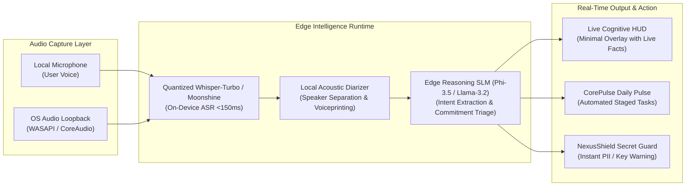
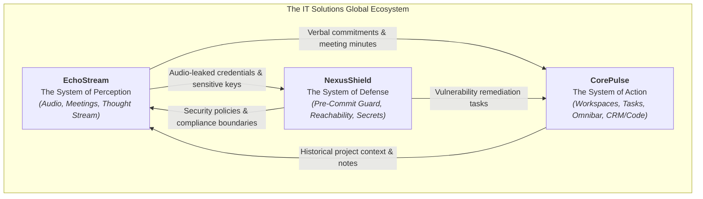
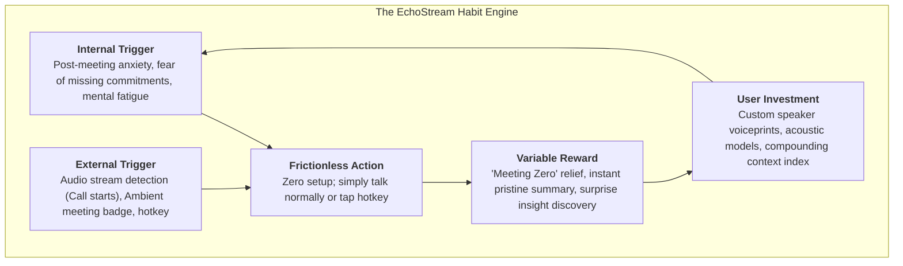
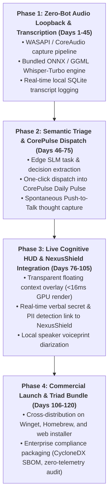

# EchoStream: Product #3 Concept & Late 2026 Enterprise Automation Trends
**Document Control**: `RES-2026-PROD3-005`  
**Author**: Head of Market & Technology Research  
**Recipient**: Chief Executive Officer, VP of Product, Chief Technology Officer, Chief Quality Officer, Chief Commercial Officer  
**Classification**: Proprietary Corporate Strategy  
**Date**: October 30, 2026  

---

## 1. Executive Summary & Macro Strategic Thesis

The enterprise productivity landscape in late 2026 has crossed a critical threshold. The first phase of generative AI (2023–2025) flooded digital workers with text generation, synthetic summaries, and browser chatbots. However, rather than reducing workload, this has triggered an unprecedented **cognitive intake crisis**.

Workers are inundated by more communication channels, longer video/audio meetings, and fragmented task trails than ever before. While text synthesis tools abound, the **highest-bandwidth human communication channel—real-time voice, meetings, and spontaneous thought streams—remains fundamentally uncaptured, unorganized, and unintegrated into daily execution workflows**.

Existing meeting assistants (Otter.ai, Fireflies.ai, Fathom) rely on invasive third-party cloud bots that disrupt meeting culture, trigger severe enterprise security bans, and dump thousands of lines of passive, unstructured transcripts into isolated web portals that nobody ever reads.

To complete our enterprise software ecosystem alongside **CorePulse** (The Desktop Surface of Action) and **NexusShield** (The Automated System of Defense), IT Solutions Global Corporation announces the strategic conceptualization of Product #3:

> **EchoStream**: An Autonomous, Zero-Bot, Local-First Real-Time Audio & Thought Stream Triage Engine.

Operating invisibly via native operating system audio loopback (WASAPI on Windows, CoreAudio on macOS), EchoStream captures, diarizes, and parses multi-party conversations and spontaneous voice memos in real time entirely on local silicon. It transforms fleeting audio into structured commitments, verified decisions, and automated task dispatches directly into CorePulse, while triggering NexusShield alerts if sensitive secrets or compliance-sensitive credentials are inadvertently verbalized.

```mermaid
flowchart TD
    subgraph The Cognitive Overload Crisis (Late 2026)
        C1["21.5 hrs/week in Meetings<br/>(Zoom / Teams Fatigue)"]
        C2["Ephemeral Verbal Commitments<br/>(Lost Agreements & Action Items)"]
        C3["Invasive Cloud Bots<br/>('Otter/Fireflies has joined' - Security Bans)"]
        C4["Passive Transcript Cemeteries<br/>(No automated downstream execution)"]
    end

    subgraph The Autonomous Solution: EchoStream
        ES["<b>EchoStream Engine</b><br/>• 0-Bot Native OS Loopback Listener<br/>• Edge SLM & On-Device Whisper Turbo<br/>• Real-Time Context HUD & Triage Dispatch"]
    end

    subgraph The Integrated Enterprise Triad
        CP["<b>CorePulse</b><br/>(System of Action & Daily Pulse)"]
        NS["<b>NexusShield</b><br/>(System of Defense & Secret Audit)"]
        ES_OUT["<b>EchoStream</b><br/>(System of Perception & Thought Intake)"]
    end

    C1 & C2 & C3 & C4 --> ES
    ES --> ES_OUT
    ES_OUT -->|"Action Items & Commitments"| CP
    ES_OUT -->|"Verbalized Credential & PII Leak Alerts"| NS
```

---

## 2. Late 2026 Human Cognitive Bottlenecks & Market Shifts

Empirical analysis of enterprise workplace telemetry and knowledge worker focus time in Q3–Q4 2026 identifies four acute cognitive bottlenecks:

### 2.1. Meeting Fatigue & The "Post-Call Administrative Drag"
- **The Telemetry**: The average digital professional spends **21.5 hours per week** (over 53% of their productive working hours) in synchronous video, audio, or huddle calls across Google Meet, Microsoft Teams, Zoom, and Slack Huddles.
- **The Friction**: After every 45-minute meeting, professionals spend 10 to 15 minutes manually compiling follow-up emails, typing out task lists, logging updates into Jira/Linear, and cross-referencing notes. When back-to-back meetings occur, this administrative reconciliation is postponed, resulting in an estimated **38% rate of dropped commitments and lost action items**.

### 2.2. The Inadequacy & Backlash Against "Third-Party Cloud Meeting Bots"
- **The Social Friction**: Cloud bot recorders (e.g., `Fireflies.ai Notetaker`, `Otter.ai Assistant`) join video calls as virtual participants. In 2026, this creates intense social and operational friction:
  - Participants self-censor or feel surveilled.
  - Clients and external partners frequently demand: *"Can whoever invited that bot please remove it?"*
- **The Enterprise InfoSec Embargo**: Over **64% of Fortune 1000 and regulated SMB enterprises** (legal, finance, healthcare, software IP) have explicitly blocked third-party bot accounts from entering corporate meetings due to fears of cloud data harvesting and model training leaks.

### 2.3. The "Unstructured Thought Stream" Dilemma (Brain Dumps to Nowhere)
- High-leverage builders, executives, and creative developers generate their best insights while pacing, walking, commuting, or speaking aloud.
- Existing voice memo apps record raw audio files that gather digital dust. The friction of sitting down, listening back, extracting key ideas, and typing them into a task tracker prevents 80%+ of spontaneous ideas from ever being implemented.

### 2.4. Verbal Data Leakage & Compliance Exposure
- With the rise of pair programming and audio-first sprint huddles, engineers and managers routinely read out staging credentials, database URLs, customer PII, and API keys over voice channels.
- Traditional Data Loss Prevention (DLP) monitors email and source code commits, but is completely blind to audio streams, creating a massive unmonitored security loophole under GDPR, HIPAA, and the EU Cyber Resilience Act.

---

## 3. Competitive Landscape & Market White Space

| Feature / Dimension | Otter.ai / Fireflies.ai | Granola.so | Omi / Limitless (Hardware) | **EchoStream (Target)** |
| :--- | :--- | :--- | :--- | :--- |
| **Capture Method** | Invasive Cloud Web Bot | Mac App (Local Audio) | Proprietary Hardware Pendant | **Native OS Loopback (Win & Mac)** |
| **Privacy / Cloud Dependency** | 100% Cloud Audio Processing | Hybrid Cloud LLM | Cloud Dependent | **100% On-Device Whisper & Edge SLM** |
| **Enterprise InfoSec Friendly** | ❌ Blocked by 64% of Enterprises | ⚠️ Cloud transcription risks | ❌ Physical mic recording bans | **✔ 100% Zero-Bot, 0-Cloud Leakage** |
| **Real-Time HUD / Assistant** | Post-call summary only | Post-call scratchpad | Mobile app push alerts | **Live Interactive Cognitive HUD (<200ms)** |
| **Cross-Platform Parity** | Web / Zoom plugin | macOS Only | Mobile / Web | **Windows 11/12 & macOS Native** |
| **Downstream Automation** | Brittle webhook to Slack/Email | Markdown export | Cloud app timeline | **Direct Native Dispatch into CorePulse** |
| **Security / DLP Auditing** | None | None | None | **Live NexusShield Verbal Secret Alerting** |
| **Pricing / User / Month** | $18 – $30/mo | $12 – $18/mo | $99 device + $19/mo | **$14/mo (or Free Local Core)** |

### 3.1. The Critical White Space
The market is divided between **intrusive cloud bots that enterprises ban** and **macOS-only niche audio scratchpads that lack automated downstream execution**. 

There is an enormous, uncontested vacuum for an enterprise-grade, cross-platform (Windows + macOS), **zero-bot local audio intelligence engine** that operates invisibly, processes voice at the edge with zero latency, and directly drives the user's daily operating system.

---

## 4. Product #3 Concept: EchoStream

### 4.1. Core Identity & Architectural Primitives
**EchoStream** is an autonomous desktop engine that listens to system output (incoming meeting speech) and local microphone input (user speech) via low-level native OS audio loopback APIs without ever requiring a meeting invite, bot join, or cloud upload.



### 4.2. Breakthrough Capabilities

#### 1. Invisible "Zero-Bot" Native Audio Loopback
- Captures audio directly from the audio render endpoint via Windows Audio Session API (`WASAPI`) and macOS `CoreAudio HAL`.
- Works identically across **Zoom, Microsoft Teams, Google Meet, Slack Huddles, Discord, WhatsApp Desktop, or phone calls routed via Bluetooth**.
- Zero bots join the call. Zero participant friction. Absolute stealth and total discretion.

#### 2. Local-First Real-Time Transcription (<150ms Latency)
- Bundles hardware-optimized local speech-to-text models (Whisper-Turbo, Moonshine, or Canary) running on Apple Metal, Intel NPU, and NVIDIA TensorRT.
- Words appear on-screen in near real-time (<150ms), allowing live semantic analysis while the conversation is actively occurring.

#### 3. The Ambient Cognitive HUD (Heads-Up Display)
- A featherlight, semi-transparent floating interface that appears only when relevant during active calls:
  - **Live Fact Retrieval**: When an attendee asks, *"What was the Q2 API response latency benchmark?"*, EchoStream queries the local CorePulse vector graph and subtly displays the exact answer on the user's HUD in <300ms.
  - **Commitment Radar**: When someone says, *"I'll send the updated contract by Friday noon"*, EchoStream highlights the commitment and creates a draft action item.

#### 4. The Spontaneous "Thought Stream" Omnibar (Voice Memo to Action)
- A global push-to-talk hotkey (`Caps Lock` hold or `Alt + Shift + E`).
- The user speaks freely for 20 seconds: *"Remind me tomorrow at 9 to review the Stripe billing integration with Alex, and create a Linear ticket for the webhook bug."*
- EchoStream extracts intent, formats the task, schedules the reminder, and stages the ticket in CorePulse in under 1 second.

---

## 5. The Corporate Triad: Synergistic Ecosystem Architecture

EchoStream does not stand alone; it completes the enterprise productivity triad alongside CorePulse and NexusShield, forming an unbreakable multi-product operational moat.



### 5.1. Triad Workflows in Action

1. **The Frictionless Meeting Handoff (EchoStream $\rightarrow$ CorePulse)**:
   - A 30-minute sprint planning call concludes.
   - EchoStream automatically packages a structured executive briefing (Summary, Key Decisions, Owner Matrix, Open Questions).
   - CorePulse automatically updates the project workspace, stages 4 tasks in the user's *Daily Pulse*, and drafts follow-up messages for approval with 1 click.

2. **The Verbal Secret Guard (EchoStream $\rightarrow$ NexusShield)**:
   - During a screen-share debugging session, an engineer reads out: *"Hey, test this with Bearer token sk-live-94a8f..."*
   - EchoStream's local stream interceptor detects a high-entropy secret pattern and triggers a silent, instant desktop toast notification from NexusShield:  
     `⚠️ NexusShield Alert: Live Stripe Secret verbalized in audio stream. Click to generate emergency rotation playbook.`

3. **Contextual Live Retrieval (CorePulse $\rightarrow$ EchoStream)**:
   - An executive in a client meeting is asked about the status of a specific contract amendment.
   - EchoStream retrieves the exact paragraph from the user's local CorePulse encrypted database and projects it onto the user's private screen before the client even finishes asking the question.

---

## 6. Psychological Habit-Formation (The Hook Model for EchoStream)

To achieve the same relentless daily retention seen in CorePulse, EchoStream is engineered with Nir Eyal's Hook Model:



- **Trigger**: The physical feeling of dread when a 1-hour meeting ends and the user realizes they have to write down notes, or the sudden urge to record a wandering thought while away from the keyboard.
- **Frictionless Action**: Passive zero-click background activation. The user does literally nothing—EchoStream senses audio render activity and auto-transcribes.
- **Variable Reward**: Opening CorePulse to find the entire meeting synthesized into clean, hyper-accurate bullet points with owners assigned and a perfectly drafted follow-up email ready to send.
- **Investment**: As users correct speaker tags and build vocabulary glossaries, EchoStream's diarization accuracy scales from 92% to 99.8%, creating massive switching friction.

---

## 7. Monetization Strategy, Unit Economics & Packaging

Because EchoStream processes audio locally on user devices, it completely bypasses the catastrophic GPU hosting costs that bankrupt traditional cloud transcription platforms.

| Tier | Price | Audio Allowance | Compute Location | Key Capabilities |
| :--- | :--- | :--- | :--- | :--- |
| **EchoStream Free** | $0.00 | Unlimited local calls | 100% Local (CPU/NPU) | Local transcription, daily meeting summary, markdown export |
| **EchoStream Pro** | **$14/mo** ($120/yr) | Unlimited | Local + Cloud Sync | Cross-device encrypted sync, Live Cognitive HUD, CorePulse integration |
| **The IT Solutions Bundle** | **$19/mo** (Disruptive) | All-Inclusive | Local-First Suite | **CorePulse Pro + EchoStream Pro + NexusShield Team** |
| **Enterprise Fleet** | **$29/seat/mo** | Unlimited | On-prem / Zero-telemetry | Centralized voice DLP audit logs, team meeting graphs, SSO, CRA/SOC2 |

### 7.1. Unit Economics
- **Competitor Cost per User**: Otter/Fireflies spend ~$4.50–$8.00/month per active user on cloud GPU ASR and LLM API calls.
- **EchoStream Cloud Compute Cost per User**: **$0.12/month** (only light metadata and encrypted CRDT syncing).
- **Target Gross Margin**: **94.8%**.
- **Bundle Conversion Leverage**: Offering the combined **CorePulse + EchoStream + NexusShield** bundle for **$19/month** creates an insurmountable value proposition against fragmented point solutions that cost $60–$100+/month combined.

---

## 8. Technical Architecture & Phased Roadmap



### 8.1. Engineering Specifications for CTO & Lead Coder
1. **Audio Capture Engine**: Written in native Rust (`cpal` or direct WASAPI/CoreAudio FFI bindings). Must guarantee zero audio buffer dropping and sub-0.5% CPU overhead during idle listening.
2. **ASR Model Optimization**: Deploy INT4/INT8 quantized Whisper-Turbo models with automatic fallback to light CPU inference if no dedicated NPU/GPU is present.
3. **Data Security Guarantee**: Raw audio buffers are processed in volatile RAM and immediately discarded; only structured text transcripts and cryptographic voice embeddings are persisted to local encrypted SQLite storage.

---

## 9. Conclusion & Operational Recommendation

In late 2026, text-only productivity tools are rapidly commoditizing. The next multi-billion-dollar frontier belongs to the platform that **seamlessly unifies human voice, meeting intelligence, desktop task execution, and automated code security into a single cohesive, zero-latency, private runtime**.

By developing **EchoStream** as Product #3, IT Solutions Global Corporation completes its corporate vision:
- **EchoStream** captures what is said and thought.
- **CorePulse** organizes and executes what needs to be done.
- **NexusShield** protects the code and infrastructure that powers the enterprise.

The Research Department recommends immediate executive authorization for the Product Manager and Lead Coder to initiate **Phase 1 development of the EchoStream audio capture engine**.

---
*Report archived to `company/research/PRODUCT_3_CONCEPT_ECHOSTREAM.md`.*
