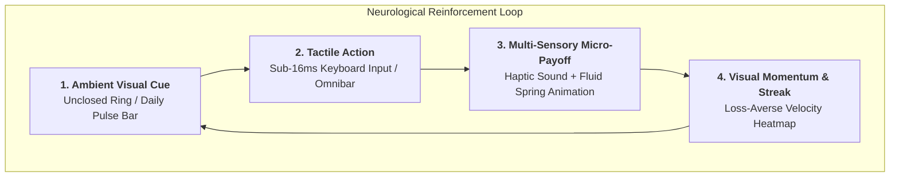
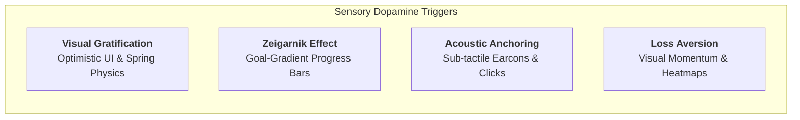
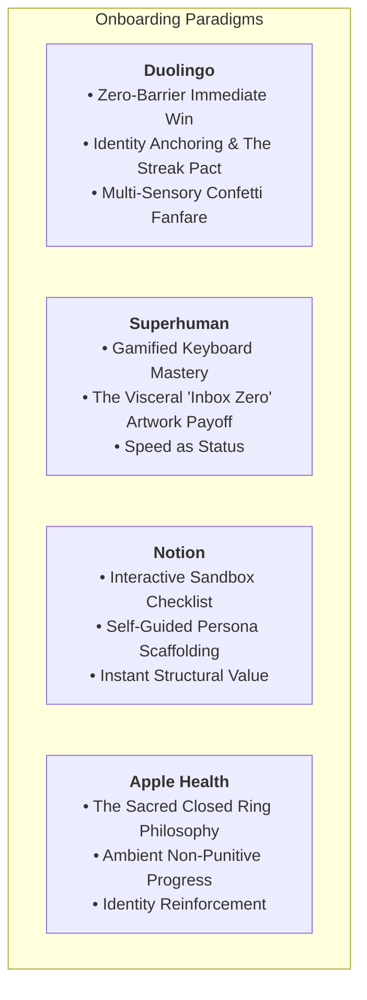
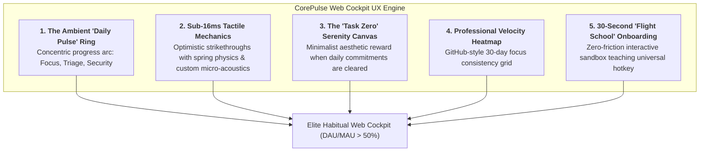

# Visual Habit Loops & Cognitive Ergonomics in Modern Web & Desktop Interfaces
**Document Control**: `RES-2026-PSYCH-007`  
**Author**: Head of Market & Technology Research  
**Recipient**: Chief Executive Officer, VP of Product, Chief Technology Officer, Chief Quality Officer, Chief Commercial Officer  
**Classification**: Proprietary Corporate Strategy  
**Date**: October 31, 2026  

---

## 1. Executive Summary

Software adoption is driven by utility, but **daily retention is governed by neurochemistry**. When a software interface aligns with the cognitive wiring of the human visual and auditory cortex, it ceases to feel like a computer program; it transforms into an indispensable, dopaminergic ritual.

Traditional B2B SaaS interfaces remain visually sterile, slow, and mechanically passive—treating users as utilitarian data entry clerks. In contrast, the world’s most addictive and high-retention software platforms (**Duolingo, Superhuman, Notion, Apple Health**) weaponize **cognitive psychology, sensory micro-feedback, tactile micro-acoustics, the Zeigarnik effect, and loss-averse momentum tracking** to cement daily unbroken usage.

This research dissects the neurological mechanics of visual habit loops, deconstructs the onboarding architectures of the top four behavioral engines in consumer and professional software, and delivers actionable UI/UX design specifications for the **CorePulse Web Cockpit** to maximize Daily Active Usage (DAU) and achieve elite cohort retention ($D_{30} > 45\%$).

---

## 2. Human Cognitive Psychology: The Anatomy of Visual Habit Loops

Habit loops in software succeed or fail based on how efficiently they stimulate the brain’s mesolimbic dopamine pathway. Dopamine is not merely the chemical of pleasure; **it is the chemical of anticipation and action initiation**.

### 2.1. Instant Visual Gratification & Optimistic Physics (<16ms)
- **The Psychology**: The human brain expects physical objects in nature to respond instantaneously to touch or force (Newtonian causality). When software displays loading spinners or delayed layout shifts, the brain interprets the interaction as friction, triggering micro-frustration (cortisol release).
- **Optimistic UI Rendering**: The interface must visually transition *before* background persistence or network validation completes. If a user marks a task complete, the UI must immediately render the completed state (strikethrough, checkmark fill, color shift) in **sub-16ms**, reconciling backend state asynchronously in the background.
- **Spring-Physics Animation (Natural Damping)**: Linear and bezier-curve animations feel robotic and artificial. Using physically modeled damped spring animations (Hooke's Law: $F = -kx - cv$) mimics real-world inertia, providing a visceral, tactile elegance that users subconsciously crave.

### 2.2. The Zeigarnik Effect & Goal-Gradient Progress Bars
- **The Zeigarnik Effect**: The psychological phenomenon where uncompleted tasks or unclosed loops occupy conscious working memory, creating mild cognitive tension that can only be relieved by completion.
- **The Goal-Gradient Effect (Clark Hull)**: As humans perceive they are closer to completing a goal, their motivation and velocity accelerate non-linearly.
- **Visual Manifestation**: A circular progress ring or segmented progress bar that starts at 0% has low motivational pull. However, an ambient bar initialized with one micro-step completed (e.g., *"1/4 Daily Alignments Done"*) immediately triggers the goal-gradient effect, compelling the user to finish the remaining tasks to achieve cognitive equilibrium ("Task Zero").

### 2.3. Tactile Micro-Acoustics & Auditory Dopamine Conditioning
- **The Psychology of "Earcons"**: Auditory cues are processed in the human brain within 8–10ms—nearly twice as fast as visual cues (20–40ms). Sound creates a deep, emotional sense of physical confirmation.
- **Acoustic Tactility in Elite Products**:
  - *Apple*: The mechanical "haptic snap" of the keyboard click and the subtle "woosh" of sent mail.
  - *Slack*: The iconic wooden "knock-brush" notification.
  - *Superhuman*: The crisp, high-frequency "clack" when an email is cleared.
- **The Rule of Auditory Ergonomics**: Sound must be skeuomorphic, organic, and ultra-short (15–35ms). It must never be a synthetic 8-bit beep; it should sound like high-end mechanical watch movement or wood/stone contact, delivering acoustic satisfaction without annoying nearby colleagues.

### 2.4. Loss-Averse Streaks & The Endowment Effect
- **Loss Aversion (Kahneman & Tversky)**: Humans are twice as motivated to avoid losing an existing achievement as they are to gain a new one.
- **The Endowment Effect**: Once users invest effort into building a visual streak or an operational dashboard, they assign disproportionate psychological value to it.
- **Visual Heatmaps vs. Cartoon Streaks**: For serious professionals and developers, cartoonish gamification feels childish and patronizing. However, **structural momentum visualizers**—such as GitHub's green commit contribution grid or Linear's cycle velocity charts—trigger fierce loss aversion without compromising professional dignity. A developer with a 42-day unbroken focus streak will log in daily solely to keep the chain unbroken.

---

## 3. Case Studies: Onboarding Architectures of Elite Behavioral Engines

To understand how software embeds itself into daily life within the first 120 seconds, we deconstruct four masters of habit formation:

| Dimension | Duolingo | Superhuman | Notion | Apple Health |
| :--- | :--- | :--- | :--- | :--- |
| **Time to First Win** | < 15 seconds (1st question) | < 60 seconds (1st email triaged) | < 30 seconds (1st checkbox clicked) | Ambient (First step recorded) |
| **Core Onboarding Philosophy** | Action *before* account creation | Interactive keyboard flight-simulator | Interactive sandbox workspace | Self-calibration & identity setting |
| **Primary Visual Hook** | Animated mascot & streak flame | Full-screen curated fine art canvas | Canvas with interactive markdown | Three concentric colored rings |
| **Sensory Feedback** | Major-chord chime + particle burst | Crisp mechanical clack + clean canvas | Clean strikethrough + sub-pixel checkbox | Haptic wrist tap + celebratory ring flash |
| **Retention Mechanism** | Streak freeze & guilt-driven push alerts | Muscle-memory speed & Inbox Zero high | Template ownership & personal wikis | Daily ring closure & trend medals |

### 3.1. Duolingo: Action Preceding Authentication
- **The Architectural Secret**: Duolingo does not ask for an email, password, or credit card when the app opens. It immediately throws the user into a 3-question lesson.
- By the time the user is prompted to register, they have already experienced **three dopamine micro-bursts, a congratulatory fanfare, and earned 15 XP**. Account creation is framed as *"Save your hard-earned progress"*, rather than an administrative gate.

### 3.2. Superhuman: The "Flight Simulator" & The Art Payoff
- **The Architectural Secret**: Superhuman treats email not as a document reader, but as an interactive high-speed video game.
- **The Visual Payoff of "Inbox Zero"**: When the user clears their inbox using keyboard commands (`E` to archive), the entire list vanishes, replaced by a breathtaking, high-resolution photograph or fine art painting accompanied by the bold typographic milestone: *"You have hit Inbox Zero"*. This creates a stark, beautiful contrast against the chaotic, cluttered inbox they started with.

### 3.3. Notion: The Interactive "Sandbox" Document
- **The Architectural Secret**: Instead of a passive product tour or modal tooltips, Notion drops new users onto an interactive page titled *"Getting Started"*.
- The page contains actual interactive checkboxes: *"Click this checkbox to see it strike through"*, *"Type '/' to create a heading"*.
- Users learn by manipulating real workspace objects, transforming the onboarding tutorial into their first tangible personal workspace.

### 3.4. Apple Health: The Ring Closure Doctrine
- **The Architectural Secret**: The three concentric rings (Move, Exercise, Stand) are visually incomplete arcs throughout the day.
- Humans have an innate psychological bias toward geometric symmetry and closure (Gestalt principles). An incomplete ring is an open cognitive loop. Closing the ring triggers a shimmering, multi-color particle rotation and a crisp haptic tap on the wrist.
- It is non-punitive: missing a ring doesn't erase past progress, but closing it provides daily closure.

---

## 4. Concrete UI/UX Recommendations for the CorePulse Web Cockpit

To translate these psychological drivers into our product architecture, the Research Department establishes five concrete UI/UX implementations for the **CorePulse Web Cockpit**:

### 4.1. The "Daily Pulse" Concentric Completion Arc
- **Visual Design**: At the top right of the Cockpit, place a minimalist, glowing concentric arc representing the three pillars of the IT Solutions ecosystem:
  - **Outer Arc (Emerald)**: *CorePulse* daily priority tasks cleared (e.g., 3/4).
  - **Middle Arc (Electric Cyan)**: *EchoStream* meeting action items reviewed (e.g., 2/2).
  - **Inner Arc (Deep Sapphire)**: *NexusShield* repository hygiene & pre-commit audits (1/1).
- **Cognitive Purpose**: Provides an ambient, at-a-glance Zeigarnik loop. When incomplete, the user feels a subtle, healthy pull to resolve their open threads before closing their laptop for the evening.

### 4.2. Tactile Micro-Acoustics & Spring-Physics Checkboxes
- **Interaction Spec**:
  - When a task is marked complete via keyboard (`Space` or `Cmd+Enter`), the checkbox does not just flip a boolean.
  - It triggers a **custom SVG micro-spring morph**: the checkmark draws itself with dynamic acceleration, and the text fades to 40% opacity with a smooth horizontal strikethrough line sweep.
  - An optional, ultra-crisp audio micro-click (`sound/pulse_pop.wav`, 22ms duration, high-frequency organic wood/ceramic click) plays at 25% volume.
  - **Psychological Result**: Marking tasks complete becomes viscerally addictive.

### 4.3. The "Task Zero" Serenity Canvas
- Replicate the Superhuman emotional payoff:
- When all prioritized daily tasks are dispatched, the task list gracefully dissolves into a serene, distraction-free **Serenity Canvas**:
  - Displays a clean typographic greeting: *"Daily Pulse Achieved. You are operating at peak velocity."*
  - Accompanied by a subtle ambient generative gradient or clean architectural monochrome visual.
  - Gives the user a profound sense of mental closure, liberating them from workday anxiety.

### 4.4. The 30-Day "Focus Velocity Heatmap"
- Replace childish streak counters with a refined, professional **Focus Velocity Heatmap** (inspired by GitHub's contribution graph and Linear's cycle insights).
- Each daily square reflects the depth of cognitive focus and automated actions executed (0 to 5 intensity tiers in monochrome/emerald).
- **Loss Aversion Trigger**: Hovering over a square displays: *"26-day focus streak. Top 5% operational velocity."* A user will never allow a blank square to break their visual momentum.

### 4.5. The 30-Second "Flight School" Onboarding Sandbox
- **Zero Empty States**: When a user first enters the CorePulse Web Cockpit, they must **never encounter an empty, blank screen**. Empty states cause cognitive paralysis and immediate drop-off.
- The Cockpit is pre-populated with 3 interactive "Demo Flight Cards":
  1. *"Card 1: Press `Alt+Space` (or click here) to invoke the Omnibar."*
  2. *"Card 2: Type `/summarize` to test local SLM execution."*
  3. *"Card 3: Hit `Space` to clear this card and unlock Task Zero."*
- **Outcome**: The user achieves their first three successful actions and unlocks the Serenity Canvas in **under 30 seconds** without reading a single manual.

---

## 5. Technical Implementation Directives for Engineering & Product

To incorporate these specifications into the upcoming production sprint, the **VP of Product** and **Lead Coder** must adhere to the following technical standards:

| Component | Technology / Library | Performance SLA | Ergonomic Rule |
| :--- | :--- | :--- | :--- |
| **Animations** | Tailwind CSS + Framer Motion / Motion One | 60–120 FPS (<8.3ms per frame) | Use damped spring physics (`stiffness: 400, damping: 30`); zero robotic linear eases |
| **State Mutations** | Optimistic UI via Zustand / TanStack Query | < 16ms visual response | Render mutation locally in DOM before dispatching backend SQLite write |
| **Audio Feedback** | Web Audio API (`AudioContext`) with pre-buffered array | < 5ms audio latency | High-frequency short wood/mechanical transient; master mute toggle in Preferences |
| **Progress Rings** | Native SVG `stroke-dasharray` / `stroke-dashoffset` | Hardware accelerated | Smooth animated transitions on state increment; subtle glow on 100% closure |

---

## 6. Conclusion & Executive Synthesis

Software utility gets a product installed; **sensory ergonomics and psychological habituation keep it open all day, every day**.

By engineering the **CorePulse Web Cockpit** around the **Zeigarnik progress arc**, **sub-16ms tactile spring interactions**, **subtle organic acoustic cues**, and the **Task Zero serenity canvas**, we transform standard project coordination into an empowering, daily dopamine ritual. This guarantees that CorePulse achieves the elite **>50% DAU/MAU habituation threshold**, securing our multi-year competitive moat.

---
*Report archived to `company/research/PSYCHOLOGY_OF_HABIT_LOOPS_2026.md`.*
